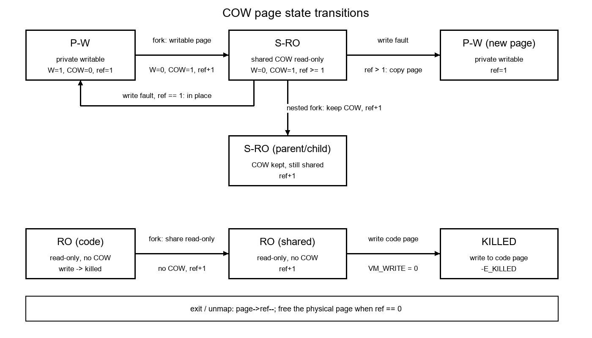
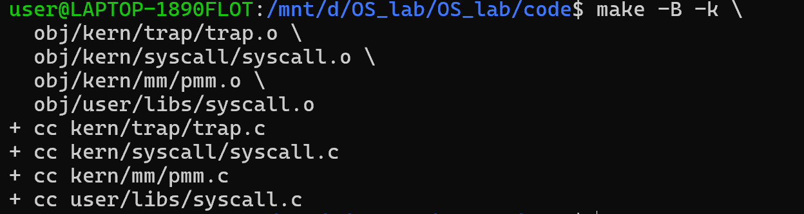
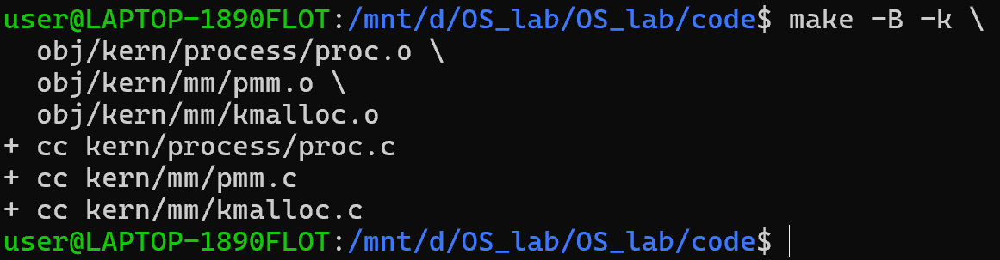
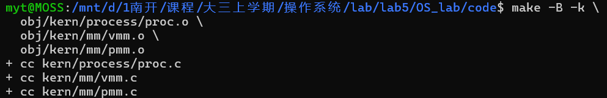
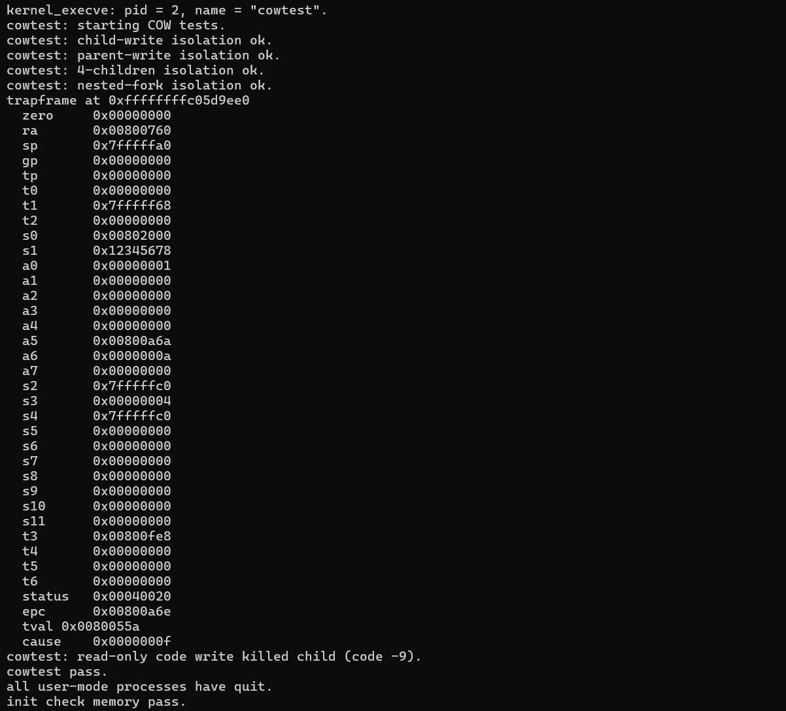
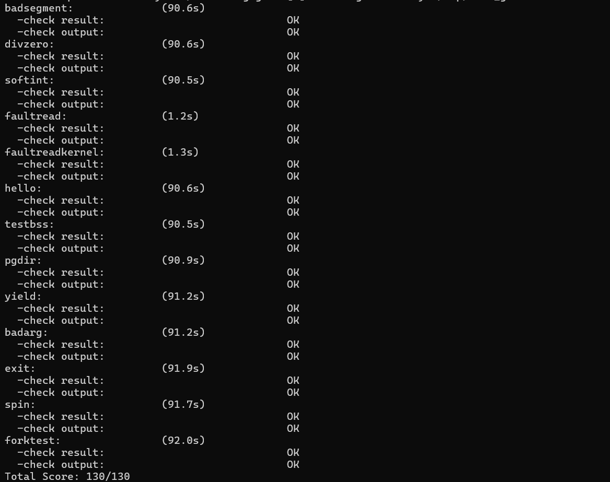

# 操作系统实验报告

## 实验基本信息

| 项目         | 内容                                           |
| ------------ | ---------------------------------------------- |
| **实验名称** | Lab5：用户进程 |
| **小组成员** | 2412084-刘芳希；2410826-马伊汀；2410439-吴佳璐 |
| **完成日期** | 2026-11-（待最终验收后填写） |


### 小组分工

| 成员                | 负责的练习/模块                                                                                                                                       | 报告分工                                                                                                                          |
| ------------------- | ----------------------------------------------------------------------------------------------------------------------------------------------------- | --------------------------------------------------------------------------------------------------------------------------------- |
| 2412084-刘芳希（A） | 前置任务：补齐 Lab2/3/4 基础代码，设计 First-Fit 提示词，更新 `RESTORE_ALL` 以支持用户态、内核态返回；功能模块一：用户态系统调用；功能模块二：创建、加载第一个用户进程及 `do_wait()` 等。 | 编写前置任务、模块一和模块二的功能说明、spec、提示词及迭代记录；记录前置代码编译检查与本人模块的验证结果。 |
| 2410826-马伊汀（B） | 功能模块三：进程复制，包括 `do_fork()`、`copy_mm()`、`dup_mmap()`、`copy_range()`；Challenge 1：实现并测试 Copy-on-Write（COW），分析相关页面状态与 Dirty COW 问题；集成测试与总评分。 | 编写模块三与 Challenge 1 的设计、提示词、迭代过程、测试结果及分析；汇总运行及评分结果。 |
| 2410439-吴佳璐（C） | 功能模块四：进程退出与调度相关系统调用，包括 `do_exit()`、`do_yield()`、`do_kill()`；Challenge 2：分析用户程序预加载与通常程序加载方式的区别；分支任务：双重 GDB 调试，跟踪 `ecall`、`sret` 及 QEMU/TCG 执行过程。 | 编写模块四、Challenge 2 和双重 GDB 调试记录；整合测试章节与报告。 |


---

## 一、实验目的

本实验的主要目的是：

1. 在 Lab2/3/4 的物理内存管理、Trap 处理、内核线程及调度机制基础上，建立用户进程的运行环境，理解用户态与内核态的权限边界及异常返回机制。
2. 实现用户态系统调用，掌握用户程序通过 `ecall` 进入内核、传递参数、完成服务并返回用户态的完整流程。
3. 实现用户程序加载与执行，理解 ELF 装载、用户地址空间、用户栈和初始 trapframe 的构造及其协作关系。
4. 实现进程复制、等待、退出和终止，理解父子进程关系、状态转换、资源回收及调度之间的配合。
5. 通过 COW 扩展、程序加载方式分析及双重 GDB 调试，加深对地址空间共享、写保护异常和模拟器执行过程的理解，并使用编译、运行及评分结果验证实现。

---

## 二、实验环境

| 成员           | AI 编程工具             | 底层模型            | 备注 |
| -------------- | ----------------------- | ------------------- | ---- |
| 2412084-刘芳希 | Claude Code for VS Code | DeepSeek-V4-Flash   | |
| 2410826-马伊汀 | Claude Code for VS Code | DeepSeek-V4-Flash   | |
| 2410439-吴佳璐 | Claude Code for VS Code | DeepSeek-V4.1-Flash | |


## 三、实验整体逻辑分析

### 3.1 本章节的逻辑主线

本实验围绕“用户进程如何被创建、执行、复制并最终回收”展开。首先补齐前序实验的物理页分配、页映射、Trap 入口和调度切换代码，扩充 `RESTORE_ALL`，使内核具备保存和恢复用户态、内核态上下文的基础能力。

在此基础上，模块一建立用户程序访问内核服务的系统调用通道：用户程序执行 `ecall` 后进入 Trap 入口，由异常处理和系统调用分发逻辑调用相应内核函数，再经上下文恢复及 `sret` 返回。模块二负责创建初始进程、加载用户程序、建立地址空间和用户栈，并构造首次进入用户态所需的现场。两者共同形成第一个用户程序能够执行和请求内核服务的路径。

模块三扩展进程创建能力，复制进程控制信息、地址空间和执行现场，使父子进程通过各自的返回值继续执行。模块四处理退出、主动让出 CPU 和终止请求，与模块二的 `do_wait()` 配合完成进程生命周期管理：退出进程解除对地址空间的引用，在不再被共享时释放相应资源，并进入 `PROC_ZOMBIE`，保留供父进程读取的退出状态；等待方在确认子进程退出后回收其内核栈和进程控制块。双方需约定唤醒条件、父子关系维护及回收责任，避免遗漏或重复释放。

基础功能连通后，Challenge 1 将普通地址空间复制扩展为 COW，检查共享页引用计数、写保护异常及复制后的隔离性；Challenge 2 分析用户程序在内核镜像中的预加载时机及其与通常程序加载方式的区别。双重 GDB 调试则沿 `ecall`、Trap 处理和 `sret` 路径观察内核与 QEMU/TCG 的执行过程。

### 3.2 功能的逐步实现

1. **恢复并适配前序实验的基础能力。** 使用 Lab2、Lab3、Lab4 的提示词重新生成物理内存初始化、First-Fit、页映射、中断处理、线程基础和调度切换等代码，填写框架中标有 `lab2`、`lab3`、`lab4` 的位置，并核对当前接口与数据布局。扩充 `RESTORE_ALL`，根据保存的 `SSTATUS_SPP` 区分返回用户态或内核态，正确处理 `sscratch` 和栈指针。这些基础代码决定后续能否正确分配内存、建立映射、处理 Trap 并恢复执行现场。

2. **建立用户态系统调用通道。** 在 `exception_handler()` 中识别用户态 `ecall`，调整返回地址并进入 `syscall()`；分发逻辑从 trapframe 读取系统调用号与参数，调用对应的 `sys_*()` 封装和进程管理函数，再将结果写回返回值寄存器。由此串联“用户程序 → `ecall` → Trap 入口 → 系统调用分发 → 内核服务 → `sret`”的执行路径，为创建、等待、退出等操作提供统一入口。

3. **创建并加载第一个用户进程。** 更新 `alloc_proc()`、`kernel_thread()` 和 `init_main()`，建立初始进程及父子关系；通过 `user_main()`、`kernel_execve()` 和 `do_execve()` 衔接用户程序执行请求。`load_icode()` 负责建立地址空间、装载 ELF 段、准备用户栈并构造初始 trapframe，设置用户入口地址、返回特权状态和用户栈指针。首次运行经 `forkret → forkrets → __trapret` 恢复现场并进入用户态；这一过程还依赖进程复制和退出接口的接入。

4. **完成进程复制与父子执行分流。** 实现 `do_fork()`、`copy_mm()`、`dup_mmap()` 和 `copy_range()`，完成进程控制块、内核栈、地址空间与执行现场的准备。创建成功后设置 PID、父子关系及管理链表，使子进程进入可运行状态，再由调度器交给 CPU。父进程获得子进程 PID，子进程从复制的现场恢复并获得返回值 0；先建立普通页面复制路径，作为后续 COW 扩展的基础。

5. **连接等待、退出和资源回收。** 实现 `do_wait()`、`do_exit()`、`do_yield()` 和 `do_kill()`，使进程能够等待子进程、主动请求调度、退出或响应终止请求。子进程退出时解除对地址空间的引用，按引用计数释放资源，保存退出码并进入 `PROC_ZOMBIE`，同时唤醒符合条件的等待方；父进程随后读取退出状态，移除相关管理关系，回收子进程内核栈和进程控制块。统一等待条件、状态转换与回收责任后，形成创建、执行、复制、等待和退出的完整生命周期。

6. **扩展功能并沿执行链联合验证。** 在普通复制路径基础上完成 Challenge 1 的 COW，检查只读共享、写保护异常、按需复制及引用计数回收，并分析 Dirty COW 问题；Challenge 2 分析嵌入内核镜像的用户程序在何时预加载，以及它与通常程序加载方式的区别。通过双重 GDB 跟踪 `ecall`、Trap 处理和 `sret` 在内核及 QEMU/TCG 中的执行过程，再结合完整构建、QEMU 运行与 `make grade` 检查各阶段衔接。单文件编译与完整运行分别记录，最终测试结果及截图在第五部分给出。

---

## 四、实验内容与实现

### 前置任务：复用此前提示词生成并适配基础代码

**负责人：** 2412084-刘芳希

#### 模块功能描述与 spec

**功能说明：**

Lab5 在前序实验的物理内存管理、中断处理、内核线程创建和调度机制之上实现用户进程。本任务复用 Lab2、Lab3、Lab4 已有的提示词，以本次框架的头文件、数据结构和接口为依据重新生成基础代码，填写 `lab2`、`lab3`、`lab4` 注释对应的空缺，并更新异常返回相关要求、为 First-Fit 补充设计提示词，为后续系统调用、用户程序加载和进程复制提供底层支持。

**提示词的复用、更新与设计：**

- **复用已有提示词。** `page_init()`、`interrupt_handler()`、`page_insert()`、`page_remove()`、`proc_init()`、`copy_thread()`、`proc_run()`、`cpu_idle()`、`schedule()`、`switch_to()` 及 `__alltraps` 的基础要求来自前序实验。
- **更新提示词以适配 Lab5。** 在 Lab3 Trap 入口与上下文恢复提示词中，更新 `RESTORE_ALL` 的规格：由原先的纯内核恢复扩展为根据 trapframe 中的 `SSTATUS_SPP` 区分用户态、内核态返回，配套处理用户栈、内核栈和 `sscratch`，并兼容首次进入新进程时人工构造的 trapframe。其他复用提示词也进行必要的场景调整，例如时钟处理中取消“三次输出后关机”并增加调度请求，页映射处理中复用现有 `page_remove_pte()`，调度处理中按当前已适配 Sv39 的 `lsatp()` 接口更新依赖说明。
- **新设计 First-Fit 提示词。** 原 Lab2 的 First-Fit 是框架提供的完整实现，没有独立生成提示词，因此依据原代码、算法说明及本次接口，按 `[PROMPT]`、`[RELY]`、`[GUARANTEE]`、`[SPECIFICATION]` 四段式重新设计，明确空闲链表、连续页分配、拆分、释放合并、引用状态和接口表的要求，再据此生成补码。

补码范围及提示词来源如下。表中的路径均相对于本次实验代码目录；提示词链接指向小组仓库的对应实验分支。

| 来源实验及模块 | 需要补充的函数或代码 | 本次填写位置 | 原提示词或参考材料 |
| --- | --- | --- | --- |
| Lab2 模块一：物理内存初始化 | `page_init()` | `kern/mm/pmm.c` 的 `lab2` 标记处 | [物理内存初始化提示词](https://github.com/fangchaliu-art/OS_lab/blob/lab2/report/prompt_task1.1_page_init.md) |
| Lab2 模块二任务一：First-Fit | `free_area`、`free_list` / `nr_free` 宏、`default_init()`、`default_init_memmap()`、`default_alloc_pages()`、`default_free_pages()`、`default_nr_free_pages()` 和 `default_pmm_manager` | `kern/mm/default_pmm.c` 的 `lab2` 标记处 | 原实验没有独立提示词；依据 [First-Fit 源码](https://github.com/fangchaliu-art/OS_lab/blob/lab2/code/kern/mm/default_pmm.c)及报告中的算法说明，新设计四段式提示词 |
| Lab3 练习一：Trap 入口与上下文恢复 | `__alltraps` 中向 C 函数 `trap()` 传递 trapframe 并调用的代码，以及 `RESTORE_ALL` 宏 | `kern/trap/trapentry.S` 的两个 `lab3` 补码标记处 | 复用并更新 [练习一提示词](https://github.com/fangchaliu-art/OS_lab/blob/lab3/report/练习一提示词.md)，补充用户态、内核态双向返回及 `sscratch` 处理规格 |
| Lab3 练习二：中断与时钟处理 | `interrupt_handler()` | `kern/trap/trap.c` 的 `lab3` 标记处 | [中断处理提示词](https://github.com/fangchaliu-art/OS_lab/blob/lab3/report/练习二interrupt_handler提示词.md) |
| Lab4 模块一：虚拟内存页操作 | `page_insert()`、`page_remove()` | `kern/mm/pmm.c` 的 `lab4` 标记处 | [虚拟内存页操作提示词](https://github.com/fangchaliu-art/OS_lab/blob/lab4/report/功能模块一_虚拟内存页操作_提示词.md) |
| Lab4 模块二：线程创建基础 | `proc_init()`、`copy_thread()` | `kern/process/proc.c` 的前序补码区域 | [线程创建提示词](https://github.com/fangchaliu-art/OS_lab/blob/lab4/report/功能模块二_线程创建_提示词.md)，按本次分工提取上述函数的要求 |
| Lab4 模块三：进程调度 | `proc_run()`、`cpu_idle()`、`schedule()` | `kern/process/proc.c` 的前序补码区域和 `kern/schedule/sched.c` 的 `lab4` 标记处 | [进程调度提示词](https://github.com/fangchaliu-art/OS_lab/blob/lab4/report/功能模块三_进程调度_提示词.md) |
| Lab4 模块三：上下文切换 | `switch_to()` | `kern/process/switch.S` 的 `lab4` 标记处 | 同上，使用其中的上下文切换规格 |

**主要要求（spec）：**

**Pre-Condition：** 本次代码框架已提供启动流程、设备树查询、页面描述符、页表接口、trapframe、进程控制块及链表工具。生成前应读取当前工程中的真实定义，将旧提示词的目标路径、补码标记和学号调整为本次任务；运行时分别满足内存初始化、进程初始化和中断初始化的调用顺序。

**Post-Condition：** 上表中的基础接口具有与当前框架一致的实现，物理页分配与回收、映射与引用计数、中断入口与返回、线程初始现场及调度切换之间的约定一致，异常返回支持用户态和内核态。待后续模块完成后，能够支持用户程序加载、系统调用和进程生命周期的联合验证。

1. **物理内存初始化。** `page_init()` 根据设备树信息及当前映射范围设置 `va_pa_offset`、`npage`、`pages`，初始化页描述符，排除固件、内核和描述符数组占用的区域，仅注册按页对齐的有效空闲范围；检查范围、布局及运算溢出，无完整空闲页时不调用要求页数大于零的初始化接口。
2. **First-Fit 分配与回收。** 空闲块按地址有序管理，`nr_free` 表示空闲页总数；分配时选取首个足够大的块并正确拆分，失败返回 `NULL`；释放时恢复页面状态并合并相邻空闲块。`free_area` 的定义应与当前头文件的 `extern` 声明保持一致，保留已有检查函数。
3. **页映射管理。** `page_insert()` 正确处理新建映射、同页权限更新和不同页替换；`page_remove()` 对无映射地址可安全重复调用。引用计数仅在相应引用增加或撤销时变化，降为零后释放页面，映射更新后使旧 TLB 翻译失效；复用已有的 `page_remove_pte()`，不重复定义。
4. **中断、入口与上下文恢复。** `__alltraps` 将保存现场后的 trapframe 地址传给 `trap()`，返回后衔接现有异常返回路径。`RESTORE_ALL` 与当前 `SAVE_ALL` 布局一致，依据保存的 `SSTATUS_SPP` 判断返回模式：返回用户态前，将 trapframe 起始地址加 `36 * REGBYTES` 得到的内核栈指针写入 `sscratch`；返回内核态时保持 `sscratch == 0`。恢复 `sstatus`、`sepc` 和通用寄存器，最后恢复 `sp`，使用已有 `sret` 返回，并兼容人工构造的初始 trapframe。时钟中断每次设置下一次事件并递增 `ticks`，结合调度需要设置 `need_resched`；去掉旧提示词中“三次输出后主动关机”的 Lab3 场景要求。系统调用异常处理在功能模块一中补充。
5. **线程初始化与初始现场。** `proc_init()` 先初始化进程链表和 PID 散列表，再建立 idle 及 init 线程，正确设置 `current`、状态、PID 和进程计数。`copy_thread()` 在新线程内核栈顶构造 trapframe，设置子进程返回值和首次执行的 `context.ra`、`context.sp`，区分内核线程栈与传入的用户栈，不修改调用者的模板。
6. **调度与切换。** `schedule()` 在中断保护下清除调度请求并选择 `PROC_RUNNABLE` 进程，无可运行进程时回退到 idle；`proc_run()` 在切换前更新 `current`，按 RV64/Sv39 编码装载目标页表并刷新 TLB；`switch_to()` 按 `struct context` 的布局保存、恢复 `ra`、`sp`、`s0`～`s11`；`cpu_idle()` 在需要重调度时调用调度器。
7. **边界与失败处理。** 覆盖内存不足、空闲块拆分与合并、重复取消映射、同页重新映射、无可运行进程及首次线程切换等情况；保持页表、引用计数、链表和进程状态一致，按进入临界区前的状态恢复中断，不依赖旧实验仅支持内核线程的假设。

#### 为 First-Fit 新设计的提示词

原 Lab2 提供 First-Fit 的完整实现，没有独立生成提示词。本次根据原代码和当前接口设计以下四段式提示词。

````markdown
# 前置补码：First-Fit 物理内存分配器提示词

[PROMPT]

**任务：** 为当前 RISC-V ucore 实验五补齐此前实验中的 First-Fit 连续物理内存分配器。在仓库根目录的 `code/kern/mm/default_pmm.c` 中实现空闲页管理、连续页面分配与释放，使当前 `pmm_manager` 能够提供正确的物理页分配和回收服务。

**操作要求：** 在我明确要求执行本提示词时，必须修改项目中的实际文件，而不只是展示代码。先核对以下依赖与现有实现，仅在 `code/kern/mm/default_pmm.c` 的 `//lab2 请补充你在lab2中的代码` 标记处补全功能，保留原有注释，并在新增实现上方添加 `//lab2 function2-1 2412084`。可以在该区域添加必要的内部辅助函数及前置声明。不得修改已有 `basic_check()`、`default_check()` 的函数体、断言或执行逻辑，不修改头文件、`pmm.c`、其他模块、构建配置或测试。不要切换到 Best-Fit，不要提交或推送 Git。

**输出要求：** 依据下列真实工程依赖与行为规格实现，避免引入无关功能。完成后说明修改位置、空闲链表组织、分配拆分与释放合并过程，以及实际验证结果。无法运行的检查要明确注明，不得将预计结果写成测试通过。

[RELY]

以 `code/kern/mm/default_pmm.c`、`default_pmm.h`、`pmm.h`、`memlayout.h`、`code/libs/list.h` 和 `code/libs/defs.h` 的实际定义为准：

- **管理结构：** `free_area_t` 包含空闲链表头 `free_list` 和空闲页总数 `nr_free`。链表中的每个节点对应一个连续空闲块的首页，而不是块中的每一页。
- **全局声明：** `default_pmm.h` 已声明 `extern free_area_t free_area` 和 `extern const struct pmm_manager default_pmm_manager`。本文件需要提供对应定义，不能将 `free_area` 定义为 `static`。
- **页面描述符：** `struct Page` 包含 `ref`、`flags`、`property`、`page_link` 等字段。空闲块首页的 `property` 表示该块包含的连续页数，`PageProperty` 表示该页是空闲块首页；不能仅凭该标志为零就判断一页已分配。
- **页面状态接口：** 可使用 `PageReserved()`、`PageProperty()`、`SetPageProperty()`、`ClearPageProperty()`、`set_page_ref()` 等已有接口，不重新定义页面状态位。
- **链表接口：** 可使用 `list_init()`、`list_empty()`、`list_next()`、`list_prev()`、`list_add_before()`、`list_add_after()`、`list_del()`，通过 `le2page(le, page_link)` 取得对应页面描述符。注意 `list_add()` 的语义是在指定节点之后插入。
- **分配器接口：** `struct pmm_manager` 提供 `name`、`init`、`init_memmap`、`alloc_pages`、`free_pages`、`nr_free_pages`、`check` 字段。当前 `pmm.c` 已选择 `default_pmm_manager`，无需修改接入逻辑。
- **调用环境：** 上层 `alloc_pages()`、`free_pages()`、`nr_free_pages()` 已通过中断保护调用分配器。本模块不新增调度、锁或中断开关逻辑。
- **已有检查：** `basic_check()` 和 `default_check()` 已提供，且会临时替换空闲链表及计数进行检查。保留其实现，由管理器的 `.check` 指向 `default_check`。若在检查函数定义之前初始化接口表，应添加匹配的 `static` 前置声明。
- **实现限制：** 分配器初始化和管理过程不能依赖 `kmalloc()` 或尚未建立的页分配服务，不引入额外动态元数据。

[GUARANTEE]

补全以下全局对象、宏和内部函数，签名及类型与当前框架一致：

```c
free_area_t free_area;

#define free_list (free_area.free_list)
#define nr_free   (free_area.nr_free)

static void default_init(void);
static void default_init_memmap(struct Page *base, size_t n);
static struct Page *default_alloc_pages(size_t n);
static void default_free_pages(struct Page *base, size_t n);
static size_t default_nr_free_pages(void);

const struct pmm_manager default_pmm_manager;
```

`default_pmm_manager` 应连接上述实现，并将 `.check` 设置为已有的 `default_check`。必要的辅助函数限于本文件内的 `static` 函数，不改变公共接口。

[SPECIFICATION]

### default_init

**Pre-Condition：** 分配器尚未注册可分配物理页，本函数在初始化阶段调用。

**Post-Condition：** `free_list` 成为空的双向循环链表，`nr_free == 0`。

**Requirements：** 只初始化管理结构，不分配页面，不访问尚未建立的页面描述符，不将保留页加入空闲链表。

### default_init_memmap

**Pre-Condition：** `base` 指向有效的连续页面描述符，`n > 0`；区间内各页处于保留状态，且未与已有空闲块重叠。

**Post-Condition：**

- 初始化该区间的页面分配状态及引用计数，使其能够参与后续分配。
- 以首页表示该空闲块，设置正确的块长及 `PageProperty`。
- 将空闲块按地址升序插入链表，`nr_free` 恰好增加 `n`。

**Case 1：空闲链表为空。** 正确插入首个空闲块。

**Case 2：已有其他空闲块。** 正确处理插入链表头部、中间和尾部的情况，保持地址有序及链表结构完整。

**Requirements：** 不把区间中的每页都作为链表节点，不重复统计页面，不依赖描述符内存原本为零；插入后必须终止本次查找，避免重复插入。

### default_alloc_pages

**Pre-Condition：** 分配器已初始化，`n > 0`。

**Post-Condition：** 成功时返回恰好 `n` 个连续页面的首页，`nr_free` 恰好减少 `n`；失败返回 `NULL`，不改变空闲链表及计数。

**Case 1：空闲页总数小于请求。** 直接返回 `NULL`。

**Case 2：总空闲页足够，但没有足够大的连续块。** 遍历后返回 `NULL`，不能把不相邻的空闲块拼成连续分配。

**Case 3：找到大小恰好匹配的块。** 从空闲链表移除该块，清除已分配块首页的 `PageProperty`。

**Case 4：找到大于请求的块。** 从该块低地址端分配 `n` 页，剩余部分作为新的空闲块，正确设置其首页、块长和标志，并保持链表地址顺序。

**Requirements：**

- 从空闲链表头部开始，选择第一个能够满足请求的块，不能改为 Best-Fit。
- 成功分配的页面不再属于空闲块，不能残留有效的空闲块首页标志。
- 不将分配等同于建立页表映射，不在本函数中将页面引用计数增加为 1。

### default_free_pages

**Pre-Condition：** `base` 指向待释放区间首页，`n > 0`；区间内各页均为可合法释放的非保留页，不包含已在空闲链表中的页面，不与现有空闲块重叠。

**Post-Condition：**

- 将该区间恢复为空闲页面，引用计数归零。
- 按地址顺序插入空闲链表，合并物理相邻的前后空闲块。
- `nr_free` 恰好增加 `n`，不会因合并而重复增加。
- 合并后的空闲块仅由最终首页表示，被吸收的旧首页不再保留 `PageProperty`。

**Case 1：链表为空或前后均不相邻。** 插入独立空闲块。

**Case 2：仅与前一个块相邻。** 合并到前块，更新块长并移除多余节点。

**Case 3：仅与后一个块相邻。** 合并后块，更新块长并移除多余节点。

**Case 4：同时与前后块相邻。** 合并成一个完整连续块，正确维护最终首页、块长、标志和链表。

**Requirements：** 相邻判断依据页面描述符所代表的物理连续性，不能仅因两个节点在链表中相邻就合并。不能修改区间外已分配页面的状态，也不能直接清除正在遍历所需的链表指针。

### default_nr_free_pages

**Pre-Condition：** 分配器已初始化。

**Post-Condition：** 返回当前空闲物理页总数 `nr_free`，不修改任何管理状态；返回值不是空闲块数量。

````

#### 为 RESTORE_ALL 更新的提示词

原 Lab3 提示词基于纯内核执行场景。本次保留 Trap 入口衔接要求，更新上下文恢复规格，支持用户态、内核态双向返回及人工构造的初始 trapframe。以下为更新后的完整提示词。

````markdown
# Lab5 前置补码提示词：Trap 入口与上下文恢复

[PROMPT]

**任务：** 为当前 RISC-V ucore 实验五补齐 Trap 入口与上下文恢复功能。目标文件为 `D:/OS_lab/OS_lab/code/kern/trap/trapentry.S`。

使内核在发生 Trap 后，能够将已保存的上下文交给 C 语言处理函数，并在处理函数返回后恢复执行环境，形成完整的“Trap 进入—现场保存—C 语言处理—现场恢复—Trap 返回”流程。恢复逻辑需要适配当前框架，支持返回用户态和内核态，并兼容新进程通过构造的 trapframe 首次进入执行的路径。

**操作要求：** 必须修改项目中的实际文件，而不是仅展示代码。

仅补全以下两个位置：

- `RESTORE_ALL` 中的 `#lab3：填写你在lab3中实现的代码，并进行修改补充` 标记处。
- `__alltraps` 中的 `#lab3:填写你在lab3中实现的代码` 标记处。

保留原有 lab3 注释，在新增实现处添加 `# lab3 function1 2412084`。

不得修改 `SAVE_ALL`、`struct trapframe`、`trap()` 的函数签名以及已有 `__trapret`、`forkrets` 返回流程，不修改其他实验模块、Makefile 或测试代码。不得通过增加空的中断或异常处理函数来绕过其他模块的编译错误。不要提交或推送 Git。

**输出要求：** 以工程真实代码为准，使用下列依赖、接口和行为规格完成实现。完成后说明修改内容、用户态与内核态返回的区别、关键约束的满足情况及实际验证结果。区分单文件编译通过、完整构建通过和运行测试通过；对于因其他模块尚未完成而无法执行的验证，应说明原因。

[RELY]

## 1. 已有文件与接口

- `kern/trap/trapentry.S`：包含 `SAVE_ALL`、`RESTORE_ALL`、`__alltraps`、`__trapret` 和 `forkrets`。
- `kern/trap/trap.h`：定义 `struct pushregs` 和 `struct trapframe`。
- `kern/trap/trap.c`：提供 C 语言处理入口：

```c
void trap(struct trapframe *tf);
```

该函数接收当前 trapframe，通过已有分发逻辑处理中断或异常。处理函数可能修改 trapframe 中的返回状态，恢复阶段必须使用最终保存的内容。

## 2. 上下文结构

当前框架的结构为：

```c
struct trapframe {
    struct pushregs gpr;
    uintptr_t status;
    uintptr_t epc;
    uintptr_t tval;
    uintptr_t cause;
};
```

`struct pushregs` 中的字段按照 x0 至 x31 的顺序排列。在当前 RV64 框架中，`uintptr_t` 和寄存器宽度均为 8 字节。

相对于 trapframe 起始地址，已有保存布局为：

- 第 0～31 个寄存器宽度槽位：通用寄存器 x0～x31。
- 第 32 个槽位：sstatus。
- 第 33 个槽位：sepc。
- 第 34 个槽位：stval，对应 `tf->tval`。
- 第 35 个槽位：scause。

整个 trapframe 占 `36 * REGBYTES` 字节。

## 3. 已有 SAVE_ALL 与 sscratch 约定

当前框架通过 `sscratch` 区分用户态与内核态入口：

- 正常运行在内核态时，`sscratch == 0`。
- 正常运行在用户态时，`sscratch` 保存该进程下一次进入 Trap 所需的内核栈指针。

`SAVE_ALL` 首先交换 `sp` 与 `sscratch`：

- 若来自用户态，交换后取得内核栈指针，用户栈指针暂存在 `sscratch`。
- 若来自内核态，交换后 `sp` 为零，再从 `sscratch` 取回原内核栈指针。

随后在内核栈上分配 trapframe，将原始 `sp` 保存到第 2 个槽位，并将 `sscratch` 清零。因此：

- 来自用户态时，第 2 个槽位保存原用户栈指针。
- 来自内核态时，第 2 个槽位保存原内核栈指针。
- `SAVE_ALL` 结束后，`sp` 指向 trapframe 起始地址，`sscratch == 0`。

恢复逻辑必须与实际 `SAVE_ALL` 一致，不得自行另设布局。

## 4. 宏与调用约定

`libs/riscv.h` 提供 `LOAD`、`STORE`、`REGBYTES` 和 `SSTATUS_SPP`。当前 RV64 配置中，`LOAD` 为 `ld`、`STORE` 为 `sd`、`REGBYTES` 为 8。

RISC-V 调用约定使用 a0 传递第一个参数。调用 C 函数时须满足栈对齐要求，并允许该函数按 ABI 使用调用者保存寄存器。

恢复时依据 trapframe 中保存的 `status` 判断返回特权级：

- `status & SSTATUS_SPP` 为零：返回 U 模式。
- `status & SSTATUS_SPP` 非零：返回 S 模式。

应根据即将恢复的现场判断，不能只根据最初进入 Trap 的来源判断。

## 5. 已有返回流程

```asm
__trapret:
    RESTORE_ALL
    sret
```

```asm
forkrets:
    move sp, a0
    j __trapret
```

`__trapret` 既用于普通 Trap 返回，也可能用于恢复新进程预先构造的 trapframe。因此，`RESTORE_ALL` 不能依赖此前一定执行过同一次 `SAVE_ALL` 或调用过 `trap()`。

对于位于进程内核栈顶的 trapframe，`sp + 36 * REGBYTES` 是恢复用户态前应保存到 `sscratch` 的内核栈指针；trapframe 第 2 个槽位则提供最终恢复到 x2 的栈指针。

[GUARANTEE]

必须补全以下两个汇编接口：

```asm
.macro RESTORE_ALL
    # 恢复当前 trapframe 所描述的执行状态
.endm

__alltraps:
    # 在已有 SAVE_ALL 的基础上连接 C 语言 Trap 处理入口
```

`RESTORE_ALL` 是汇编宏，`__alltraps` 是汇编入口标签，不应将它们改写为普通 C 函数。

交付结果必须满足：

- `__alltraps` 将当前 trapframe 正确传给 `trap()`。
- `trap()` 正常返回后衔接已有 `__trapret`。
- `RESTORE_ALL` 恢复通用寄存器、sstatus、sepc 和栈指针。
- 返回用户态前，为下一次 Trap 准备正确的 `sscratch`。
- 返回内核态时，保持 `sscratch == 0`。
- 已有 `sret` 能依据恢复的状态返回。
- 支持恢复符合当前布局和栈位置约定的人工构造 trapframe。

本任务不需要新增公开接口、全局变量或动态内存分配。

[SPECIFICATION]

## __alltraps

**Pre-Condition：**

- 处理器已经进入 Trap 处理入口，相关硬件状态已记录。
- 已有 `SAVE_ALL` 能按当前布局切换到可用内核栈并保存现场。
- 内核栈有足够空间保存上下文和执行 C 函数。
- `trap(struct trapframe *tf)` 接口保持不变。

**Post-Condition：**

- `trap()` 接收到指向当前真实 trapframe 的有效指针。
- 调用过程不会破坏后续恢复所需的数据。
- `trap()` 正常返回后，执行流进入已有 `__trapret`。
- 进入恢复阶段时，`sp` 仍能正确定位同一 trapframe，不产生栈偏移泄漏。
- `trap()` 对 trapframe 的有效修改能够传递给恢复阶段。

**Case 1：处理函数未修改返回现场。** 保留原现场，使恢复阶段能够返回被打断的执行流。

**Case 2：处理函数修改返回现场。** 当 `trap()` 修改 `tf->epc`、通用寄存器或返回状态时，后续恢复使用修改后的现场，不重新覆盖为进入 Trap 时的旧值。

**Requirements：**

- 遵守 RISC-V 参数传递和栈对齐约定。
- 不依赖调用者保存寄存器在 C 函数调用后仍保持原值。
- 不重复执行 `SAVE_ALL`，不重复分配 trapframe。
- 不在入口中实现中断分类、时钟计数或系统调用分发。
- 保持入口原有的四字节对齐。
- 用户栈与内核栈的入口切换由已有 `SAVE_ALL` 完成，不另建切换机制。

## RESTORE_ALL

**Pre-Condition：**

- `sp` 指向符合当前布局的有效 trapframe。
- trapframe 来自 Trap 保存现场，或由进程创建、程序加载逻辑按相同约定构造。
- trapframe 中的 `status`、`epc`、`gpr.sp` 等字段已设置为本次应恢复的状态。
- 恢复过程处于可安全操作返回现场的内核上下文中。

**Post-Condition：**

- 可恢复的通用寄存器与 trapframe 对应字段一致，x0 保持零值。
- x2 从 trapframe 第 2 个槽位恢复。
- sstatus 和 sepc 与 trapframe 中的最终返回状态一致。
- 返回 U 模式时，`sscratch` 保存对应的内核栈指针，x2 恢复为用户栈指针。
- 返回 S 模式时，`sscratch == 0`，x2 恢复为保存的内核栈指针。
- 已有 `sret` 可以从正确地址、按正确特权状态继续执行。

**Case 1：返回内核态。** 当 trapframe 的 `status` 中 SPP 为 1 时，恢复内核现场，确保 `sscratch == 0`，避免后续内核 Trap 被误判为来自用户态。

**Case 2：返回用户态。** 当 SPP 为 0 时，在恢复用户栈指针前，将当前 trapframe 起始地址加 `36 * REGBYTES` 得到的内核栈指针保存到 `sscratch`，再恢复用户现场。不能把用户栈指针写入 `sscratch`。

**Case 3：首次进入新进程。** 当 `forkrets` 或程序加载逻辑把 `sp` 指向人工构造的 trapframe 时，根据该帧恢复状态，不依赖 C 处理函数的返回值或原 Trap 入口中的临时寄存器。

**Case 4：返回现场被修改。** 当处理函数调整 `tf->epc`、系统调用返回值或其他有效字段时，采用修改后的值。本宏不自行判断指令长度，也不额外增加返回地址。

**Requirements：**

- 恢复布局和数据宽度必须与 `SAVE_ALL`、`struct trapframe` 一致。
- 最后恢复 sp，避免尚未读取的字段失去正确寻址依据。
- 用于判断 SPP、计算内核栈指针或恢复 CSR 的临时寄存器，最终也必须恢复为 trapframe 中的值。
- 不把 `cause` 和 `tval` 等诊断快照机械地写回为返回状态。
- 不擅自强制开启中断，不固定返回到 U 模式或 S 模式。
- 不无条件清零 `sscratch`，也不无条件向其写入内核栈指针；其最终值应符合返回模式。
- 需要分支标签时，使用与 `.altmacro` 配套的 `LOCAL` 等方式避免宏多次展开时符号冲突。
- 不在宏内执行 `sret`，继续使用已有 `__trapret` 的返回指令。

````

### 功能模块一：用户态系统调用功能

**负责人：** 2412084-刘芳希

#### 模块功能描述

**需要实现/修改的函数：**

```c
// code/kern/trap/trap.c
void exception_handler(struct trapframe *tf);

// code/kern/syscall/syscall.c
void syscall(void);
static int sys_exit(uint64_t arg[]);
static int sys_fork(uint64_t arg[]);
static int sys_wait(uint64_t arg[]);
static int sys_exec(uint64_t arg[]);
static int sys_yield(uint64_t arg[]);
static int sys_kill(uint64_t arg[]);
static int sys_getpid(uint64_t arg[]);
static int sys_putc(uint64_t arg[]);
static int sys_pgdir(uint64_t arg[]);

// code/kern/mm/pmm.c，页表查看依赖
void print_pgdir(void);

// code/user/libs/syscall.c，用户态系统调用公共封装
static inline int syscall(int64_t num, uint64_t arg0, uint64_t arg1,
                          uint64_t arg2, uint64_t arg3, uint64_t arg4);
```

用户态各 `sys_*()` 包装函数同步适配固定五参数入口，未使用的参数槽补零；页表遍历所需的内部辅助函数随 `print_pgdir()` 一并实现。

**功能说明：**

本模块负责建立用户程序访问内核服务的统一通道，连接用户态 `ecall`、异常处理、系统调用分发和返回值写回。用户程序通过库函数把系统调用号放入 `a0`，把最多五个参数放入 `a1`～`a5`，再触发异常；内核根据保存的 trapframe 识别请求、执行相应服务，并将正常返回的结果写入用户可见的 `a0`，由已有 Trap 返回流程恢复执行。

`exception_handler()` 识别 `CAUSE_USER_ECALL`，先将 `tf->epc` 增加 4，使返回后继续执行下一条指令，再调用 `syscall()`。`syscall()` 从 `current->tf` 读取完整宽度的调用号和参数，检查编号范围及分发表项是否有效，然后调用对应的 `sys_*()` 包装函数。对越界编号或未注册编号返回 `-E_INVAL`；对正常返回的调用，将结果按有符号值扩展后写回 `a0`，保留其他模块对返回地址、用户栈等现场字段的有效修改。

各包装函数将统一参数转换为具体内核接口所需的类型：`sys_exit()`、`sys_fork()`、`sys_wait()`、`sys_exec()`、`sys_yield()` 和 `sys_kill()` 分别转交退出、复制、等待、程序替换、让出 CPU 和终止请求；`sys_getpid()` 返回当前进程号，`sys_putc()` 通过 `cputchar()` 输出字符，`sys_pgdir()` 提供页表查看入口。页表查看入口现已调用真实的内核 `print_pgdir()`，只读遍历活动的 Sv39 页表，并对未对齐的大页叶子输出诊断。

本模块与前置代码中的 Trap 入口、`RESTORE_ALL` 及用户态系统调用封装共同维护寄存器传参与返回约定；与模块二的 `do_wait()`、`do_execve()`、模块三的 `do_fork()` 及模块四的 `do_exit()`、`do_yield()`、`do_kill()` 协作完成具体进程操作。包装层只转换和传递参数，不重复管理进程树、页表或资源；涉及用户指针的参数由实际访问数据的下层接口结合 `current->mm` 和 `user_mem_check()` 检查范围及读写权限。完整运行还需这些下层实现和用户态封装共同满足接口约定。

#### 最终提示词

````markdown
# 功能模块一：用户态系统调用提示词

[PROMPT]

**任务：**

在当前 RISC-V ucore Lab5 项目中实现用户态系统调用功能，修改以下实际文件：

- `D:/OS_lab/OS_lab/code/kern/trap/trap.c`
- `D:/OS_lab/OS_lab/code/kern/syscall/syscall.c`
- `D:/OS_lab/OS_lab/code/kern/mm/pmm.c`：仅补齐 `print_pgdir()` 及内部辅助函数。
- `D:/OS_lab/OS_lab/code/user/libs/syscall.c`：仅修复内部系统调用封装及对应调用点。

完成 `exception_handler()`、`syscall()` 及九个 `sys_*()` 包装函数，建立“用户态 ecall → 异常处理 → 系统调用分发 → 内核服务 → 返回值写回”的调用链。

**操作要求：**

必须修改项目中的实际文件，不能只展示代码。

先阅读当前代码和依赖定义，在 `lab5 function1 YOUR CODE` 对应位置实现本模块，将对应的 `YOUR CODE` 替换为学号 `2412084`，保留 `lab5 function1` 标记及已有说明。

允许在上述文件中补充必要的头文件和函数声明。当前 `syscalls[]` 位于补码位置之前，必须在分发表前添加匹配的 `static` 函数声明，确保初始化分发表时相关函数已经声明。保留已实现的正确逻辑，新增依赖代码用 `lab5 function1 2412084` 注释说明用途。

保留已有系统调用编号、分发表结构及公共接口，仅按上述范围修复用户态封装和页表打印依赖，不修改其他实验模块、Makefile 或测试代码。

不实现或覆盖模块二、三、四中的 `do_*()` 函数，不通过空函数绕过缺失依赖。本任务不实现 COW 或页故障处理。

**输出要求：**

完成后说明修改位置、寄存器传参关系、分发表检查方式、各包装函数对应的内核接口及实际验证结果。

区分单文件编译、完整链接和运行测试。依赖尚未实现导致的警告、错误或无法执行的测试，应如实说明，不将预计结果写成测试通过。

[RELY]

## 1. 当前框架与数据结构

以实际文件为准核对：

- `kern/trap/trap.c`、`kern/trap/trap.h`
- `kern/syscall/syscall.c`、`kern/syscall/syscall.h`
- `kern/process/proc.h`
- `kern/mm/pmm.h`、`kern/mm/vmm.h`
- `libs/unistd.h`、`libs/error.h`、`libs/riscv.h`
- `user/libs/syscall.c`

`current` 指向当前进程，`current->tf` 指向当前系统调用使用的 trapframe。

trapframe 的通用寄存器通过 `tf->gpr` 访问；异常返回地址为 `tf->epc`，异常原因为 `tf->cause`。

## 2. 用户态调用约定

当前工程使用：

- `a0`：系统调用号；
- `a1`～`a5`：最多五个参数；
- 返回时的 `a0`：系统调用返回值。

不能套用其他系统以 `a7` 保存系统调用号的约定。

`ecall` 指令长度固定为 4 字节。处理 `CAUSE_USER_ECALL` 时，必须在调用 `syscall()` 前将保存的 `epc` 增加 4，使复制进程现场及异常返回均采用下一条指令的地址。

`uint64_t arg[5]` 保存原始参数。指针参数应通过 `uintptr_t` 转换，避免截断 RV64 地址。

## 3. 已有进程管理接口

```c
int do_exit(int error_code);
int do_fork(uint32_t clone_flags, uintptr_t stack,
            struct trapframe *tf);
int do_wait(int pid, int *code_store);
int do_execve(const char *name, size_t len,
              unsigned char *binary, size_t size);
int do_yield(void);
int do_kill(int pid);
```

这些接口由其他功能模块负责实现，本模块负责正确调用并传递返回值。

辅助接口包括：

- `cputchar()`：输出字符；
- `print_trapframe()`：打印异常现场；
- `panic()`：报告无法继续处理的异常；
- `user_mem_check()`：依据地址空间和读写要求检查内存范围。

## 4. 参数检查的职责

系统调用包装函数不直接解引用用户指针。

`sys_wait()` 将用户退出码存储地址传给 `do_wait()`；由实际执行写入的进程管理层验证地址可写，并处理允许的空指针语义。

`sys_exec()` 将名称、长度、程序镜像地址和大小传给 `do_execve()`；由实际读取或复制这些数据的执行层完成范围、访问权限及长度检查。

检查下层实现是否具备这些验证；尚未实现时，将其列为模块间接口要求。不能因为当前下层未完成，就越界补写其他模块或声称用户指针安全性已经验证。

不得将本框架的 exec 接口改成文件路径、argv 形式，也不得拒绝框架合法的内核发起程序加载路径。

## 5. 页表打印依赖

当前内核 `pmm.h` 声明了：

```c
void print_pgdir(void);
```

但当前内核代码尚未提供其定义；用户库中的同名函数不是内核实现，不能拿来链接内核。

执行任务时重新核对：

- 如果已有真实内核实现，核对其适用于当前 Sv39 页表后复用。
- 如果仍只有声明，在 `kern/mm/pmm.c` 中实现 `print_pgdir()` 及必要的内部辅助函数。读取当前 `satp`，正确屏蔽 MODE、ASID 并提取根页表物理地址，结合当前 `KADDR()` 和页表宏只读遍历活动页表。
- `sys_pgdir()` 必须调用真实打印接口并返回 0，不再允许以 `-E_UNIMP` 作为完成结果。

不得添加空的 `print_pgdir()`，不得在未打印任何内容时返回成功。

## 6. 用户态封装依赖修复

当前用户库将 `ret` 定义为 4 字节 `int`，却通过 `sd` 写入 8 字节；可变参数循环还无条件读取五项，而多个调用点没有提供五个参数。必须修复这两处问题，并检查内联汇编的寄存器约束。

内部封装改为“调用号 + 五个寄存器宽度参数”的固定参数接口，各公开包装函数为未使用参数补零，指针经 `uintptr_t` 转换。保持用户库公开函数签名不变。以寄存器宽度的有符号变量接收返回值，最后转换为 `int`。

使用绑定寄存器变量和正确的输入输出约束传递 `a0`～`a5`；`a0` 既是调用号输入也是返回值输出，其他实际改写的寄存器必须准确建模，并保留必要的 `memory` clobber。禁止向窄对象写入宽值，禁止继续读取未提供的可变参数。

[GUARANTEE]

必须实现下列接口，保持签名一致：

```c
void exception_handler(struct trapframe *tf);
void syscall(void);

static int sys_exit(uint64_t arg[]);
static int sys_fork(uint64_t arg[]);
static int sys_wait(uint64_t arg[]);
static int sys_exec(uint64_t arg[]);
static int sys_yield(uint64_t arg[]);
static int sys_kill(uint64_t arg[]);
static int sys_getpid(uint64_t arg[]);
static int sys_putc(uint64_t arg[]);
static int sys_pgdir(uint64_t arg[]);
```

交付结果必须满足：

- 用户态系统调用能够进入正确的分发入口。
- 系统调用号经过完整范围检查，分发表空槽不会被调用。
- 参数顺序、宽度和类型与当前用户态约定及内核接口一致。
- 正常返回的系统调用结果写回当前调用现场的 `a0`。
- 负错误码写回 RV64 寄存器时保持正确的有符号扩展。
- 包装函数不重复实现进程管理、调度或资源回收。
- 页表查看输出活动页表的真实映射；用户态封装不存在宽度不匹配的写入或缺失可变参数读取。

[SPECIFICATION]

## 1. exception_handler

**Pre-Condition：**

- `tf` 指向有效的异常现场。
- 已有 Trap 入口完成寄存器保存。
- 对于用户态系统调用，`current` 和 `current->tf` 有效，且 `current->tf` 对应本次现场。

**Post-Condition：**

- 遇到 `CAUSE_USER_ECALL` 时，先执行 `tf->epc += 4`，再调用 `syscall()`。
- 系统调用正常返回后，保留修改后的 trapframe，交给已有异常返回流程。
- 不在本函数内执行 `sret`，不再次增加系统调用返回地址。

**Case 1：用户态系统调用。**

识别 `CAUSE_USER_ECALL`，更新返回地址并转交系统调用分发。

**Case 2：其他异常。**

当前任务不实现其他异常的业务处理。若已有有效处理分支，则保留；若框架没有提供处理逻辑，则打印异常现场并通过 `panic()` 明确终止，不能静默返回并反复触发同一异常。

**Requirements：**

- 不将所有异常统一当成系统调用。
- 不将未知异常直接跳过。
- 不修改 `interrupt_handler()`、`trap()`、`SAVE_ALL` 或 `RESTORE_ALL`。

## 2. syscall

**Pre-Condition：**

- `current != NULL` 且 `current->tf != NULL`。
- trapframe 中保存本次调用号及参数。
- 对应的 ecall 返回地址已由异常处理函数推进。

**Post-Condition：**

- 合法且已注册的调用恰好执行一次。
- 调用结果写入本次 trapframe 的 `gpr.a0`。
- 非法编号或分发表空槽返回 `-E_INVAL`，不访问越界内存，不调用空函数指针。
- 不修改无关的通用寄存器或再次调整 `epc`。

**Case 1：有效调用号。**

使用完整寄存器宽度读取 `a0`，确认其小于 `NUM_SYSCALLS` 且表项非空，再提取 `a1`～`a5` 组成参数数组并调用对应函数。

**Case 2：越界调用号。**

包括过大的编号和以负数位模式传入的编号，均安全返回错误。不得先截断为 `int`，使高位非零的非法编号变成有效编号。

**Case 3：编号位于数组范围内但未注册。**

检查表项是否为空，安全返回错误。

**Case 4：系统调用改变执行状态。**

`do_wait()` 等函数可能阻塞并在稍后恢复；正常返回时仍应向原调用现场写回结果。`do_execve()` 可能更新该现场的入口地址和用户栈，分发器不得用旧快照覆盖这些修改。

`do_exit()` 成功时通常不再返回，不要求强行执行返回值写回。

**Requirements：**

- 可用断言检查内核内部的 `current`、`tf` 前提。
- 在调用前保存本次 trapframe 指针。
- 先完成编号和空表项检查，再调用分发表。
- 将 `int` 返回值按有符号值扩展到寄存器宽度。
- 保留现有分发表中的系统调用编号，不新增无关调用。

## 3. sys_* 包装函数

**Pre-Condition：**

`arg` 指向按 `a1`～`a5` 顺序提取的五个参数，当前进程及调用现场有效。

**Post-Condition：**

各函数按下表转换参数并调用对应接口，不添加与接口语义无关的状态修改。

| 函数 | 参数与行为 |
| --- | --- |
| `sys_exit` | 将 `arg[0]` 转为退出码，调用 `do_exit()`。 |
| `sys_fork` | 调用 `do_fork(0, current->tf->gpr.sp, current->tf)`，使用保存的用户栈指针，不能使用内核当前 sp。 |
| `sys_wait` | 将 `arg[0]` 转为 PID，将 `arg[1]` 经 `uintptr_t` 转为 `int *`，调用 `do_wait()`。 |
| `sys_exec` | 按名称指针、名称长度、镜像指针、镜像大小的顺序，将 `arg[0]`～`arg[3]` 传给 `do_execve()`。 |
| `sys_yield` | 调用 `do_yield()`，不在包装层直接实现调度。 |
| `sys_kill` | 将 `arg[0]` 转为 PID，调用 `do_kill()`。 |
| `sys_getpid` | 返回 `current->pid`。 |
| `sys_putc` | 将 `arg[0]` 转为字符输出接口所需类型，调用 `cputchar()`，完成后返回 0。 |
| `sys_pgdir` | 调用真实的内核 `print_pgdir()`，完成后返回 0。 |

**Requirements：**

- 原样传递下层函数返回的成功值或负错误码。
- 无参数调用不读取无关参数。
- 不在包装层直接读取或写入用户指针指向的数据。
- 不自行更新进程树、释放页面、修改引用计数或切换页表。
- `sys_getpid()`、`sys_putc()` 等简单调用也必须经过统一分发入口返回结果。

## 4. 页表打印与用户态封装的补充规格

**Pre-Condition：** Sv39 分页及内核直接映射已建立，当前页表由内核管理，遍历期间不会被并发修改。

**Post-Condition：** 页表打印输出真实的映射级别、虚拟地址范围、物理地址及权限，不分配或释放页面，不修改页表、引用计数或进程状态。用户态封装完整传递参数和返回值，并保持原有 ABI。

**Requirements：**

- 按 Sv39 三级、每级 512 项遍历；先检查有效位，再根据 R/W/X 区分叶子与非叶子。支持 1 GiB、2 MiB 和 4 KiB 叶子，不得将大页叶子当成下级页表解引用。
- 输出正常叶子映射前，必须验证其物理地址按当前级别的页面大小对齐。根据 `level` 计算 `size = (uintptr_t)1 << (PGSHIFT + 9 * level)`，检查 `(pa & (size - 1)) == 0`；level 2 的 1 GiB 叶子要求低 30 位为零，level 1 的 2 MiB 叶子要求低 21 位为零。未对齐时输出包含级别、虚拟地址、物理地址和所需对齐大小的诊断，跳过该表项并继续遍历，不输出普通有效映射、不进入下级递归，也不修改原表项。
- 正确处理高半区虚拟地址的符号扩展及最高地址区间的溢出，可以输出起始地址和长度。权限来自真实表项，打印参数类型与格式符一致。
- 核对物理地址范围后再进行地址转换。异常表项或不支持的分页模式应明确诊断，不能越界读取或递归到数据页；不得照搬当前文件中面向旧架构的两级页表辅助逻辑。
- 零参数、少参数和完整五参数调用都显式提供五个槽位。返回值接收宽度与汇编输出一致，负错误码保持符号，所有实际改写的寄存器均反映在汇编约束中。

````

#### 实现迭代过程

本模块已完成两次迭代：第一次修复页表查看功能缺失和用户态封装问题，第二次补齐大页对齐诊断。当前已通过相应静态检查与编译检查，完整运行验证待后续联合测试。

---

##### 第一次迭代

**遇到的问题：**

- **问题1：页表查看接口仅返回未实现错误。** `kern/syscall/syscall.c` 中的 `sys_pgdir()` 返回 `-E_UNIMP`，没有输出页表。检查发现内核 `pmm.h` 只有 `print_pgdir()` 声明，没有对应定义。原提示词限制修改范围，并允许依赖缺失时返回未实现错误，因此生成结果虽然符合该临时约定，却没有满足模块一的页表查看功能要求。这属于功能缺失，不能仅凭编译通过认定模块完成。
- **问题2：原有用户态封装存在宽度与参数读取问题。** `user/libs/syscall.c` 将返回值变量 `ret` 定义为 4 字节 `int`，却使用 RV64 的 `sd` 写入 8 字节，存在覆盖相邻内存的风险；同时，无论调用方实际传入多少参数，都固定读取五个可变参数，零参数或少参数调用会读取未提供的参数。该问题来自原框架，原提示词将用户库排除在修改范围外，因此第一次生成未修复。内联汇编还需一并核对参数寄存器的输入输出约束，确保编译器知道实际被修改的寄存器。

  实验手册列出的 `void syscall(void)` 位于内核 `kern/syscall/syscall.c`。本次额外修改的是框架已有的 `user/libs/syscall.c` 中的 `static inline int syscall(...)`，属于为保证系统调用链路正确而进行的框架依赖修复。上述参数读取发生在执行 `ecall` 之前，返回值存储发生在异常返回之后，均由用户态封装执行。新增内核代码即使遵循寄存器传参约定，也无法消除这些用户态操作中的未定义行为和越界写入风险，因此修复需要落实到用户库内部。

**问题解决策略：**

- **针对问题1：** 扩大提示词的必要依赖修改范围，允许在 `kern/mm/pmm.c` 实现已有声明的 `print_pgdir()` 及内部辅助函数。要求只读遍历当前活动的 Sv39 页表，区分非叶子表项与不同级别的叶子映射，输出虚拟地址范围、物理映射及权限；禁止修改页表或引用计数。`sys_pgdir()` 必须调用真实打印接口，完成后返回 0，取消以 `-E_UNIMP` 作为完成结果的约定。
- **针对问题2：** 允许修改 `user/libs/syscall.c` 的内部封装及对应调用点，采用固定五参数的内部接口，不使用无条件读取五项的可变参数循环；各公开包装函数为未使用参数补零，指针转换保持 RV64 宽度。使用寄存器宽度的有符号变量接收结果，并通过正确的内联汇编约束绑定 `a0`～`a5`，最后转换为公开接口要求的 `int`。保持系统调用号和用户库公开函数签名不变。

  本次选用固定五参数方案，使每个参数都有明确来源。例如无参数的 `sys_fork()` 调用 `syscall(SYS_fork, 0, 0, 0, 0, 0)`。内部通过寄存器变量将调用号绑定到 `a0`、参数绑定到 `a1`～`a5`，并以 `"+r"(a0)` 声明 `a0` 同时承担调用号输入和返回值输出。执行 `ecall` 后使用 `return (int)a0` 完成类型转换，从而消除原来向 4 字节 `ret` 手写 8 字节存储的问题。固定五参数是本次采用的具体修复方案，原框架缺陷及其修复范围在迭代记录中明确说明。

**本轮验证结果：**

修订提示词后已完成上述两项主要问题的代码修复：`sys_pgdir()` 已调用真实的 `print_pgdir()`，后者读取当前 `satp` 并遍历 Sv39 页表；用户态封装已改为固定五参数，未使用参数补零，使用寄存器宽度变量接收返回值，取消了原来的可变参数读取和宽写窄存。

已使用现有 RISC-V GCC 工具链强制重新编译 `obj/kern/trap/trap.o`、`obj/kern/syscall/syscall.o`、`obj/kern/mm/pmm.o` 和 `obj/user/libs/syscall.o`，四个目标均通过，未出现编译警告或错误。进一步检查用户库目标文件反汇编，确认调用号位于 `a0`、参数位于 `a1`～`a5`，未使用参数正确补零，`ecall` 后通过 `sext.w` 转换为 `int` 返回，没有原来的越界存储。复查发现大页对齐诊断缺失。

##### 第二次迭代

**遇到的问题：**

`kern/mm/pmm.c` 的 `pgdir_print_table()` 能区分不同级别的叶子表项，但在输出 1 GiB 或 2 MiB 映射前，没有检查叶子表项中的物理地址是否按该级页面大小对齐。对于物理地址未对齐的大页表项，处理器不能将其作为合法的大页翻译，而当前打印逻辑仍会输出普通映射信息，可能误导页表诊断。

**问题解决策略：**

在提示词的页表打印规格中补充级别相关的物理地址对齐检查：根据 `level` 计算 `size = 1ULL << (PGSHIFT + 9 * level)`，在输出正常叶子映射前确认 `(pa & (size - 1)) == 0`。1 GiB 叶子需按 1 GiB 对齐，2 MiB 叶子需按 2 MiB 对齐；发现不对齐时打印明确的异常诊断并跳过该表项，继续遍历其他项，不将其输出为有效映射，也不修改或修复原页表。

**本轮验证结果：**

已补齐叶子物理地址对齐检查。静态复查确认：代码根据页表级别计算 1 GiB、2 MiB 或 4 KiB 页面大小，在正常映射输出前检查 `(pa & (size - 1))`；未对齐时打印包含页面大小、虚拟地址、物理地址及所需对齐值的诊断，并通过 `continue` 跳过当前项，不进入下级递归、不修改页表或引用计数。正常对齐项继续沿原有路径输出。

已使用现有 RISC-V GCC 工具链执行 `make -B obj/kern/mm/pmm.o`，目标重新编译通过，未出现编译警告或错误。

---

### 功能模块二：创建加载第一个用户进程功能

**负责人：** 2412084-刘芳希

#### 模块功能描述

**需要实现/修改的函数：**

```c
// code/kern/process/proc.c
static int init_main(void *arg);
static struct proc_struct *alloc_proc(void);
int kernel_thread(int (*fn)(void *), void *arg, uint32_t clone_flags);
int do_wait(int pid, int *code_store);
static int user_main(void *arg);
static int kernel_execve(const char *name, unsigned char *binary, size_t size);
int do_execve(const char *name, size_t len, unsigned char *binary, size_t size);
static int load_icode(unsigned char *binary, size_t size);

// code/kern/mm/pmm.c，失败清理及旧地址空间回收依赖
void exit_range(pde_t *pgdir, uintptr_t start, uintptr_t end);

// code/kern/mm/kmalloc.c，内存回收验证所需统计
size_t slob_allocated(void);
size_t kallocated(void);
size_t kmalloc_pages(void);
```

分配器内部的小对象分配、释放和大块页分配、释放路径同步维护真实存活量，arena 扩容路径记录持有页数；`kmalloc.h` 补充 `kmalloc_pages()` 声明，供 `init_main()` 查询。

**功能说明：**

本模块负责把内核线程运行环境扩展为能够加载并执行第一个用户程序的环境。已有 `proc_init()` 建立 `idleproc` 并创建执行 `init_main()` 的内核线程；`alloc_proc()` 初始化包含等待状态、退出码和亲属关系在内的进程控制块，`kernel_thread()` 构造内核线程初始现场，并通过模块三的 `do_fork()` 创建线程。`init_main()` 随后创建执行 `user_main()` 的过渡线程，自己通过 `do_wait()` 等待并回收后续退出的子进程。

`user_main()` 根据默认配置或测试宏选择嵌入内核镜像的用户程序，经 `KERNEL_EXECVE` / `KERNEL_EXECVE2` 调用 `kernel_execve()`。`do_execve()` 验证输入并处理旧地址空间，`load_icode()` 解析 ELF、建立用户虚拟内存区域和页映射、复制段内容并清零 BSS、准备用户栈，最后设置用户入口地址、栈指针及返回状态。`kernel_execve()` 在装载成功后必须衔接已有 `forkrets → __trapret → sret` 路径，才能从过渡内核线程真正进入用户态。

本模块依赖前置内存管理、调度与上下文恢复代码，并通过模块一接收用户态 exec、wait 请求；进程复制由模块三提供，退出与唤醒由模块四提供。`do_wait()` 与 `do_exit()` 共同完成回收：退出方解除地址空间引用、保存退出码并进入僵尸态，等待方读取退出码后移除管理关系，释放子进程内核栈和 PCB。已有 `proc_init()`、`copy_thread()` 作为前置代码复用，`do_fork()`、`copy_mm()` 不在本模块重复实现。

**主要要求（spec）：**

1. **进程初始化：** `alloc_proc()` 分配失败返回 `NULL`；成功时初始化全部字段，设置 `PROC_UNINIT`、未分配 PID、启动页表及空亲属关系。`kernel_thread()` 按 `kernel_thread_entry` 的约定传递函数和参数，构造返回内核态的现场，正确设置 SPP、SPIE、SIE，并传递创建失败的错误码。
2. **启动与返回衔接：** `user_main()` 保留现有测试程序选择机制，`kernel_execve()` 成功后从新用户入口执行，不返回旧内核线程继续运行。使用当前 RV64/Sv39 的 `lsatp()` 和 TLB 刷新接口，不套用旧架构的页表装载方式；装载可执行代码后处理指令缓存同步。
3. **ELF 与用户内存：** 访问 ELF 头和程序头前检查镜像边界，检查文件段、内存段、用户地址范围及加法溢出；建立匹配段属性的用户权限，准确复制文件内容并清零 BSS。用户栈按当前框架建立，保留栈底保护页，并保证入口和栈指针有效。
4. **地址空间替换：** 在销毁旧地址空间前检查参数并保存后续仍需使用的数据；若镜像位于旧用户地址空间，必须确保拆除旧映射后仍有有效数据来源。先切换到启动页表，再按共享引用计数释放旧资源。新装载失败时完整回收部分分配的资源；旧映像已经销毁时，不能返回旧用户现场继续执行。
5. **等待与回收：** `pid == 0` 等待任意子进程，正 PID 仅等待指定子进程，没有符合条件的子进程时返回 `-E_BAD_PROC`。验证非空退出码存储地址可写；存在未退出子进程时，在中断保护下设置睡眠与 `WT_CHILD`，防止遗漏唤醒；醒来后重新检查条件。僵尸子进程只回收一次，不在等待方重复释放已由退出方处理的地址空间。
6. **验证边界：** 先进行模块二文件编译及接口核对，待模块三、四接入后验证首个用户程序、exec、等待退出及资源回收，结合已有评分检查记录真实结果。内存检查提示必须在相应断言通过后输出，不以打印成功信息替代验证。

#### 最终提示词

````markdown
# 功能模块二：创建加载第一个用户进程提示词

[PROMPT]

**任务：**

在当前 RISC-V ucore Lab5 工程的 `D:/OS_lab/OS_lab/code/kern/process/proc.c` 中，实现或更新 `init_main()`、`alloc_proc()`、`kernel_thread()`、`do_wait()`、`user_main()`、`kernel_execve()`、`do_execve()` 和 `load_icode()`，完成从内核线程到第一个用户程序的启动、装载、执行和等待链路。

本轮同时允许在 `D:/OS_lab/OS_lab/code/kern/mm/pmm.c` 中修复本模块清理路径依赖的 `exit_range()`，仅调整中间页表回收逻辑及必要的内部辅助函数，保持公开接口不变。为完成 `init_main()` 的真实内存回收验证，还允许在 `D:/OS_lab/OS_lab/code/kern/mm/kmalloc.c` 和 `kmalloc.h` 中补齐存活分配量与 SLOB 持有页数统计及对应查询接口，不改变既有分配/释放语义。

**操作要求：**

明确执行本提示词时，必须修改实际文件。先核对工程现有定义，只在 `lab5 function2 YOUR CODE` 对应区域实现本模块，将对应的 `YOUR CODE` 替换为 `2412084`，保留 `lab5 function2` 及已有说明。允许在本文件增加必要的头文件、前置声明和 `static` 辅助函数，不重复定义已有接口。

对于已填写的本模块代码，在原位置保留正确部分并修正；上述限定的 `exit_range()` 依赖修复不受补码区域限制，使用 `lab5 function2 2412084` 注释说明原因，不改动其他内存管理功能。

`proc_init()`、`copy_thread()`、`proc_run()` 等已作为前置代码补齐，应核对并复用。`do_fork()`、`copy_mm()`、`dup_mmap()`、`copy_range()` 属于模块三；`do_exit()`、`do_yield()`、`do_kill()` 属于模块四，不在本任务实现或覆盖。不修改模块一、汇编入口、既有公共接口签名、Makefile 或现有测试；分配器统计所需的查询接口除外。不通过空函数绕过依赖缺失。

**输出要求：**

说明八个函数的实现位置、启动调用链、用户态返回路径、ELF 与栈布局、失败清理及 wait/exit 回收分工。明确列出其他模块需满足的接口约定。资源回收验证必须说明所依据的分配器统计真实语义，并考虑 SLOB 缓存页；不得以恒真指标或删除断言代替。区分静态检查、目标文件编译、完整链接和运行验证，未实际执行的测试不能写成通过。

[RELY]

## 1. 当前框架与接口

先读取 `kern/process/proc.c`、`proc.h`、`entry.S`、`kern/trap/trapentry.S`、`trap.h`、`kern/mm/pmm.h`、`vmm.h`、`vmm.c`、`memlayout.h`、`kern/mm/kmalloc.h`、`kern/schedule/sched.c`、`libs/elf.h`、`riscv.h`、`error.h`，以及用户启动代码和 `tools/test_lab5.c`、`tools/grade.sh`。

- `proc_struct` 包含状态、PID、运行次数、内核栈、调度标志、父进程、mm、context、tf、页表物理地址、flags、name、管理链表、exit_code、wait_state 及 cptr/yptr/optr。
- `proc_list`、`hash_list`、`idleproc`、`initproc`、`current`、`nr_process` 已由框架管理。
- 已有 `set_links()` / `remove_links()` 同时维护亲属关系、全局链表和进程计数，不要重复增减计数；`hash_proc()` / `unhash_proc()` 维护 PID 散列表。
- 可复用 `set_proc_name()`、`find_proc()`、`setup_pgdir()`、`put_pgdir()`、`put_kstack()`、`wakeup_proc()`、`schedule()` 和中断保护接口。
- `kmalloc()` / `kfree()` 管理 PCB 等内核对象；`kallocated()` 和 `nr_free_pages()` 必须按真实分配器实现核对后使用。当前 `slob_allocated()` 可能固定返回 0，SLOB 也可能长期保留已释放对象所在的 arena 页，不能把这些指标直接当作可靠的泄漏判据。

## 2. 首次运行与异常返回约定

`kernel_thread_entry` 从 s0 取得线程函数、从 s1 取得参数，调用函数并将返回值交给 `do_exit()`。

已有 `copy_thread()` 在新线程内核栈中保存 trapframe，并把 context 设置为从 `forkret` 开始执行；`forkret → forkrets → __trapret` 最终执行 `RESTORE_ALL` 和 `sret`。

`forkrets(struct trapframe *tf)` 将 sp 设置为传入的帧地址。当前 `RESTORE_ALL` 根据保存的 SPP 区分返回模式：用户态返回时设置后续 Trap 所需的内核栈指针，内核态返回时使 `sscratch` 为零。

当前模块一只处理 `CAUSE_USER_ECALL`。不能直接在 S 模式执行 `ecall` 并假定它产生用户态系统调用，也不能为此修改模块一。`kernel_execve()` 可以在内核中调用 `do_execve()`，成功后明确通过 `forkrets(current->tf)` 进入已有返回路径；只有装载失败且旧执行环境仍有效时才返回错误。若采用其他桥接方式，必须说明与现有异常处理约定的兼容性。

## 3. 用户程序来源

现有 `KERNEL_EXECVE` / `KERNEL_EXECVE2` 宏使用链接器生成的用户镜像符号，程序格式为当前工程的 ELF64。保留这些宏的输出及符号约定。

`user_main()` 支持 Makefile 提供的 `TEST`、`TESTSTART`、`TESTSIZE`，测试模式通过 `KERNEL_EXECVE2` 选择程序，普通模式默认使用 `KERNEL_EXECVE(hello)`。`_size` 链接符号表示大小值，应按现有宏转换，不能当作指向长度变量的地址去解引用。

## 4. 地址空间与内存接口

使用 `mm_create()`、`mm_map()`、`exit_mmap()`、`mm_destroy()`、`mm_count_inc/dec()`、`setup_pgdir()`、`put_pgdir()`、`pgdir_alloc_page()`、`page2kva()` 等真实接口。区分 VMA 元数据、页表页、数据页和 mm 引用计数的回收责任。

`setup_pgdir()` 复制启动页表，保留内核映射。`current->pgdir` 存放页表物理地址；当前 `lsatp()` 已采用 RV64 Sv39 编码，切换后使用现有 TLB 刷新接口，不能使用旧的 Sv32 编码。写入可执行代码后，在进入用户态前执行必要的 `fence.i`。

`USTACKTOP`、`USTACKSIZE`、`USTACKPAGE`、`PGSIZE`、`USER_ACCESS`、`PTE_U/R/W/X/V`、`VM_READ/WRITE/EXEC/STACK` 以当前头文件为准。`user_mem_check()` 对 `mm == NULL` 的情况使用内核地址范围检查；对用户栈写入会拒绝栈底保护页。

`exit_mmap()` 要求 mm 引用计数为零，先撤销所有 VMA 的用户映射，再逐个范围回收中间页表；根页表及 mm 元数据仍需按已有接口清理。当前 `exit_range()` 对上级页表的释放判断存在缺陷，本轮须按下述补充规格修复，不得重复释放共享内核映射。其他框架缺陷单独报告。

当前 `mm_map()` 仅用 `find_vma(mm, start)` 作部分重叠判断，插入时仍可能触发 `check_vma_overlap()` 断言。装载器不能依赖它拒绝所有损坏布局；应预检查各段的按页对齐区间及完整栈 VMA，避免把用户可控布局错误转成内核断言。`mm_map()` 还可能返回 `-E_NO_MEM`，不能把所有失败统一改写为 `-E_INVAL`。

[GUARANTEE]

实现以下接口，保持公开签名不变：

```c
static int init_main(void *arg);
static struct proc_struct *alloc_proc(void);
int kernel_thread(int (*fn)(void *), void *arg, uint32_t clone_flags);
int do_wait(int pid, int *code_store);
static int user_main(void *arg);
static int kernel_execve(const char *name, unsigned char *binary, size_t size);
int do_execve(const char *name, size_t len, unsigned char *binary, size_t size);
static int load_icode(unsigned char *binary, size_t size);
```

交付代码应保证：PCB 初始状态完整；内核线程现场符合入口约定；成功装载后进入正确用户入口；失败路径不会使用已释放地址空间或泄漏部分分配资源；等待只回收符合条件的子进程一次。完整运行依赖模块三和模块四的实际实现，不以占位函数替代。

[SPECIFICATION]

## 1. alloc_proc 与 kernel_thread

**Pre-Condition：** 内存分配及启动页表已初始化；线程入口和参数由内核提供。

**Post-Condition：** `alloc_proc()` 失败返回 `NULL`；成功返回安全初始化的 PCB。`kernel_thread()` 返回新线程 PID 或原样传递负错误码。

**Requirements：**

- 初始化全部字段：状态 `PROC_UNINIT`、PID -1、运行次数 0、空 mm/tf/parent、启动页表物理地址、清零 context/name/flags/退出码/等待状态及亲属指针，链表节点处于明确的未挂接状态。
- 临时 trapframe 先清零；s0 保存函数、s1 保存参数，epc 指向 `kernel_thread_entry`，SPP 置位、SPIE 置位、SIE 清零，不能在恢复现场过程中提前打开中断。
- 调用 `do_fork(clone_flags | CLONE_VM, 0, &tf)`，由现有 `copy_thread()` 安置现场。不自行分配第二套内核栈或重复挂接进程。

## 2. init_main 与 user_main

**Pre-Condition：** `proc_init()` 已建立 idle/init，模块三支持内核线程创建。

**Post-Condition：** 创建承载用户程序的过渡线程；init 等待并回收其子进程，直至没有可等待的子进程。

**Requirements：**

- 检查创建失败；保留测试宏选择与默认 hello 路径。成功的 `kernel_execve()` 不应返回旧 `user_main()`，意外返回应明确报告。
- `init_main()` 使用 `do_wait(0, NULL)` 循环收束子进程，并对非预期错误作出明确处理。
- 核对 `grade.sh` 的退出及内存检查输出要求；只有完成实际结构和资源检查后，才能输出 `all user-mode processes have quit.`、`init check memory pass.` 等成功信息。
- 检查当前只剩 idle/init、init 无子进程，结合创建用户线程之前的资源基线验证回收。init 是收养孤儿的特殊进程，不能直接返回并经 `kernel_thread_entry` 退出；完成后保留在调度循环中。
- 内存回收检查不得依赖恒真或受缓存影响的指标。先核对 `kmalloc.c` 中 `kallocated()` / `slob_allocated()` 的真实实现与 SLOB 的页持有语义：若 `slob_allocated()` 只是固定返回 0 的占位，应为分配器补充真实存活分配量（小对象 arena 存活单元与存活大块页）和 SLOB 持有页数统计，并提供查询接口；`init_main()` 保留子进程链表和进程数检查，使用真实存活量前后比较，并将空闲页减少量与 SLOB 持有页增加量核对，只有剩余差值才视为真实页泄漏。不能保留恒真比较、不能把 SLOB 缓存页造成的正常差异误报为泄漏，也不能删除断言后直接输出成功信息。

## 3. kernel_execve 与 do_execve

**Pre-Condition：** 当前进程及 tf 有效。启动时镜像来自内核嵌入符号；用户请求中的指针不可信。

**Post-Condition：** 成功时当前进程使用新地址空间和用户现场；用户态 exec 经原 Trap 返回路径继续，内核启动 exec 明确进入 `forkrets`。失败时错误与清理行为一致。

**Requirements：**

- 检查名称长度、地址范围、镜像大小及加法溢出；在回收旧 mm 前，把进程名保存到已清零、可容纳终止符的内核缓冲区，再设置进程名，避免 `set_proc_name()` 固定长度读取越界。
- 使用 `user_mem_check()` 等核对用户来源数据的读权限。内核启动路径必须兼容 `mm == NULL` 和嵌入镜像；不得无条件把合法内核地址当成非法用户地址。
- 若镜像数据位于旧用户地址空间，在销毁旧映射前保存到可独立存活的内核缓冲区，检查分配失败并负责释放。不要将任意大小镜像直接交给有大小限制的 `kmalloc()`；必要时按实际接口分配连续物理页，记录页数以便回收。
- 处理旧 mm 时，先切回 `boot_pgdir_pa` 并刷新 TLB，再减少 mm 引用计数；最后引用释放时依次清理映射、根页表和元数据。清除当前旧 mm 引用并设置一致的页表状态，再调用 `load_icode()`。
- 参数检查失败且旧映像尚未拆除时返回负错误码。旧映像已拆除后若装载失败，清理资源并通过 `do_exit()` 终止当前进程，不能返回已失效的用户 epc。不在本模块实现 `do_exit()`。
- 内核启动路径调用 `do_execve()` 成功后关闭中断，再通过真实有效的 `current->tf` 进入 `forkrets`；禁止仅返回 0 而继续执行旧内核线程。避免生成会与活动 C 栈相互覆盖的 trapframe。

## 4. load_icode

**Pre-Condition：** 旧 mm 已按约定解除，镜像缓冲区在整个装载期间可读且不会被清理；当前 tf 可用于构造新现场。

**Post-Condition：** 成功返回 0，新 mm 引用计数、`current->mm`、`current->pgdir`、satp 和 tf 一致；失败返回负错误码并回收部分构造的全部资源。

**Requirements：**

- 在读取前验证 ELF 头大小、魔数、当前 RV64 支持的格式、程序头条目大小及表范围。使用减法边界检查等方式防止 `offset + size` 或表大小运算溢出。
- 对每个可装载段检查 `p_filesz <= p_memsz`、文件范围、用户地址范围和入口有效性；处理零长度段，拒绝不支持的布局并完整清理，不静默加载损坏镜像。
- 在建立任何段或栈 VMA 前完成布局预检查：计算所有非空 PT_LOAD 的按页对齐区间，按区间交叠规则检查任意两段，以及各段与完整用户栈 VMA 的冲突，不依赖程序头按虚拟地址排序。未实现合法同页共享合并时，明确拒绝同页相邻或重叠布局并返回 `-E_INVAL`，不得触发内核断言。检查范围和取整运算不溢出，不为预检查新增无上界的内核栈数组。
- 对每处 `mm_map()` 调用保存其返回值，失败后按原值返回并执行清理；VMA 分配失败保留 `-E_NO_MEM`，布局错误保留 `-E_INVAL`。其他分配失败也不得被后续默认错误码覆盖。
- 根据段属性建立 VMA 和 PTE 权限，包含 `PTE_U`，可写映射必须满足 Sv39 权限编码要求。按页处理未对齐段起点、首尾部分页与 BSS，分配后明确清零，准确复制文件字节，不让相邻段内容被错误清零覆盖。
- 用物理页的内核映射写入代码和数据，不依赖尚未启用的新用户页表。对重叠段或同页相邻段，依据 `mm_map()` 真实约束正确处理或明确拒绝，不重复分配覆盖已加载页面。
- 建立 `[USTACKTOP - USTACKSIZE, USTACKTOP)` 的栈 VMA，带 `VM_STACK`，栈底保护页不映射。当前没有按需缺页处理，不可把用户实际可用栈页的分配寄托于尚不存在的页故障逻辑；按本实验栈布局预先映射可用页并清零。
- 构造用户 trapframe：通用寄存器清零，epc 为 ELF 入口，sp 为符合对齐要求的用户栈顶，SPP 清零、SPIE 置位、SIE 清零，保留内核访问用户内存所需的 SUM 等合理状态。不要把用户程序恢复为 S 模式。
- 在所有构造步骤成功后再发布当前进程的新 mm 和用户现场，安装页表、刷新 TLB 并同步指令缓存。失败时按分配的逆序回收，区分 mm 引用、数据页、中间页表、根页表及 VMA 元数据。

## 5. do_wait 与模块四的共同约定

**Pre-Condition：** 当前进程有效，亲属关系由模块三正确建立；模块四按下面约定发布退出状态并唤醒等待者。

**Post-Condition：** 成功返回 0，指定或任意一个僵尸子进程已回收，非空 `code_store` 获得退出码；不存在匹配子进程时返回 `-E_BAD_PROC`。

**Case 1：已存在僵尸子进程。** 验证可写结果地址后读取退出码，移除 PID 散列、进程链表及亲属关系，回收内核栈和 PCB，避免重复增减 `nr_process`。

**Case 2：存在匹配子进程但尚未退出。** 在中断保护下完成查找、设置 `PROC_SLEEPING` 和 `WT_CHILD`，进入调度；唤醒后重新扫描，不能假定唤醒必然意味着目标子进程已经退出。按既有临界区约定恢复中断。

**Case 3：没有匹配子进程。** `pid == 0` 查找任意子进程，正 PID 查找指定且父进程为 current 的进程；负 PID、非子进程或不存在的 PID 返回 `-E_BAD_PROC`，不得等待无关进程。

**Case 4：错误指针或等待期间被终止。** 非空退出码地址需检查 `sizeof(int)` 范围可写，非法时返回 `-E_INVAL`，不提前消费僵尸。允许 `NULL`。睡眠后重新检查 `PF_EXITING`，按框架约定调用 `do_exit(-E_KILLED)`。

**回收责任约定：** `do_exit()` 解除 mm 引用、按引用计数释放地址空间、设置 exit_code 和 `PROC_ZOMBIE`，将孤儿交给 init，并唤醒等待相关子进程的父进程。它不能释放当前仍在使用的内核栈和 PCB。`do_wait()` 负责这些对象的最终回收，不再次释放退出方已处理的 mm。`wakeup_proc()` 已负责清除等待状态，复用其逻辑。

## 6. exit_range 依赖修复

**Pre-Condition：** 范围按页对齐且符合 USER_ACCESS；调用者已撤销相应数据页映射，或正在清理部分构造失败的用户页表。不存在并发页表修改。

**Post-Condition：** 只回收能够确认完全为空的中间页表，不释放根页表、数据页、范围外仍在使用的下级表或共享内核映射；清除已释放表对应的父表项，重复清理安全。

**Requirements：**

- 对目标范围涉及的最低级页表，扫描全部 512 项确认无有效映射后才释放，并清空相应父表项。不能仅依据目标子区间没有映射就释放整个下级表。
- 在考虑回收其上一级页表时，必须检查该表全部 512 个子项；只在所有有效子项均已清除后释放，并清空根页表中的对应项。范围外的子表即使自身为空，只要尚未回收，就必须保留其父表，不能丢失该子表的地址。
- 无效子项表示不存在子表，不应直接把“上级表可以释放”的判断置为假。处理“仅分配了上级表，下级分配失败”的场景，避免部分构造失败后泄漏。
- 复用现有物理地址转换和释放接口，区分叶子与非叶子；不将上层大页叶子当作页表解引用。不新增数据页回收逻辑，不绕过正常引用计数，不改变根页表由 `put_pgdir()` 回收的责任。


````

#### 实现迭代过程

本模块已完成两次迭代：第一次修复 ELF 布局预检查、错误码传递及框架页表回收依赖三个问题；第二次修正 `init_main()` 的内存回收验证，为 SLOB 补上真实存活分配量与持有页统计。当前已通过静态复查及分文件编译，完整运行验证待模块三、四接入后进行。

---

##### 第一次迭代

**遇到的问题：**

- **问题1：损坏 ELF 的重叠段可能触发内核断言。** `load_icode()` 直接把各段交给 `mm_map()`，但当前 `mm_map()` 只检查起始地址所在的 VMA，无法拒绝所有重叠布局。例如先插入高地址段，再插入从更低地址开始并覆盖前一段的区域，可能进入 `insert_vma_struct()` 的重叠断言。原提示词要求拒绝不支持的布局，却没有明确要求在调用框架接口前做完整的区间冲突检查。
- **问题2：内存不足错误被改写为参数错误。** 段 VMA 和栈 VMA 的两处 `mm_map()` 调用失败后，代码统一设置 `ret = -E_INVAL`；该接口也可能因 VMA 分配失败返回 `-E_NO_MEM`，因此丢失了真实错误原因。该问题影响失败行为及排错，不能只检查能否退出清理路径。
- **问题3：框架中间页表回收存在缺陷。** `load_icode()` 失败清理及 `do_execve()` 旧映像清理均依赖 `exit_mmap()` / `exit_range()`。原框架 `exit_range()` 只查看请求范围中的子项，却可能据此释放整个上级表，丢失范围外尚未回收的下级表；遇到无效子项时又将 `free_pd0` 置零，可能漏掉仅分配上级表而下级分配失败后的回收。这是原框架依赖问题，不是新装载逻辑自身引入，但会破坏本模块的失败清理保证。

**问题解决策略：**

- **针对问题1：** 在提示词中要求先验证全部非空 PT_LOAD 的按页对齐区间，再建立 VMA；检查任意两段之间及各段与完整栈 VMA 的冲突，不假定程序头按地址排序。未支持的同页或重叠布局返回 `-E_INVAL`，禁止交给内核断言处理。
- **针对问题2：** 明确保存并传递每次 `mm_map()` 的原始返回值，布局错误保留 `-E_INVAL`，内存不足保留 `-E_NO_MEM`，并要求验证错误码与资源清理两方面。
- **针对问题3：** 将本次必要依赖修复范围扩展到 `kern/mm/pmm.c` 中的 `exit_range()`。释放最低级表前确认其全部项为空；释放上级表前检查全部 512 个子项均已清除，不能仅根据本次请求范围判断。无效子项不阻止空表回收；释放后清空父项，保留范围外子表、共享内核映射及有效数据映射，根页表仍由 `put_pgdir()` 回收。

**本轮验证结果：**

已根据修订提示词完成三个问题的修复。静态复查确认：`load_icode()` 在分配资源前检查全部可装载段的页对齐区间及完整栈区域，覆盖逆序重叠和包含关系；段与栈的两处 `mm_map()` 均保存并传递原始错误码；`exit_range()` 在释放下级表前扫描其全部表项，在释放上级表前扫描全部 512 个子项，保留范围外仍有效的子项，无效项不再阻止空表回收，释放后清空对应父表项。

已使用现有 RISC-V GCC 工具链执行 `make -B -k obj/kern/process/proc.o obj/kern/mm/pmm.o`，两个目标均重新编译通过，未出现编译警告或错误。本轮针对上述三个问题的静态复查未发现新的明确问题。尚未执行损坏 ELF、内存分配失败注入或独立页表回收的运行测试，也未完成完整系统调用与用户程序运行验证；相关运行结果及资源计数检查待模块三、四接入后补充，不能将分文件编译通过等同于全部功能通过。

##### 第二次迭代

**遇到的问题：**

`init_main()` 结束前的内存回收检查不可靠。`kern/mm/kmalloc.c` 中的 `slob_allocated()` 固定返回 0，`kallocated()` 只是转调它，因此 `kernel_allocated_store == kallocated()` 恒为 `0 == 0`，不能发现 kmalloc 对象泄漏。另一方面，SLOB 在 arena 空间不足时会从页分配器取得新页并长期保留，`slob_free()` 只做页内空闲块合并，不会把这些页归还页分配器；用户进程生命周期内只要触发过 arena 扩容，`nr_free_pages()` 就不会回到创建用户线程之前的基线。原来的“空闲页数必须完全相等”断言可能在没有任何泄漏时误报，不能通过删除断言后直接打印成功信息来规避。

**问题解决策略：**

给分配器补充两类真实统计：`slob_live_bytes` 统计小对象 arena 中存活单元及存活大块页的字节数，`slob_held_pages` 统计 arena 从页分配器取得且不归还的页数；`slob_allocated()` 返回真实存活量，并新增 `kmalloc_pages()` 暴露持有页数。`kmalloc()`/`kfree()` 的小对象路径、大块页路径及新页插入路径分别维护两个计数器，统计读取在关中断状态下完成。

修改 `init_main()`：保留 `initproc->cptr == NULL` 和 `nr_process == 2` 检查；将存活量比较改为真实 `kallocated()` 的前后比较；页数检查改为“空闲页减少量必须等于 SLOB 持有页增加量”，剩余差值才视为真实页泄漏。这样既能识别 kmalloc 泄漏和页表/栈等页泄漏，也能容纳 SLOB 的合法缓存页。同时修正 `__slob_free_pages()` 调用 `kva2page()` 的参数类型，使分配器能够编译。

**本轮验证结果：**

已实现上述统计与检查。`make -B -k obj/kern/mm/kmalloc.o obj/kern/process/proc.o` 通过，无编译警告或错误。使用页分配器桩编译并执行真实 `kmalloc.c`：首次小对象分配使持有页从 0 增至 1，释放后存活量归零而持有页保持；300 次小对象分配/释放后存活量回到基线，`nr_free_pages()` 减少量与 `kmalloc_pages()` 增加量相等；8192 字节大块分配/释放后存活量归零、页数恢复；不释放小对象时 `kallocated()` 高于基线，直接泄漏一页时调整后的页等式不成立。

---

### 功能模块三：复制用户进程功能

**负责人：** 2410826-马伊汀

#### 模块功能描述

**需要实现/修改的函数：**

```c
// code/kern/process/proc.c
static int copy_mm(uint32_t clone_flags, struct proc_struct *proc);
int do_fork(uint32_t clone_flags, uintptr_t stack, struct trapframe *tf);

// code/kern/mm/vmm.c
int dup_mmap(struct mm_struct *to, struct mm_struct *from);

// code/kern/mm/pmm.c
int copy_range(pde_t *to, pde_t *from, uintptr_t start,
               uintptr_t end, bool share);
```

**实现位置：**

| 函数 | 文件与标记 |
| --- | --- |
| `copy_mm()` | `code/kern/process/proc.c` 的 `//lab5 function3 2410826 update copy_mm` 处 |
| `do_fork()` | `code/kern/process/proc.c` 的 `//lab5 function3 2410826` 处 |
| `dup_mmap()` | `code/kern/mm/vmm.c` 的 `//lab5 function3 2410826` 处 |
| `copy_range()` | `code/kern/mm/pmm.c` 的 `//lab5 function3 2410826` 处 |

**功能说明：**

本模块负责把父进程的执行环境复制成一个新的子进程，使子进程拥有自己的进程控制块、内核栈、trapframe 和用户地址空间映像，`do_fork()` 是整条链路的总入口，负责创建 PCB、准备内核栈、复制地址空间、构造首次执行现场，并把子进程接入进程树、PID 散列表和调度器，成功后父进程得到子进程 PID，子进程首次被调度时从 0 返回。

`copy_mm()` 决定新进程与父进程共享还是复制地址空间，内核线程路径下 `current->mm == NULL`，直接沿用启动页表，`CLONE_VM` 路径下共享父进程的 `mm` 并增加 `mm_count`，普通 `fork` 路径下新建 `mm`、建立只包含内核映射的根页表、调用 `dup_mmap()` 复制 VMA 和页面，只有复制全部成功后才增加引用计数并发布 `proc->mm` 和 `proc->pgdir`。

`dup_mmap()` 按 VMA 粒度复制父进程的合法虚拟内存区域，每个 VMA 通过 `vma_create()` 新建、通过 `insert_vma_struct()` 按地址有序插入，避免直接复制 `list_link` 和 `vm_mm` 破坏链表，每建立一个 VMA 就立即调用 `copy_range()` 复制其页面，失败时保留已经插入的 VMA，由 `copy_mm()` 的 `exit_mmap()` 统一回收。

`copy_range()` 按页粒度复制页面内容并建立新的页表映射，它遍历 Sv39 三级页表，遇到整块 2 MiB 页表不存在时跳到下一个 2 MiB 边界，遇到页表存在但 PTE 无效时只前进一页，遇到有效页时通过 `page2kva()` 取得内核虚拟地址、复制完整 `PGSIZE`、按源 PTE 的用户权限建立目标映射，`share` 参数为 `true` 时共享同一物理页并为 Challenge 1 的 COW 预留入口，为 `false` 时分配新页并复制。

本模块与功能模块一、二、四共同维护进程生命周期，`sys_fork()` 把用户栈指针和用户 trapframe 传给 `do_fork()`，`kernel_thread()` 通过 `CLONE_VM` 创建内核线程，`do_exit()` 在进程退出时减少 `mm_count` 并在归零时释放地址空间，`do_wait()` 只回收内核栈和 PCB，`test_lab5_process_create` 检查 `initproc` 的父进程、状态、上下文和 PID，本模块的失败回滚和引用计数必须与这些约定保持一致。

**主要要求（spec）：**

1. **进程创建入口。** `do_fork()` 先检查 `nr_process >= MAX_PROCESS`，达到上限时直接返回 `-E_NO_FREE_PROC` 且不分配任何对象，随后 `alloc_proc()` 失败返回 `-E_NO_MEM`，成功后立即设置 `proc->parent = current`，再依次执行 `setup_kstack()`、`copy_mm()`、`copy_thread()`，最后在关中断临界区内完成 `get_pid()`、`hash_proc()`、`set_links()`，临界区外 `wakeup_proc()` 并返回子进程 PID。
2. **失败回滚。** `setup_kstack()` 失败只释放 PCB，`copy_mm()` 失败先 `put_kstack()` 再释放 PCB，`copy_mm()` 内部 `mm_create()` 失败直接返回，`setup_pgdir()` 失败只 `mm_destroy()`，`dup_mmap()` 失败按 `exit_mmap()`、`put_pgdir()`、`mm_destroy()` 的顺序清理，所有路径都不重复释放、不释放未分配对象、不留下半挂接的进程。
3. **地址空间决策。** 内核线程 `current->mm == NULL` 时直接返回 0，`proc->mm` 保持 `NULL`、`proc->pgdir` 保持 `boot_pgdir_pa`，`CLONE_VM` 时共享父进程 `mm` 并 `mm_count_inc()`，普通 `fork` 时新建 `mm`、`setup_pgdir()`、`dup_mmap()`，只有复制全部成功后才 `mm_count_inc()` 并发布 `proc->mm`/`proc->pgdir`，且 `proc->pgdir` 必须是 `PADDR(mm->pgdir)`。
4. **VMA 复制。** `dup_mmap()` 按 `from->mmap_list` 顺序遍历，每个 VMA 通过 `vma_create()` 新建、`insert_vma_struct()` 插入，不能直接 `*nvma = *vma`，每插入一个 VMA 就立即对其区间调用 `copy_range(..., share = 0)`，失败时不在 `dup_mmap()` 内清理，交给 `copy_mm()` 的 `exit_mmap()` 统一回收。
5. **页面复制。** `copy_range()` 在 `get_pte(from, start, 0) == NULL` 时按 `PTSIZE` 跳到下一个 2 MiB 边界，在页表存在但 PTE 无效时只前进 `PGSIZE`，有效页通过 `page2kva()` 取内核虚拟地址、复制完整 `PGSIZE`、按源 PTE 的 `PTE_USER` 权限建立目标映射，`share = true` 时共享同一物理页，`share = false` 时分配新页并复制，`page_insert()` 失败时释放刚分配的页并返回 `-E_NO_MEM`。
6. **边界与验证。** 模块内不调用 `schedule()`/`proc_run()`/`lsatp()`，不在 `copy_mm()` 持有 `mm_lock` 时让 `dup_mmap()` 重复加锁，不修改父进程的 VMA 链表、页表和页面内容，验证以分文件编译、符号检查、静态复查为主，完整运行验证待后续联合测试，不把单文件编译通过写成运行通过。

#### 最终提示词

````markdown
# 功能模块三：复制用户进程提示词

[PROMPT]

**任务：**

在当前 RISC-V ucore Lab5 工程中实现进程复制功能，修改以下实际文件：

- `code/kern/process/proc.c`：在 `//lab5 function3 YOUR CODE update copy_mm` 标记处实现 `static int copy_mm(uint32_t clone_flags, struct proc_struct *proc)`；在 `//lab5 function3 YOUR CODE` 标记处实现 `int do_fork(uint32_t clone_flags, uintptr_t stack, struct trapframe *tf)`。
- `code/kern/mm/vmm.c`：在 `//lab5 function3 YOUR CODE` 标记处实现 `int dup_mmap(struct mm_struct *to, struct mm_struct *from)`。
- `code/kern/mm/pmm.c`：在 `//lab5 function3 YOUR CODE` 标记处实现 `int copy_range(pde_t *to, pde_t *from, uintptr_t start, uintptr_t end, bool share)`。

完成“父进程 → 子进程”的完整复制链：创建进程控制块、内核栈、用户地址空间、用户页内容和首次执行现场，并把子进程接入进程树、PID 散列表和调度器。成功后父进程得到子进程 PID，子进程首次被调度时从 0 返回；内核线程创建路径（`CLONE_VM`）必须继续可用。

**操作要求：**

- 必须修改项目中的实际文件，不能只展示代码。
- 先阅读现有代码和头文件。只在上述三个文件的四个 `//lab5 function3 YOUR CODE` 标记处补充实现，保留标记和原有说明，将标记中的 `YOUR CODE` 替换为学号 `2410826`，并在新增实现上方添加 `//lab5 function3 2410826`。
- 路径以当前工程为准：以下路径相对工程根目录（包含 `code/`、`report/` 的目录）；若工作区直接打开的是 `code/`，则去掉前缀 `code/`。
- 允许在 `proc.c`、`vmm.c`、`pmm.c` 内增加必要的 `static` 辅助函数和前置声明；不新增公开接口，不修改 `proc.h`、`vmm.h`、`pmm.h` 中的函数签名、结构体或宏定义，不修改 Makefile、用户态代码和测试代码。
- 不实现或覆盖功能模块一（`exception_handler`、`syscall`、`sys_*`）、功能模块二（`alloc_proc`、`kernel_thread`、`init_main`、`user_main`、`kernel_execve`、`do_execve`、`load_icode`、`do_wait`）和功能模块四（`do_exit`、`do_yield`、`do_kill`）。这些函数由其他成员负责，本任务只调用它们或依赖它们已约定的语义。
- 本任务不实现 Copy-on-Write。`copy_range` 的 `share` 参数只需保持正确语义（`true` 时共享同一物理页，`false` 时复制页面内容），本模块的 `dup_mmap` 使用 `share = 0` 的复制路径；不要在本任务中写保护、设置 COW 位或修改页故障处理。
- 不提交或推送 Git。

**输出要求：**

完成后说明四个函数的实现位置、进程创建与失败回滚顺序、`mm_count` 引用计数的变化、内核线程路径与普通用户进程路径的差异，以及实际验证结果。区分单文件编译、完整链接和运行测试；由于功能模块一和四尚未接入而无法链接或运行的部分，应如实说明原因，不得把预计结果写成测试通过。

[RELY]

## 1. 当前框架与进程控制块

以实际代码为准核对 `code/kern/process/proc.c`、`proc.h`、`kern/mm/vmm.h`、`kern/mm/pmm.h`、`kern/schedule/sched.h`、`kern/sync/sync.h`、`libs/unistd.h`、`libs/error.h`、`libs/list.h`、`libs/riscv.h`、`kern/mm/mmu.h`、`kern/mm/memlayout.h`。

`struct proc_struct` 的关键字段：

- `state`：`PROC_UNINIT`、`PROC_SLEEPING`、`PROC_RUNNABLE`、`PROC_ZOMBIE`。
- `pid`、`runs`、`kstack`、`need_resched`、`parent`、`mm`、`context`、`tf`、`pgdir`、`flags`、`name`。
- `list_link`、`hash_link`、`exit_code`、`wait_state`、`cptr`、`optr`、`yptr`。
- `pgdir` 保存页表**物理基址**；`mm->pgdir` 保存页表**内核虚拟地址**。

`proc.c` 中已有、可直接复用的实现：

- `alloc_proc()`：分配并初始化全部字段，`state = PROC_UNINIT`、`pid = -1`、`mm = NULL`、`pgdir = boot_pgdir_pa`、`context` 清零、`list_link`/`hash_link` 已 `list_init`。
- `setup_kstack(proc)`：分配 `KSTACKPAGE` 页内核栈并写入 `proc->kstack`，失败返回 `-E_NO_MEM`；`put_kstack(proc)` 释放。
- `copy_thread(proc, stack, tf)`：已由功能模块二实现。它在 `proc->kstack` 顶部放置 trapframe，复制 `*tf`，把子进程 `gpr.a0` 置 0；`stack != 0` 时把 `gpr.sp` 设为 `stack`，否则设为 trapframe 地址；并设置 `context.ra = forkret`、`context.sp = proc->tf`。**不要重新实现或修改它。**
- `get_pid()`：在 `proc_list` 中分配唯一 PID。
- `hash_proc(proc)` / `unhash_proc(proc)`：维护 PID 散列表。
- `set_links(proc)` / `remove_links(proc)`：维护全局进程链表、父子/兄弟关系和 `nr_process`。`set_links` 内部已经执行 `nr_process++`，**不要重复增减**。
- `wakeup_proc(proc)`：在中断保护下把非 `PROC_RUNNABLE` 的进程置为 `PROC_RUNNABLE` 并清除 `wait_state`；不能对 `PROC_ZOMBIE` 调用。
- `nr_process` 是 `proc.c` 内的 `static int`；`MAX_PROCESS` 定义在 `proc.h`。

## 2. 地址空间与页表接口

`struct mm_struct` 包含 `mmap_list`、`mmap_cache`、`pgdir`、`map_count`、`sm_priv`、`mm_count`、`mm_lock`。`mm_count` 表示共享该地址空间的进程数，每个进程持有一个引用。

可复用接口：

```c
struct mm_struct *mm_create(void);
void mm_destroy(struct mm_struct *mm);
int mm_map(struct mm_struct *mm, uintptr_t addr, size_t len,
           uint32_t vm_flags, struct vma_struct **vma_store);
void exit_mmap(struct mm_struct *mm);
struct vma_struct *vma_create(uintptr_t vm_start, uintptr_t vm_end,
                              uint32_t vm_flags);
void insert_vma_struct(struct mm_struct *mm, struct vma_struct *vma);
int dup_mmap(struct mm_struct *to, struct mm_struct *from);
pte_t *get_pte(pde_t *pgdir, uintptr_t la, bool create);
int page_insert(pde_t *pgdir, struct Page *page, uintptr_t la, uint32_t perm);
struct Page *alloc_page(void);
void free_page(struct Page *page);
void *page2kva(struct Page *page);
struct Page *pte2page(pte_t pte);
void tlb_invalidate(pde_t *pgdir, uintptr_t la);
void flush_tlb(void);
```

关键语义：

- `mm_create()`：分配并初始化 `mm`，`mm_count = 0`，VMA 链表为空，`pgdir = NULL`。
- `setup_pgdir(mm)`（`proc.c` 内 `static`）：分配一页作为根页表，`memcpy(pgdir, boot_pgdir_va, PGSIZE)`，从而保留内核映射，并设置 `mm->pgdir`（内核虚拟地址）。`put_pgdir(mm)` 释放根页表。
- `exit_mmap(mm)`：要求 `mm_count(mm) == 0`。它遍历 VMA 链表，先 `unmap_range` 撤销数据页映射并处理引用计数，再 `exit_range` 回收空的中间页表。**它不释放 `mm` 本身，也不释放根页表。**
- `mm_destroy(mm)`：要求 `mm_count(mm) == 0`，释放全部 VMA 和 `mm`；**不释放根页表**。
- `insert_vma_struct(mm, vma)`：按 `vm_start` 有序插入，设置 `vma->vm_mm`，并执行 `map_count++`。
- `lock_mm(mm)` / `unlock_mm(mm)`：`mm_lock` 是非递归锁；`lock()` 在竞争时会调用 `schedule()`，因此**不要在已经持有锁的情况下再次加锁**。

页表与地址常量：

- Sv39 三级页表：`PDX1`（1 GiB）、`PDX0`（2 MiB）、`PTX`（4 KiB）。
- `PGSIZE = 4096`、`PTSIZE = 2 MiB`、`PDSIZE = 1 GiB`、`NPTEENTRY = 512`。
- 用户地址范围：`USERBASE <= addr < USERTOP`，`USERTOP == USTACKTOP == 0x80000000`。
- `USER_ACCESS(start, end)` 要求 `USERBASE <= start < end <= USERTOP`。
- `get_pte(pgdir, la, 0)` 在任一级页表不存在时返回 `NULL`；`create = 1` 时会分配缺失的页表页、清零，并以 `PTE_U | PTE_V` 建立非叶子表项。
- `page_insert(pgdir, page, la, perm)`：先 `page_ref_inc(page)`；若该地址已有映射，则通过 `page_remove_pte` 递减旧页引用并在归零时释放旧页；然后写入 `pte_create(page2ppn(page), perm)` 并刷新 TLB。返回 `0` 或 `-E_NO_MEM`。
- `PTE_V/R/W/X/U` 见 `mmu.h`；`PTE_USER` 为 `R | W | X | U | V`。`pte_create` 会自行设置 `PTE_V`。
- 用户栈 VMA 覆盖 `[USTACKTOP - USTACKSIZE, USTACKTOP)`，但**栈底保护页没有建立页映射**；`copy_range` 遇到该页时应自然跳过。

## 3. 两条创建路径

- `kernel_thread(fn, arg, clone_flags)`（功能模块二）构造内核态 trapframe，并调用 `do_fork(clone_flags | CLONE_VM, 0, &tf)`。这条路径中 `current->mm == NULL`，`stack == 0`，`tf` 指向内核栈上的临时 trapframe。
- `sys_fork()`（功能模块一）调用 `do_fork(0, current->tf->gpr.sp, current->tf)`。这条路径中 `current->mm != NULL`，`stack` 是用户栈指针，`tf` 是用户态 trapframe；异常处理已经把 `tf->epc` 前移 4 字节，因此子进程会从 `ecall` 的下一条指令继续执行。
- `do_exit()`（功能模块四）会对 `current->mm` 执行 `mm_count_dec`，只有计数归零时才依次 `exit_mmap`、`put_pgdir`、`mm_destroy`；`do_wait()`（功能模块二）只回收内核栈和 PCB，不释放 `mm`。因此 `copy_mm` 必须让每个新进程恰好持有该 `mm` 的一个引用。
- `test_lab5_process_create` 会检查 `initproc->parent == idleproc`、`initproc->state == PROC_RUNNABLE`、`initproc->context.ra != 0`、`context.sp != 0`、`pid == 1`，本模块不能破坏这些不变量。

## 4. 中断保护

```c
bool intr_flag;
local_intr_save(intr_flag);
{
    /* 临界区 */
}
local_intr_restore(intr_flag);
```

`local_intr_save` 保存进入前的 `sstatus.SIE` 并关中断；`local_intr_restore` 仅在原来开中断时恢复。PID 分配、散列插入和进程树挂接必须在同一临界区内完成。

[GUARANTEE]

实现以下接口，签名必须与头文件及现有声明一致：

```c
int do_fork(uint32_t clone_flags, uintptr_t stack, struct trapframe *tf);

static int copy_mm(uint32_t clone_flags, struct proc_struct *proc);

int dup_mmap(struct mm_struct *to, struct mm_struct *from);

int copy_range(pde_t *to, pde_t *from, uintptr_t start,
               uintptr_t end, bool share);
```

交付结果必须满足：

- 普通 `fork` 创建的子进程拥有独立的 `mm`、根页表和数据页，父子进程的用户空间内容在创建时刻一致，此后互不影响。
- 内核线程路径（`current->mm == NULL`）不复制用户地址空间，子进程继续使用启动页表。
- `CLONE_VM` 路径共享父进程的 `mm`，并正确增加 `mm_count`。
- 成功时子进程已进入 PID 散列表、`proc_list` 和父子/兄弟关系，状态为 `PROC_RUNNABLE`，父进程得到正 PID。
- 任一失败路径都不泄漏 PCB、内核栈、`mm`、根页表、页表页或数据页，也不留下半挂接的进程。
- 不修改父进程的页表、VMA 链表和页面内容。
- 不在 `do_fork` 内直接调度；只把子进程置为可运行，由调度器决定何时运行。

本任务不新增公开接口和全局变量，不需要修改任何头文件。

[SPECIFICATION]

## 1. do_fork

**Pre-Condition：**

- `current` 有效，且 `current->wait_state == 0`。
- 普通用户路径：`current->mm != NULL`，`tf` 指向当前用户 trapframe，`stack` 是用户栈指针。
- 内核线程路径：`current->mm == NULL`，`stack == 0`，`tf` 指向内核构造的 trapframe。
- `proc_list`、`hash_list` 已由 `proc_init()` 初始化。

**Post-Condition：**

- 成功：返回子进程 PID（正数）。子进程的 PCB、内核栈、`mm`、`pgdir`、trapframe 和 `context` 均已就绪；已通过 `hash_proc`、`set_links` 接入管理结构；状态为 `PROC_RUNNABLE`。子进程第一次被调度时从 `forkret` 进入 `forkrets`，并按 `tf->epc` 返回用户态或内核线程入口，`a0 == 0`。
- 失败：返回负错误码；除 `current` 外不留下任何新对象。

**Case 1：进程数达到上限。** `nr_process >= MAX_PROCESS` 时直接返回 `-E_NO_FREE_PROC`，不分配任何对象。

**Case 2：PCB 分配失败。** `alloc_proc()` 返回 `NULL` 时返回 `-E_NO_MEM`。

**Case 3：内核栈分配失败。** `setup_kstack()` 失败时释放 PCB 并返回 `-E_NO_MEM`。

**Case 4：地址空间复制失败。** `copy_mm()` 失败时依次释放内核栈和 PCB，返回 `copy_mm()` 的原始错误码。

**Case 5：创建成功。** 先 `copy_thread()` 构造初始现场，再在中断保护下完成 `get_pid()`、`hash_proc()`、`set_links()`，最后 `wakeup_proc()` 并把 PID 作为返回值。

**Requirements：**

- 在调用 `set_links()` 之前必须设置 `proc->parent = current`；`set_links()` 依赖该字段。
- `copy_thread()` 必须在 `copy_mm()` 成功之后调用，因为它依赖已经分配好的内核栈。
- `nr_process`、`proc_list`、`hash_list` 和亲属关系只通过 `set_links()`、`hash_proc()` 维护，不能手工重复增减。
- PID 分配、散列插入和链表挂接必须在同一关中断临界区内完成，避免并发创建得到重复 PID 或破坏进程树。
- `wakeup_proc()` 放在临界区之外调用即可；不要对未初始化或僵尸进程调用。
- 失败路径的顺序必须是：`put_kstack(proc)` → `kfree(proc)`；不要对尚未分配的 `mm` 或内核栈执行释放。
- 不在 `do_fork()` 内调用 `schedule()`、`proc_run()` 或 `lsatp()`；不要复制或修改调用者的 trapframe。
- 不手工设置 `proc->pid`、`proc->state` 之外的调度字段；`copy_thread()` 已负责 `context`、`tf` 和子进程返回值。
- 不允许把 `CLONE_VM` 路径误写成复制页表，也不允许把普通 `fork` 误写成共享页表。

## 2. copy_mm

**Pre-Condition：**

- `proc` 的 PCB 已由 `alloc_proc()` 初始化，内核栈已由 `setup_kstack()` 分配。
- `current->mm` 可能为 `NULL`（内核线程）。
- 普通路径下父进程的 VMA 链表和页表处于一致状态。

**Post-Condition：**

- 内核线程路径：返回 `0`，`proc->mm` 保持 `NULL`，`proc->pgdir` 保持 `boot_pgdir_pa`。
- `CLONE_VM` 路径：`proc->mm = current->mm`，`mm_count` 增加 1，`proc->pgdir = PADDR(mm->pgdir)`。
- 普通路径：新建 `mm` 和根页表，复制父进程全部 VMA 及页内容，`mm_count == 1`，`proc->pgdir = PADDR(mm->pgdir)`，返回 `0`。
- 失败：返回负错误码，不留下新建的 `mm`、根页表、页表页、数据页或 VMA。

**Case 1：内核线程。** `current->mm == NULL` 时直接返回 `0`，不创建 `mm`，不修改 `proc->pgdir`。

**Case 2：`CLONE_VM`。** 令 `mm = current->mm`，执行 `mm_count_inc(mm)`，设置 `proc->mm` 和 `proc->pgdir` 后返回 `0`。

**Case 3：普通用户进程。** 依次执行 `mm_create()`、`setup_pgdir(mm)`、`lock_mm(oldmm)`、`dup_mmap(mm, oldmm)`、`unlock_mm(oldmm)`；全部成功后 `mm_count_inc(mm)`，设置 `proc->mm` 和 `proc->pgdir`。

**Case 4：`mm_create()` 失败。** 返回 `-E_NO_MEM`，不需要清理。

**Case 5：`setup_pgdir()` 失败。** 执行 `mm_destroy(mm)` 后返回 `-E_NO_MEM`；此时不能调用 `exit_mmap()` 或 `put_pgdir()`，因为根页表尚未建立。

**Case 6：`dup_mmap()` 失败。** 按 `exit_mmap(mm)` → `put_pgdir(mm)` → `mm_destroy(mm)` 的顺序清理，返回 `dup_mmap()` 的原始错误码。

**Requirements：**

- 只有 `dup_mmap()` 成功后才能执行 `mm_count_inc()`；失败时 `mm_count` 必须仍为 0，否则 `exit_mmap()` 的断言会失败。
- `lock_mm(oldmm)` 只包住 `dup_mmap()`；`dup_mmap()` 内部不得再次加锁，否则会在非递归锁上自旋并调用 `schedule()`。
- 保留 `dup_mmap()` 返回的错误码，不要统一改写成 `-E_INVAL`。
- `proc->pgdir` 必须是页表**物理地址**，即 `PADDR(mm->pgdir)`；不能把内核虚拟地址直接写入。
- 成功路径不切换页表、不刷新 TLB、不调用 `lsatp()`；子进程尚未运行。
- 不修改父进程的 `mm`、VMA 链表和页表；`CLONE_VM` 时也不要释放父进程的 `mm`。
- 本任务不设置写保护、不设置 COW 位；`dup_mmap` 必须使用复制路径。

## 3. dup_mmap

**Pre-Condition：**

- `to != NULL`、`from != NULL`。
- `to->pgdir` 已由 `setup_pgdir()` 建立，且只包含内核映射；`to` 的 VMA 链表为空。
- `from` 的 VMA 链表按 `vm_start` 有序，父进程页表与 VMA 一致。

**Post-Condition：**

- `to` 中按相同顺序、相同起止地址、相同 `vm_flags` 建立全部 VMA，`map_count` 与 `from` 一致。
- 每个已映射的用户页在 `to` 中有独立的数据页，内容与 `from` 相同，权限与 `from` 相同。
- 返回 `0`。

**Case 1：父进程没有 VMA。** 直接返回 `0`。

**Case 2：正常 VMA。** 对每个 VMA 执行 `vma_create()`、`insert_vma_struct()`、`copy_range(to->pgdir, from->pgdir, vma->vm_start, vma->vm_end, 0)`。

**Case 3：`vma_create()` 失败。** 返回 `-E_NO_MEM`；已经插入的 VMA 和已经复制的页面由调用者的 `exit_mmap()` 统一清理。

**Case 4：`copy_range()` 失败。** 返回 `-E_NO_MEM`；同样交由调用者清理。

**Requirements：**

- 必须通过 `vma_create()` + `insert_vma_struct()` 创建新 VMA，不能直接 `*nvma = *vma`，否则会复制 `list_link`、`vm_mm` 并破坏链表。
- 必须保持 VMA 的顺序；`insert_vma_struct()` 会按地址插入并设置 `vm_mm`、增加 `map_count`，不要手工修改这些字段。
- 每建立一个 VMA 后立即复制其页面；不要先建立全部 VMA 再统一复制，否则失败时难以确认哪些区间已经复制。
- 失败时不要自行释放页面、页表或 `to->mm`；`copy_mm()` 的清理路径会处理已经插入的对象。
- 不修改 `from` 的 VMA 链表、页表或页面内容。
- 本任务固定使用 `share = 0`；`share = 1` 的共享语义由 `copy_range()` 支持，但 `dup_mmap()` 不启用。

## 4. copy_range

**Pre-Condition：**

- `start`、`end` 均按 `PGSIZE` 对齐，且满足 `USER_ACCESS(start, end)`。
- `from` 是有效的页表基址（内核虚拟地址）。
- `to` 是有效的页表基址，且已由 `setup_pgdir()` 建立。
- 本模块中 `share == false`；函数仍需正确处理 `share == true`。

**Post-Condition：**

- 对区间内每个有效用户页，`to` 建立对应映射：
  - `share == false`：分配新页，复制原页全部 `PGSIZE` 字节，权限与源页一致。
  - `share == true`：把同一物理页映射到 `to`，权限与源页一致；`page_insert()` 会增加该页引用计数。
- 返回 `0`。

**Case 1：整个 2 MiB 页表不存在。** `get_pte(from, start, 0) == NULL` 表示当前 2 MiB 区间没有任何页表；执行 `start = ROUNDDOWN(start + PTSIZE, PTSIZE)` 跳到下一个 2 MiB 边界后继续。

**Case 2：页表存在但当前 PTE 无效。** `*ptep` 没有 `PTE_V`（例如用户栈底保护页）：执行 `start += PGSIZE` 后继续。

**Case 3：有效页，复制模式。** `get_pte(to, start, 1)` 建立目标 PTE；取 `perm = *ptep & PTE_USER`；取 `page = pte2page(*ptep)`；`npage = alloc_page()`；`memcpy(page2kva(npage), page2kva(page), PGSIZE)`；`page_insert(to, npage, start, perm)`。

**Case 4：有效页，共享模式。** 同样取得 `perm` 和 `page`，执行 `page_insert(to, page, start, perm)`，不分配新页。

**Case 5：目标页表建立失败。** `get_pte(to, start, 1) == NULL` 时返回 `-E_NO_MEM`。

**Case 6：新页分配失败。** `alloc_page() == NULL` 时返回 `-E_NO_MEM`。

**Case 7：`page_insert()` 失败。** 复制模式下先 `free_page(npage)`，再返回 `-E_NO_MEM`；共享模式下直接返回。

**Requirements：**

- 必须通过 `page2kva(page)` 取得内核虚拟地址后 `memcpy`，禁止直接把用户虚拟地址当源或目的。
- 复制长度必须是完整的 `PGSIZE`，不能使用段大小或 VMA 长度。
- 权限必须来自源 PTE 的用户权限位（`PTE_U | PTE_R | PTE_W | PTE_X`，可包含 `PTE_V`）；不得强制添加 `PTE_W`，不得丢失 `PTE_U`。
- 复制模式必须让目标页获得独立物理页；共享模式才允许 `page_insert(to, page, ...)`。
- 只有在“页表不存在”时才按 `PTSIZE` 跳跃；页表存在但 PTE 无效时必须只前进 `PGSIZE`，不能跳过同一页表中的其他有效页。
- 循环必须使用 `while (start != 0 && start < end)` 之类的回绕保护，避免地址溢出导致死循环。
- 失败时不要释放已经成功插入的目标页、页表页或 VMA；这些由 `copy_mm()` 的 `exit_mmap()` 统一回收。只允许释放本次刚刚分配但尚未成功插入的 `npage`。
- 不修改 `from` 的 PTE，不为父进程页面写保护，不设置 COW 位；本任务不做 COW。
- 不手工操作 TLB；`page_insert()` 已经对新映射执行 `tlb_invalidate()`。

## 5. 验证要求

完成后按以下顺序验证，并如实报告结果：

1. 单文件编译：

```bash
cd code
make -B -k obj/kern/process/proc.o obj/kern/mm/vmm.o obj/kern/mm/pmm.o
```

三个目标都应编译通过，不出现新增警告或错误。

2. 静态检查：

- `do_fork` 的失败路径没有重复释放，也没有在 `set_links` 之外修改 `nr_process`。
- `copy_mm` 的 `mm_count_inc` 只在 `dup_mmap` 成功后执行。
- `dup_mmap` 没有重复加锁。
- `copy_range` 在页表不存在和 PTE 无效两种情况下分别按 `PTSIZE` 和 `PGSIZE` 前进。
- `copy_range` 复制页面时使用 `page2kva`。

3. 完整运行验证（依赖功能模块一、二、四）：

- `make qemu` 能启动，`hello` 能输出并退出。
- `make grade` 中 `forktest`、`forktree`、`exit`、`spin`、`badarg` 等与 fork 相关的用例通过。
- `forktest` 输出 `forktest pass.`，不出现 `fork claimed to work ... times!`、`wait stopped early`、`wait got too many`。
- `test_lab5_process_create` 的断言全部通过。

如果完整链接因 `do_exit()` 等模块四函数尚未实现而失败，明确说明这是当前阻塞点，不要用空函数绕过，也不要把单文件编译通过写成运行通过。
````

#### 实现迭代过程

本模块已完成一次迭代，代码生成后通过分文件编译和静态复查，完整链接按预期阻塞在功能模块四，运行测试尚未执行。

##### 第一次迭代

**遇到的问题：**

完整的 `make` 在链接 `bin/kernel` 时失败，未定义符号集中在 `do_exit`、`do_yield`、`do_kill`，分别由 `trap.o`、`entry.o`、`proc.o` 和 `syscall.o` 引用，这三个函数都属于功能模块四，不属于本模块的实现范围；由于内核镜像无法生成，`make qemu`、`make grade`、`forktest`、`forktree`、`exit`、`spin`、`badarg` 以及 `test_lab5_process_create` 都无法运行，不能声称这些测试已经通过。

静态复查同时核对了四个函数的失败路径和关键不变量，`do_fork()` 的 `proc->parent` 在 `set_links()` 之前设置、`nr_process` 只由 `set_links()` 修改、失败标签按 `put_kstack()` 到 `kfree()` 的顺序回退，`copy_mm()` 的 `mm_count_inc()` 只在 `dup_mmap()` 成功后执行、`setup_pgdir()` 失败时不调用 `exit_mmap()`/`put_pgdir()`，`dup_mmap()` 不重复加锁、不直接复制 VMA 结构，`copy_range()` 在页表不存在和 PTE 无效两种情况下分别按 `PTSIZE` 和 `PGSIZE` 前进、复制时使用 `page2kva()`，这些检查没有发现模块三自身的功能性缺陷。

**问题解决策略：**

保持模块三的修改范围，不实现或覆盖功能模块四的 `do_exit()`、`do_yield()`、`do_kill()`，不用空函数绕过链接错误，也不修改功能模块一、二的文件；把验证分为两层，当前完成分文件编译、符号检查和静态复查，完整运行验证待后续联合测试，`copy_range()` 的 `share = true` 分支保留但本模块的 `dup_mmap()` 固定使用 `share = 0`，为 Challenge 1 的 COW 留出入口。

**本轮验证结果：**

`make -B -k obj/kern/process/proc.o obj/kern/mm/vmm.o obj/kern/mm/pmm.o` 三个目标全部编译通过，未出现新增警告或错误；符号检查确认 `proc.o` 定义 `do_fork` 并引用 `dup_mmap`，`vmm.o` 定义 `dup_mmap` 并引用 `copy_range`，`pmm.o` 定义 `copy_range`，`copy_mm` 为 `static` 且被 `-O2` 内联；完整链接只在功能模块四的符号上失败；运行测试未执行，完整运行验证待后续联合测试。

---

### 扩展练习 Challenge 1：Copy-on-Write（COW）

**负责人：** 2410826-马伊汀

#### 1、功能描述

本扩展练习在功能模块三的普通 `fork` 复制链上实现 COW，`dup_mmap()` 不再整页复制，而是让父子进程共享同一物理页，并把可写页的父子 PTE 都改成只读并置 `PTE_COW`；任一进程首次写入时触发 `CAUSE_STORE_PAGE_FAULT`，由 `do_pgfault()` 根据 `page->ref` 决定原地解除写保护还是分配新页复制，从而在保持写时隔离的同时减少 `fork` 的即时页复制开销。

**修改清单：**

| 文件 | 位置 | 修改内容 |
| --- | --- | --- |
| `kern/mm/mmu.h` | PTE 定义区 | 新增软件位 `PTE_COW = 0x200`（bit 9，硬件不可见） |
| `kern/mm/vmm.h` | `dup_mmap` 声明之后 | 新增 `do_pgfault()` 声明 |
| `kern/mm/vmm.c` | `dup_mmap()` | `copy_range(..., 0)` 改为 `share = 1` |
| `kern/mm/vmm.c` | `dup_mmap()` 之后 | 新增 `do_pgfault()` |
| `kern/mm/vmm.c` | `user_mem_check()` | `write = 1` 时先把范围内的 COW 页解开，避免内核写用户页触发内核态故障 |
| `kern/mm/pmm.c` | `copy_range()` 的 `share == true` 分支 | 父子共享物理页并写保护，设置 `PTE_COW` |
| `kern/trap/trap.c` | `exception_handler()` | 新增 `CAUSE_STORE_PAGE_FAULT` 分支 |
| `user/cowtest.c` | 新增 | COW 正确性功能测试（5 个显式场景 + `init check memory pass.` 的内存回收检查） |
| `user/cowbug.c` | 新增 | Dirty COW 后果模拟测试，配合缺陷开关 |

所有新增代码均未删除或改写其他成员的 `lab5 function1/2/3/4` 注释，未修改 `do_exit()`、`do_yield()`、`do_kill()`、`do_wait()`、`mm_count` 语义及 `tools/grade.sh`。

#### 2、设计目标与边界

- 普通 `fork` 不再整页复制用户空间，可写页父子共享并写保护，首次写入时才分配私有副本。
- 只读代码页保持普通只读共享，不设置 COW 位，对代码段的写操作被拒绝并使进程终止。
- 只处理“页已映射、PTE 被写保护且带 `PTE_COW`”的写故障；本实验没有按需调页、swap、mmap、文件系统或 page cache，因此缺页、未映射页一律返回 `-E_INVAL`。
- 嵌套 `fork` 必须保留 COW 状态，不能把 COW 页当成普通只读页。
- 引用计数完全交给 `page_insert()` / `page_remove_pte()` 维护，`do_pgfault()` 不手工增减。
- 不改变 `do_exit()` 中 `mm_count` 的递减与释放规则，COW 只影响 `page->ref`，不影响 `mm_count`。

#### 3、页状态与转换

##### （1）四种页状态

| 状态 | PTE | `page->ref` | 含义 |
| --- | --- | --- | --- |
| **P-W** | `W=1, COW=0` | 1（通常） | 进程私有可写页 |
| **S-RO** | `W=0, COW=1` | ≥ 1（共享时通常 ≥ 2） | 带 COW 位的只读映射，共享者退出后可能只剩 1 个引用 |
| **RO** | `W=0, COW=0` | ≥ 1 | 普通只读页（代码段），共享但不 COW |
| **UNMAPPED** | `V=0` | — | 未建立映射（含栈底保护页） |

`PTE_COW` 是软件位，RISC-V 硬件忽略它；判断“已经是 COW 页”必须直接看原始 `*ptep`，因为 `perm = *ptep & PTE_USER` 会丢掉该位。

##### （2）状态转换

| 当前状态 | 事件 | 条件 | 结果状态 | 动作 |
| --- | --- | --- | --- | --- |
| P-W | `fork` | 父 PTE 可写 | 父、子均为 S-RO | 子先 `page_insert`，父再 `page_insert`；`page->ref +1`；两边 `W=0, COW=1` |
| S-RO | `fork`（嵌套） | 父 PTE 带 COW | 父、子仍为 S-RO | 用原始 `*ptep` 检测 COW，保留 COW 位；`ref +1` |
| RO | `fork` | 代码页 | 父、子仍为 RO | 不设 COW，仅共享；`ref +1` |
| S-RO | 读 | — | S-RO | 无动作，COW 页本身可读 |
| S-RO | 用户写故障 | `page->ref == 1` | P-W | 原地改 PTE 为可写、清 COW、刷新 TLB，不分配新页 |
| S-RO | 用户写故障 | `page->ref > 1` | 当前进程 P-W，其他共享者仍 S-RO | 分配新页、整页复制、`page_insert` 新映射；旧页引用由 `page_insert` 递减 |
| S-RO | 内核写用户页（如 `do_wait` 写 `code_store`） | `user_mem_check(..., write=1)` 发现 PTE 带 COW | P-W | 写前由 `user_mem_check` 调用 `do_pgfault` 解除写保护或复制 |
| RO | 写 | 代码段 VMA 无 `VM_WRITE` | 进程终止 | `do_pgfault` 返回 `-E_INVAL`，置 `PF_EXITING` |
| UNMAPPED | 写 | 无 PTE / 无 VMA | 进程终止 | 返回 `-E_INVAL`，不做按需调页 |
| P-W / S-RO / RO | `exit` / `unmap` | — | UNMAPPED | `page->ref -1`，归零时释放物理页 |



#### 4、引用计数

##### （1）page->ref

| 操作 | `page->ref` 变化 |
| --- | --- |
| 可写页 `fork` | 父页 +0（同页重映射），子映射 +1，最终 1 → 2 |
| 只读代码页 `fork` | 同上，最终 +1 |
| 写故障且 `ref == 1` | 不变 |
| 写故障且 `ref > 1` | 新页 0 → 1；旧页 2 → 1（`page_insert` 内部 `page_remove_pte`） |
| 进程退出 `exit_mmap` | 每个映射 -1，最后一个映射撤销时释放 |

`do_pgfault()` 中没有手工 `page_ref_inc/dec`；复制分支失败时只 `free_page(npage)` 释放本次刚分配、尚未插入的新页，旧页引用由 `page_insert()` 负责。

##### （2）mm_count

- 普通 `fork`：子进程新建 `mm`，`dup_mmap()` 成功后才 `mm_count_inc(mm)`，即子进程持有 1 个引用；父进程的 `mm_count` 不变。
- `CLONE_VM`：`mm_count_inc(oldmm)`，与 COW 无关。
- 进程退出：`do_exit()` 仍是“每进程递减一次，归零才 `exit_mmap/put_pgdir/mm_destroy`”。
- COW 只把多个进程的虚拟地址映射到同一个物理页，`mm_count` 的语义（地址空间引用数）没有改变，因此不需要修改 `do_exit()`。

#### 5、关键实现

##### （1）`copy_range()` 的共享分支

```c
if ((perm & PTE_W) || (*ptep & PTE_COW))
{
    uint32_t shared_perm = (perm & ~PTE_W) | PTE_COW;

    if (page_insert(to, page, start, shared_perm) != 0)   /* 子进程先 */
        return -E_NO_MEM;
    if (page_insert(from, page, start, shared_perm) != 0) /* 父进程再 */
        return -E_NO_MEM;
}
else
{
    if (page_insert(to, page, start, perm) != 0)          /* 只读代码页 */
        return -E_NO_MEM;
}
```

`perm` 来自 `*ptep & PTE_USER`，不含 `PTE_COW`；因此嵌套 `fork` 判断 COW 必须使用原始 `*ptep`。

##### （2）`dup_mmap()`

只把每个 VMA 的 `copy_range(..., 0)` 改为 `copy_range(..., 1)`，VMA 的创建顺序、失败清理约定不变。

##### （3）`do_pgfault()`

```c
la = ROUNDDOWN(addr, PGSIZE);
vma = find_vma(mm, la);
if (vma == NULL || vma->vm_start > la)   return -E_INVAL;
if (!(vma->vm_flags & VM_WRITE))         return -E_INVAL;
ptep = get_pte(mm->pgdir, la, 0);
if (ptep == NULL || !(*ptep & PTE_V))    return -E_INVAL;
if (!(*ptep & PTE_COW))                  return -E_INVAL;

page = pte2page(*ptep);
perm = (*ptep & (PTE_U | PTE_R | PTE_X)) | PTE_W;
if (page_ref(page) == 1) {               /* 原地解除写保护 */
    *ptep = pte_create(page2ppn(page), perm);
    tlb_invalidate(mm->pgdir, la);
    return 0;
}
npage = alloc_page();                    /* 复制私有副本 */
if (npage == NULL) return -E_NO_MEM;
memcpy(page2kva(npage), page2kva(page), PGSIZE);
if (page_insert(mm->pgdir, npage, la, perm) != 0) {
    free_page(npage);
    return -E_NO_MEM;
}
return 0;
```

##### （4）`exception_handler()`

- `CAUSE_STORE_PAGE_FAULT` 且用户态：调用 `do_pgfault(current->mm, tf->cause, tf->tval)`，成功则直接返回并重试原指令；失败打印现场并置 `PF_EXITING`，由 `trap()` 统一调用 `do_exit(-E_KILLED)`。
- 不增加 `tf->epc += 4`。
- 不处理 `CAUSE_LOAD_PAGE_FAULT`。
- 内核态写故障一律打印现场并 `panic`，不按 COW 处理。

##### （5）内核写用户 COW 页的衔接

`do_wait()` 通过用户指针 `code_store` 写退出码，此时父进程的用户栈页可能仍是 COW 只读页；若直接写会触发内核态 store page fault。为保持“内核态写故障不按 COW 处理”的规则，`user_mem_check(mm, addr, len, write = 1)` 在通过 VMA 权限检查后，逐页检查该范围内的 PTE，只对“已映射且带 `PTE_COW`”的页调用 `do_pgfault()` 解除写保护或复制，这样后续内核写用户内存不会产生 COW 故障，`user_mem_check()` 的原有权限和范围语义不变，也不会为普通未映射页做按需调页。

#### 6、Dirty COW 分析

##### （1）CVE-2016-5195 的成因

Linux 的私有只读文件映射在写入时本应“解除 COW 并生成私有副本”，漏洞利用 `madvise(MADV_DONTNEED)` 丢弃私有副本、再用 `/proc/self/mem` 写只读映射，在“解除 COW”和“回收私有副本”之间制造竞争窗口，使写入落到 page cache 的共享页，从而修改只读文件，并可能用于提权。

##### （2）ucore 为什么不能原样复现

ucore 没有文件系统、page cache、文件映射、`/proc/self/mem`、`madvise`，也没有多线程和同一地址空间内的并发写者；单核上 trap 处理期间中断关闭，检查和复制是原子的，缺少这些前置条件，无法复现 Linux 的竞争过程。

##### （3）缺陷版本模拟的后果

本任务模拟的是“写到共享页，使其他进程看到本不该看到的修改”这一类后果，而不是复现 Linux 的 race；缺陷版 `do_pgfault()` 在 `page_ref(page) > 1` 时没有复制，而是原地把共享物理页在当前进程 PTE 中改成可写并清除 COW，父进程的 PTE 仍指向同一物理页，因此能读到子进程的写入。

##### （4）正确实现如何阻止

1. `do_pgfault()` 要求 VMA 可写、PTE 有效且带 `PTE_COW`，否则拒绝。
2. `page->ref > 1` 时强制分配新页并整页复制，绝不原地写共享页。
3. `page_insert()` 把当前进程映射切换到私有新页，旧页引用递减。
4. 只读代码页不设 COW，写入被 VMA 权限检查拒绝，进程终止，代码内容不变。
5. 嵌套 `fork` 通过原始 `*ptep` 检测 COW 位并继续传递，避免把 COW 页误当成普通只读页共享。

#### 7、缺陷版本

- 开关：`COW_SIMULATE_DIRTYCOW`，默认不定义，默认构建始终是正确实现。
- 构建与运行（直接指定 `DEFS`）：

```bash
make -B \
  "DEFS+=-DTEST=cowbug -DTESTSTART=_binary_obj___user_cowbug_out_start \
   -DTESTSIZE=_binary_obj___user_cowbug_out_size -DCOW_SIMULATE_DIRTYCOW=1"
make qemu
```

正确内核下：

```text
cowbug: parent still reads 0x11223344, COW isolated the page.
cowbug pass.
init check memory pass.
```

缺陷内核下：

```text
cowbug: parent reads 0x55667788, the child's write reached the shared page!
cowbug: Dirty COW consequence simulated by the defect kernel.
init check memory pass.
```

两者对比说明：正确实现下父子隔离；缺陷实现下子进程的写穿透到共享物理页，模拟了 Dirty COW 的“写共享页”后果。该程序仅用于报告演示，不作为默认回归测试，`tools/grade.sh` 未包含它。

#### 8、测试用例

`user/cowtest.c` 覆盖以下场景：

1. **子写父读。** 父进程 `fork()`，子进程修改全局变量并 `exit(0)`，父进程 `waitpid()` 后断言自己的值仍是原值。
2. **父写子读。** 父进程 `fork()` 后修改全局变量，子进程读取自己的副本并断言仍是原值，父子用 `waitpid()` 收尾，不依赖谁先运行。
3. **多子进程。** 连续 `fork()` 4 个子进程，每个子进程写入不同的值并断言自己读到的值，父进程等待全部子进程后断言自己的值不变。
4. **嵌套 fork。** 子进程再 `fork()` 一个孙进程，子和孙分别写入并各自断言，父进程最后断言自己的值不变。
5. **代码段写保护。** 子进程通过 `volatile` 指针写自己的代码页，正确实现下子进程被内核以 `-E_KILLED` 终止，父进程 `waitpid()` 得到 `code == -9`，代码内容不变。
6. **退出回收。** 所有子进程退出后，父进程正常返回，最终出现 `cowtest pass.` 和 `init check memory pass.`。

测试使用 `waitpid()`、`assert()` 和返回值判断，不依赖 `cprintf` 输出顺序，也不靠固定次数的 `yield()` 同步。

#### 9、实现迭代过程

本扩展练习已完成两轮迭代，第一轮实现 COW 主体并修复内核写用户 COW 页的问题，第二轮收紧代码段写保护的测试断言并对齐报告措辞。

##### （1）第一次迭代

**遇到的问题：**

1. **内核态写用户 COW 页导致 panic。** `cowtest` 第一次运行时在 `do_wait()` 的 `*code_store = proc->exit_code` 处触发内核态 store page fault，`panic("store page fault in kernel mode")`；原因是父进程用户栈页在 `fork` 后是 COW 只读页，`waitpid()` 由内核直接写用户指针，而用户态代码在 `fork` 返回后并不一定先写该页，内核成为第一个写者。

**问题解决策略：**

- 在 `user_mem_check(..., write = 1)` 中，通过 VMA 检查后对范围内的 COW 页预先调用 `do_pgfault()` 解除写保护或复制；`do_wait()` 在写 `code_store` 前已经调用该检查，因此内核写用户页时不再触发内核态故障，`exception_handler()` 对内核态写故障仍然严格 panic，不把内核故障当作 COW。

**本轮验证结果：**

- `make -B -k obj/kern/mm/vmm.o obj/kern/mm/pmm.o obj/kern/trap/trap.o obj/user/cowtest.o obj/user/cowbug.o` 通过，无警告。
- `make` 成功生成 `bin/kernel` / `bin/ucore.img`。
- `cowtest` 连续运行 3 次，均输出 5 个场景的 `ok`、`code -9`、`cowtest pass.` 和 `init check memory pass.`。
- 基础 `hello`、`exit`、`forktest`、`spin`、`badarg`、`waitkill`、`forktree` 均通过，`make grade` 在最终源码上得到 `Total Score: 130/130`。

##### （2）第二次迭代

**遇到的问题：**

代码段写保护测试原来的断言是 `assert(code != 0)`，如果子进程的非法写意外成功、然后走到 `exit(1)`，父进程也会因为 `code == 1` 而通过，无法区分“被内核终止”和“自行退出”。

**问题解决策略：**

把断言收紧为 `assert(code == -9)`（`-E_KILLED`），明确要求子进程被内核终止；同时把报告中的“6 类 COW 功能测试”改为“5 个显式场景 + `init check memory pass.` 的内存回收检查”，把 S-RO 的引用计数说明改为“≥ 1（共享时通常 ≥ 2）”。

**本轮验证结果：**

`build-cowtest` 编译通过，无警告；重新运行 `cowtest` 仍然输出 `cowtest: read-only code write killed child (code -9).`、`cowtest pass.` 和 `init check memory pass.`，收紧后的断言通过，说明子进程确实是被内核以 `-E_KILLED` 终止，而不是自行 `exit(1)`。随后恢复默认构建，`make clean && make` 成功生成 `bin/kernel` / `bin/ucore.img`，内核代码本次未改动，之前最终源码上的 `make grade` 130/130 结果仍然有效。

#### 10、最终提示词

本扩展练习的完整提示词见 `report/Challenge1_COW_提示词.md`，完整设计报告见 `report/Challenge1_COW_设计报告.md`。提示词采用与功能模块一、二、三一致的 `[PROMPT]`、`[RELY]`、`[GUARANTEE]`、`[SPECIFICATION]` 四段式结构，核心约束包括：

- `PTE_COW = 0x200`，`copy_range()` 共享分支对可写页或已 COW 页设置 `W=0, COW=1`，父子 PTE 都要改。
- `do_pgfault()` 只处理已映射、带 COW 位、VMA 可写的写故障；`ref == 1` 原地解保护，`ref > 1` 分配新页复制。
- `exception_handler()` 只增加用户态 `CAUSE_STORE_PAGE_FAULT` 分支，内核态写故障仍然 panic，不推进 `epc`。
- 不修改 `do_exit()`、`do_yield()`、`do_kill()` 和 `mm_count` 语义，不实现按需调页、swap、mmap 或文件系统。
- 默认构建必须是正确实现，Dirty COW 缺陷版本只能通过 `COW_SIMULATE_DIRTYCOW` 显式启用。
- 测试必须覆盖子写父读、父写子读、多子进程、嵌套 fork、代码段写保护和退出回收，并如实区分编译、链接和运行结果。

---

### Challenge 2：用户程序的预加载

#### 问题

说明该用户程序是何时被预先加载到内存中的？与我们常用操作系统的加载有何区别，原因是什么？

#### 回答

**1. 预加载的时机：构建时嵌入内核镜像，引导时随内核一起进入内存。**

本实验的用户程序（`hello`、`exit`、`spin`、`forktest` 等）先各自编译链接成 ELF 文件 `obj/__user_xxx.out`，随后在链接内核时通过 `ld` 的 `--format=binary` 选项与内核目标文件一起链接进 `bin/kernel`（见 `code/Makefile` 中 `$(LD) ... --format=binary $(USER_BINS) --format=default`）。这样每个用户程序在内核中表现为两个链接器符号：`_binary_obj___user_xxx_out_start` 与 `_binary_obj___user_xxx_out_size`，内核可以直接按地址和长度访问它们。因此，用户程序的字节内容在**内核构建时就已经成为内核镜像的一部分**；QEMU 启动时用 `-device loader,file=bin/ucore.img,addr=0x80200000` 把整个镜像装入物理内存，用户程序也随之进入内存，此时系统中还没有任何用户进程。

真正建立用户进程时，`init_main()` 创建 `user_main()` 内核线程，后者调用 `kernel_execve()` → `do_execve()` → `load_icode()`。`load_icode()` 直接从上述内核内嵌镜像中读取 ELF 头和程序头，为每个 `PT_LOAD` 段创建 VMA、分配物理页并把文件字节复制到新分配的用户页中，再建立用户栈 VMA、映射可用栈页并构造初始 trapframe。也就是说，**“预加载”指的是可执行文件镜像随内核镜像常驻内存；用户虚拟地址空间中的页面则是在 exec 时由 `load_icode()` 现场分配并拷入的**，两者需要区分。

**2. 与常用操作系统的区别。**

| 对比项 | 本实验（Lab5） | 常用操作系统 |
| --- | --- | --- |
| 可执行文件存放位置 | 链接进内核镜像，随内核常驻物理内存 | 存放在磁盘文件系统中，以文件形式存在 |
| 进入内存的时机 | 内核构建时嵌入，系统引导时随 `ucore.img` 一次性载入 | `execve` 打开文件后按需读入，页面首次访问时才通过缺页异常装入 |
| 加载粒度 | `load_icode()` 一次性复制全部 `PT_LOAD` 段与用户栈页面 | 只读 ELF 头与程序头，正文/数据页按需调入，未访问页不占内存 |
| 页面来源与复用 | 直接分配物理页并整页复制，程序之间不共享页面 | 通过页缓存、`mmap` 映射文件页，多个进程可共享同一文件页，并支持换出 |
| 程序集合与灵活性 | 程序集合在编译期内固定，增删程序需重新构建内核 | 可加载任意符合格式的可执行文件，替换文件即可升级程序 |
| 内存占用 | 每个被嵌入的程序都占用内核镜像空间，且执行时全部页面常驻 | 只有实际访问的页面驻留内存，镜像本身不占用内核空间 |

**3. 原因。**

- **Lab5 尚无文件系统与块设备驱动。** 内核没有按路径打开、读取可执行文件的能力，无法像通用操作系统那样从磁盘读取 ELF 文件；文件系统要到 Lab6 才引入。把用户程序用链接器嵌入内核镜像，是当前阶段让内核“拿到”程序镜像的最直接手段。
- **本实验没有按需分页与缺页处理。** 当前没有实现缺页异常下的页面调入和换出机制，用户栈也只能预先映射而不是依赖栈缺页增长。因此 `load_icode()` 必须在 exec 时一次性把所需页面全部准备好，不能采用“先建立映射、访问时再装入”的惰性加载策略。
- **接口仍为后续扩展保留了空间。** `do_execve(name, len, binary, size)` 的形态是“程序名 + 内存中的镜像 + 大小”，与镜像来自内核符号还是来自文件读取无关。后续引入文件系统后，只需把镜像来源替换为 VFS 读入的缓冲区，`load_icode()` 的装载流程基本可以复用。
- **代价与取舍。** 这种做法的代价是内核镜像变大、可运行程序集合固定、所有页面常驻内存；但在本实验规模下可以接受，并且便于用 `init_main()` 的 `init check memory pass.` 对页面回收做严格检查。

---

## 五、测试与验证

<!-- 根据该实验的具体情况，提供完整的测试运行截图，应包含：
- 编译及运行成功的输出（make qemu），可能有多个
- 测试通过的结果（make grade），只有一个
-->

### 5.1 前置代码编译检查

**负责人：** 2412084-刘芳希

**测试目的：** 检查从 Lab2、Lab3、Lab4 复用并适配的前置代码是否能够通过分文件编译，包括 First-Fit、物理内存初始化、页映射操作、Trap 入口与 `RESTORE_ALL`、上下文切换及进程调度，识别前置代码错误与 Lab5 待实现模块造成的阻塞。

**执行方法：** 在 WSL 中进入工程的 `code` 目录，配置 RISC-V 工具链路径后，执行以下命令。`-B` 强制重新编译，避免使用旧目标文件；`-k` 在单个目标失败后继续检查其他独立目标。本次只编译目标文件，不执行完整链接、`make qemu` 或 `make grade`。

```bash
cd /mnt/d/OS_lab/OS_lab/code
export PATH=/home/user/compiler-lab/riscv-elf-toolchains/bin:$PATH

make -B -k \
  obj/kern/mm/default_pmm.o \
  obj/kern/mm/pmm.o \
  obj/kern/trap/trapentry.o \
  obj/kern/process/switch.o \
  obj/kern/schedule/sched.o \
  obj/kern/process/proc.o \
  obj/kern/trap/trap.o
```

**预期结果：** 独立的前置代码文件通过编译或汇编；包含 Lab5 待实现函数的文件可能出现相应警告或错误，应逐项确认其来源。`RESTORE_ALL` 应通过汇编，但其用户态、内核态双向返回行为仍需后续运行验证。

**实际结果：**

| 检查文件 | 编译结果 | 结果说明 |
| --- | --- | --- |
| `kern/mm/default_pmm.c` | 通过 | First-Fit 实现未报告编译警告或错误。 |
| `kern/mm/pmm.c` | 通过 | 物理内存初始化及页映射操作未报告编译警告或错误。 |
| `kern/trap/trapentry.S` | 通过 | Trap 入口及扩充后的 `RESTORE_ALL` 通过汇编。 |
| `kern/process/switch.S` | 通过 | 上下文切换代码通过汇编。 |
| `kern/schedule/sched.c` | 通过 | 调度代码未报告编译警告或错误。 |
| `kern/process/proc.c` | 通过，存在警告 | `alloc_proc()`、`init_main()` 已声明并被使用，但尚未定义，属于 Lab5 功能模块二的待实现内容。 |
| `kern/trap/trap.c` | 未通过 | `trap_dispatch()` 调用的 `exception_handler()` 尚未实现，触发隐式函数声明错误，属于 Lab5 功能模块一的待实现内容。 |


**结果确认方法：** 对照终端中的 `+ cc` 编译记录及后续诊断信息，确认上述七个目标均被实际尝试重新编译；根据警告和错误所指向的函数，核对其所属实验模块。五个独立文件无诊断，`proc.c` 仅出现两个待实现函数的警告，`trap.c` 的阻塞点为缺失的 `exception_handler()`。不将单文件编译或汇编通过等同于功能测试通过。

**测试截图：**


---


### 5.2 模块一：系统调用编译、静态及反汇编检查

**负责人：** 2412084-刘芳希

**测试目的：** 检查异常处理、系统调用分发、页表查看和用户态封装能够生成目标文件；通过代码与反汇编检查，核对调用号、参数、返回值和页表诊断逻辑。该阶段不替代真实用户态系统调用测试。

**执行方法：** 在 WSL 的工程代码目录配置工具链，强制重新编译相关文件，并反汇编用户库目标文件：

```bash
cd /mnt/d/OS_lab/OS_lab/code
export PATH=/home/user/compiler-lab/riscv-elf-toolchains/bin:$PATH

make -B -k \
  obj/kern/trap/trap.o \
  obj/kern/syscall/syscall.o \
  obj/kern/mm/pmm.o \
  obj/user/libs/syscall.o

riscv64-unknown-elf-objdump -d obj/user/libs/syscall.o
```

结合源码检查 `epc += 4`、完整宽度的调用号边界判断、分发表空槽处理、参数转换、负返回值扩展、活动页表遍历和异常大页对齐判断。

**实际结果：** 编译通过，无编译警告或错误；静态检查通过。完整运行验证待后续联合测试。

**测试截图：**



---

### 5.3 模块二：用户进程加载与回收代码检查

**负责人：** 2412084-刘芳希

**测试目的：** 检查进程初始化、内核线程到用户进程的入口衔接、ELF 装载、等待回收及其页表清理依赖，核对 ELF 冲突、错误码覆盖和中间页表回收问题的修复情况。同时检查分配器真实存活量、SLOB 持有页数统计及 `init_main()` 内存回收检查的衔接。

**执行方法：** 使用已有工具链重新编译模块二及其修改的内存管理依赖：

```bash
cd /mnt/d/OS_lab/OS_lab/code
export PATH=/home/user/compiler-lab/riscv-elf-toolchains/bin:$PATH

make -B -k \
  obj/kern/process/proc.o \
  obj/kern/mm/pmm.o \
  obj/kern/mm/kmalloc.o
```

静态检查 `kernel_execve → do_execve → load_icode` 与成功后的 `forkrets → __trapret → sret` 衔接，检查 ELF 预检查、两处 `mm_map()` 的返回值传递及 `exit_range()` 的完整子表扫描。核对 `do_wait()` 与模块四约定的退出码、睡眠唤醒及最终回收责任。

检查小对象与大块分配、释放时的存活量增减是否配对，arena 扩容是否正确累计持有页数，以及统计读取的中断保护。核对 `init_main()` 保留子进程链表和进程数检查，并比较真实存活量的前后值，确认空闲页减少量与 SLOB 持有页增加量相等。

**实际结果：** `proc.c`、`pmm.c` 和新增内存统计所在的 `kmalloc.c` 均重新编译通过，无编译警告或错误。ELF 布局、错误码传递、页表回收、分配器统计及 `init_main()` 内存回收检查的静态检查通过。完整运行验证待后续联合测试。

**测试截图：**



---

### 5.4 模块三：进程复制编译、静态与链接阻塞检查

**负责人：** 2410826-马伊汀

**测试目的：** 检查 `do_fork()`、`copy_mm()`、`dup_mmap()`、`copy_range()` 能够生成目标文件，核对失败回滚、`mm_count`、VMA 复制顺序、页表遍历与权限位，确认完整链接的阻塞点确实属于功能模块四而不是模块三。

**执行方法：** 在 WSL 中进入本机的工程 `code` 目录（本机 WSL 的 PATH 已包含 `riscv64-unknown-elf-gcc 10.2.0`），先强制重新编译模块三涉及的三个目标文件，再用 `nm` 检查符号，最后执行一次完整构建并收集链接错误。

```bash
cd "/mnt/d/1南开/课程/大三上学期/操作系统/lab/lab5/OS_lab/code"

make -B -k \
  obj/kern/process/proc.o \
  obj/kern/mm/vmm.o \
  obj/kern/mm/pmm.o

riscv64-unknown-elf-nm obj/kern/process/proc.o | grep -E 'do_fork|copy_mm|dup_mmap'
riscv64-unknown-elf-nm obj/kern/mm/vmm.o | grep -E 'dup_mmap|copy_range'
riscv64-unknown-elf-nm obj/kern/mm/pmm.o | grep -E 'copy_range'

make -B -k 2>&1 | tee /tmp/lab5-link.log
grep -nE 'undefined reference|do_exit|do_yield|do_kill' /tmp/lab5-link.log
```

**实际结果：**

| 检查项 | 结果 | 说明 |
| --- | --- | --- |
| 分文件编译 | 通过 | `proc.o`、`vmm.o`、`pmm.o` 三个目标全部重新编译成功，模块三代码没有新增警告或错误 |
| 符号检查 | 通过 | `proc.o` 定义 `do_fork` 并引用 `dup_mmap`，`vmm.o` 定义 `dup_mmap` 并引用 `copy_range`，`pmm.o` 定义 `copy_range`，`copy_mm` 为 `static` 且被 `-O2` 内联 |
| 静态检查 | 通过 | `do_fork` 失败路径无重复释放，`nr_process` 仅由 `set_links` 增减；`copy_mm` 的 `mm_count_inc` 只在 `dup_mmap` 成功后执行，失败时计数保持 0；`dup_mmap` 不重复加锁；`copy_range` 在页表不存在时按 `PTSIZE` 跳跃、PTE 无效时按 `PGSIZE` 前进，复制使用 `page2kva`，`page_insert` 失败时释放刚分配的页 |

**结果说明：** 从编译记录看，`proc.o`、`vmm.o`、`pmm.o` 三个目标都被重新编译，模块三的四个函数没有引入新的警告或错误；从符号表看，`do_fork`、`dup_mmap`、`copy_range` 分别落在 `proc.o`、`vmm.o`、`pmm.o` 中，`copy_mm` 作为 `static` 函数被 `-O2` 内联，符合当前框架的编译方式；静态复查确认 `do_fork` 的失败回滚、`copy_mm` 的 `mm_count` 发布时机、`dup_mmap` 的 VMA 复制顺序以及 `copy_range` 的页表遍历与权限处理都符合前述约定；完整链接的未定义符号只有 `do_exit`、`do_yield`、`do_kill`，均属于功能模块四，完整运行验证待后续联合测试。

**测试截图：**



---

### 5.5 Challenge 1：COW 功能验证

**负责人：** 2410826-马伊汀

**测试目的：** 检查 COW 在真实 QEMU 运行中的父子隔离、代码段写保护、嵌套 fork 和退出回收，确认 COW 功能本身正确。

**执行方法：** 在 WSL 中进入 `code` 目录，先分文件编译，再构建并运行 `cowtest`。

```bash
make -B -k obj/kern/mm/vmm.o obj/kern/mm/pmm.o obj/kern/trap/trap.o obj/user/cowtest.o obj/user/cowbug.o
make build-cowtest
make qemu
```

测试完成后内核进入 idle 循环，QEMU 命令由 `timeout` 结束，退出码 124 表示超时而非失败，结果以串口输出判定。

**实际结果：**

| 检查项 | 结果 | 说明 |
| --- | --- | --- |
| 分文件编译 | 通过 | `vmm.o`、`pmm.o`、`trap.o`、`cowtest.o`、`cowbug.o` 全部编译通过，无警告 |
| 完整构建 | 通过 | `make` 成功生成 `bin/kernel` 和 `bin/ucore.img` |
| COW 功能测试 | 通过 | `cowtest` 连续运行 3 次，5 个显式场景全部通过，代码段写保护子进程退出码为 `-9`，每次均出现 `cowtest pass.` 和 `init check memory pass.` |
| 缺陷版本 | 通过（演示） | `COW_SIMULATE_DIRTYCOW` 下父进程读到子进程写入的 `0x55667788`，正确构建下读到的仍是 `0x11223344` |

`cowtest` 的关键输出：

```text
kernel_execve: pid = 2, name = "cowtest".
cowtest: starting COW tests.
cowtest: child-write isolation ok.
cowtest: parent-write isolation ok.
cowtest: 4-children isolation ok.
cowtest: nested-fork isolation ok.
cowtest: read-only code write killed child (code -9).
cowtest pass.
init check memory pass.
```

**结果说明：** 从运行结果看，`cowtest` 的 5 个场景连续 3 次全部通过，代码段写保护的子进程退出码为 `-9`，说明非法写被内核以 `-E_KILLED` 终止，而不是自行 `exit(1)`；所有子进程回收后出现 `init check memory pass.`，说明共享页引用计数在退出路径上闭合；基础 lab5 回归与最终评分见 5.6；缺陷版本在 `COW_SIMULATE_DIRTYCOW` 下复现了父子共享页被写穿的后果，默认构建保持正确行为。

截图中间出现的 trapframe 是子进程写代码页触发 store page fault 时 `exception_handler()` 打印的现场，属于预期行为；随后子进程以 `-9` 终止，父进程继续完成剩余测试。

**测试截图：**



### 5.6 集成测试与总评分

**负责人：** 2410826-马伊汀

**测试目的：** 在最终源码上执行完整评分，确认 Challenge 1 接入后 13 个评分程序仍然全部通过，并记录总评分。

**执行方法：** 在 `code` 目录执行：

```bash
make grade
```

**实际结果：**

| 检查项 | 结果 | 说明 |
| --- | --- | --- |
| 基础 lab5 回归 | 通过 | `hello`、`exit`、`forktest`、`spin`、`badarg`、`waitkill`、`forktree` 均正常，未出现 `fork claimed to work ... times!`、`wait stopped early`、`wait got too many` |
| 评分程序 | 13/13 通过 | `badsegment`、`divzero`、`softint`、`faultread`、`faultreadkernel`、`hello`、`testbss`、`pgdir`、`yield`、`badarg`、`exit`、`spin`、`forktest` 全部 `check result / check output: OK` |
| 总评分 | 130/130 | `Total Score: 130/130` |

**结果说明：** 最终源码的完整评分全部通过，说明模块三的进程复制、模块四的进程控制和 Challenge 1 的 COW 接入后没有破坏基础 lab5 的功能；`forktest`、`exit`、`spin`、`badarg` 等 fork/wait 相关用例继续通过，`init check memory pass.` 仍然出现。

**测试截图：**



---

## 六、实验总结与收获

### 对操作系统的理解

| 实验知识点 | 对应 OS 原理及联系 |
| --- | --- |


### AI 协作开发的经验


---

