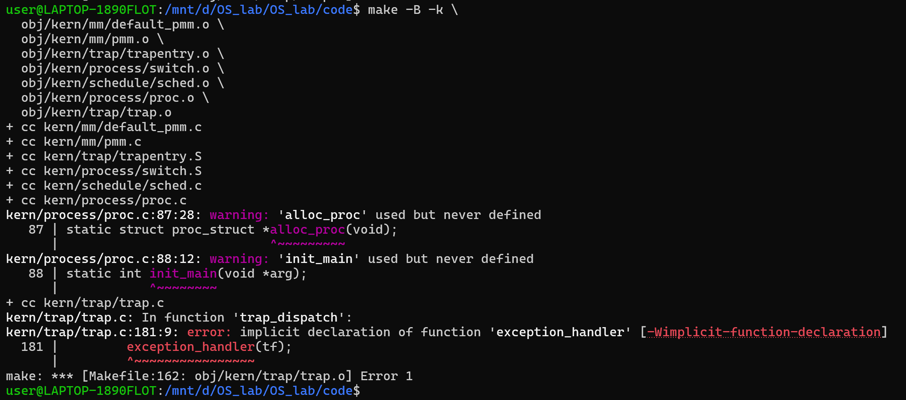

# 操作系统实验报告

## 实验基本信息

| 项目         | 内容                                           |
| ------------ | ---------------------------------------------- |
| **实验名称** | Lab5：用户进程 |
| **小组成员** | 2412084-刘芳希；2410826-马伊汀；2410439-吴佳璐 |
| **完成日期** | 2026-11-（待最终验收后填写） |


### 小组分工

| 成员                | 负责的练习/模块                                                                                                                                       | 报告分工                                                                                                                          |
| ------------------- | ----------------------------------------------------------------------------------------------------------------------------------------------------- | --------------------------------------------------------------------------------------------------------------------------------- |
| 2412084-刘芳希（A） | 前置任务：补齐 Lab2/3/4 基础代码，设计 First-Fit 提示词，更新 `RESTORE_ALL` 以支持用户态、内核态返回；功能模块一：用户态系统调用；功能模块二：创建、加载第一个用户进程及 `do_wait()` 等。 | 编写前置任务、模块一和模块二的功能说明、spec、提示词及迭代记录；记录前置代码编译检查与本人模块的验证结果。 |
| 2410826-马伊汀（B） | 功能模块三：进程复制，包括 `do_fork()`、`copy_mm()`、`dup_mmap()`、`copy_range()`；Challenge 1：实现并测试 Copy-on-Write（COW），分析相关页面状态与 Dirty COW 问题。 | 编写模块三与 Challenge 1 的设计、提示词、迭代过程、测试结果及分析。 |
| 2410439-吴佳璐（C） | 功能模块四：进程退出与调度相关系统调用，包括 `do_exit()`、`do_yield()`、`do_kill()`；Challenge 2：分析用户程序预加载与通常程序加载方式的区别；分支任务：双重 GDB 调试，跟踪 `ecall`、`sret` 及 QEMU/TCG 执行过程；负责集成测试。 | 编写模块四、Challenge 2 和双重 GDB 调试记录；汇总运行及评分结果，整合测试章节与报告。 |


---

## 一、实验目的

本实验的主要目的是：

1. 在 Lab2/3/4 的物理内存管理、Trap 处理、内核线程及调度机制基础上，建立用户进程的运行环境，理解用户态与内核态的权限边界及异常返回机制。
2. 实现用户态系统调用，掌握用户程序通过 `ecall` 进入内核、传递参数、完成服务并返回用户态的完整流程。
3. 实现用户程序加载与执行，理解 ELF 装载、用户地址空间、用户栈和初始 trapframe 的构造及其协作关系。
4. 实现进程复制、等待、退出和终止，理解父子进程关系、状态转换、资源回收及调度之间的配合。
5. 通过 COW 扩展、程序加载方式分析及双重 GDB 调试，加深对地址空间共享、写保护异常和模拟器执行过程的理解，并使用编译、运行及评分结果验证实现。

---

## 二、实验环境

| 成员           | AI 编程工具             | 底层模型            | 备注 |
| -------------- | ----------------------- | ------------------- | ---- |
| 2412084-刘芳希 | Claude Code for VS Code | DeepSeek-V4-Flash   | |
| 2410826-马伊汀 | Claude Code for VS Code | DeepSeek-V4-Flash   | |
| 2410439-吴佳璐 | Claude Code for VS Code | DeepSeek-V4.1-Flash | |

编译与运行环境如下，AI 工具信息按各成员实际使用情况记录。

| 项目 | 配置 |
| --- | --- |
| 宿主系统与开发环境 | Windows、WSL Ubuntu 22.04 |
| 目标架构 | RISC-V RV64，Sv39 分页 |
| 编译工具链 | `riscv64-unknown-elf-gcc` 及配套工具，目录为 `/home/user/compiler-lab/riscv-elf-toolchains/bin` |
| 构建工具 | GNU Make |
| 模拟器 | QEMU 4.1.1，使用 `/home/user/os-lab/qemu-4.1.1/build/riscv64-softmmu/qemu-system-riscv64` |
| 工程代码目录 | Windows：`D:/OS_lab/OS_lab/code`；WSL：`/mnt/d/OS_lab/OS_lab/code` |

在 WSL 终端中使用以下配置进行构建与运行。各成员可按本机安装位置调整工具路径。

```bash
export PATH=/home/user/compiler-lab/riscv-elf-toolchains/bin:$PATH
QEMU411=/home/user/os-lab/qemu-4.1.1/build/riscv64-softmmu/qemu-system-riscv64
```

---

## 三、实验整体逻辑分析

### 3.1 本章节的逻辑主线

本实验围绕“用户进程如何被创建、执行、复制并最终回收”展开。首先补齐前序实验的物理页分配、页映射、Trap 入口和调度切换代码，扩充 `RESTORE_ALL`，使内核具备保存和恢复用户态、内核态上下文的基础能力。

在此基础上，模块一建立用户程序访问内核服务的系统调用通道：用户程序执行 `ecall` 后进入 Trap 入口，由异常处理和系统调用分发逻辑调用相应内核函数，再经上下文恢复及 `sret` 返回。模块二负责创建初始进程、加载用户程序、建立地址空间和用户栈，并构造首次进入用户态所需的现场。两者共同形成第一个用户程序能够执行和请求内核服务的路径。

模块三扩展进程创建能力，复制进程控制信息、地址空间和执行现场，使父子进程通过各自的返回值继续执行。模块四处理退出、主动让出 CPU 和终止请求，与模块二的 `do_wait()` 配合完成进程生命周期管理：退出进程解除对地址空间的引用，在不再被共享时释放相应资源，并进入 `PROC_ZOMBIE`，保留供父进程读取的退出状态；等待方在确认子进程退出后回收其内核栈和进程控制块。双方需约定唤醒条件、父子关系维护及回收责任，避免遗漏或重复释放。

基础功能连通后，Challenge 1 将普通地址空间复制扩展为 COW，检查共享页引用计数、写保护异常及复制后的隔离性；Challenge 2 分析用户程序在内核镜像中的预加载时机及其与通常程序加载方式的区别。双重 GDB 调试则沿 `ecall`、Trap 处理和 `sret` 路径观察内核与 QEMU/TCG 的执行过程。

### 3.2 功能的逐步实现

1. **恢复并适配前序实验的基础能力。** 使用 Lab2、Lab3、Lab4 的提示词重新生成物理内存初始化、First-Fit、页映射、中断处理、线程基础和调度切换等代码，填写框架中标有 `lab2`、`lab3`、`lab4` 的位置，并核对当前接口与数据布局。扩充 `RESTORE_ALL`，根据保存的 `SSTATUS_SPP` 区分返回用户态或内核态，正确处理 `sscratch` 和栈指针。这些基础代码决定后续能否正确分配内存、建立映射、处理 Trap 并恢复执行现场。

2. **建立用户态系统调用通道。** 在 `exception_handler()` 中识别用户态 `ecall`，调整返回地址并进入 `syscall()`；分发逻辑从 trapframe 读取系统调用号与参数，调用对应的 `sys_*()` 封装和进程管理函数，再将结果写回返回值寄存器。由此串联“用户程序 → `ecall` → Trap 入口 → 系统调用分发 → 内核服务 → `sret`”的执行路径，为创建、等待、退出等操作提供统一入口。

3. **创建并加载第一个用户进程。** 更新 `alloc_proc()`、`kernel_thread()` 和 `init_main()`，建立初始进程及父子关系；通过 `user_main()`、`kernel_execve()` 和 `do_execve()` 衔接用户程序执行请求。`load_icode()` 负责建立地址空间、装载 ELF 段、准备用户栈并构造初始 trapframe，设置用户入口地址、返回特权状态和用户栈指针。首次运行经 `forkret → forkrets → __trapret` 恢复现场并进入用户态；这一过程还依赖进程复制和退出接口的接入。

4. **完成进程复制与父子执行分流。** 实现 `do_fork()`、`copy_mm()`、`dup_mmap()` 和 `copy_range()`，完成进程控制块、内核栈、地址空间与执行现场的准备。创建成功后设置 PID、父子关系及管理链表，使子进程进入可运行状态，再由调度器交给 CPU。父进程获得子进程 PID，子进程从复制的现场恢复并获得返回值 0；先建立普通页面复制路径，作为后续 COW 扩展的基础。

5. **连接等待、退出和资源回收。** 实现 `do_wait()`、`do_exit()`、`do_yield()` 和 `do_kill()`，使进程能够等待子进程、主动请求调度、退出或响应终止请求。子进程退出时解除对地址空间的引用，按引用计数释放资源，保存退出码并进入 `PROC_ZOMBIE`，同时唤醒符合条件的等待方；父进程随后读取退出状态，移除相关管理关系，回收子进程内核栈和进程控制块。统一等待条件、状态转换与回收责任后，形成创建、执行、复制、等待和退出的完整生命周期。

6. **扩展功能并沿执行链联合验证。** 在普通复制路径基础上完成 Challenge 1 的 COW，检查只读共享、写保护异常、按需复制及引用计数回收，并分析 Dirty COW 问题；Challenge 2 分析嵌入内核镜像的用户程序在何时预加载，以及它与通常程序加载方式的区别。通过双重 GDB 跟踪 `ecall`、Trap 处理和 `sret` 在内核及 QEMU/TCG 中的执行过程，再结合完整构建、QEMU 运行与 `make grade` 检查各阶段衔接。单文件编译与完整运行分别记录，最终测试结果及截图在第五部分给出。

---

## 四、实验内容与实现

### 前置任务：复用此前提示词生成并适配基础代码

**负责人：** 2412084-刘芳希

#### 模块功能描述与 spec

**功能说明：**

Lab5 在前序实验的物理内存管理、中断处理、内核线程创建和调度机制之上实现用户进程。本任务复用 Lab2、Lab3、Lab4 已有的提示词，以本次框架的头文件、数据结构和接口为依据重新生成基础代码，填写 `lab2`、`lab3`、`lab4` 注释对应的空缺，并更新异常返回相关要求、为 First-Fit 补充设计提示词，为后续系统调用、用户程序加载和进程复制提供底层支持。

**提示词的复用、更新与设计：**

- **复用已有提示词。** `page_init()`、`interrupt_handler()`、`page_insert()`、`page_remove()`、`proc_init()`、`copy_thread()`、`proc_run()`、`cpu_idle()`、`schedule()`、`switch_to()` 及 `__alltraps` 的基础要求来自前序实验。复用时调整实验名称、目标路径、占位注释和学号，核对当前接口，并按本次分工提取需要生成的函数，保留原有功能规格作为基础。
- **更新提示词以适配 Lab5。** 在 Lab3 Trap 入口与上下文恢复提示词中，更新 `RESTORE_ALL` 的规格：由原先的纯内核恢复扩展为根据 trapframe 中的 `SSTATUS_SPP` 区分用户态、内核态返回，配套处理用户栈、内核栈和 `sscratch`，并兼容首次进入新进程时人工构造的 trapframe。其他复用提示词也进行必要的场景调整，例如时钟处理中取消“三次输出后关机”并增加调度请求，页映射处理中复用现有 `page_remove_pte()`，调度处理中按当前已适配 Sv39 的 `lsatp()` 接口更新依赖说明。
- **新设计 First-Fit 提示词。** 原 Lab2 的 First-Fit 是框架提供的完整实现，没有独立生成提示词，因此依据原代码、算法说明及本次接口，按 `[PROMPT]`、`[RELY]`、`[GUARANTEE]`、`[SPECIFICATION]` 四段式重新设计，明确空闲链表、连续页分配、拆分、释放合并、引用状态和接口表的要求，再据此生成补码。

补码范围及提示词来源如下。表中的路径均相对于本次实验代码目录；提示词链接指向小组仓库的对应实验分支。

| 来源实验及模块 | 需要补充的函数或代码 | 本次填写位置 | 原提示词或参考材料 |
| --- | --- | --- | --- |
| Lab2 模块一：物理内存初始化 | `page_init()` | `kern/mm/pmm.c` 的 `lab2` 标记处 | [物理内存初始化提示词](https://github.com/fangchaliu-art/OS_lab/blob/lab2/report/prompt_task1.1_page_init.md) |
| Lab2 模块二任务一：First-Fit | `free_area`、`free_list` / `nr_free` 宏、`default_init()`、`default_init_memmap()`、`default_alloc_pages()`、`default_free_pages()`、`default_nr_free_pages()` 和 `default_pmm_manager` | `kern/mm/default_pmm.c` 的 `lab2` 标记处 | 原实验没有独立提示词；依据 [First-Fit 源码](https://github.com/fangchaliu-art/OS_lab/blob/lab2/code/kern/mm/default_pmm.c)及报告中的算法说明，新设计四段式提示词 |
| Lab3 练习一：Trap 入口与上下文恢复 | `__alltraps` 中向 C 函数 `trap()` 传递 trapframe 并调用的代码，以及 `RESTORE_ALL` 宏 | `kern/trap/trapentry.S` 的两个 `lab3` 补码标记处 | 复用并更新 [练习一提示词](https://github.com/fangchaliu-art/OS_lab/blob/lab3/report/练习一提示词.md)，补充用户态、内核态双向返回及 `sscratch` 处理规格 |
| Lab3 练习二：中断与时钟处理 | `interrupt_handler()` | `kern/trap/trap.c` 的 `lab3` 标记处 | [中断处理提示词](https://github.com/fangchaliu-art/OS_lab/blob/lab3/report/练习二interrupt_handler提示词.md) |
| Lab4 模块一：虚拟内存页操作 | `page_insert()`、`page_remove()` | `kern/mm/pmm.c` 的 `lab4` 标记处 | [虚拟内存页操作提示词](https://github.com/fangchaliu-art/OS_lab/blob/lab4/report/功能模块一_虚拟内存页操作_提示词.md) |
| Lab4 模块二：线程创建基础 | `proc_init()`、`copy_thread()` | `kern/process/proc.c` 的前序补码区域 | [线程创建提示词](https://github.com/fangchaliu-art/OS_lab/blob/lab4/report/功能模块二_线程创建_提示词.md)，按本次分工提取上述函数的要求 |
| Lab4 模块三：进程调度 | `proc_run()`、`cpu_idle()`、`schedule()` | `kern/process/proc.c` 的前序补码区域和 `kern/schedule/sched.c` 的 `lab4` 标记处 | [进程调度提示词](https://github.com/fangchaliu-art/OS_lab/blob/lab4/report/功能模块三_进程调度_提示词.md) |
| Lab4 模块三：上下文切换 | `switch_to()` | `kern/process/switch.S` 的 `lab4` 标记处 | 同上，使用其中的上下文切换规格 |

**主要要求（spec）：**

**Pre-Condition：** 本次代码框架已提供启动流程、设备树查询、页面描述符、页表接口、trapframe、进程控制块及链表工具。生成前应读取当前工程中的真实定义，将旧提示词的目标路径、补码标记和学号调整为本次任务；运行时分别满足内存初始化、进程初始化和中断初始化的调用顺序。

**Post-Condition：** 上表中的基础接口具有与当前框架一致的实现，物理页分配与回收、映射与引用计数、中断入口与返回、线程初始现场及调度切换之间的约定一致，异常返回支持用户态和内核态。待后续模块完成后，能够支持用户程序加载、系统调用和进程生命周期的联合验证。

1. **物理内存初始化。** `page_init()` 根据设备树信息及当前映射范围设置 `va_pa_offset`、`npage`、`pages`，初始化页描述符，排除固件、内核和描述符数组占用的区域，仅注册按页对齐的有效空闲范围；检查范围、布局及运算溢出，无完整空闲页时不调用要求页数大于零的初始化接口。
2. **First-Fit 分配与回收。** 空闲块按地址有序管理，`nr_free` 表示空闲页总数；分配时选取首个足够大的块并正确拆分，失败返回 `NULL`；释放时恢复页面状态并合并相邻空闲块。`free_area` 的定义应与当前头文件的 `extern` 声明保持一致，保留已有检查函数。
3. **页映射管理。** `page_insert()` 正确处理新建映射、同页权限更新和不同页替换；`page_remove()` 对无映射地址可安全重复调用。引用计数仅在相应引用增加或撤销时变化，降为零后释放页面，映射更新后使旧 TLB 翻译失效；复用已有的 `page_remove_pte()`，不重复定义。
4. **中断、入口与上下文恢复。** `__alltraps` 将保存现场后的 trapframe 地址传给 `trap()`，返回后衔接现有异常返回路径。`RESTORE_ALL` 与当前 `SAVE_ALL` 布局一致，依据保存的 `SSTATUS_SPP` 判断返回模式：返回用户态前，将 trapframe 起始地址加 `36 * REGBYTES` 得到的内核栈指针写入 `sscratch`；返回内核态时保持 `sscratch == 0`。恢复 `sstatus`、`sepc` 和通用寄存器，最后恢复 `sp`，使用已有 `sret` 返回，并兼容人工构造的初始 trapframe。时钟中断每次设置下一次事件并递增 `ticks`，结合调度需要设置 `need_resched`；去掉旧提示词中“三次输出后主动关机”的 Lab3 场景要求。系统调用异常处理在功能模块一中补充。
5. **线程初始化与初始现场。** `proc_init()` 先初始化进程链表和 PID 散列表，再建立 idle 及 init 线程，正确设置 `current`、状态、PID 和进程计数。`copy_thread()` 在新线程内核栈顶构造 trapframe，设置子进程返回值和首次执行的 `context.ra`、`context.sp`，区分内核线程栈与传入的用户栈，不修改调用者的模板。
6. **调度与切换。** `schedule()` 在中断保护下清除调度请求并选择 `PROC_RUNNABLE` 进程，无可运行进程时回退到 idle；`proc_run()` 在切换前更新 `current`，按 RV64/Sv39 编码装载目标页表并刷新 TLB；`switch_to()` 按 `struct context` 的布局保存、恢复 `ra`、`sp`、`s0`～`s11`；`cpu_idle()` 在需要重调度时调用调度器。
7. **边界与失败处理。** 覆盖内存不足、空闲块拆分与合并、重复取消映射、同页重新映射、无可运行进程及首次线程切换等情况；保持页表、引用计数、链表和进程状态一致，按进入临界区前的状态恢复中断，不依赖旧实验仅支持内核线程的假设。
8. **验证与记录。** 先核对声明、定义和数据布局并进行相关目标文件的编译检查，再在依赖齐全后完成链接与运行验证；异常返回应覆盖用户态返回、内核态返回及初始 trapframe 恢复路径。后续模块缺失或其他依赖导致的阻塞应单独记录，不通过空函数桩、修改测试或伪造结果绕过；实际执行结果填写在迭代记录和测试章节中，不能仅凭代码已填写就认定验证通过。

#### 为 First-Fit 新设计的提示词

原 Lab2 提供 First-Fit 的完整实现，没有独立生成提示词。本次根据原代码和当前接口设计以下四段式提示词。

````markdown
# 前置补码：First-Fit 物理内存分配器提示词

[PROMPT]

**任务：** 为当前 RISC-V ucore 实验五补齐此前实验中的 First-Fit 连续物理内存分配器。在仓库根目录的 `code/kern/mm/default_pmm.c` 中实现空闲页管理、连续页面分配与释放，使当前 `pmm_manager` 能够提供正确的物理页分配和回收服务。

**操作要求：** 在我明确要求执行本提示词时，必须修改项目中的实际文件，而不只是展示代码。先核对以下依赖与现有实现，仅在 `code/kern/mm/default_pmm.c` 的 `//lab2 请补充你在lab2中的代码` 标记处补全功能，保留原有注释，并在新增实现上方添加 `//lab2 function2-1 2412084`。可以在该区域添加必要的内部辅助函数及前置声明。不得修改已有 `basic_check()`、`default_check()` 的函数体、断言或执行逻辑，不修改头文件、`pmm.c`、其他模块、构建配置或测试。不要切换到 Best-Fit，不要提交或推送 Git。

**输出要求：** 依据下列真实工程依赖与行为规格实现，避免引入无关功能。完成后说明修改位置、空闲链表组织、分配拆分与释放合并过程，以及实际验证结果。无法运行的检查要明确注明，不得将预计结果写成测试通过。

[RELY]

以 `code/kern/mm/default_pmm.c`、`default_pmm.h`、`pmm.h`、`memlayout.h`、`code/libs/list.h` 和 `code/libs/defs.h` 的实际定义为准：

- **管理结构：** `free_area_t` 包含空闲链表头 `free_list` 和空闲页总数 `nr_free`。链表中的每个节点对应一个连续空闲块的首页，而不是块中的每一页。
- **全局声明：** `default_pmm.h` 已声明 `extern free_area_t free_area` 和 `extern const struct pmm_manager default_pmm_manager`。本文件需要提供对应定义，不能将 `free_area` 定义为 `static`。
- **页面描述符：** `struct Page` 包含 `ref`、`flags`、`property`、`page_link` 等字段。空闲块首页的 `property` 表示该块包含的连续页数，`PageProperty` 表示该页是空闲块首页；不能仅凭该标志为零就判断一页已分配。
- **页面状态接口：** 可使用 `PageReserved()`、`PageProperty()`、`SetPageProperty()`、`ClearPageProperty()`、`set_page_ref()` 等已有接口，不重新定义页面状态位。
- **链表接口：** 可使用 `list_init()`、`list_empty()`、`list_next()`、`list_prev()`、`list_add_before()`、`list_add_after()`、`list_del()`，通过 `le2page(le, page_link)` 取得对应页面描述符。注意 `list_add()` 的语义是在指定节点之后插入。
- **分配器接口：** `struct pmm_manager` 提供 `name`、`init`、`init_memmap`、`alloc_pages`、`free_pages`、`nr_free_pages`、`check` 字段。当前 `pmm.c` 已选择 `default_pmm_manager`，无需修改接入逻辑。
- **调用环境：** 上层 `alloc_pages()`、`free_pages()`、`nr_free_pages()` 已通过中断保护调用分配器。本模块不新增调度、锁或中断开关逻辑。
- **已有检查：** `basic_check()` 和 `default_check()` 已提供，且会临时替换空闲链表及计数进行检查。保留其实现，由管理器的 `.check` 指向 `default_check`。若在检查函数定义之前初始化接口表，应添加匹配的 `static` 前置声明。
- **实现限制：** 分配器初始化和管理过程不能依赖 `kmalloc()` 或尚未建立的页分配服务，不引入额外动态元数据。

[GUARANTEE]

补全以下全局对象、宏和内部函数，签名及类型与当前框架一致：

```c
free_area_t free_area;

#define free_list (free_area.free_list)
#define nr_free   (free_area.nr_free)

static void default_init(void);
static void default_init_memmap(struct Page *base, size_t n);
static struct Page *default_alloc_pages(size_t n);
static void default_free_pages(struct Page *base, size_t n);
static size_t default_nr_free_pages(void);

const struct pmm_manager default_pmm_manager;
```

`default_pmm_manager` 应连接上述实现，并将 `.check` 设置为已有的 `default_check`。必要的辅助函数限于本文件内的 `static` 函数，不改变公共接口。

[SPECIFICATION]

### default_init

**Pre-Condition：** 分配器尚未注册可分配物理页，本函数在初始化阶段调用。

**Post-Condition：** `free_list` 成为空的双向循环链表，`nr_free == 0`。

**Requirements：** 只初始化管理结构，不分配页面，不访问尚未建立的页面描述符，不将保留页加入空闲链表。

### default_init_memmap

**Pre-Condition：** `base` 指向有效的连续页面描述符，`n > 0`；区间内各页处于保留状态，且未与已有空闲块重叠。

**Post-Condition：**

- 初始化该区间的页面分配状态及引用计数，使其能够参与后续分配。
- 以首页表示该空闲块，设置正确的块长及 `PageProperty`。
- 将空闲块按地址升序插入链表，`nr_free` 恰好增加 `n`。

**Case 1：空闲链表为空。** 正确插入首个空闲块。

**Case 2：已有其他空闲块。** 正确处理插入链表头部、中间和尾部的情况，保持地址有序及链表结构完整。

**Requirements：** 不把区间中的每页都作为链表节点，不重复统计页面，不依赖描述符内存原本为零；插入后必须终止本次查找，避免重复插入。

### default_alloc_pages

**Pre-Condition：** 分配器已初始化，`n > 0`。

**Post-Condition：** 成功时返回恰好 `n` 个连续页面的首页，`nr_free` 恰好减少 `n`；失败返回 `NULL`，不改变空闲链表及计数。

**Case 1：空闲页总数小于请求。** 直接返回 `NULL`。

**Case 2：总空闲页足够，但没有足够大的连续块。** 遍历后返回 `NULL`，不能把不相邻的空闲块拼成连续分配。

**Case 3：找到大小恰好匹配的块。** 从空闲链表移除该块，清除已分配块首页的 `PageProperty`。

**Case 4：找到大于请求的块。** 从该块低地址端分配 `n` 页，剩余部分作为新的空闲块，正确设置其首页、块长和标志，并保持链表地址顺序。

**Requirements：**

- 从空闲链表头部开始，选择第一个能够满足请求的块，不能改为 Best-Fit。
- 成功分配的页面不再属于空闲块，不能残留有效的空闲块首页标志。
- 不将分配等同于建立页表映射，不在本函数中将页面引用计数增加为 1。

### default_free_pages

**Pre-Condition：** `base` 指向待释放区间首页，`n > 0`；区间内各页均为可合法释放的非保留页，不包含已在空闲链表中的页面，不与现有空闲块重叠。

**Post-Condition：**

- 将该区间恢复为空闲页面，引用计数归零。
- 按地址顺序插入空闲链表，合并物理相邻的前后空闲块。
- `nr_free` 恰好增加 `n`，不会因合并而重复增加。
- 合并后的空闲块仅由最终首页表示，被吸收的旧首页不再保留 `PageProperty`。

**Case 1：链表为空或前后均不相邻。** 插入独立空闲块。

**Case 2：仅与前一个块相邻。** 合并到前块，更新块长并移除多余节点。

**Case 3：仅与后一个块相邻。** 合并后块，更新块长并移除多余节点。

**Case 4：同时与前后块相邻。** 合并成一个完整连续块，正确维护最终首页、块长、标志和链表。

**Requirements：** 相邻判断依据页面描述符所代表的物理连续性，不能仅因两个节点在链表中相邻就合并。不能修改区间外已分配页面的状态，也不能直接清除正在遍历所需的链表指针。

### default_nr_free_pages

**Pre-Condition：** 分配器已初始化。

**Post-Condition：** 返回当前空闲物理页总数 `nr_free`，不修改任何管理状态；返回值不是空闲块数量。

### 验证要求

先进行静态核对，检查全局对象链接属性、管理器回调、链表顺序、块长、页面标志、引用计数及空闲页计数的一致性。

在仓库的 `code` 目录执行目标文件编译检查：

```bash
make -B obj/kern/mm/default_pmm.o
```

待其他模块具备构建和运行条件后，再执行完整构建及 QEMU 验证，观察已有 `basic_check()`、`default_check()` 是否正常通过。重点核对整块分配、拆分、连续空间不足、不同顺序释放及前后合并等行为。

若其他待补代码导致完整构建或运行失败，应说明具体阻塞原因，只报告已实际执行的检查结果，不补写其他模块、不修改测试，也不将预期输出写成已通过。
````

#### 为 RESTORE_ALL 更新的提示词

原 Lab3 提示词基于纯内核执行场景。本次保留 Trap 入口衔接要求，更新上下文恢复规格，支持用户态、内核态双向返回及人工构造的初始 trapframe。以下为更新后的完整提示词。

````markdown
# Lab5 前置补码提示词：Trap 入口与上下文恢复

[PROMPT]

**任务：** 为当前 RISC-V ucore 实验五补齐 Trap 入口与上下文恢复功能。目标文件为 `D:/OS_lab/OS_lab/code/kern/trap/trapentry.S`。

使内核在发生 Trap 后，能够将已保存的上下文交给 C 语言处理函数，并在处理函数返回后恢复执行环境，形成完整的“Trap 进入—现场保存—C 语言处理—现场恢复—Trap 返回”流程。恢复逻辑需要适配当前框架，支持返回用户态和内核态，并兼容新进程通过构造的 trapframe 首次进入执行的路径。

**操作要求：** 必须修改项目中的实际文件，而不是仅展示代码。

仅补全以下两个位置：

- `RESTORE_ALL` 中的 `#lab3：填写你在lab3中实现的代码，并进行修改补充` 标记处。
- `__alltraps` 中的 `#lab3:填写你在lab3中实现的代码` 标记处。

保留原有 lab3 注释，在新增实现处添加 `# lab3 function1 2412084`。

不得修改 `SAVE_ALL`、`struct trapframe`、`trap()` 的函数签名以及已有 `__trapret`、`forkrets` 返回流程，不修改其他实验模块、Makefile 或测试代码。不得通过增加空的中断或异常处理函数来绕过其他模块的编译错误。不要提交或推送 Git。

**输出要求：** 以工程真实代码为准，使用下列依赖、接口和行为规格完成实现。完成后说明修改内容、用户态与内核态返回的区别、关键约束的满足情况及实际验证结果。区分单文件编译通过、完整构建通过和运行测试通过；对于因其他模块尚未完成而无法执行的验证，应说明原因。

[RELY]

## 1. 已有文件与接口

- `kern/trap/trapentry.S`：包含 `SAVE_ALL`、`RESTORE_ALL`、`__alltraps`、`__trapret` 和 `forkrets`。
- `kern/trap/trap.h`：定义 `struct pushregs` 和 `struct trapframe`。
- `kern/trap/trap.c`：提供 C 语言处理入口：

```c
void trap(struct trapframe *tf);
```

该函数接收当前 trapframe，通过已有分发逻辑处理中断或异常。处理函数可能修改 trapframe 中的返回状态，恢复阶段必须使用最终保存的内容。

## 2. 上下文结构

当前框架的结构为：

```c
struct trapframe {
    struct pushregs gpr;
    uintptr_t status;
    uintptr_t epc;
    uintptr_t tval;
    uintptr_t cause;
};
```

`struct pushregs` 中的字段按照 x0 至 x31 的顺序排列。在当前 RV64 框架中，`uintptr_t` 和寄存器宽度均为 8 字节。

相对于 trapframe 起始地址，已有保存布局为：

- 第 0～31 个寄存器宽度槽位：通用寄存器 x0～x31。
- 第 32 个槽位：sstatus。
- 第 33 个槽位：sepc。
- 第 34 个槽位：stval，对应 `tf->tval`。
- 第 35 个槽位：scause。

整个 trapframe 占 `36 * REGBYTES` 字节。

## 3. 已有 SAVE_ALL 与 sscratch 约定

当前框架通过 `sscratch` 区分用户态与内核态入口：

- 正常运行在内核态时，`sscratch == 0`。
- 正常运行在用户态时，`sscratch` 保存该进程下一次进入 Trap 所需的内核栈指针。

`SAVE_ALL` 首先交换 `sp` 与 `sscratch`：

- 若来自用户态，交换后取得内核栈指针，用户栈指针暂存在 `sscratch`。
- 若来自内核态，交换后 `sp` 为零，再从 `sscratch` 取回原内核栈指针。

随后在内核栈上分配 trapframe，将原始 `sp` 保存到第 2 个槽位，并将 `sscratch` 清零。因此：

- 来自用户态时，第 2 个槽位保存原用户栈指针。
- 来自内核态时，第 2 个槽位保存原内核栈指针。
- `SAVE_ALL` 结束后，`sp` 指向 trapframe 起始地址，`sscratch == 0`。

恢复逻辑必须与实际 `SAVE_ALL` 一致，不得自行另设布局。

## 4. 宏与调用约定

`libs/riscv.h` 提供 `LOAD`、`STORE`、`REGBYTES` 和 `SSTATUS_SPP`。当前 RV64 配置中，`LOAD` 为 `ld`、`STORE` 为 `sd`、`REGBYTES` 为 8。

RISC-V 调用约定使用 a0 传递第一个参数。调用 C 函数时须满足栈对齐要求，并允许该函数按 ABI 使用调用者保存寄存器。

恢复时依据 trapframe 中保存的 `status` 判断返回特权级：

- `status & SSTATUS_SPP` 为零：返回 U 模式。
- `status & SSTATUS_SPP` 非零：返回 S 模式。

应根据即将恢复的现场判断，不能只根据最初进入 Trap 的来源判断。

## 5. 已有返回流程

```asm
__trapret:
    RESTORE_ALL
    sret
```

```asm
forkrets:
    move sp, a0
    j __trapret
```

`__trapret` 既用于普通 Trap 返回，也可能用于恢复新进程预先构造的 trapframe。因此，`RESTORE_ALL` 不能依赖此前一定执行过同一次 `SAVE_ALL` 或调用过 `trap()`。

对于位于进程内核栈顶的 trapframe，`sp + 36 * REGBYTES` 是恢复用户态前应保存到 `sscratch` 的内核栈指针；trapframe 第 2 个槽位则提供最终恢复到 x2 的栈指针。

[GUARANTEE]

必须补全以下两个汇编接口：

```asm
.macro RESTORE_ALL
    # 恢复当前 trapframe 所描述的执行状态
.endm

__alltraps:
    # 在已有 SAVE_ALL 的基础上连接 C 语言 Trap 处理入口
```

`RESTORE_ALL` 是汇编宏，`__alltraps` 是汇编入口标签，不应将它们改写为普通 C 函数。

交付结果必须满足：

- `__alltraps` 将当前 trapframe 正确传给 `trap()`。
- `trap()` 正常返回后衔接已有 `__trapret`。
- `RESTORE_ALL` 恢复通用寄存器、sstatus、sepc 和栈指针。
- 返回用户态前，为下一次 Trap 准备正确的 `sscratch`。
- 返回内核态时，保持 `sscratch == 0`。
- 已有 `sret` 能依据恢复的状态返回。
- 支持恢复符合当前布局和栈位置约定的人工构造 trapframe。

本任务不需要新增公开接口、全局变量或动态内存分配。

[SPECIFICATION]

## __alltraps

**Pre-Condition：**

- 处理器已经进入 Trap 处理入口，相关硬件状态已记录。
- 已有 `SAVE_ALL` 能按当前布局切换到可用内核栈并保存现场。
- 内核栈有足够空间保存上下文和执行 C 函数。
- `trap(struct trapframe *tf)` 接口保持不变。

**Post-Condition：**

- `trap()` 接收到指向当前真实 trapframe 的有效指针。
- 调用过程不会破坏后续恢复所需的数据。
- `trap()` 正常返回后，执行流进入已有 `__trapret`。
- 进入恢复阶段时，`sp` 仍能正确定位同一 trapframe，不产生栈偏移泄漏。
- `trap()` 对 trapframe 的有效修改能够传递给恢复阶段。

**Case 1：处理函数未修改返回现场。** 保留原现场，使恢复阶段能够返回被打断的执行流。

**Case 2：处理函数修改返回现场。** 当 `trap()` 修改 `tf->epc`、通用寄存器或返回状态时，后续恢复使用修改后的现场，不重新覆盖为进入 Trap 时的旧值。

**Requirements：**

- 遵守 RISC-V 参数传递和栈对齐约定。
- 不依赖调用者保存寄存器在 C 函数调用后仍保持原值。
- 不重复执行 `SAVE_ALL`，不重复分配 trapframe。
- 不在入口中实现中断分类、时钟计数或系统调用分发。
- 保持入口原有的四字节对齐。
- 用户栈与内核栈的入口切换由已有 `SAVE_ALL` 完成，不另建切换机制。

## RESTORE_ALL

**Pre-Condition：**

- `sp` 指向符合当前布局的有效 trapframe。
- trapframe 来自 Trap 保存现场，或由进程创建、程序加载逻辑按相同约定构造。
- trapframe 中的 `status`、`epc`、`gpr.sp` 等字段已设置为本次应恢复的状态。
- 恢复过程处于可安全操作返回现场的内核上下文中。

**Post-Condition：**

- 可恢复的通用寄存器与 trapframe 对应字段一致，x0 保持零值。
- x2 从 trapframe 第 2 个槽位恢复。
- sstatus 和 sepc 与 trapframe 中的最终返回状态一致。
- 返回 U 模式时，`sscratch` 保存对应的内核栈指针，x2 恢复为用户栈指针。
- 返回 S 模式时，`sscratch == 0`，x2 恢复为保存的内核栈指针。
- 已有 `sret` 可以从正确地址、按正确特权状态继续执行。

**Case 1：返回内核态。** 当 trapframe 的 `status` 中 SPP 为 1 时，恢复内核现场，确保 `sscratch == 0`，避免后续内核 Trap 被误判为来自用户态。

**Case 2：返回用户态。** 当 SPP 为 0 时，在恢复用户栈指针前，将当前 trapframe 起始地址加 `36 * REGBYTES` 得到的内核栈指针保存到 `sscratch`，再恢复用户现场。不能把用户栈指针写入 `sscratch`。

**Case 3：首次进入新进程。** 当 `forkrets` 或程序加载逻辑把 `sp` 指向人工构造的 trapframe 时，根据该帧恢复状态，不依赖 C 处理函数的返回值或原 Trap 入口中的临时寄存器。

**Case 4：返回现场被修改。** 当处理函数调整 `tf->epc`、系统调用返回值或其他有效字段时，采用修改后的值。本宏不自行判断指令长度，也不额外增加返回地址。

**Requirements：**

- 恢复布局和数据宽度必须与 `SAVE_ALL`、`struct trapframe` 一致。
- 最后恢复 sp，避免尚未读取的字段失去正确寻址依据。
- 用于判断 SPP、计算内核栈指针或恢复 CSR 的临时寄存器，最终也必须恢复为 trapframe 中的值。
- 不把 `cause` 和 `tval` 等诊断快照机械地写回为返回状态。
- 不擅自强制开启中断，不固定返回到 U 模式或 S 模式。
- 不无条件清零 `sscratch`，也不无条件向其写入内核栈指针；其最终值应符合返回模式。
- 需要分支标签时，使用与 `.altmacro` 配套的 `LOCAL` 等方式避免宏多次展开时符号冲突。
- 不在宏内执行 `sret`，继续使用已有 `__trapret` 的返回指令。

## 验证要求

在仓库的 `code` 目录单独编译目标文件：

```bash
make -B obj/kern/trap/trapentry.o
```

检查以下内容：

- 汇编语法、宏展开和符号引用正确。
- 恢复字段的偏移及宽度与当前 `SAVE_ALL` 一致。
- 调用 `trap()` 时参数正确、栈对齐，返回后仍定位到原 trapframe。
- 返回 S 模式时，内核栈指针正确，`sscratch == 0`。
- 返回 U 模式时，用户栈指针正确，`sscratch` 保存有效内核栈指针。
- 在其他模块具备运行条件时，验证用户态进入内核后能返回，以及人工构造 trapframe 的首次执行路径。
- 若相关模块尚未完成，只报告实际完成的静态检查和编译结果，不修改其他模块来伪造完整测试通过。
````

### 功能模块一：用户态系统调用功能

**负责人：** 2412084-刘芳希

#### 模块功能描述

**需要实现/修改的函数：**


**功能说明：**


**主要要求（spec）：**


#### 最终提示词

以下是经过迭代优化后，最终成功实现该功能的提示词：

````markdown


````

### 功能模块二：创建加载第一个用户进程功能

**负责人：** 2412084-刘芳希

#### 模块功能描述

**需要实现/修改的函数：**


**功能说明：**


**主要要求（spec）：**


#### 实现迭代过程

##### 第一次迭代：

**遇到的问题：**


**原因分析：**


**问题解决策略：**


**最终结果：**


## 五、测试与验证

<!-- 根据该实验的具体情况，提供完整的测试运行截图，应包含：
- 编译及运行成功的输出（make qemu），可能有多个
- 测试通过的结果（make grade），只有一个
-->

### 5.1 前置代码编译检查

**负责人：** 2412084-刘芳希

**测试目的：** 检查从 Lab2、Lab3、Lab4 复用并适配的前置代码是否能够通过分文件编译，包括 First-Fit、物理内存初始化、页映射操作、Trap 入口与 `RESTORE_ALL`、上下文切换及进程调度，识别前置代码错误与 Lab5 待实现模块造成的阻塞。

**执行方法：** 在 WSL 中进入工程的 `code` 目录，配置 RISC-V 工具链路径后，执行以下命令。`-B` 强制重新编译，避免使用旧目标文件；`-k` 在单个目标失败后继续检查其他独立目标。本次只编译目标文件，不执行完整链接、`make qemu` 或 `make grade`。

```bash
cd /mnt/d/OS_lab/OS_lab/code
export PATH=/home/user/compiler-lab/riscv-elf-toolchains/bin:$PATH

make -B -k \
  obj/kern/mm/default_pmm.o \
  obj/kern/mm/pmm.o \
  obj/kern/trap/trapentry.o \
  obj/kern/process/switch.o \
  obj/kern/schedule/sched.o \
  obj/kern/process/proc.o \
  obj/kern/trap/trap.o
```

**预期结果：** 独立的前置代码文件通过编译或汇编；包含 Lab5 待实现函数的文件可能出现相应警告或错误，应逐项确认其来源。`RESTORE_ALL` 应通过汇编，但其用户态、内核态双向返回行为仍需后续运行验证。

**实际结果：**

| 检查文件 | 编译结果 | 结果说明 |
| --- | --- | --- |
| `kern/mm/default_pmm.c` | 通过 | First-Fit 实现未报告编译警告或错误。 |
| `kern/mm/pmm.c` | 通过 | 物理内存初始化及页映射操作未报告编译警告或错误。 |
| `kern/trap/trapentry.S` | 通过 | Trap 入口及扩充后的 `RESTORE_ALL` 通过汇编。 |
| `kern/process/switch.S` | 通过 | 上下文切换代码通过汇编。 |
| `kern/schedule/sched.c` | 通过 | 调度代码未报告编译警告或错误。 |
| `kern/process/proc.c` | 通过，存在警告 | `alloc_proc()`、`init_main()` 已声明并被使用，但尚未定义，属于 Lab5 功能模块二的待实现内容。 |
| `kern/trap/trap.c` | 未通过 | `trap_dispatch()` 调用的 `exception_handler()` 尚未实现，触发隐式函数声明错误，属于 Lab5 功能模块

**结果确认方法：** 对照终端中的 `+ cc` 编译记录及后续诊断信息，确认上述七个目标均被实际尝试重新编译；根据警告和错误所指向的函数，核对其所属实验模块。五个独立文件无诊断，`proc.c` 仅出现两个待实现函数的警告，`trap.c` 的阻塞点为缺失的 `exception_handler()`。不将单文件编译或汇编通过等同于功能测试通过。

**测试截图：**




---


## 六、实验总结与收获

### 对操作系统的理解

| 实验知识点 | 对应 OS 原理及联系 |
| --- | --- |


### AI 协作开发的经验


---

