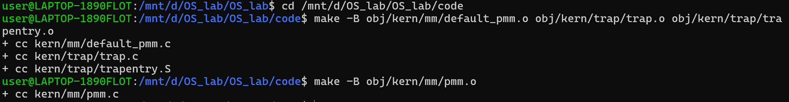

# 操作系统实验报告

## 实验基本信息

| 项目         | 内容                                           |
| ------------ | ---------------------------------------------- |
| **实验名称** | Lab4：进程管理 |
| **小组成员** | 2412084-刘芳希；2410826-马伊汀；2410439-吴佳璐 |
| **完成日期** | 2026-11-                                     |


### 小组分工

| 成员           | 负责的练习/模块                                                                                  | 报告分工                                                                                                 |
| -------------- | ------------------------------------------------------------------------------------------------ | -------------------------------------------------------------------------------------------------------- |
| 2412084-刘芳希（A） | 使用实验二、三的提示词重新生成并适配基础代码；完成模块一：虚拟内存页操作（`page_insert`、`page_remove`）；完成 Challenge 2：分页模式与 `get_pte` 分析 | 负责报告前半部分（实验基本信息、小组分工、第一至三部分），以及本人模块和 Challenge 2 的功能说明、spec、prompt、实现迭代与问题分析 |
| 2410439-吴佳璐（B） | 完成模块二：进程创建与初始化（`alloc_proc`、`proc_init`、`kernel_thread`、`do_fork`、`copy_thread`、`copy_mm`） | 负责本人模块的功能说明、spec、prompt、实现迭代与问题分析 |
| 2410826-马伊汀（C） | 完成模块三：进程调度与上下文切换（`cpu_idle`、`schedule`、`proc_run`、`switch_to`）；完成 Challenge 1：中断保存与恢复分析；负责最终联调与测试 | 负责本人模块和 Challenge 1 的功能说明、spec、prompt、实现迭代与问题分析，以及第五部分测试与验证、第六部分实验总结与收获 |


---

## 一、实验目的

本实验的主要目的是：

1. 在物理内存管理和基础页表机制之上，掌握虚拟地址与物理页之间映射的建立、更新和撤销，理解页表项、物理页引用计数与 TLB 一致性的关系。
2. 理解虚拟内存管理结构 `mm_struct` 和虚拟内存区域结构 `vma_struct` 的作用，认识地址空间描述与底层页表映射之间的联系。
3. 掌握内核线程的创建与初始化过程，理解进程控制块、内核栈、陷阱帧和上下文的作用，以及 `idleproc`、`initproc` 的建立方式。
4. 理解从选择可运行线程到切换页表、保存和恢复寄存器的完整调度过程，使内核能够将 CPU 从空闲线程交给新建的内核线程。
5. 分析中断状态的保存与恢复，以及 Sv32、Sv39、Sv48 分页模式的异同，理解临界区保护和多级页表设计的原理。
6. 实践基于 spec 和 prompt 的 AI 辅助开发：复用并适配此前实验的提示词，明确本次模块的接口与约束，通过代码审查、编译和运行测试验证生成结果，并记录问题与迭代过程。

---

## 二、实验环境

| 成员           | AI 编程工具             | 底层模型            | 备注 |
| -------------- | ----------------------- | ------------------- | ---- |
| 2412084-刘芳希 | Claude Code for VS Code | DeepSeek-V4-Flash   |
| 2410826-马伊汀 | Claude Code for VS Code | DeepSeek-V4-Flash   |
| 2410439-吴佳璐 | Claude Code for VS Code | DeepSeek-V4.1-Flash |

---

---

## 三、实验整体逻辑分析

### 3.1 本章节的逻辑主线

本实验围绕“虚拟内存页操作 → 进程创建与初始化 → 进程调度与上下文切换”展开。前面的实验已经提供物理页分配、基础页表和中断处理能力，本实验进一步解决如何在内核中创建多个执行实体，以及如何让其中一个执行实体真正获得 CPU 并开始运行的问题。

内存管理为线程运行提供基础：物理页分配器提供内核栈和页表所需的内存，页映射接口维护虚拟地址与物理页的对应关系，虚拟内存管理结构描述地址空间布局。在此基础上，进程创建模块将控制块、内核栈、PID、运行状态和首次执行现场组织为一个可被调度的内核线程；调度模块再选择可运行线程，切换当前线程、页表及寄存器上下文，使线程从“已经创建”进入“实际执行”。

本实验使用进程管理的数据结构和接口来管理内核线程。当前阶段的 `copy_mm` 保留地址空间处理接口，不进行真正的用户地址空间复制；线程创建与切换是本次实现的重点。

### 3.2 功能的逐步实现

1. **恢复并适配前序实验的基础能力。** 使用实验二、三中设计的提示词重新生成物理内存初始化、物理页分配和中断处理等代码，填写本次框架中标有 `lab2`、`lab3` 的位置，并检查其与实验四接口的兼容性。这些基础代码决定后续能否正确分配内存、处理陷阱并恢复执行现场。
2. **完善虚拟内存页操作。** 实现 `page_insert` 和 `page_remove`，在现有 `get_pte` 基础上建立、替换或撤销映射，同时维护引用计数并使对应 TLB 缓存失效。只有保证映射和物理页生命周期一致，后续内存使用才有可靠基础；框架中的 `vmm_init` 则负责虚拟内存管理相关初始化与检查。
3. **创建并登记内核线程。** `alloc_proc` 初始化进程控制块，`proc_init` 将当前执行现场组织为 `idleproc`，并通过 `kernel_thread`、`do_fork` 创建 `initproc`。创建过程中分配内核栈、设置父子关系和 PID、登记线程并使其进入可运行状态；`copy_thread` 准备陷阱帧和上下文，`copy_mm` 保留本阶段的地址空间处理接口。此时线程已经具备运行所需的信息，但仍需调度模块将其交给 CPU。
4. **选择线程并完成上下文切换。** 内核初始化后进入 `cpu_idle`，在需要重新调度时调用 `schedule`，从进程链表中选择可运行线程；没有合适线程时回退到 `idleproc`。`proc_run` 在中断保护的临界区内更新 `current`、切换页表，并调用 `switch_to` 保存旧线程、恢复新线程的寄存器上下文。新线程首次运行时，通过 `forkret → forkrets → __trapret` 恢复预先准备的陷阱帧，再进入线程入口执行。
5. **沿执行链联调并分析原理。** 按照 `kern_init → pmm_init → pic_init / idt_init → vmm_init → proc_init → cpu_idle → schedule → proc_run → switch_to` 检查各阶段的衔接，重点验证内存分配与映射、线程初始化、调度选择及首次运行现场。两个 Challenge 分别分析中断保护和多级页表，可与对应模块同步开展；最终运行结果和测试证据在第五部分记录。

---

## 四、实验内容与实现

<!-- 
说明：本部分按照 exercises 文档中的练习顺序组织
每个功能模块或者练习中可能包含多项任务，请根据实际情况调整
-->

### 4.1 前置任务：复用此前提示词生成并适配基础代码

**负责人：** 2412084-刘芳希

#### 模块功能描述与 spec

本任务使用实验二、三中设计的提示词，重新生成物理内存管理和陷阱处理的基础代码，并将其适配到实验四中标有 `lab2`、`lab3` 的位置，为后续页映射操作、线程创建和上下文切换提供基础。

涉及文件为 `kern/mm/default_pmm.c`、`kern/mm/pmm.c`、`kern/trap/trap.c` 和 `kern/trap/trapentry.S`；使用 `best_fit_pmm_manager` 命名时，还需通过 `kern/mm/best_fit_pmm.h` 声明管理器，并与 `pmm.c` 中选择的管理器保持一致。主要函数为：

```c
// kern/mm/default_pmm.c：Best Fit 物理页分配器
static void best_fit_init(void);
static void best_fit_init_memmap(struct Page *base, size_t n);
static struct Page *best_fit_alloc_pages(size_t n);
static void best_fit_free_pages(struct Page *base, size_t n);
static size_t best_fit_nr_free_pages(void);
static void best_fit_insert_block(struct Page *base); // 内部辅助函数

// kern/mm/pmm.c：物理内存探测与页描述符初始化
static void page_init(void);

// kern/trap/trap.c：中断和异常处理
void interrupt_handler(struct trapframe *tf);
void exception_handler(struct trapframe *tf);
```

汇编部分需要补全 `RESTORE_ALL` 宏，以及 `__alltraps` 中向 `trap()` 传递陷阱帧并调用该函数的代码。各部分的 spec 如下。

**Best Fit 要求（`default_pmm.c`）：**

- `best_fit_init` 初始化空闲块链表，并将空闲页总数 `nr_free` 置为 0。
- 空闲块链表按地址升序排列，每个空闲块仅在首页设置 `PG_property`，首页的 `property` 记录该块的连续页数。
- `best_fit_init_memmap` 接收待登记的连续页范围，检查页面原为保留状态，重置页面标志、块大小和引用计数，再将整块内存登记为空闲块。
- `best_fit_alloc_pages` 要求请求页数大于 0，在所有容量不小于请求的空闲块中选择容量最小的块；容量相同时选择地址较低的块。
- 大块分配后拆出剩余部分并保持链表的地址顺序，清除已分配块首页的空闲块标志；空闲页总数不足或不存在足够大的连续块时返回 `NULL`，失败时不改变链表和计数。
- `best_fit_free_pages` 重置待释放页的状态与引用计数，按地址插入空闲链表，并合并前后物理相邻的空闲块，清除被合并块原首页的块标志和块大小。
- 新登记或释放页时增加 `nr_free`，成功分配时减少 `nr_free`，合并操作不重复增加页数；`best_fit_nr_free_pages` 返回当前空闲页总数。
- 保留 `pmm.c` 中 `alloc_pages`、`free_pages`、`nr_free_pages` 接口的中断状态保护，退出临界区时恢复进入前的中断状态。
- 管理器结构体正确关联上述接口及 `best_fit_check`，不修改框架提供的 `basic_check`、`best_fit_check`，也不使用无法随测试一起保存和恢复的隐藏链表缓存。

**物理内存初始化要求（`pmm.c` 的 `page_init`）：**

- 通过 `get_memory_base()`、`get_memory_size()` 获取设备树解析出的内存信息，检查空范围、地址溢出及内核是否处于有效内存范围内。
- 使用与启动页表一致的 `PHYSICAL_MEMORY_OFFSET` 设置 `va_pa_offset`，保持 `PADDR`、`KADDR` 与实际内核映射一致。
- 将设备树报告的内存上界限制在内核允许管理的物理范围内，并向下按页对齐；`npage` 表示管理范围物理页号的上界，`pages[0]` 对应物理页号 `nbase`。
- 在内核结束地址 `end` 之后按页对齐放置 `struct Page` 数组，依据 `npage - nbase` 计算描述符数量，检查数组大小和地址边界，防止越界或整数溢出。
- 清零页描述符数组并将各页初始标记为保留状态，避免将固件、内核镜像及页描述符数组占用的页加入空闲链表。
- 将页描述符数组之后的第一个完整物理页作为空闲范围起点，仅在存在可用完整页时调用 `init_memmap`，登记正确的起始页和页数。
- 保留实验四已有的 `pmm_init`、`get_pte`、`get_page`、页表检查与 `kmalloc_init` 等逻辑；本节只补充旧实验的初始化能力，`page_insert`、`page_remove` 属于后续模块一。

**中断处理要求（`trap.c` 的 `interrupt_handler`）：**

- 从 `tf->cause` 中去掉 RV64 `scause` 的最高位，得到中断原因码，并按原因码分派处理。
- 对 S 模式时钟中断，先调用 `clock_set_next_event()` 设置下一次时钟事件，再递增 `ticks`，保证时钟中断能够持续产生。
- 每累计 `TICK_NUM` 次时钟中断调用一次 `print_ticks()`，不修改异步中断发生位置对应的 `tf->epc`。
- 对其他已知中断输出对应类型；对未知中断输出原因码并打印陷阱帧，便于定位问题。
- 若按旧提示词保留累计输出后关机的功能，应明确 `SHUTDOWN_AFTER` 的定义、计数方式和 `sbi_shutdown()` 的声明；实验四持续运行与联调时，应按运行需求禁用或隔离该逻辑，避免定时关机中断线程执行和测试。

**异常处理要求（`trap.c` 的 `exception_handler`）：**

- 根据 `tf->cause` 区分异常类型，对非法指令和断点异常输出异常种类及发生地址。
- 对本实验使用的 2 字节压缩指令和 4 字节普通指令，读取指令低 16 位判断长度，正确增加 `tf->epc`，使 `sret` 返回后能够跳过触发指令；指令读取以异常地址可访问为前提。
- 地址输出使用能够容纳 RV64 地址的格式，避免只显示低 32 位而影响调试。
- 对其他异常打印完整陷阱帧；该基础处理不等同于完成缺页修复，不能对所有异常统一增加 `epc` 后继续运行。无法恢复的异常需要明确诊断，避免无提示地反复陷入。
- 保留实验四已有的 `idt_init`、打印函数和 `trap` 分派逻辑，尤其保留 `SSTATUS_SUM` 设置，不重复定义已有函数。

**陷阱恢复与调用要求（`trapentry.S`）：**

- `RESTORE_ALL` 的槽位布局与 `SAVE_ALL`、`struct trapframe` 一致，陷阱帧大小为 `36 * REGBYTES`，不能自行改变字段顺序。
- 从第 32、33 个寄存器宽度偏移槽位恢复 `sstatus`、`sepc`，再恢复通用寄存器 `x1`、`x3` 至 `x31`；`x0` 为常量零寄存器，无需恢复。
- 恢复寄存器时保持 `sp` 指向陷阱帧，最后从第 2 个寄存器宽度偏移槽位恢复原 `sp`，避免提前丢失陷阱帧地址。
- 在 `__alltraps` 中完成 `SAVE_ALL` 后，执行 `mv a0, sp`，按调用约定将陷阱帧地址作为第一个参数传给 `trap()`，再通过 `jal trap` 调用处理函数；返回时 `sp` 应仍指向该陷阱帧。
- 保留 `__trapret` 中的 `RESTORE_ALL` 和 `sret`，以及实验四新增的 `forkrets`。`forkrets` 将传入的陷阱帧地址设置为 `sp` 后跳转至 `__trapret`，为新线程首次运行复用同一恢复路径。

#### 实现迭代过程

首次使用此前的提示词生成代码后，通过代码审查发现了以下实验场景适配问题，并据此提出调整方案。

---

##### 第一次迭代

**遇到的问题：**

生成的 `interrupt_handler()` 保留了实验三中“累计 300 次时钟中断后自动关机”的逻辑：每累计 `TICK_NUM = 100` 次时钟中断调用一次 `print_ticks()`，当累计输出次数达到 `SHUTDOWN_AFTER = 3` 时调用 `sbi_shutdown()`。这段代码符合旧提示词的要求，但实验四需要继续执行内核线程并进行调度与联调，自动关机可能提前中断运行，影响观察和测试。

原因在于复用旧提示词时，没有明确区分实验三的阶段性结束条件与实验四的持续运行需求，AI 因而保留了旧实验的关机行为。

**问题解决策略：**

在提示词的 spec 中补充实验四的运行约束：保留时钟中断重设、`ticks` 累加以及每 100 次中断输出统计信息的行为，删除累计输出三次后自动关机的逻辑，并同步删除 `SHUTDOWN_AFTER`、`print_count` 及相关过时注释。时钟中断处理函数不得因达到固定计数而主动关闭系统。

可追加的提示词约束为：

> 本次代码用于 Lab4 内核线程管理。请保留 `clock_set_next_event()`、`ticks++` 和每 `TICK_NUM` 次中断调用 `print_ticks()` 的逻辑，移除旧实验中通过 `print_count`、`SHUTDOWN_AFTER` 调用 `sbi_shutdown()` 的定时关机功能，并更新对应注释；不要修改其他中断和异常处理逻辑。

**最终结果：**

补充上述约束后，使用修改后的提示词重新生成代码。生成结果移除了累计 300 次时钟中断后自动关机的逻辑，保留了时钟事件重设、`ticks` 累加和周期性统计输出，并同步更新了相关注释。修改后的代码通过了前置任务相关测试，完成了实验四中标有 `lab2`、`lab3` 位置的基础代码补充，为后续虚拟内存页操作、内核线程创建和调度功能的实现提供了基础。

---


### 功能模块一：虚拟内存页操作

**负责人：** 2412084-刘芳希

#### 模块功能描述

**需要实现/修改的函数：**

涉及文件为 `kern/mm/pmm.c`，在 `//LAB4 function1 YOUR CODE` 对应位置实现以下两个接口：

```c
int page_insert(pde_t *pgdir, struct Page *page,
                uintptr_t la, uint32_t perm);
void page_remove(pde_t *pgdir, uintptr_t la);
```

**功能说明：**

本模块在现有 Sv39 多级页表框架上，提供虚拟地址与物理页之间映射的建立、更新和撤销功能。`page_insert` 将指定虚拟地址所在的页映射到目标物理页，并设置访问权限；`page_remove` 撤销指定虚拟地址所在页的映射。两者需要同步维护页表项、物理页引用计数和 TLB 状态，为页表自检及后续地址空间相关操作提供基础。

`page_insert` 通过 `get_pte(pgdir, la, 1)` 查找目标页表项，必要时由现有接口分配中间级页表。需要分别处理目标地址尚未映射、已映射到同一物理页和已映射到其他物理页三种情况。建立新映射时增加目标页的引用计数；替换映射时撤销旧页的引用，并在旧页引用计数降为 0 时释放旧页；同一地址重复映射到同一物理页时，只更新权限，引用计数应保持不变，也不能误释放该页。成功返回 0，无法取得所需页表项时返回 `-E_NO_MEM`，且不能破坏已有映射或错误增加目标页的引用计数。

`page_remove` 通过 `get_pte(pgdir, la, 0)` 查找已有页表项，不为删除操作分配新的页表。若目标页表项不存在或无有效映射，直接返回；若存在有效映射，则减少对应物理页的引用计数，在计数降为 0 时调用 `free_page()` 释放物理页，并清空对应页表项。重复删除同一地址应保持安全，不重复释放物理页，也不影响其他地址的映射。

**主要要求（spec）：**

- 页表项、引用计数和 TLB 状态保持一致，映射建立、替换、权限更新和撤销后，调用现有 `tlb_invalidate()` 使对应地址的旧翻译失效。
- 同一物理页允许被多个虚拟地址映射；每新增一处映射增加一次引用，删除其中一处映射时不能释放仍被其他映射引用的物理页。
- 同一虚拟地址重新映射到同一物理页时，最终引用计数不变；新的权限应反映调用者本次传入的 `perm`，不能残留旧映射的权限。
- 通过现有 `pte_create()` 构造有效页表项，正确使用物理页号和权限位，避免将内核虚拟地址直接作为页表项中的物理地址。
- 对未映射地址的删除是幂等操作；对页表分配失败返回明确错误，不继续解引用空页表项，也不留下有效的半完成目标映射。
- 可根据需要增加内部辅助函数以复用撤销映射的逻辑，对外函数签名保持与 `pmm.h` 一致。
- 复用现有的 `get_pte()`、`pte2page()`、引用计数接口、`free_page()` 和 TLB 失效接口，保留老师提供的页表框架及检查代码。

本模块与前置任务的物理页分配器相衔接：中间页表分配依赖 `alloc_page()`，映射撤销后的物理页回收依赖 `free_page()`；`get_pte()` 负责定位页表项，本模块负责维护具体映射的生命周期。验证时重点检查新建映射、重复映射、替换物理页、权限变化、共享物理页及重复删除等场景，并结合框架中的 `check_pgdir()`、`check_boot_pgdir()` 和模块测试进行确认。

#### 最终提示词

以下是经过迭代优化后，最终成功实现该功能的提示词：

````markdown

## [PROMPT]

**任务**：在当前 Lab4 项目中修改 `code/kern/mm/pmm.c`（相对于代码目录为 `kern/mm/pmm.c`），实现 `page_insert()` 和 `page_remove()`，完成虚拟地址到物理页映射的建立、更新和撤销，并保持页表项、物理页引用计数与 TLB 状态一致。

**操作要求**：必须修改项目中的实际文件，不能只输出代码片段。先阅读现有实现和声明，只在 `//LAB4 function1 YOUR CODE` 对应区域补充这两个函数及必要的 `static` 辅助函数。保留 `LAB4 function1` 标记，将其中的 `YOUR CODE` 替换为学号 `2412084`。不修改现有页表框架、函数声明、测试代码及其他模块，不引入无关功能。

**输出要求**：以工程真实代码和下面三个部分为准完成修改，简要说明修改内容及验证结果。如果当前项目因其他 Lab4 模块尚未完成而无法完整编译或运行，应说明实际阻塞原因，不补写其他模块，也不声称测试已经通过。

## [RELY]

代码运行于 RV64/Sv39 环境，相关声明位于 `kern/mm/pmm.h`，类型和宏定义位于 `kern/mm/memlayout.h`、`libs/riscv.h` 等现有头文件。使用前以实际代码核对，不重新定义这些接口。

**类型与状态：**

- `pde_t`、`pte_t` 为工程提供的页表项类型。
- `struct Page` 描述物理页，其中 `ref` 为引用计数；`pages[0]` 对应物理页号 `nbase`，不能直接将描述符数组下标作为物理页号。
- `boot_pgdir_va` 为启动页表的内核虚拟地址，已有页表检查代码使用该页表验证映射操作。
- 权限位包括 `PTE_V`、`PTE_U`、`PTE_R`、`PTE_W` 等，`PTE_V` 表示页表项有效；`PGSIZE` 为页大小。
- `E_NO_MEM` 由 `error.h` 提供，内存不足时返回 `-E_NO_MEM`。

**可用接口：**

```c
pte_t *get_pte(pde_t *pgdir, uintptr_t la, bool create);
pte_t pte_create(uintptr_t ppn, int type);
ppn_t page2ppn(struct Page *page);
struct Page *pte2page(pte_t pte);
int page_ref(struct Page *page);
int page_ref_inc(struct Page *page);
int page_ref_dec(struct Page *page);
void set_page_ref(struct Page *page, int val);
void tlb_invalidate(pde_t *pgdir, uintptr_t la);
```

- `get_pte(..., 1)` 查找目标页表项，必要时分配中间级页表，失败返回 `NULL`；`get_pte(..., 0)` 只查找，不分配。
- `pte_create()` 接收物理页号和权限，现有实现自动设置 `PTE_V`；`page2ppn()` 将页描述符转换为正确的物理页号。
- 仅对有效映射调用 `pte2page()`；`page_ref_inc()`、`page_ref_dec()` 返回更新后的引用计数。
- `alloc_page()`、`free_page(page)` 为已有单页分配、释放宏；映射目标物理页由调用者提供，中间页表分配由 `get_pte()` 负责。
- `tlb_invalidate()` 使指定地址的翻译失效，工程也提供 `flush_tlb()`；复用现有接口，不自行重写 TLB 操作。

## [GUARANTEE]

必须实现以下两个公开接口，签名与 `pmm.h` 一致：

```c
int page_insert(pde_t *pgdir, struct Page *page,
                uintptr_t la, uint32_t perm);
void page_remove(pde_t *pgdir, uintptr_t la);
```

允许增加本文件内部使用的 `static` 辅助函数，以复用撤销映射等逻辑；不增加新的公开接口。

## [SPECIFICATION]

### page_insert

**Pre-Condition：**

- 物理内存管理已经初始化，`pgdir` 指向可用的页表，`page` 是调用者提供的有效、已分配物理页描述符。
- `la` 是待映射地址，不要求页对齐；操作对象为其所在的虚拟页。`perm` 是调用者要求的权限，需兼容现有测试中的 `0`、`PTE_U | PTE_W` 等输入。

**Post-Condition：**

- 成功返回 `0`，`la` 所在页有效映射到 `page`，权限更新为本次请求的状态，引用计数与实际映射关系一致，对应 TLB 旧翻译失效。
- 无法取得所需页表项时返回 `-E_NO_MEM`，不破坏原有映射，不错误增加目标物理页的引用计数，不留下有效的半完成目标映射。

**Case 1：目标地址原来没有有效映射。** 建立到 `page` 的映射，目标物理页引用计数增加 1，并设置调用者要求的权限。

**Case 2：目标地址已经映射到同一物理页。** 更新权限，最终引用计数保持不变，不能因撤销旧映射而误释放该物理页。

**Case 3：目标地址已经映射到其他物理页。** 撤销旧映射对旧页的引用，旧页引用计数降为 0 时释放旧页；建立新映射后，目标页引用计数增加 1，旧权限不能残留。

**Case 4：所需中间页表无法分配。** 返回 `-E_NO_MEM`，不继续访问空页表项，不安装目标映射，也不释放调用者传入的物理页。

**Requirements：**

- 构造页表项时使用物理页号，不能将 `struct Page *` 或内核虚拟地址直接写入页表项。
- 正确处理同一物理页被多个地址共享的情况，不通过重置引用计数破坏其他映射。
- 映射建立、替换和权限更新完成后，保证对应 TLB 翻译失效；不能仅覆盖旧页表项而忽略引用计数和 TLB。

### page_remove

**Pre-Condition：**

- `pgdir` 指向可用页表，`la` 是待删除地址，可以不是页对齐地址，也可以没有有效映射。

**Post-Condition：**

- 删除后，`la` 所在页无有效映射；相关物理页引用计数和释放状态正确，其他地址的映射不受影响。
- 该接口无返回值，重复删除同一地址应安全且幂等。

**Case 1：对应页表不存在，或目标页表项无有效映射。** 安静返回，不分配新页表，不减少引用计数，不释放物理页。

**Case 2：存在有效映射，物理页仍被其他映射引用。** 撤销当前映射，使引用计数减少 1，但不释放该物理页；清空目标页表项并使对应 TLB 翻译失效。

**Case 3：存在有效映射，删除后物理页引用计数为 0。** 清除当前映射，释放该物理页，并保证页表和 TLB 不再保留对它的有效映射。

**Requirements：**

- 删除操作只查找已有页表项，不能为了删除而创建中间级页表。
- 仅在物理页引用计数降为 0 时释放它，不重复释放；不将目标数据页的引用计数与中间级页表页的引用计数混淆。
- 本接口不承担回收整棵页表的任务，保留现有中间级页表及其管理逻辑，兼容框架后续检查和清理。

### 验证要求

检查新建映射、同页重复映射及权限变化、替换物理页、多地址共享物理页、删除不存在的映射、重复删除和页表分配失败等路径。优先使用现有 `check_pgdir()`、`check_boot_pgdir()` 及模块测试，不改动测试以迁就实现，并如实说明已执行与尚未执行的验证。

````


### Challenge 2：深入理解不同分页模式的工作原理

**负责人：** 2412084-刘芳希

#### 1. `get_pte()` 中两段代码为什么相像？

Sv32、Sv39 和 Sv48 都采用多级页表，将虚拟页号拆成多个索引，逐级定位页表项。对于普通的 4 KiB 页面，三者的页内偏移均为 12 位，主要区别如下：

| 分页模式 | 适用架构 | 虚拟地址划分（从高位索引到页内偏移） | 页表级数 | 每个页表项大小 | 每页页表项数量 |
| --- | --- | --- | --- | --- | --- |
| Sv32 | RV32 | 10 + 10 + 12 位 | 2 级 | 4 字节 | 1024 |
| Sv39 | RV64 | 9 + 9 + 9 + 12 位 | 3 级 | 8 字节 | 512 |
| Sv48 | RV64 | 9 + 9 + 9 + 9 + 12 位 | 4 级 | 8 字节 | 512 |

Sv39 和 Sv48 的虚拟地址仍由 64 位寄存器保存，上表只列参与地址划分的低 39 位或低 48 位，其余高位必须分别等于第 38 位或第 47 位。这些模式也支持在较高层级使用叶子项映射大页，因此并非所有映射都必须走到最底层。

本实验的 `get_pte()` 按 Sv39 的三级页表、4 KiB 页面路径查找。代码中的两段相似逻辑分别用于保证两个下一级页表存在：

1. 第一段通过 `PDX1(la)` 在根页表中找到 `pdep1`。若该项无效且允许创建，就分配一个物理页作为中间页表，设置引用计数、清零页表页，并将其物理页号写入 `pdep1`。
2. 第二段沿 `pdep1` 指向的中间页表，通过 `PDX0(la)` 找到 `pdep0`。若该项无效，同样根据 `create` 决定是否分配并初始化下一级页表页，然后更新 `pdep0`。
3. 最后通过 `PTX(la)` 定位最底层页表项，并返回其地址，由 `page_insert()` 等调用者设置具体的物理页映射。

两段代码相像，是因为多级页表各层采用相同的结构，每向下一层都需要重复“检查页表项是否有效 → 必要时分配并清零下一级页表 → 建立指向下一级页表的链接”的操作，区别只在所处层级和使用的索引。`PDE_ADDR()` 用于取出下一级页表的物理地址，`KADDR()` 将其转换为内核可访问的虚拟地址。

在根页表已存在、使用普通 4 KiB 页面且沿用这一写法的前提下，Sv32 只需要一次这样的下钻，Sv39 需要两次，Sv48 则需要三次。因此可以将重复步骤抽成辅助函数，或根据分页级数用循环实现。需要注意，当前函数只检查中间项的 `PTE_V`，未区分中间层的大页叶子项，不能直接当作支持所有大页情况的通用页表遍历函数。

另外，`get_pte()` 创建的是保存页表项的页表页，不是最终映射的数据页；返回非空指针也只说明找到了页表项的位置，并不代表该项已经包含有效映射。

#### 2. 是否应该将查找和页表页分配拆开？

我认为当前写法适合本实验，没有必须拆开的必要，但在功能更复杂的内核中，可以将对外接口区分得更清楚，同时复用内部遍历逻辑。

当前函数通过 `create` 参数控制行为：`create = 0` 时只查找，缺少中间页表就返回 `NULL`；`create = 1` 时允许按需分配缺失的页表页。这让查找与创建共用一套地址索引和遍历代码，减少重复实现。比如 `page_remove()` 使用 `get_pte(pgdir, la, 0)`，删除不存在的映射时不会分配页表；`page_insert()` 使用 `get_pte(pgdir, la, 1)`，能够在建立映射前补齐所需页表。

这种设计的不足是函数名不能直接体现是否会修改页表，调用者必须注意 `create` 参数。开启创建后，函数还可能消耗物理页并因内存不足失败，错误处理比纯查找复杂。例如，当前代码在第一层成功分配页表、第二层分配失败时会返回 `NULL`，但已经挂入页表树的前一层页表页会保留，不会自动回滚。因此，失败不一定表示页表结构完全没有变化，虽然此时尚未建立目标数据页的映射。

如果需要改进，可以对外提供只读查找接口 `lookup_pte()` 和允许创建的接口 `ensure_pte()`，内部仍共用同一个页表遍历辅助函数，避免复制两套逻辑。创建接口还应明确分配失败时是保留已建的空页表，还是回收本次新分配的页表页；并发环境下也需要统一考虑页表修改的同步保护。这些问题不会仅靠拆分函数自动解决。

因此，本实验保留 `get_pte(pgdir, la, create)`，明确参数语义并正确处理 `NULL` 即可；若后续需要支持更多分页模式、大页或并发地址空间管理，再根据维护需求拆分接口并完善遍历与失败处理。

---

## 五、测试与验证

<!-- 根据该实验的具体情况，提供完整的测试运行截图，应包含：
- 编译及运行成功的输出（make qemu），可能有多个
- 测试通过的结果（make grade），只有一个
-->

### 5.1 前置代码与功能模块一编译检查

**负责人：** 2412084-刘芳希

**测试目的：** 检查补充的 Best Fit 分配器、中断与异常处理、陷阱现场恢复代码，以及 `pmm.c` 中的 `page_init()`、`page_insert()` 和 `page_remove()` 能否与现有接口一起由 RISC-V 工具链编译，确认不存在阻止生成目标文件的语法、类型或汇编错误。

**执行方法：** 在已安装实验工具链的 Linux/WSL 环境中，进入项目的 `code` 目录，执行：

```bash
cd /mnt/d/OS_lab/OS_lab/code
make -B obj/kern/mm/default_pmm.o obj/kern/trap/trap.o obj/kern/trap/trapentry.o
make -B obj/kern/mm/pmm.o
```

其中 `-B` 强制重新编译，避免已有目标文件使本次检查直接跳过。该命令只生成对应目标文件，不链接完整内核，因此不依赖尚未完成的线程创建和调度函数。

**预期结果：** 两条编译命令正常结束，生成上述四个 `.o` 文件，无编译错误；若存在警告，需结合具体内容判断并记录。

**实际结果：** 第一条编译命令依次输出 `+ cc kern/mm/default_pmm.c`、`+ cc kern/trap/trap.c` 和 `+ cc kern/trap/trapentry.S`，随后正常返回命令提示符，前置代码编译检查通过。第二条编译命令输出 `+ cc kern/mm/pmm.c`，截图范围内未出现编译错误，但未完整显示该命令结束后的提示符，最终退出状态仍需确认。

**结果确认方法：** 第二条编译命令结束后立即执行 `echo $?`，输出 `0` 表示该命令成功结束。补充包含返回提示符和退出状态的截图后，即可确认两项编译检查均通过。

**测试截图：** 下图同时记录了前置代码与功能模块一的编译输出。



**验证范围：** 上述检查独立于模块二、三进行，但只验证代码能否编译，不能证明映射、引用计数、权限和 TLB 的运行行为正确。新建映射、同页重复映射、替换物理页、共享映射、重复删除和分配失败等功能路径，仍需在后续运行测试中验证。

---

## 六、实验总结与收获

### 对操作系统的理解

1. 列出你们认为本实验中重要的知识点，以及与对应的 OS 原理中的知识点，并简要说明二者的含义、关系和差异
2. 列出你们认为 OS 原理中很重要、但在本实验中没有对应上的知识点

### AI 协作开发的经验

[写出你们在与 AI 协作过程中实际收获的经验或者感悟]

---

