# 操作系统实验报告

## 实验基本信息

| 项目         | 内容                                           |
| ------------ | ---------------------------------------------- |
| **实验名称** | Lab 2：物理内存和页表                          |
| **小组成员** | 2412084-刘芳希、2410826-马伊汀、2410439-吴佳璐 |
| **完成日期** | 2026-10-20                                     |


### 小组分工

本次实验按初始化与对象分配、页级分配算法、地址翻译调试三个方向分工。每位成员负责本人实验的实现或分析，同时填写对应报告正文、实际使用的 spec 与 prompt、迭代记录和测试材料。最终报告整理不代替各成员对本人实验过程的记录。

| 成员               | 实验任务                                                                | 报告责任                                                                 |
| ------------------ | ----------------------------------------------------------------------- | ------------------------------------------------------------------------ |
| **2412084-刘芳希** | 模块一任务一及 Challenge；模块二任务一 First-Fit；模块二 SLUB Challenge | 实验基本信息及第一至第三部分；本人任务的实验内容、prompt 和测试材料      |
| **2410439-吴佳璐** | 模块二任务二 Best-Fit；任务三 Buddy System，包含实现和测试              | 本人任务的实验内容、prompt、测试设计及结果、报告第五部分                 |
| **2410826-马伊汀** | 分支任务：GDB 调试页表查询过程                                          | 分支任务正文、prompt 与调试证据；汇总第六部分，统一整理全组报告和 prompt |

Buddy System 属于普通任务。物理内存范围获取和 SLUB 属于选做 Challenge，本组为其分别指定负责人推进；最终按实际完成情况记录。分支任务指手册中的调试任务，与 Git 分支无关。

---

## 一、实验目的

实验一建立了能够启动并输出信息的最小内核。实验二进一步解决内核如何发现可用内存、组织空闲物理页并提供分配与回收服务的问题，同时学习页表映射与地址翻译机制。

1. **理解物理内存的发现与初始化。** 根据设备树提供的内存信息确定可管理范围，建立 `Page` 描述符，区分物理地址、虚拟地址、物理页号及描述符地址，排除固件、内核和管理结构占用的空间。
2. **理解页面分配算法。** 分析 First-Fit 的空闲链表、分配、释放与合并过程，实现 Best-Fit 和 Buddy System，比较它们的分配策略、碎片问题与改进空间。
3. **理解页表的建立和使用。** 学习内核初始映射及 RISC-V Sv39 地址翻译过程，理解页表、页表项、`satp` 和 TLB 各自承担的职责。
4. **通过 SLUB 扩展理解对象分配。** 在页级分配之上组织不同大小的内存对象，理解物理页分配和对象分配之间的层次关系。
5. **掌握辅助开发与调试方法。** 使用明确的 spec 和 prompt 辅助实现及测试，通过 GDB 调试 QEMU 与 ucore，将源码分析和实际运行证据对应起来。

---

## 二、实验环境

| 成员           | AI 编程工具             | 底层模型          | 备注 |
| -------------- | ----------------------- | ----------------- | ---- |
| 2410826-马伊汀 | Claude Code for VS Code | DeepSeek-V4-Flash |
| 2412084-刘芳希 | Claude Code for VS Code | DeepSeek-V4-Flash |
| 2410439-吴佳璐 | Claude Code for VS Code | DeepSeek-V4-Flash |


## 三、实验整体逻辑分析

### 3.1 本章节的逻辑主线

本实验围绕“识别物理内存、管理物理页、提供分配服务、理解地址翻译”展开。内核首先需要确定哪些内存可用，再用统一的描述符记录页面状态，最后通过物理内存管理器提供分配和回收接口。

物理内存管理与页表映射解决不同的问题：前者决定哪些物理页空闲、如何分配和回收；后者决定虚拟地址如何对应到物理地址。TLB 缓存地址翻译结果，不直接负责分配空闲物理页。分支调试任务通过观察 QEMU 对硬件行为的模拟，将这两类机制与实际访存过程联系起来。

### 3.2 功能的逐步实现

1. **选择物理内存管理器。** `pmm_init()` 调用 `init_pmm_manager()`，选择并初始化当前分配器。统一的 `pmm_manager` 接口使不同算法能够接入同一套内存管理框架。
2. **发现内存并建立页面描述符。** `page_init()` 根据设备树信息计算可管理范围，设置 `va_pa_offset`、`npage`、`pages` 等状态，布置 `Page` 数组，并排除 OpenSBI、内核镜像及描述符数组本身占用的空间。
3. **注册可用页面。** 经过边界限制与页面对齐后，将完整的空闲页面通过 `init_memmap()` 交给分配器。内存信息无效时应终止初始化；没有可用完整页时不应注册空闲区。
4. **理解并扩展页级分配。** 从 First-Fit 的完整实现出发，理解空闲块管理，再实现 Best-Fit 和 Buddy System。Best-Fit 选择满足请求的最小空闲块；Buddy 将页面组织为二的幂大小的块，通过分裂和伙伴合并完成分配与释放。
5. **扩展到对象分配。** SLUB 在页级分配接口上组织不同大小的对象，避免每次小对象请求都单独占用整页。简化实现仍需体现页级与对象级两层结构。
6. **观察地址翻译。** 在理解初始映射的基础上，通过 GDB 追踪 QEMU 中 TLB 查询和页表翻译的关键路径，并用具体虚拟地址及物理地址验证分析。

其中物理页管理的主调用链可概括为：

```text
pmm_init()
  ├─ init_pmm_manager()：选择并初始化管理器
  └─ page_init()：确定内存范围、建立描述符
       └─ init_memmap()：注册可用页面
随后通过 alloc_pages() / free_pages() 分配与回收页面
```

---

## 四、实验内容与实现

### 4.1 功能模块一：物理内存初始化

#### 4.1.1 任务一：物理内存探测与页描述符初始化

**负责人：2412084-刘芳希。**

##### 模块功能描述

**需要实现的函数：**

```c
static void page_init(void);
```

目标文件为 `code/kern/mm/pmm.c`。该函数无参数、无返回值，由 `pmm_init()` 在物理内存管理器初始化后调用，为后续物理页分配建立初始状态。

**功能说明：**

- 根据设备树提供的内存基址和大小确定可管理范围，并遵守框架的内存上界。
- 设置虚实地址偏移 `va_pa_offset`、物理页号上界 `npage` 和描述符数组指针 `pages`，正确区分虚拟地址、物理地址、页号及描述符地址。
- 在内核镜像之后布置页对齐的 `Page` 数组，初始化页面状态，保留 OpenSBI、内核及描述符数组占用的页面。
- 将剩余的完整空闲页通过 `init_memmap()` 交给当前 `pmm_manager`，输出探测范围和实际管理范围。
- 对无效内存信息、布局不兼容、运算溢出或描述符空间不足进行错误处理；没有完整空闲页时不调用 `init_memmap()`。

本模块依赖设备树查询接口及现有地址转换、对齐和页面状态宏，不负责实现分配算法，也不切换当前管理器。

##### 提示词设计

````markdown

[PROMPT]

**任务：** 为当前 RISC-V ucore 实验二实现物理内存探测与页描述符初始化功能。在仓库根目录的 `code/kern/mm/pmm.c` 中补全 `page_init()`，使内核能够根据设备树识别内存，建立正确的地址转换和页面管理状态，将排除固件、内核镜像和描述符数组后的完整空闲页注册到当前 `pmm_manager`。

**操作要求：** 在我明确要求执行本提示词时，必须修改项目中的实际文件，而不只是展示代码。先核对以下依赖与现有实现，仅在 `code/kern/mm/pmm.c` 的 `//lab2 function1 YOUR CODE` 位置补全该功能，将此处的 `YOUR CODE` 替换为 `2412084`，保留 `lab2 function1` 标记及其他已有逻辑。不得修改其他任务、分配器、设备树解析器、启动页表、公共接口或测试。不要切换到 Best-Fit，不要提交或推送 Git。

**输出要求：** 依据下列真实工程依赖与行为规格实现，避免引入无关功能。完成后说明修改位置、地址和页号关系、保留区与空闲区边界，以及逐项验证结果。无法运行的检查要明确注明，不得将预计结果写成测试通过。

[RELY]

以 `code/kern/mm/pmm.c`、`pmm.h`、`memlayout.h`、`mmu.h`、`code/kern/driver/dtb.h` 和 `code/libs/defs.h` 的实际定义为准：

- **接口：** `get_memory_base()`、`get_memory_size()` 获取设备树内存信息；可使用 `panic()`、`cprintf()`、`PADDR()`、`pa2page()`、`page2pa()`、`set_page_ref()` 和 `init_memmap()`。后者要求页数大于零，且待注册页原先处于保留状态。
- **全局状态：** `pages` 是 `struct Page` 数组的虚拟地址；`pages[0]` 对应页号 `nbase = DRAM_BASE / PGSIZE`；`npage` 是物理页号上界，描述符数量为 `npage - nbase`，不能与空闲页数混淆。
- **地址关系：** `PADDR(kva) = kva - va_pa_offset`；`pa2page(pa) = &pages[PPN(pa) - nbase]`。偏移应符合启动映射的 `PHYSICAL_MEMORY_OFFSET`，不是 `KERNBASE - 内存基址`；`end` 是内核结束虚拟地址。当前 `KADDR` 被注释掉，不可使用。
- **宏与字段：** 使用 `PGSIZE`、`PPN`、`ROUNDUP`、`ROUNDDOWN`、`PHYSICAL_MEMORY_END` 及页面状态宏；`struct Page` 包含 `ref`、`flags`、`property`、`page_link`。初始化时不能假定描述符内存已经清零。

[GUARANTEE]

仅补全以下接口；必要的辅助函数限于本模块内的 `static` 函数，不改变公共接口：

```c
static void page_init(void);
```

[SPECIFICATION]

### page_init

**Pre-Condition：** 启动映射已建立，设备树初始化路径已执行，当前 `pmm_manager` 已初始化但尚未注册空闲区。本函数在启动时调用一次，不依赖尚未建立的页分配服务。

**Post-Condition：**

- 正确设置 `va_pa_offset`、`npage`、`pages`，输出探测范围和实际管理范围；所有地址、页号及描述符转换一致且不越界。
- `pages` 位于 `end` 之后并按页对齐，整个描述符数组落在有效内存内；页面状态初始化明确，未释放的页保持保留。
- 当前管理器仅接管排除 OpenSBI、内核和描述符数组后的完整空闲页，不遗漏可管理完整页，也不包含边缘不足一页的空间。

**Case 1：正常情况。** 内存信息和布局有效且存在完整空闲页时，满足上述后置条件并注册空闲区，注册前满足分配器的保留状态要求。

**Case 2：范围与对齐边界。** 内存末端超过 `PHYSICAL_MEMORY_END` 时截断到管理上界；描述符和空闲区起点向上按页对齐，管理末端向下对齐，所有大小与地址运算避免溢出。

**Case 3：无完整空闲页。** 描述符布局有效，但剩余空间不足一页或为零时，不调用 `init_memmap()`。

**Case 4：信息或布局无效。** 基址或大小无效、范围运算溢出、布局与固定映射不兼容，或无法容纳描述符数组时，通过 `panic()` 终止；必须在越界访问前发现问题。

**Requirements：** 验证构建及正常配置下的全局状态、保留区、空闲页和地址转换，并说明边界检查依据。保持测试不变；`test_page_init()` 假定设备树末端未超过管理上界且存在空闲页，不能直接用于判定截断和零空闲页场景。其他未完成任务导致的评分失败应单独说明，不扩展本任务修改范围。

````

##### 实现迭代过程

本模块在第一版代码运行检查中发现一处地址输出异常，经过一次修正后完成复测。以下记录第一次迭代的问题、处理方法和实际结果。

---

###### 第一次迭代

**遇到的问题：**

在 QEMU 4.1.1 中使用 `default_pmm_manager` 联调 SLUB 测试时，物理内存初始化输出出现异常：

```text
reserved: [0xffffffff80000000, 0x000000008037a000) (firmware+kernel+Page array)
```

其中保留区起点应为物理地址 `0x0000000080000000`，实际却显示为 `0xffffffff80000000`。该行由 `page_init()` 输出，发生在 SLUB 初始化之前，因此归入物理内存初始化模块的问题记录。

对应代码为：

```c
cprintf("reserved: [0x%016lx, 0x%016lx) (firmware+kernel+Page array)\n",
        DRAM_BASE, free_start_pa);
```

**原因分析：** `DRAM_BASE` 定义为未显式指定 64 位类型的十六进制常量 `0x80000000`，而 `%lx` 要求参数类型为 `unsigned long`。将该常量直接传入可变参数函数，参数类型与格式要求不匹配；在当前 RISC-V 64 位调用约定下，观察到了高位扩展为 `ffffffff` 的现象。问题出在打印参数，不应据此认定实际内存管理范围也从该错误地址开始。

**问题解决策略：**

在打印处显式转换参数类型，使其与 `%lx` 一致：

```c
cprintf("reserved: [0x%016lx, 0x%016lx) (firmware+kernel+Page array)\n",
        (unsigned long)DRAM_BASE, (unsigned long)free_start_pa);
```

当前源码已在该打印语句中采用上述类型转换，修复后的运行日志确认保留区起点显示正常。其他使用地址宏的打印语句（包括异常分支）仍应核对类型匹配，不能用本次正常运行替代异常分支验证。

拟在提示词的 `[SPECIFICATION]` / `Requirements` 中补充：

> 输出地址和页数时，格式说明符必须与实际参数类型一致。对传入 `%lx` 或 `%lu` 的宏常量及相关数值，应确保参数为对应的 `unsigned long` 类型，必要时显式转换；同时检查正常和异常路径中的打印语句，避免可变参数类型不匹配造成地址显示错误。

修复后重新运行，保留区起点已显示为 `0x0000000080000000`。本次空闲起点仍为 `0x8037a000`、空闲页数仍为 31878，First-Fit 检查和 SLUB 五组测试均通过，说明该次打印修正没有改变日志所示的页面布局与测试结果。

**最终结果：**

- ✅ `pmm.c` 已单独重新编译通过。
- ✅ 在暂时排除未完成 Best-Fit 的构建配置下，内核已运行，识别到 128 MiB 内存，建立 32768 个描述符，日志报告 31878 个初始空闲页。
- ✅ First-Fit 输出 `check_alloc_page() succeeded!`；同次运行中 SLUB 五组行为测试均报告通过。
- ✅ 地址打印异常已修复并经本次运行复测确认，保留区输出为 `[0x0000000080000000, 0x000000008037a000)`。
- 验证范围：上述结果对应本次正常内存配置，不代表 `page_init()` 的所有异常边界或完整框架评分均已通过。

**关键改进点总结：**

1. 在提示词中明确日志格式与参数类型的匹配要求，特别关注宏常量进入可变参数函数的情况。
2. 检查运行结果时既关注测试结论，也核对地址和数量等中间输出，不能只看 `PASS`。
3. 区分发现问题的场景与问题所属模块：本次在 SLUB 联调中发现，但缺陷位于 `page_init()` 的打印语句。

---

#### 4.1.2 Challenge：物理内存范围的获取方式

**负责人：2412084-刘芳希。**

**问题：** 如果操作系统无法提前知道硬件的可用物理内存范围，应如何获取？

当内存布局已知时，可以使用宏定义记录物理内存的起始地址和大小；但如果操作系统无法提前知道这些信息，就需要通过设备树、固件接口或引导程序提供的内存映射获取。在内核启动之前，固件通常已经完成内存初始化，并能将内存布局信息提供给操作系统。具体方式取决于平台。
1. 读取设备树（Device Tree）
   在本实验的 RISC-V 平台上，可以解析启动时传入的设备树。设备树的内存节点描述物理内存区域，通常通过 reg 属性记录起始地址和大小。实验框架提供的 get_memory_base() 和 get_memory_size() 就用于获取这些信息，供 page_init() 初始化物理内存管理。
2. 通过固件接口获取内存映射
   不同平台提供不同的接口。例如，传统 x86 BIOS 可通过 E820 接口提供内存映射，UEFI 可通过 GetMemoryMap() 提供内存描述符。这些信息不仅包含区域的地址和长度，还区分可用内存、保留区域等类型。引导程序可以先取得这些信息，再传递给内核。
3. 读取平台的内存控制器配置
   在某些嵌入式系统中，还可以根据芯片手册读取内存控制器寄存器，了解已配置的内存容量和布局。不过这种方法依赖具体硬件，通用性较差，通常由固件或引导程序完成。
获取物理内存范围后，不能直接将整个范围都交给分配器。 操作系统还需要排除固件保留区、设备映射区、内核镜像、页描述符数组等占用的空间，并按页面边界对齐，最后才能将完整的可用页面注册为空闲页。

---

### 4.2 功能模块二：物理内存分配

本模块在模块一（4.1）完成物理内存探测与页描述符初始化之后，负责空闲连续物理页的分配与回收。模块一已建立页描述符数组 `pages[]` 并划分出内核保留区与空闲区；本模块在此基础上实现具体的分配器：按请求页数从空闲区切出连续物理页，并在页面释放时归还、合并回空闲区，尽量抑制外部碎片。

本模块共四个子任务，策略由简到繁，分别对应框架默认实现、两个自实现算法与一个对象分配挑战：

| 子任务          | 算法         | 任务分配                | 源文件                                           | 管理器                 |
| --------------- | ------------ | ----------------------- | ------------------------------------------------ | ---------------------- |
| 4.2.1 任务一    | First-Fit    | 2412084-刘芳希 理解框架 | [default_pmm.c](../code/kern/mm/default_pmm.c)   | `default_pmm_manager`  |
| 4.2.2 任务二    | Best-Fit     | 2410439-吴佳璐 代码实现 | [best_fit_pmm.c](../code/kern/mm/best_fit_pmm.c) | `best_fit_pmm_manager` |
| 4.2.3 任务三    | Buddy System | 2410439-吴佳璐 代码实现 | [buddy_pmm.c](../code/kern/mm/buddy_pmm.c)       | `buddy_pmm_manager`    |
| 4.2.4 Challenge | SLUB         | 2412084-刘芳希 代码实现 | [slub.c](../code/kern/mm/slub.c)                 | 建立在页分配器之上     |

- **First-Fit**：按空闲块地址顺序查找，取第一个满足请求的块，立即分配。
- **Best-Fit**：在所有足够大的空闲块中选择最小者，减少大块被拆碎，抑制外部碎片。
- **Buddy System**：按 2 的幂阶（`2^k` 页）管理空闲块，释放时按伙伴关系（`i ^ (1<<k)`）逐级合并。
- **SLUB**：在页分配器之上实现对象级分配，管理小对象与大小类别，并处理多页大对象。

四个页分配器通过统一的 `struct pmm_manager` 回调接口接入内核——`init`、`init_memmap`、`alloc_pages`、`free_pages`、`nr_free_pages`、`check`；由 [pmm.c](../code/kern/mm/pmm.c) 的 `init_pmm_manager()` 依据编译宏选择当前生效的管理器（定义 `PMM_USE_BUDDY` 时用 Buddy，定义 `PMM_USE_FIRST_FIT` 时用 First-Fit，两者都未定义时用 Best-Fit），因此上层 `alloc_page()`/`free_page()` 等接口与具体算法解耦。

它们共享同一套空闲区管理约定：

- `free_list` 按物理地址升序排列各空闲块的首页，构成有序双向空闲链表；
- `nr_free` 记录空闲物理页总数，而非空闲块个数；
- 仅空闲块首页设置 `PageProperty` 标志，其 `property` 记录该块的连续页数；
- 分配时从空闲块中切出请求页数，释放时将相邻空闲块合并，以抑制碎片。

各算法的原理、实现与验证见 4.2.1–4.2.4；对应的测试记录汇总于第五部分（5.1–5.5）。

#### 4.2.1 任务一：理解 First-Fit 连续物理内存分配

**负责人：2412084-刘芳希。**

##### （1）算法原理与数据结构

First-Fit 算法按空闲块的排列顺序查找，找到第一个能够满足请求的连续空闲块后立即分配，不再继续寻找其他块。

本实验的 `kern/mm/default_pmm.c` 使用 `free_area` 管理空闲物理页：

- `free_list` 是按物理地址从低到高排列的空闲块链表，每个节点对应一个空闲块的首页。
- `nr_free` 表示当前空闲物理页的总数，而不是空闲块数量。
- 空闲块首页的 `property` 记录该块包含的连续页面数量。
- `PageProperty` 标志表示该页是空闲块的首页，并非所有空闲页都设置此标志。

因此，分配时只需遍历各空闲块的首页，不需要逐页检查。

##### （2）初始化管理结构：`default_init()`

```c
static void default_init(void) {
    list_init(&free_list);
    nr_free = 0;
}
```

该函数将空闲链表初始化为空，并将空闲页总数设为零。此时只是建立了管理结构，还没有加入实际的可用页面；物理页由后续的 `default_init_memmap()` 注册。

##### （3）初始化空闲页：`default_init_memmap()`

该函数接收起始页描述符 `base` 和连续页数 `n`，将这段内存初始化为一个空闲块。具体步骤为：

1. 检查 `n > 0`，并确认这些页面原先处于保留状态。
2. 遍历页面，清除原有标志和 `property`，将引用计数设为零。
3. 设置 `base->property = n`，并为首页设置 `PageProperty` 标志。
4. 将空闲页总数 `nr_free` 增加 `n`。
5. 按地址顺序，将空闲块首页插入 `free_list`。

当前实现的 `default_init_memmap()` 只负责注册空闲块，没有执行相邻块合并；合并逻辑位于 `default_free_pages()` 中。

##### （4）分配连续物理页：`default_alloc_pages()`

该函数申请 `n` 个连续物理页。如果 `n > nr_free`，说明空闲页总量不足，直接返回 `NULL`；否则，从链表头开始依次检查空闲块：

```c
if (p->property >= n) {
    page = p;
    break;
}
```

找到第一个大小不小于 `n` 的块后就停止搜索，随后分两种情况处理：

- 如果块大小恰好等于 `n`，将整个块从空闲链表中移除。
- 如果块大小大于 `n`，分配其前面的 `n` 页，将剩余页面组成新空闲块。新首页为 `page + n`，大小为原大小减去 `n`，并插回原来的链表位置以保持地址有序。

最后，将 `nr_free` 减少 `n`，清除已分配块首页的 `PageProperty` 标志，返回其首页描述符。


##### （5）回收页面与合并：`default_free_pages()`

该函数释放从 `base` 开始的 `n` 个连续页面。首先检查页面状态，清除相关标志并将引用计数归零，再将其组织为一个新的空闲块：

```c
base->property = n;
SetPageProperty(base);
nr_free += n;
```

随后按地址顺序插入空闲链表，再分别检查与前驱、后继块是否在物理地址上连续。

**与前驱块合并：**

```c
if (p + p->property == base)
```

如果前驱块的结束位置恰好是当前块的起始位置，就增加前驱块的 `property`，清除当前块首页的 `PageProperty` 标志并删除其链表节点，最后将 `base` 更新为合并后块的首页。

**与后继块合并：**

```c
if (base + base->property == p)
```

如果当前块的结束位置恰好是后继块的起始位置，就继续合并，并移除后继块的首页节点及标志。


##### （6）First-Fit 是否有进一步的改进空间？

有。在查找效率、碎片管理和错误检查方面仍有改进空间。

**提高空闲块查找效率。** 当前每次分配都从链表头开始，最坏情况下需要遍历全部空闲块。如果使用按地址组织、同时记录子树最大空闲块大小的平衡树，跳过不可能满足请求的区域，可以提高查找效率，但会增加实现与维护成本。

**减少重复扫描。** 可以记录上次查找的位置，从该位置继续搜索，减少对链表前部小空闲块的重复扫描。不过，这种情况下策略不再是当前严格从头查找的 First-Fit，也不能保证所有场景下效果更好。

**改善碎片管理。** 当前释放函数已经合并相邻空闲块，但不能合并被已分配页面隔开的区域。若初始化阶段可能多次注册相邻内存区，可以在 `default_init_memmap()` 中增加合并逻辑。也可以根据需求采用 Best-Fit 或 Buddy System 等策略，但也不能保证完全消除碎片。

#### 4.2.2 任务二：实现 Best-Fit 连续物理内存分配

**负责人：2410439-吴佳璐。**

在 [best_fit_pmm.c](../code/kern/mm/best_fit_pmm.c) 的 `lab2 function2-2 2410439` 位置补全了分配器，在 [pmm.c](../code/kern/mm/pmm.c) 的 `init_pmm_manager()` 中启用 `best_fit_pmm_manager`。原有 `basic_check()` 和 `best_fit_check()` 的函数体、断言和编译条件完整保留，First-Fit、SLUB、公共接口及评分工具均未修改。

##### 算法原理与选择策略

Best-Fit 与 First-Fit 同属基于空闲块链表的连续物理页分配，二者的数据结构与释放合并逻辑相同，区别只在于"选哪一块"：

- **First-Fit**：按地址顺序取第一个满足请求的块，命中即分配，遇到足够大的块即可提前结束查找；
- **Best-Fit**：遍历所有空闲块，在满足请求的候选中选择 `property` 最小（即最贴合）的块，再从中分配。

Best-Fit 的动机是抑制外部碎片：从最小的合适块中切出请求页数，尽量不拆碎更大的空闲块，把大块留给后续更大的请求。代价是每次分配都要扫描整条空闲链表，最坏为 `O(F)`（`F` 为空闲块数），而 First-Fit 可在找到第一个合适块时提前结束。

当最小合适块恰好等于请求页数（精确匹配）时，该块被整体分配、不产生余块，因此实现遇到精确匹配即可提前结束；由于链表按地址升序排列，第一个精确匹配必然是地址最低的那个，这也满足"同大小候选取低地址"的确定性要求。综上，本任务以更高的查找成本换取更好的碎片表现，在空闲块数量有限的小内存场景中该成本可以接受（复杂度分析另见本节末"改进空间"）。

##### 实际使用的 spec 与 prompt

使用 [Best-Fit 实现与验证提示词 v1](prompt_task2_best_fit.md)，其中 `[PROMPT]` 至 `[END PROMPT]` 的正文保留为本次执行前的输入，文末 `[ACTUAL RESPONSE]` 记录本轮真实回复、运行命令与问题处理。为便于对照，下面把该提示词正文一并列出：

````markdown

[PROMPT]

**任务：** 请在当前 RISC-V ucore 实验二工程中，参考完整 First-Fit 实现，补全 Best-Fit 连续物理内存管理模块，接入内核并实际验证。请修改项目文件，不要只展示代码。算法时空复杂度不作要求，优先保证正确性和可解释性。

**操作范围：** 在 `code/kern/mm/best_fit_pmm.c` 的 `//lab2 function2-2 YOUR CODE` 位置补充实现，保留 `lab2 function2-2` 标记，将该处 `YOUR CODE` 替换为 `2410439`。可以补充必要的前置声明；必须完整保留原有 `basic_check()` 和 `best_fit_check()`，不得修改其函数体、断言或编译条件。在 `code/kern/mm/pmm.c` 的 `init_pmm_manager()` 中启用 `best_fit_pmm_manager`。仅在必要时调整相关头文件或构建接入，保留已有物理内存初始化、First-Fit、SLUB、公共接口和评分工具，不提交或推送 Git。

[RELY]

- 先阅读 `code/kern/mm/default_pmm.c`、`best_fit_pmm.c`、`best_fit_pmm.h`、`pmm.h`、`pmm.c`、`memlayout.h`、`mmu.h` 和 `code/libs/list.h`，再检查 `code/Makefile`、`code/tools/test_lab2.c` 与实际启动流程。
- 根据 `struct pmm_manager` 自行设计内部状态、管理函数及注册结构。页分配返回 `struct Page *` 描述符；`nr_free_pages()` 返回空闲页数，不是空闲块数。
- 原测试直接保存、清空和恢复 `free_list` 与 `nr_free`，两者必须是兼容该操作的可写状态。可以沿用 `free_area_t` 和宏别名。不要增加无法随测试状态操作保持一致的隐藏缓存或索引。
- `best_fit_check()` 会先清空链表、后清零计数；在链表为空但计数尚未清零时，分配仍须失败。测试还会释放一个已分配区域中的子区间，并将相邻已分配页面作为整体释放。
- 可使用现有链表、断言、输出和内存工具；不依赖宿主环境的 `malloc/free`，不改动 `struct Page`。

[GUARANTEE]

定义 `const struct pmm_manager best_fit_pmm_manager`，提供正确的名称和 `init`、`init_memmap`、`alloc_pages`、`free_pages`、`nr_free_pages`、`check` 六个回调；`check` 指向原有 `best_fit_check()`。内部辅助函数使用 `static`。

[SPECIFICATION]

**Pre-Condition：** 按当前内核的单核、串行调用环境实现。初始化时由 `page_init()` 提供合法的保留页区间；正常分配和释放的页数大于零，释放范围内的页面当前均已分配。

**初始化：** `init()` 建立空管理状态；`init_memmap(base, n)` 正确初始化区间内每个页描述符的标志、引用计数和管理信息，将完整区间登记为空闲内存。只有空闲块首页设置 `PageProperty`，首页 `property` 保存连续页数，空闲页总数准确。

**分配：** 在所有不少于 `n` 页的空闲块中选择最小者，分配恰好 `n` 页；同样大小时选择地址较低的块，作为本实现的确定性约定。只有保证按地址升序遍历，或能够确定不存在更低地址的精确匹配时，遇到恰好匹配的块才可以提前结束查找。较大块需要拆分并正确登记余块；已分配页面不得保留空闲块首页标志。没有合适连续块时返回 `NULL`，失败不改变管理状态，不能仅凭空闲页总数判断分配成功。

**释放：** `free_pages(base, n)` 归还指定的连续页面，重置必要的页状态和引用计数，准确增加空闲页数，并合并前后物理相邻的空闲块。既要支持部分区间释放，也要兼容原测试对相邻已分配页面的整体释放；不得强制要求每次释放与某次原始申请完全一一对应。

**一致性：** 空闲链表中各块互不重叠、大小为正、标志正确，各块页数之和等于 `nr_free_pages()`。拆分、合并不能留下重复节点或失效首页；测试结束后资源必须恢复。

**验证：**

1. 记录实际编译器、QEMU 版本及命令。参考报告中已有运行环境，核实本机工具位置，通过命令参数指定 QEMU，不硬编码他人的路径。
2. 先检查两个原测试的函数体与修改前一致，再进行干净构建。在 QEMU 中确认管理器名称为 `best_fit_pmm_manager`，原有测试实际执行，观察 `check_alloc_page() succeeded!`；如通过 `make test` 启用评分输出，先清理旧产物并核对实际编译选项。
3. 在 Best-Fit 配置运行 `make grade`，并回归启动流程中已有的 SLUB 测试。评分工具中的管理器检查不能替代原有分配行为测试；通用成功信息也不能替代管理器名称确认。
4. 若补充测试，使用独立测试函数，不能改动两个原测试。补充用例可以检查不同大小候选块、前后双向合并，以及空闲总量足够但无足够连续块时分配失败。
5. 无法编译或运行时，明确记录阻塞原因和未验证项；不将静态检查、预期输出或旧配置日志写成实际通过。

**回复与报告：** 完成后说明内部结构、各回调职责、选块与合并过程、修改文件及真实验证结果，并回答“本实现是否还有改进空间”，结合查找开销、索引维护成本和小碎片讨论，不必实现全部优化。将本轮实际回复与执行记录追加到本文件 `[ACTUAL RESPONSE]` 后，并据实补充 `report/report.md` 的 4.2.2 和对应验证项。保留实际使用的本版 prompt；后续修订另记版本和原因，不用后来的提示词冒充本轮输入，不预填其他任务的结果。

[END PROMPT]

````

##### 内部结构与管理函数

实现使用一个 `static free_area_t free_area`。`free_list` 是按页地址升序排列的双向空闲链表，每个节点代表一个空闲块首页；`nr_free` 记录总空闲页数。只有空闲块首页带有 `PageProperty`，其 `property` 保存块长。已分配页和空闲块内部页的 `property` 置零。状态直接通过两个宏别名访问，兼容原测试对链表和计数的保存、清空及恢复。

下表左列为 `pmm_manager` 接口定义的六个回调，后两列为 Best-Fit 管理器（`best_fit_pmm_manager`）对每个回调给出的具体实现函数及其职责：
| 接口回调        | Best-Fit 实现函数          | 职责                                                               |
| --------------- | -------------------------- | ------------------------------------------------------------------ |
| `init`          | `best_fit_init()`          | 建立空链表，空闲页计数归零                                         |
| `init_memmap`   | `best_fit_init_memmap()`   | 检查保留页，清理标志、引用计数和块长，注册完整区间并合并相邻空闲块 |
| `alloc_pages`   | `best_fit_alloc_pages()`   | 选择最小的合适空闲块，分配请求页数，登记拆分后的余块               |
| `free_pages`    | `best_fit_free_pages()`    | 归还指定连续页，重置页状态并合并前后相邻块                         |
| `nr_free_pages` | `best_fit_nr_free_pages()` | 返回实际空闲页计数                                                 |
| `check`         | `best_fit_check()`         | 复用原有测试函数，其中继续调用原有 `basic_check()`                 |


分配时遍历空闲链表，只有候选块比已找到的块更小时才替换候选。因为遍历顺序按地址升序，同大小候选自然保留低地址块；遇到精确匹配时可以提前结束。选中较大块后，从其低地址端取出恰好 `n` 页，把余块放回原来的链表位置。若链表为空或所有块都小于请求，即使总空闲页数非零也返回 `NULL`，且不修改状态。

初始化和释放共用 `best_fit_insert_block()`：先找到插入位置并只插入一次，再检查前驱和后继。向左合并后更新当前块首页，随后继续检查右侧；被合并的旧首页清除标志和块长，并从链表删除。页数只在调用者登记或释放时增加一次，合并本身不增加页数。释放不依赖原申请记录，因此支持合法子区间释放以及相邻已分配页面的整体释放。

上述行为对应以下三段关键代码。分配时的候选选择、精确匹配提前结束与失败返回（`best_fit_alloc_pages()`）：

```c
struct Page *best = NULL;
list_entry_t *le = &free_list;
while ((le = list_next(le)) != &free_list) {
    struct Page *p = le2page(le, page_link);
    if (p->property >= n &&
        (best == NULL || p->property < best->property)) {
        best = p;                  /* 记录更小的合适块 */
        if (p->property == n) {    /* 精确匹配，地址有序故必然最低 */
            break;
        }
    }
}
if (best == NULL) {
    return NULL;                   /* 总空闲页非零但无合适连续块 */
}
```

选中后从低地址端切出 `n` 页，余块登记为新首页并放回原链表位置：

```c
list_entry_t *prev = list_prev(&best->page_link);
list_del(&best->page_link);
if (best->property > n) {
    struct Page *rest = best + n;
    rest->property = best->property - n;
    SetPageProperty(rest);
    list_add_after(prev, &rest->page_link);   /* 保持地址有序 */
}
nr_free -= n;
ClearPageProperty(best);
best->property = 0;
```

初始化与释放共用的 `best_fit_insert_block()` 先按地址插入一次，再分别向前驱、后继检查物理相邻并合并：

```c
if (prev + prev->property == base) {      /* 与前驱块相邻 */
    prev->property += base->property;
    ClearPageProperty(base);
    base->property = 0;
    list_del(&base->page_link);
    base = prev;
}
/* ... */
if (base + base->property == next) {      /* 与后继块相邻 */
    base->property += next->property;
    ClearPageProperty(next);
    next->property = 0;
    list_del(&next->page_link);
}
```

##### 分配与释放示例

以空闲链表含三个块 `{2, 5, 8}`（按地址升序，数字为 `property`，即块长）为例：

- `best_fit_alloc_pages(3)`：满足 `≥ 3` 的候选为 5 与 8，取最小者 5；从该块低地址端切出 3 页返回，余 2 页登记为新首页并插回原位，`nr_free` 减 3。链表变为 `{2, 2, 8}`（新余块位于被分配页之后）。
- `best_fit_free_pages(base, 3)`：把这 3 页作为一块按地址插回，检查相邻后与前后块合并，`nr_free` 加 3，链表恢复为 `{2, 5, 8}`。
- `best_fit_alloc_pages(5)`：长度为 5 的块精确匹配，整体移除、不产生余块，链表变为 `{2, 8}`。

该例体现了 Best-Fit 的关键选择顺序——"先筛合适、再取最小"，与 First-Fit 的"取第一个"不同；且同大小候选中因地址升序而取低地址块。

##### Best-Fit 物理内存分配和释放总结

前文从接口职责、关键代码与具体示例三个角度展示了实现，这里集中归纳代码对物理内存的分配和释放流程。Best-Fit 管理的对象是连续物理页（`struct Page` 描述符），全部状态维护在按地址升序的空闲块链表与 `nr_free` 计数中。

**分配（`best_fit_alloc_pages(n)`）分四步：**

1. **选块**：按地址升序遍历空闲链表，在 `property ≥ n` 的候选中保留最小者；遍历有序使同大小候选自然取低地址块，遇到 `property == n` 的精确匹配立即提前结束；
2. **切出**：从选中块的低地址端取出恰好 `n` 页返回；该范围首页清除 `PageProperty`、`property` 置零，已分配页从此与空闲链表无关；
3. **登记余块**：若原块大于 `n`，以 `best + n` 为新首页登记剩余块长并插回原链表位置，地址有序性保持不变；
4. **计数与失败**：`nr_free` 减 `n`；若无合适连续块——即使总空闲页数足够——返回 `NULL`，且不改变任何管理状态。

**释放（`best_fit_free_pages(base, n)`）分三步：**

1. **插回**：把 `[base, base+n)` 的 `n` 页重置状态后作为一块，按地址找到插入点并一次性插入空闲链表；
2. **双向合并**：先检查前驱，物理相邻则前驱吸收本块（`property` 相加，本块清除标志并移出链表）；再检查后继，相邻则同样被吸收删除，合并后链表中不存在相邻却未合并的空闲块；
3. **计数**：`nr_free` 加 `n` 且只加一次，合并不重复计数。

释放只依据页描述符的当前地址与块长，不依赖原始申请记录，因此天然支持子区间释放与相邻已分配页面的整体释放。经此流程，链表始终维持"互不重叠、大小为正、地址有序、各块页数之和等于 `nr_free_pages()`"的不变量；上文 `{2, 5, 8}` 示例中释放后链表完全复原，正是释放操作逆转分配效果的体现。

##### 实际验证与覆盖

本节记录编写 Best-Fit 过程中为确认实现无误所做的**自测** ：

运行环境为本机 WSL Ubuntu 24.04、SiFive RISC-V GCC 10.1.0、QEMU 4.1.1、OpenSBI v0.4、128 MiB RAM。

| 测试                               | 目的                                                                                                                                              | 实际结果与证据                                                                                                                                      |
| ---------------------------------- | ------------------------------------------------------------------------------------------------------------------------------------------------- | --------------------------------------------------------------------------------------------------------------------------------------------------- |
| 重新构建                           | 全部重新编译，确认加入 Best-Fit 后仍能编过                                                                                                        | `make clean` 后 `make -j2` 成功，Best-Fit 源文件被完整编译链接；见[构建日志](logs/task2_best_fit_build.txt)                                         |
| QEMU 原测试                        | 在内核中运行框架自带的 `basic_check`+`best_fit_check`，验证"选最小合适块""同大小取低地址"等规则                                                   | `memory management: best_fit_pmm_manager`、`grading: 6 / 6 points`、`check_alloc_page() succeeded!`；见[内核运行日志](logs/task2_best_fit_qemu.txt) |
| 独立补充测试（详细信息见后文介绍） | 用独立页位图当标准答案，逐项核对框架未覆盖的边界：选最小块、同大小取低地址、拆分余块、前后合并、部分/整体释放、碎片失败时状态不变、多段乱序初始化 | 全部通过；见[宿主测试日志](logs/task2_best_fit_host.txt)    或下方截图                                                                              |
| 随机对照                           | 长序列压测：随机申请/释放并逐步与位图对答案，检查是否选错块或泄漏                                                                                 | 4 个固定种子各 5000 次循环，各轮最终恢复 215 页；同上                                                                                               |
| 框架评分                           | 运行课程评分脚本给 Best-Fit 打分                                                                                                                  | 将评分脚本换行规范为 LF 后 `Total Score: 20/20`；见[评分日志](logs/task2_best_fit_grade.txt)                                                        |


**① 独立补充测试的目的与工作原理：** test_best_fit_host.py 这个脚本的目的，是把**我们写出来的 Best-Fit** 与一份**由脚本自己按规则算出的标准结果**逐项对拍。脚本直接把真实的 `best_fit_pmm.c` 编译进来运行：每执行一次申请或释放，**预期值**就是我们的 Best-Fit 实际返回的块；**标准结果**则由脚本内部独立维护的一张页位图，按"**够用且最小、位置最低**"的原则直接推导出"这一步正确的结果应该是什么"；然后把两者**逐个对比**——只要有一处不同（选错块、拆分或合并有误、计数漂移），立即断言失败。正因为两边用的是**两套互不相干的推导**（链表遍历 vs 位图扫描），它才能独立发现实现中的错误。

**② 关于随机对照与随机种子。** 报告里的"随机对照"是**同一脚本内的 `randomized_checks()`**（第 254 行起）：它用伪随机发生器生成一长串操作序列，每一步随机决定"分配还是释放、申请几页、释放哪一段"，每个种子跑 5000 步。**种子（seed）**是喂给这个发生器的初值，属于**测试的输入参数**——脚本里它是一个 `const uint32_t` 常量数组（第 255 行 `{1, 2410439, 0x13579BDF, 0xC0FFEE}`，后两个即十进制 324508639、12648430），运行时赋给伪随机状态变量 `rng_state`（第 257 行），由它决定这一轮 5000 步的完整序列。

脚本运行结果如下图：

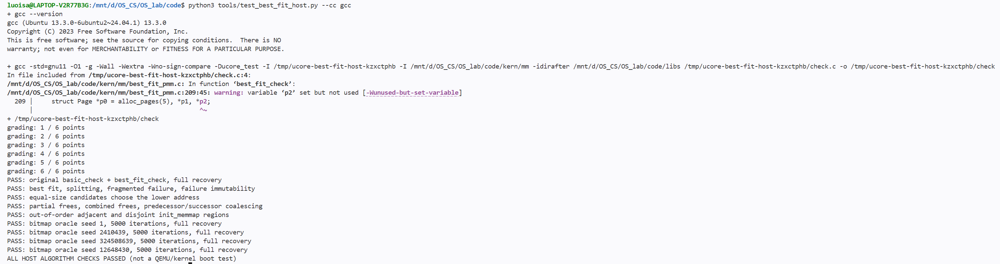


**输出解读：** 

- `grading: 1 / 6 points` 直到 `grading: 6 / 6 points`：脚本先运行**框架自带**的 `basic_check` 与 `best_fit_check`，6 个断言点全部通过。
- `PASS: original basic_check + best_fit_check, full recovery`：原测试通过，且收尾时**完全恢复**空闲状态。
- 随后的 5 行 `PASS:`：**定向边界对照**全部通过——最小合适块与拆分、碎片化失败与"失败不改变状态"、等长候选取低地址、部分/整体释放与前后合并、乱序与不相邻的 `init_memmap`；每一行都表示该项"实际返回结果"与"位图算出的标准结果"**一致**。
- 4 行 `PASS: bitmap oracle seed 1 / 2410439 / 324508639 / 12648430, 5000 iterations, full recovery`：**随机对照**的 4 条长序列（各 5000 步，合计约 2 万步）全部跑完，并**完全恢复**到 215 页空闲。
- 末行 `ALL HOST ALGORITHM CHECKS PASSED (not a QEMU/kernel boot test)`：总判定——**所有检查通过**。

由此可见：无论是定向边界还是约 2 万步随机序列，**我们写的 Best-Fit 每一次选块、拆分、合并与计数都与独立标准结果完全一致，结束时也没有泄漏**——这份 `best_fit_pmm.c` 的实现是正确的。


**③ 关于框架评分：**`make grade` 的 20 分由两项构成——`test_page_init()`（10 分，模块一页初始化）与 `test_best_fit()`（10 分）。其中 `test_best_fit()` 仅判断当前管理器是否为 `best_fit_pmm_manager`，即"选择正确"，并不测算法行为；算法行为由上面的 QEMU 原测试与宿主对照覆盖。

本轮核心命令为 `make clean`、`make -j2 GCCPREFIX=…`，以及启用 `ucore_test` 的 `make test`。

`make test` 在干净构建后启用了 `ucore_test`，本次原始输出摘录为（完整输出见 [内核运行日志](logs/task2_best_fit_qemu.txt)）：

```text
memory management: best_fit_pmm_manager
grading: 6 / 6 points
check_alloc_page() succeeded!
```


##### Best-Fit 是否还有改进空间

有。设空闲块数为 `F`，本实现分配最坏需要 `O(F)` 扫描；初始化和释放处理 `n` 个页描述符并寻找插入点，复杂度为 `O(n + F)`，统计为 `O(1)`。在已有页描述符之外，分配器只增加常量级管理状态。

可以增加按块大小组织的平衡树或分级索引来降低查找成本，并保留地址索引方便相邻合并。但这些结构会增加空间和同步维护成本，而且当前原测试直接清空和恢复 `free_list`、`nr_free`，新增索引必须兼容这些操作，不能保留过期状态。当前已做精确匹配提前结束及相邻块及时合并。

Best-Fit 仍可能留下难以利用的小空闲块，也不能合并被存活分配隔开的区域。可结合实际请求分布评估索引和碎片情况；不能为减少小块而擅自多分配页面，因为本任务规定恰好分配 `n` 页及相应释放语义。本轮只完成分析，没有额外引入这些优化。

#### 4.2.3 任务三：Buddy System 伙伴分配算法

**负责人：2410439-吴佳璐。**

2026-10-17 分两步完成实现与测试。第一阶段新增 [buddy_pmm.c](../code/kern/mm/buddy_pmm.c)、[buddy_pmm.h](../code/kern/mm/buddy_pmm.h)，接入条件选择、初步结构检查和已有 SLUB 回归。第二阶段新增 [buddy_test.c](../code/kern/mm/buddy_test.c)、[buddy_test.h](../code/kern/mm/buddy_test.h)，独立运行八组测试，全部通过；阶 15 的真实整块物理分配受内核保留区限制，单独列为未覆盖。

本任务的完整设计说明（设计目标与约束、总体结构、数据结构设计、核心算法、框架集成与复杂度分析）另见[Buddy 设计文档](buddy_设计文档.md)；本节以下保留设计要点、实际验证与迭代记录。

##### 实际使用的 spec 与 prompt

第一阶段执行 [Buddy System 实现提示词 v1](prompt_task3_buddy.md)。保留执行前的 `[PROMPT]` 正文及该轮实际记录。第二阶段另行执行 [Buddy System 测试提示词 v1](prompt_task3_buddy_test.md)，在该文件 `[ACTUAL RESPONSE]` 后追加真实回复与执行记录；未反向改写任一轮输入，也未改写第一轮的历史结论。为便于对照，两轮提示词正文分别列出如下。

**第一阶段：实现提示词正文**

````markdown

[PROMPT]

**任务：** 请参考当前 RISC-V ucore 物理内存管理框架，从零实现 Buddy System 页分配模块并接入内核。请修改实际工程文件。所有分配块的页数必须为二的幂，支持分配时逐级分裂和释放时逐级伙伴合并；算法时空复杂度不作要求。

**操作范围：** 新建 `code/kern/mm/buddy_pmm.c`、`buddy_pmm.h`，在 `pmm.c` 接入 `buddy_pmm_manager`。可以增加必要的内部元数据和最小构建配置，保留已有物理内存初始化、First-Fit、Best-Fit、SLUB、公共接口、`struct Page` 和原有测试，不修改评分工具，不提交或推送 Git。本轮生成分配模块和有实际断言的初步结构检查，不提前生成下一份提示词负责的完整行为测试。

[RELY]

- 先阅读 `report/prompt_task2_best_fit.md` 及实际 Best-Fit 完成状态，再阅读 `code/kern/mm/pmm.h`、`pmm.c`、`memlayout.h`、`mmu.h`、`default_pmm.c`、`slub.c`、`code/libs/list.h`、`code/libs/defs.h`、`code/Makefile` 和启动流程。若前置任务尚未完成，先报告依赖缺口，不把补做 Best-Fit 算作本轮 Buddy 实现。
- `pmm_manager` 要求 `init`、`init_memmap`、`alloc_pages`、`free_pages`、`nr_free_pages` 和 `check`。`pmm_init()` 在 `page_init()` 后调用当前管理器的 `check`，此时 SLUB 尚未初始化。
- `page_init()` 提供的空闲起点可能没有按大块对齐，总页数也不一定是二的幂。不得把整段容量向下取整后丢弃尾页，或把保留区补入可分配范围。
- 已有 SLUB 使用 `alloc_pages(n)` 获取连续页，随后按同一个原始 `n` 调用 `free_pages(base, n)`，因此 Buddy 必须支持这种配对方式。
- 使用内核已有断言、链表、输出和地址转换工具。不能依赖宿主 `malloc/free`，不能依赖尚未初始化的 SLUB，也不能递归调用被实现的页分配接口获取自身必要元数据。
- 参考资料：[伙伴分配器的一个极简实现](https://coolshell.cn/articles/10427.html)。可以借鉴思想，具体实现须适配本工程。以下向上取整、返回失败和管理器选择规则属于本实验主动选择的设计约定。

[GUARANTEE]

定义 `const struct pmm_manager buddy_pmm_manager`，在头文件声明，完整实现六个回调，内部辅助函数使用 `static`。明确记录最大阶数、各阶块大小、伙伴定位基准，以及使用 `property`、标志或额外元数据的具体含义。

在 `init_pmm_manager()` 中使用编译宏 `PMM_USE_BUDDY` 选择管理器：定义该宏时启用 Buddy，否则保持 Best-Fit。优先通过 Makefile 现有 `DEFS` 传递宏；若已有等价的选择机制则沿用并说明。每次切换配置先清理旧构建产物，确保 Best-Fit 的评分方式仍可复现。

[SPECIFICATION]

**Pre-Condition：** 按单核、串行调用实现。正常释放只接受本分配器返回的、尚未释放的原始块首地址及原始申请页数，不要求支持内部偏移释放、部分释放、重复释放或非法指针。不能直接套用 Best-Fit 原测试的部分释放语义。

**管理结构：** 自行选择按阶空闲链表或树等结构，并解释选择。尽量将管理状态集中组织，便于后续检查和受控区域测试。元数据存储需有明确容量与边界，初始化不能依赖未建立的分配服务。

**初始化：** `init()` 建立空状态。`init_memmap(base, n)` 对合法、互不重叠的保留页区间进行初始化，清除交付页的保留标志、将引用计数置零，按本实现约定初始化首页标志和元数据，再将整个区间拆成满足大小和对齐要求的二次幂块。正确处理不规则起点、非二次幂长度和多段区域；登记后空闲页总数增加恰好 `n`。分裂与合并均不得跨过未登记区域或保留区。

**分配：**

- 对 `n > 0`，取最小的 `2^k >= n` 作为实际分配页数。寻找可用的目标阶或更高阶空闲块；必要时逐级对半分裂，把未使用的伙伴放回管理结构。
- 返回完整、连续且符合本实现对齐规则的块首 `struct Page *`。存活分配不能重叠；分配不应破坏其他存活块数据，不承诺新内存清零。
- 空闲页计数扣除实际分配的 `2^k` 页，记录足够的释放信息。例如申请 3 页实际占 4 页，计数减少 4。
- `n == 0`、取整可能溢出、超过最大支持阶或没有可用块时返回 `NULL`。先做范围检查，再移位或计算地址；失败不修改管理状态，也不破坏已分配数据。

**释放：** 使用原始申请页数调用 `free_pages(base, n)` 时，必须完整回收当时分配的 `2^k` 页。例如 `alloc_pages(3)` 配对 `free_pages(base, 3)`，计数恢复 4 页。只在伙伴位于可管理范围内、同阶且确实空闲时合并，合并后继续向高阶检查；相邻但不是伙伴的块不能合并。计算伙伴时先验证范围，再访问描述符或元数据。

**统计与初步检查：** `nr_free_pages()` 返回可分配的实际物理页总数。`.check` 先提供有实际断言的结构一致性检查，至少检查块大小、对齐、范围、空闲块不重叠，以及各块页数之和等于空闲页计数；不得用空函数、固定成功输出代替检查。明确这只是第一阶段检查，完整行为测试尚待另一份提示词生成。

**编译与运行：**

1. 核实本机工具链与 QEMU，记录版本和真实命令；不硬编码他人的路径。
2. 干净构建 Buddy 配置，实际传入 `PMM_USE_BUDDY`，在 QEMU 启动输出中确认 `buddy_pmm_manager`。记录初步结构检查与已有 SLUB 回归测试的实际结果。
3. 干净构建并回归 Best-Fit 配置，确认原有测试和评分入口仍可用。现有 `make grade` 要求 Best-Fit，不能用它宣称 Buddy 已验收。
4. 分开报告编译、启动、结构检查和 SLUB 回归情况。完整 Buddy 行为测试未生成时明确标记为未完成；工具不可用或运行失败时如实记录，不编造通过日志。

**回复与报告：** 说明内部结构、伙伴定位公式及其对齐基准、分裂与合并、非二次幂请求的释放约定、边界处理和配置切换方法。将本轮实际回复、修改文件与执行记录追加到本文件 `[ACTUAL RESPONSE]` 后，并据实补充 `report/report.md` 的 4.2.3 实现部分及对应验证项。保留实际使用的 prompt，后续修订另记版本；不预填下一阶段测试结果。

[END PROMPT]

````

**第二阶段：测试提示词正文**

````markdown

[PROMPT]

**任务：** 请根据第一份 Buddy 实现提示词的行为规格和实际生成的模块，独立设计、实现并运行 Buddy System 测试，检验分配器是否正确。请生成实际测试文件、接入当前管理器的检查流程，并解释各项测试覆盖什么行为、能够发现什么错误。时空复杂度不作要求。

**操作范围：** 新建 `code/kern/mm/buddy_test.c`、`buddy_test.h`，声明 `void buddy_test(void)`，从 Buddy 管理器的 `.check` 路径接入。允许为接入测试作最小修改，辅助用例使用 `static`。保留原有 Best-Fit 两个测试、First-Fit、SLUB、物理内存初始化和评分工具，不提交或推送 Git。若发现分配算法缺陷，保留可复现失败用例并报告证据，记录为待修复；不要降低断言、隐藏失败或顺手修改分配算法来让测试通过。

[RELY]

- 先阅读 `report/prompt_task3_buddy.md`、其实际执行记录、实际 `code/kern/mm/buddy_pmm.c` 和 `buddy_pmm.h`，再核对 `pmm.h`、`pmm.c`、页描述符、地址转换和现有 SLUB 测试。若实现尚不存在，应说明前置依赖未满足，不能凭空写成测试通过。
- 测试预期以第一份提示词的接口契约为准。阅读实现是为了明确阶数、布局及接入方式，不能将实现的错误行为当成新的规格。
- 已选契约：`alloc_pages(n)` 对正数向上取整为二次幂页数；`free_pages(base, 原始 n)` 归还实际整块；空闲页计数按实际块大小变化。零页、超大或溢出请求返回 `NULL`，失败保持状态；不要求支持非法指针、重复释放或部分释放。
- `Page *` 是描述符地址，不能把它当作可写物理页的内核地址。数据读写应按工程真实映射转换；当前 `KADDR` 不可用。
- 记录数组和辅助元数据采用容量明确的静态存储，不依赖被测分配器或尚未初始化的 SLUB 保存必要测试记录。压力测试必须有上限和可恢复的清理路径。

[GUARANTEE]

测试通过当前公开分配、释放、统计接口验证行为，必要时辅以结构检查。每个用例有可定位的断言及输出，只有所有必需用例实际执行并通过后，才能打印整体通过。未执行或受环境限制的用例明确标为未覆盖，不能计入全部通过。

[SPECIFICATION]

**Pre-Condition：** 当前管理器确实为 Buddy，物理页初始化已完成，测试串行运行。入口记录空闲页基线；不调用初始化函数重置正在使用的全局分配器。测试不能递归调用当前 `.check`。

**受控测试区域：** 多级合并、非伙伴不合并及不规则初始化需要确定性场景。自行设计安全的隔离方法，优先复用内部管理结构形成独立实例，或从真实空闲内存中获取足够大的独占区域，保存并正确恢复相关管理状态。若公开接口不足以构造场景，允许在 Buddy 模块中加入最小的条件编译测试入口或只读观测接口，但不得改变生产分配、释放算法或暴露可任意改写全局状态的接口。不能只备份一个链表头就假定完整状态已保存。任何实际内存读写都必须位于独占区域内；未注册页不能被伙伴查找或合并纳入可分配范围。

**Case 1 基本分配与大小边界：** 覆盖 1、2、3、4、5 页，以及实际可测的 `2^k-1`、`2^k`、`2^k+1`。验证返回块位于合法范围、符合声明的对齐规则、引用计数等页面状态符合接口约定，空闲页数按实际二次幂块大小变化；使用原始 `n` 释放后恢复。预期取整结果使用明确样例或独立计算，不直接调用被测取整辅助函数充当判据。

**Case 2 逐级分裂：** 在受控的大块中申请较小块，验证分裂后的可用容量、地址范围及存活块互不重叠。继续申请剩余容量以检查余下伙伴是否正确登记，释放后恢复原容量。不能只用一次非空返回断言宣称逐级分裂已覆盖。

**Case 3 伙伴与多级合并：** 从一个确定的大块构造多个小块，分别按不同顺序释放真正的伙伴，验证逐级合并后能再次申请原来的大块，且计数准确。用受控区域避免其他空闲大块掩盖合并失败；不能只凭全局一次大块申请成功判断目标区域完成合并。

**Case 4 不应合并的情况：** 构造同阶、地址相邻但不是伙伴的块，以及伙伴仍被占用的情况，验证不能错误拼成大块。检查仍存活块的内容保持不变。对于多段初始区域，验证不能跨过未登记间隙或保留区合并；应按实现声明的伙伴基准判定关系。

**Case 5 对象独立与数据完整性：** 同时持有不同大小的块，写入不同模式，在请求范围内检查各页及首尾内容。交错分配释放后核对存活块的数据，结合区间不重叠检查发现重复分配、错误合并和越界覆盖。不要修改 `Page` 描述符充当数据写入测试。

**Case 6 失败与恢复：** 测试 `n == 0`、超过可管理容量、接近 `SIZE_MAX` 的请求；验证返回 `NULL`，计数和存活数据不变。构造真实耗尽及空闲总量足够但无所需阶块的场景，验证失败无副作用；释放后再次申请成功。达到记录数组上限但未耗尽时标记该耗尽用例未覆盖，不能把停止循环当成分配失败。

**Case 7 初始区域与最大块边界：** 在隔离状态测试起点相对于高阶块不对齐、非二次幂长度、单页区域、多段区域及最大支持阶边界。验证全部合法页可用且恰好计入一次，不浪费尾页、不越界，不把区域外页面纳入分裂或合并。最大阶无法在真实 RAM 中构造时，明确区分可运行的结构测试与未覆盖的实际页分配场景。

**Case 8 重复分配与回收：** 进行有明确轮数的混合分配和不同顺序释放。每轮清理后检查空闲页数恢复，并在受控区域验证原有大块重新可用。若使用随机序列，使用固定种子并记录，保证失败可复现。

**Post-Condition：** 所有测试申请均被正确归还，必要的隔离状态和页描述符恢复，空闲页数回到入口基线；不得遗留影响后续 SLUB 的分配、链表或元数据修改。

**执行与回归：** 干净构建 Buddy 配置，记录真实工具版本、命令、管理器名称和各用例结果，然后运行已有 SLUB 回归测试。切回 Best-Fit 后清理重建并确认原有测试及评分仍可运行。现有 `make grade` 不包含 Buddy 验收，不能替代上述测试。运行条件不足时记录未运行项；测试失败时保留诊断，不写预期成功日志。

**回复与报告：** 说明每个用例的输入、判定条件、实际结果，以及它能发现的具体错误；区分黑盒行为测试、结构检查和覆盖限制。将本轮实际回复、测试代码位置、命令及关键输出追加到本文件 `[ACTUAL RESPONSE]` 后，并据实补充 `report/report.md` 的 4.2.3 测试部分及对应验证项。保留实际使用的 prompt 和失败迭代记录，不将测试通过描述为对所有输入的形式化证明。

[END PROMPT]

````

##### 设计要点


空闲块按阶组织为 16 条链表（阶 0..15，块长 1..32768 页），全部管理状态集中于一个 `static struct buddy_state`，含 32768 项逐页元数据（每页 2 字节），整个状态在当前 ELF 中占 98576 字节。页索引以 `pages[0]`（对应 `DRAM_BASE=0x80000000`）为基准，阶 `k` 块首页满足 `i % (1 << k) == 0`，伙伴索引为 `i ^ (1 << k)`。页分五种状态（未登记、空闲首页、空闲内部页、分配首页、分配内部页），由逐页元数据区分；分配首页的 `property` 保存原始请求 `n`，与元数据阶数共同构成释放时的配对核对依据，因此兼容 SLUB 按原始 `n` 的配对释放。

下表左列为 `pmm_manager` 接口定义的六个回调，后两列为 Buddy 管理器（`buddy_pmm_manager`）对每个回调给出的具体实现函数及其职责：

| 接口回调        | Buddy 实现函数          | 职责                                                                                   |
| --------------- | ----------------------- | -------------------------------------------------------------------------------------- |
| `init`          | `buddy_init()`          | 清零全局伙伴状态，初始化 16 条各阶空闲链表，断言基准对齐                               |
| `init_memmap`   | `buddy_init_memmap()`   | 检查保留页并清理属性，将区域贪心拆分为对齐的最大二次幂块登记并尝试伙伴合并，不丢尾页   |
| `alloc_pages`   | `buddy_alloc_pages()`   | 拒绝非法请求后取最小 2^k ≥ n，向上找非空阶取块并逐级分裂，登记分配元数据并扣减空闲计数 |
| `free_pages`    | `buddy_free_pages()`    | 核对配对记录后整块清理，重新登记并逐级合并真正的空闲伙伴                               |
| `nr_free_pages` | `buddy_nr_free_pages()` | 返回当前空闲页计数                                                                     |
| `check`         | `buddy_check()`         | 运行结构自检 `buddy_check_structure()`；测试构建下再运行 `buddy_test()` 八组用例       |

六个回调中，`init_memmap` 将区域贪心拆分为“当前对齐且不超过剩余长度”的最大二次幂块并尝试伙伴合并，不规则起点、非二次幂长度与多段区域均不丢尾页；分配先拒绝 `n==0` 与 `n>32768`，再取最小 `2^k ≥ n`，从目标阶或更高阶取块并逐级分裂（右半块回挂低一阶链表）；释放核对配对记录后清理整块、逐级合并真正的伙伴。一次分配或释放的开销为 `O(2^k + 16)`；向上取整产生的内部碎片是本实现明确选择的接口约定。

##### 实际验证与覆盖

本节记录编写 Buddy System 过程中为确认实现无误所做的**自测**，具体测试设计见[Buddy 设计文档](buddy_设计文档.md)；跨模块（SLUB、Best-Fit）的完整测试与回归见第五部分。Buddy 的验证分两阶段：接入后先做编译、启动选择与结构自检，第二份提示词完成后编写独立测试并运行八组用例。

`init_pmm_manager()` 在定义 `PMM_USE_BUDDY` 时选择 `buddy_pmm_manager`，定义 `PMM_USE_FIRST_FIT` 时选择框架原有的 `default_pmm_manager`，两者都未定义时选择 `best_fit_pmm_manager`；每次切换都执行 `make clean`，防止旧对象文件掩盖配置变化。本机工具为 WSL Ubuntu、SiFive RISC-V GCC 10.1.0、QEMU 4.1.1、GNU Make 4.3；路径经实际版本命令核实后通过参数传入，没有写入工程构建配置。

**第一阶段：编译、启动与结构自检**

| 测试           | 目的                                                     | 实际结果与证据                                                                                                    |
| -------------- | -------------------------------------------------------- | ----------------------------------------------------------------------------------------------------------------- |
| Buddy 编译     | 干净构建，确认新增模块能编过并正确链接 `-DPMM_USE_BUDDY` | 构建成功，含新增模块；见[构建日志](logs/task3_buddy_build.txt)及[编译宏和 ELF 符号](logs/task3_buddy_linkage.txt) |
| Buddy 启动选择 | 确认启动时真的启用了 Buddy，而不是回落到 Best-Fit        | 输出 `memory management: buddy_pmm_manager`；见[Buddy 运行日志](logs/task3_buddy_qemu.txt)                        |
| 初步结构检查   | 不依赖具体申请序列，直接检查分配器内部状态是否自洽       | 31853 个空闲页、10 个空闲块、31853 个已登记页，断言全部通过，随后 `check_alloc_page() succeeded!`；同上           |

初步 `check` 实际断言各阶块长、对齐、描述符范围、链表前后链接、首页与内部页标志、逐页覆盖不重叠、登记状态与页数统计一致，还检查没有遗留可合并的同阶空闲伙伴。它也具备核对存活分配元数据的逻辑，但当前启动调用点尚无存活分配，不能把这段逻辑的存在写成已运行分配行为测试。

本次 Buddy 实际空闲区为 `[0x80393000, 0x88000000)`，起点相对 `pages[0]` 的索引为 915、长度为 31853，均不能作为一个大二次幂块直接使用；初步检查确认本次登记总量未丢失。Buddy 静态管理状态和代码使保留区扩大，空闲基线比 Best-Fit 少 25 页。两个 QEMU 运行在成功输出后进入原有内核无限循环，由 30 秒超时结束，包装命令返回 124；判定通过依据是管理器名称、实际断言输出及无 panic/明确 FAIL，不把超时本身视为通过。

**第二阶段：独立测试与八组用例**

第二阶段新增 `buddy_test.c`，实现 `void buddy_test(void)`。为构造确定性场景进行边界测试，测试增加独立的 `buddy_test_state`，通过活动状态指针选择真实实例或测试实例；真实隔离入口先从当前分配器取得一个 64 页独占块，静态备份其全部描述符，只在该块内构造子区域，回调结束后完整恢复并按原始 64 页释放；最大阶另用静态 `Page[32768]` 描述符模型覆盖，不做物理地址转换或写入。

下表八组用例均已在本次 QEMU 中实际执行；PASS 表示该行场景通过。完整输出见 [Buddy 行为测试日志](logs/task3_tests_buddy_qemu.txt)。

| 用例                      | 目的（在测什么）                                                                                                                                             | 实际结果                                                      |
| ------------------------- | ------------------------------------------------------------------------------------------------------------------------------------------------------------ | ------------------------------------------------------------- |
| Case 1 基本与大小边界     | 申请 `1,2,3,4,5,7,8,9,15,16,17,31,32,33,63,64` 页及全局 `k=6..14` 的 `2^k±1`，检查是否按 2 的幂向上取整、块长/对齐/标志/引用/计数正确，并按原始 `n` 完整释放 | PASS；小边界 16 次，高阶 26 次成功及 `16385` 页请求的预期失败 |
| Case 2 逐级分裂           | 独占 64 页块拆成 64 个单页：不丢余块、不重复登记、不重叠，再申请必须返回 `NULL`                                                                              | PASS，覆盖六级分裂及真实耗尽                                  |
| Case 3 伙伴与多级合并     | 升序/降序/`(i*17)%64` 三种顺序释放后，都要能重新取得同一 64 页大块                                                                                           | PASS，三种顺序均恢复六级合并                                  |
| Case 4 禁止错误合并       | 只有"伙伴"能合并；相邻但非伙伴、被占用、未登记的间隙都不许合并                                                                                               | PASS；存活数据与失败前后状态同时检查                          |
| Case 5 对象独立与数据完整 | 同时申请 `{1,3,5,2,7,1}` 页，按标识写不同模式，交错释放/复用后核对存活块数据不被破坏                                                                         | PASS，最终重新申请并释放原 64 页块                            |
| Case 6 失败与恢复         | 非法/溢出/超大请求、真耗尽、碎片化后总量够但无连续块——都要失败且不破坏状态                                                                                   | PASS；失败前后计数、只读状态摘要、存活数据一致，最终恢复整块  |
| Case 7 初始化与最大阶     | 不规则单区/多段/乱序/邻接段登记都要正确合并；最大阶用描述符模型覆盖 0..15 阶的 46 个有效三边界请求                                                           | PASS；最大阶正向成功仅为描述符模型，真实整块物理分配未覆盖    |
| Case 8 重复与固定随机序列 | 种子 `0x02410439`、32 轮×128 步 = 4096 步混合申请/释放，逐步与独立位图对答案                                                                                 | PASS，32 轮均恢复容量与大块可用性                             |


**本轮命令、输出与覆盖限制**


**命令一：Buddy 干净构建。**

```bash
cd /mnt/d/OS_CS/OS_lab/code
make clean
make -j2 GCCPREFIX=/home/luoisa/riscv-toolchain/bin/riscv64-unknown-elf- DEFS=-DPMM_USE_BUDDY
```

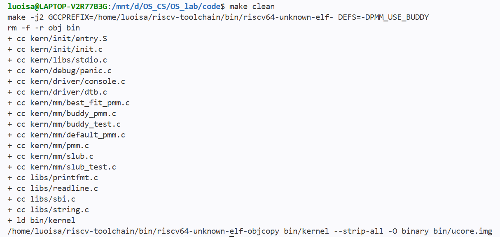


**命令二：启用 ucore_test 运行八组测试。** 重新清理后运行；`timeout` 限定 60 秒是因为测试成功后原内核会无限空转，需超时结束 QEMU：

```bash
make clean
timeout --signal=TERM 60s make GCCPREFIX=/home/luoisa/riscv-toolchain/bin/riscv64-unknown-elf- QEMU=/opt/qemu-4.1.1/bin/qemu-system-riscv64 DEFS=-DPMM_USE_BUDDY TEST_CONFIG=ucore_test test
```

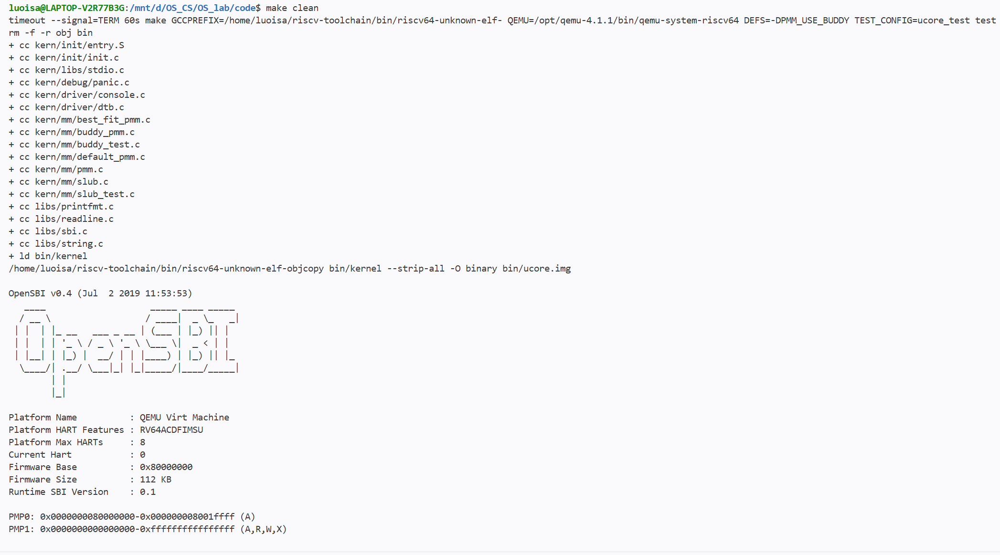


上述步骤的回复过长截图无法完整展示，所以将完整日志复制到了[Buddy 行为测试日志](logs/task3_tests_buddy_qemu.txt)，可以点击查看。

测试运行的关键输出提取如下：

```text
memory management: buddy_pmm_manager
[buddy_test] start, baseline free pages = 31503
[buddy_test] case1 (basic, rounding and real size boundaries): PASS
[buddy_test] case2 (all split remainders and true exhaustion): PASS
[buddy_test] case3 (six-level merge in three release orders): PASS
[buddy_test] case4 (non-buddies, occupied buddies and unregistered holes): PASS
[buddy_test] case5 (full requested-page data and interleaved reuse): PASS
[buddy_test] case6 (invalid, overflow, exhausted and fragmented failures): PASS
[buddy_test] case7 (irregular/multiple regions and max-order descriptors): PASS
[buddy_test] NOT COVERED: actual order-15 (32768-page) physical allocation; firmware/kernel reserve part of the 128 MiB RAM
[buddy_test] case8: seed=0x02410439, rounds=32, operations/round=128
[buddy_test] case8 (fixed-seed bitmap-oracle allocation/recovery): PASS
[buddy_test] 8/8 required groups passed (coverage exclusions listed above); baseline restored to 31503
check_alloc_page() succeeded!
```

八组测试后结构检查再次确认 31503 个空闲页、10 个块，表明隔离测试没有遗留影响后续服务的分配或管理状态。新的模拟描述符与测试静态存储使本轮自由区变为 `[0x804f1000,0x88000000)`，比第一阶段少 350 页；31503 与上一阶段的 31853 是不同内核镜像的真实基线，不是内存泄漏。两次 QEMU 包装命令分别在 60 秒和 30 秒后返回 124，原因是测试成功后原内核继续无限循环；通过判据是完整实际输出、正确管理器、全部必需组执行成功及无 panic/FAIL，不是超时码。

##### 迭代记录与覆盖限制

本轮为测试代码完善：编译前静态审查发现测试自身的高阶全局申请失败路径可能遗漏释放，已改为保留原始指针与 `n` 并统一清理；若返回畸形或保留区地址则打印诊断并停止，避免继续写入。随后实际构建、Buddy 运行及八组测试均通过，未发现可复现的分配算法缺陷。

**覆盖限制**：QEMU 模拟的 DRAM 总共 128 MiB，但这块内存并不全归分配器——OpenSBI 固件、内核镜像和页描述符数组已经占掉了其中一部分（本轮实际空闲 31503 页，约 123 MiB）。阶 15 的块恰好是 32768 页、正好一整块 128 MiB，分配成功的前提是存在一块完全连续且完全空闲的 128 MiB；保留区已经占掉了一部分，这样的块在真实内存里永远凑不出来，因此阶 15 的成功路径无法在真实内存上验证。本实现改用两步代替：用静态描述符模型验证阶 15 的登记、拆分与合并逻辑；在真实内存里申请阶 15，确认它正确地返回失败。所以不能声称真的分出过 128 MiB 整块并对其读写。其余限制：真实高阶 6..14 的成功分配只检查了全部页描述符及请求首尾页的数据，未逐字节扫描整个请求；随机部分只用一个固定种子跑了有限的 4096 步；并发、非法指针、重复释放、部分释放不在本接口契约内。上述通过是对列出场景的实验验证，不是对所有输入的形式化证明。

#### 4.2.4 Challenge：SLUB 内存对象分配算法

**负责人：2412084-刘芳希。**

##### 模块功能描述

**已实现的接口：**

```c
void slub_init(void);
void *slub_alloc(size_t size);
void slub_free(void *ptr);
void slub_check(void);  // 独立测试入口
```

以上接口是本组为简化实现设计的接口，并非框架已提供的函数。分配器实现在 [slub.c](../code/kern/mm/slub.c)、[slub.h](../code/kern/mm/slub.h)，独立测试实现在 [slub_test.c](../code/kern/mm/slub_test.c)、[slub_test.h](../code/kern/mm/slub_test.h)。在 `init.c` 中，`pmm_init()` 完成后调用 `slub_init()`；当前版本仅在定义 `ucore_test` 的测试构建中继续调用 `slub_check()`，普通构建只初始化分配器。

**功能说明：**

物理页分配器以整页为单位提供内存，一页为 4096 字节。当内核只需要几十或几百字节时，为每个对象单独申请整页会产生较多浪费。本任务在已有页分配接口上建立对象分配层，让多个小对象共享页面，并支持不同字节大小的请求。

本模块采用两层结构：底层通过 `alloc_pages()` 和 `free_pages()` 获取、归还物理页；上层按对象大小管理页面中的可用空间，向调用方提供可读写的内核虚拟地址。页描述符、物理地址与对象虚拟地址需要正确转换。SLUB 不替换当前 `pmm_manager`，而是使用它提供的页面服务。

**设计方案与功能约定：**

- 小对象按大小类别组织，优先复用已有 slab 的空位；只有容量不足时才向底层获取新页。页内管理信息与用户对象空间分开计算。
- 分配结果至少按 16 字节对齐，可读写范围不少于请求大小，存活对象之间不能重叠。
- 当前实现以 1024 字节为小对象上限，超过该值的请求进入大对象路径，按用户空间、管理头和对齐开销计算所需连续页数。大对象路径可能只需要一页，也可能需要多页；其管理头记录释放时需要的页数。
- 释放小对象后可复用其空间；slab 中仍有存活对象时保留页面，最后一个对象释放后归还整页。大对象释放时归还对应页范围。
- 零大小、大小运算溢出或资源不足返回 `NULL`；`slub_free(NULL)` 无副作用。非法指针和重复释放不属于有效接口输入。
- 本版本针对单核串行调用，不实现 Linux SLUB 的每 CPU 缓存、NUMA 或并发优化。接口、对齐及立即回收空页策略属于本组的简化设计选择。

##### 代码实现与设计要点

**1. 按大小类别组织对象，复用已有页分配接口。**

`slub_sizes[]` 定义了从 16 到 1024 字节的 20 个大小类别：

```text
16、32、48、64、80、96、112、128、160、192、
224、256、320、384、448、512、640、768、896、1024
```

`slub_cache_for(size)` 按从小到大的顺序选择第一个不小于请求大小的类别，例如申请 33 字节时使用 48 字节槽位。这样同一页中的对象具有相同槽位大小，便于计算位置和维护空闲链表；代价是请求大小与槽位大小之间可能存在内部碎片。每个 `slub_cache` 保存该类别的 `obj_size` 及其 slab 页链表 `slabs`。类别管理表使用静态数组，避免分配器为了建立自身账本而递归调用 `slub_alloc()`。

`slub_init()` 只设置各类别的槽位大小并初始化空链表，不提前申请物理页。实际需要新页时再调用 `alloc_page()` 或 `alloc_pages(n)`，回收时使用对应的页释放接口。因此 SLUB 不修改 `struct Page`、不切换 `pmm_manager`，可以建立在 First-Fit、Best-Fit 或 Buddy 提供的页服务之上。

**2. 管理头放在页首，用户空间与管理信息分开。**

每个小对象 slab 页的开头存放 `struct slub_slab`，其中 `magic` 标识小对象页或大对象页组，`link` 将小对象页挂入所属类别链表，`cache` 指向所属类别，`freelist` 指向页内第一个空闲槽位，`obj_count` 和 `free_count` 分别记录槽位总数和空闲数。大对象只在连续页组的首页保存一个管理头，并复用 `obj_count` 记录申请页数。

`slub_header_size()` 将结构体大小向上对齐到 16 字节，当前 RV64 布局下预留 64 字节。小对象页布局为：

```text
一页 4096 字节
| 管理头及对齐填充：64 字节 | 对象槽位 0 | 对象槽位 1 | …… | 不足一个槽位的余量 |
```

槽位容量按 `(PGSIZE - slub_header_size()) / cache->obj_size` 计算，向下取完整个数。例如 16 字节类别每页可放 `(4096 - 64) / 16 = 252` 个对象。由于页起点对齐、头部预留大小及全部槽位大小都是 16 的倍数，每个返回对象也满足至少 16 字节对齐。管理头会占用物理页空间，但不挤占承诺给调用者的请求字节数。

**3. 用内嵌空闲链表管理槽位，优先复用已有空间。**

这里有两种不同层次的链表：`cache->slabs` 管理同一类别的多个 slab 页，`slab->freelist` 管理某一页内的空闲对象。初始化新页时，`slub_slab_init()` 将每个空闲槽位开头的一个指针大小空间用作“下一个空闲对象地址”；RV64 中该指针占 8 字节，不需要额外为每个槽位分配链表节点。

```c
/* 将空闲槽位 obj 插入页内空闲链表头。 */
*(void **)obj = slab->freelist;
slab->freelist = obj;
```

小对象申请先遍历所属类别的页链表，寻找 `free_count > 0` 的页；只有找不到空位时才申请新页。选中页后，从 `freelist` 取出头节点，用该槽位中保存的下一指针更新链表头，再将 `free_count` 减一。对象交给调用者后，槽位开头原先保存指针的字节也属于用户可写空间；分配器不依赖存活对象中的旧链表指针，也不承诺自动清零对象内容。

**4. 区分页描述符、物理地址和虚拟地址，实现无大小参数释放。**

底层申请返回 `struct Page *`，它指向页描述符，不能直接当作对象内存。`page2kva()` 先通过 `page2pa()` 得到物理页地址，再加 `va_pa_offset` 转成内核可访问的虚拟地址。释放时，`slab_of(ptr)` 将对象地址通过 `PADDR()` 转成物理地址，向下按页对齐找到页首，再转换回管理头的虚拟地址。

调用者只需传回 `slub_alloc()` 返回的原始指针。小对象从头部的 `cache` 和计数信息确定所属页；大对象返回地址紧跟首页管理头，也可以通过同样方式找到页组首页。`magic` 决定采用小对象还是大对象释放路径，它只是类型标签，不是完整的指针合法性检查，不能据此保证支持内部偏移指针或重复释放。

**5. 小对象按槽位回收，全空页及时归还。**

`slub_free_small()` 将释放的槽位头插回页内空闲链表，并增加 `free_count`，后续申请可以直接复用。只有当 `free_count == obj_count` 时，才先从类别链表摘下该 slab，再通过 `pa2page()` 找到页描述符并归还整页。这个顺序确保类别链表不会保留已经交还底层的页，也避免其他存活对象仍在使用时过早回收页面。

大对象不加入小对象类别链表。`slub_free_large()` 根据首页保存的原始申请页数调用 `free_pages()`，使申请和释放的范围配对；底层若有自己的块取整规则，由底层负责处理。

**6. 大对象计入管理开销，并逐级检查整数溢出。**

超过 1024 字节的请求先将用户大小向上对齐到 16 字节，再加管理头，最后按 4096 字节向上取整，计算连续页数：

```text
total       = ROUNDUP(size, 16)
total_bytes = slub_header_size() + total
npages      = ROUNDUP(total_bytes, PGSIZE) / PGSIZE
```

例如申请 1025 字节，对齐后为 1040 字节，加头后为 1104 字节，只需一页；申请 4096 字节，加头后为 4160 字节，需要两页。因此不能把“大对象路径”等同于“必定占多页”。

在执行上述计算之前，代码分别检查 `size + 15`、`total + slub_header_size()`、`total_bytes + 4095` 是否可能超过 `size_t` 最大值。每次均先使用 `a > MAX - b` 判断，再执行相应加法，避免无符号溢出把巨大申请误算成小申请或零页。零大小、溢出或底层申请失败时返回 `NULL`；只有实际拿到页后才写入管理头。

**7. 简化范围与代价。**

当前实现串行使用，没有每 CPU 缓存、NUMA 支持或并发保护，也没有把部分空闲页与全满页分成独立链表。寻找可用 slab 需要扫描该类别的页链表，页内取出或归还一个槽位则是常数次指针操作。空页立即回收可以及时恢复底层可用内存，但反复申请、释放同一类别时可能重复建页。这些取舍用于突出实验中的两层分配结构，不等同于完整 Linux SLUB。

##### 实现提示词

````markdown

[PROMPT]

**任务：** 为当前 RISC-V ucore 实验二实现简化的 SLUB 内存对象分配模块。底层通过现有物理页分配接口获取内存，上层在页面中管理多个小对象，并支持不同字节大小的申请与释放，体现页级分配与对象级分配的两层结构。

**操作要求：** 在我明确要求执行时，新建 `code/kern/mm/slub.c` 和 `slub.h`，并在 `code/kern/init/init.c` 的物理内存初始化之后接入 `slub_init()`。仅在确有需要时调整构建文件。保留其他任务、现有页分配器和测试，不修改 `struct Page` 或切换 `pmm_manager`，不提交或推送 Git。本轮实现模块，测试由另一份提示词独立生成。

**输出要求：** 修改实际文件，说明大小类别、页内元数据、对象定位及空页回收策略；区分课程要求与简化设计。报告实际编译结果和未验证项，不虚构成功结论。

[RELY]

- 阅读 `code/kern/mm/pmm.h`、`memlayout.h`、`mmu.h`、`code/libs/defs.h` 和 `code/kern/init/init.c`，以真实代码为准。
- 现有接口：`struct Page *alloc_pages(size_t n)`、`void free_pages(struct Page *base, size_t n)`、`size_t nr_free_pages(void)`，以及 `page2pa()`、`pa2page()`、`PADDR()`。
- `PGSIZE` 为 4096；`va_pa_offset` 表示已建立的直接映射偏移。页分配返回的是描述符，不是可直接作为对象使用的内存地址。`KADDR` 当前不可用；访问页内存须正确转换为内核虚拟地址。
- 可使用已有 `list.h`、`string.h`、`assert`、`panic()` 和 `cprintf()`。没有可依赖的宿主 `malloc/free`，也不能递归调用尚在实现的对象分配器来分配自身元数据。

[GUARANTEE]

新增以下公开接口，内部辅助函数使用 `static`：

```c
void slub_init(void);
void *slub_alloc(size_t size);
void slub_free(void *ptr);
```

[SPECIFICATION]

**Pre-Condition：** 页分配器和地址映射已初始化。本简化版本按单核、串行调用使用，不要求实现每 CPU 缓存、NUMA 或并发分配。

**slub_init：** 在首次对象分配前调用一次，建立模块初始状态，不破坏底层空闲页管理；固定管理表可使用静态存储。

**slub_alloc：**

- 正常返回值为至少 16 字节对齐、可读写不少于 `size` 字节的内核虚拟地址；不同存活对象不能重叠，分配不会破坏已有对象内容，不承诺内存自动清零。
- 小对象按合理的大小类别管理，一页应能容纳多个对象；优先复用有空闲对象的已有 slab，容量不足时才获取新页。页内元数据、对齐与对象容量应一并计算，不得占用用户请求空间。
- 对超过单页 slab 有效对象容量的请求，使用连续多页分配作为简化的大对象路径，计入元数据和对齐开销，并记录释放所需信息。不能把“大于单页”一律当成不支持。
- `size == 0`、大小计算溢出或底层容量不足时返回 `NULL`；失败不能泄漏页面或破坏既有对象及管理状态。

**slub_free：**

- 接收尚未释放的、由 `slub_alloc()` 返回的原始指针，无需调用方提供大小；`slub_free(NULL)` 不产生副作用。
- 释放小对象后允许复用；slab 中仍有存活对象时，不得归还其页面。最后一个对象释放后将整页归还底层管理器。
- 大对象释放时归还原分配范围；全部对象释放后，底层空闲页数恢复到 `slub_init()` 后的基线。
- 非本模块指针、内部偏移指针和重复释放不属于有效接口输入，不要求安全支持；如提供检测，应解释其能力和限制。

**Requirements：** 不得将每个小对象都退化为整页分配；元数据初始化确定，所有地址、容量和对齐运算有效。若完整构建被其他未完成任务阻止，单独说明并区分本模块检查结果，不擅自补写其他任务。

````

##### 测试提示词

````markdown

[PROMPT]

**任务：** 根据第一份提示词的行为规格及实际生成的 SLUB 模块，设计独立测试，验证不同大小对象的分配、写入、释放、复用和底层页面回收。测试应检验约定行为，不能只重复实现逻辑或只检查返回值非空。

**操作要求：** 在我明确要求执行时，新建 `code/kern/mm/slub_test.c` 和 `slub_test.h`，在 `code/kern/init/init.c` 中于 `slub_init()` 之后接入测试；必要时作最小构建调整。只修改测试及接入位置，不修改 SLUB 实现、底层分配器或已有测试。若发现实现缺陷，报告可复现用例和证据，不降低断言来迁就错误，也不提交或推送 Git。

**输出要求：** 生成实际测试文件，解释各用例验证的行为和能够发现的错误，给出真实命令、结果及覆盖限制。QEMU 使用 4.1.1，通过运行参数指定本机路径，不写入他人的固定路径。编译器版本以实际检查为准；无法运行的测试明确标为未运行。

[RELY]

- 先阅读 `report/prompt_challenge2_slub.md` 和实际 `code/kern/mm/slub.c`、`slub.h`。若实现尚不存在，不猜造测试结果，说明需先完成实现。
- 被测接口：`slub_init()`、`slub_alloc(size_t)`、`slub_free(void *)`；底层观测接口为 `nr_free_pages()`。可使用现有断言、输出和字符串函数。
- 基本契约：至少 16 字节对齐、对象不重叠、零大小返回 `NULL`、空指针释放无副作用、空 slab 和大对象及时回收、不保证新对象自动清零。
- 测试辅助记录采用有明确容量的静态数组，避免使用被测分配器保存自己的必要记录。测试不依赖不可访问的 `static` 内部状态。

[GUARANTEE]

新增测试入口并在头文件声明，辅助用例使用 `static`：

```c
void slub_check(void);
```

[SPECIFICATION]

**Pre-Condition：** 物理页管理与 SLUB 已初始化，测试串行运行，不存在其他调用者持有的 SLUB 对象。记录开始时的空闲页基线，不重复初始化正在使用的分配器。

**Post-Condition：** 所有有效申请均被正确释放，空闲页数恢复基线；每个用例有明确检查和可定位的输出。只有实际完成全部断言后才能输出整体通过。

**Case 1：基本与大小边界。** 覆盖 0、1 字节、实际各大小类别边界前后，以及单页容量边界和多页申请；验证空指针行为、16 字节对齐，并读写请求范围首尾。大小类别应从实际实现确定，不能假定一套不存在的配置。

**Case 2：对象独立性。** 同时持有多个同类及混合大小对象，为每个对象写入不同模式，交错分配释放后核对仍存活对象的整个请求范围，检查返回区间不重叠及数据未被破坏。

**Case 3：页内复用与跨页扩展。** 连续分配多个小对象，用底层页数变化证明对象共享 slab，而非每对象占一页；分配到需要多个 slab，释放部分对象后再申请，检查空位复用不需要额外获取页面，不强求返回完全相同的地址或固定顺序。

**Case 4：回收。** 释放部分对象时检查同 slab 中剩余对象仍有效；释放全部对象后检查空闲页数恢复。大对象单独验证完整归还，并重复若干轮以暴露泄漏。

**Case 5：失败与恢复。** 超大、可能触发大小运算溢出的请求应返回 `NULL` 且页数不变；设计可控、有限的内存不足场景，验证失败不破坏已存活对象，清理后可以重新申请。压力测试必须有数量上限；若达到测试记录容量而非真实耗尽，应注明未覆盖耗尽，不能误报通过。

**Requirements：** 不将任意非法指针或重复释放作为必须通过的测试，因为它们不在接口契约内。每个用例应解释其目的、判定条件与覆盖限制；既有框架测试的通过不能替代这些 SLUB 测试。若其他未完成任务导致全项目无法构建，应单独报告阻塞，不声称 SLUB 运行通过。

````

##### 测试覆盖与有效性说明

测试实现在 `slub_test.c`，由 `slub_check()` 串行执行五组用例。测试开始先记录 `nr_free_pages()` 基线；使用静态记录表保存对象地址、请求大小、填充值和存活标记，避免测试账本本身占用被测分配器。各组通过公开分配、释放接口操作对象，不直接读取 SLUB 的内部链表；大小边界表根据当前实现的 20 个类别确定。

| 测试组与场景                       | 具体输入及操作过程                                                                                                                                                            | 通过条件与观察依据                                                                                          | 能够检验的设计及发现的问题                                                                                                           |
| ---------------------------------- | ----------------------------------------------------------------------------------------------------------------------------------------------------------------------------- | ----------------------------------------------------------------------------------------------------------- | ------------------------------------------------------------------------------------------------------------------------------------ |
| Case 1：零大小、最小申请与空指针   | 调用 `slub_alloc(0)`、`slub_free(NULL)`，并单独申请 1 字节；1 字节对象只对唯一字节写入并读回，避免首尾两个记号写到同一位置                                                    | 零大小返回 `NULL`；释放空指针前后页数不变；1 字节申请非空、地址按 16 字节对齐、数据读回一致，释放后恢复基线 | 验证公开接口对特殊输入的约定，发现零大小错误占页、空指针释放产生副作用、最小对象无法使用等错误                                       |
| Case 1：大小类别及大小对象路径边界 | 对 20 个实际类别逐一测试 `S-1、S、S+1`；其中 1024 与 1025 字节跨越小对象和大对象路径；另测试 2048、4096、8192、16384 字节                                                     | 每次有效申请均非空且至少 16 字节对齐；请求范围首尾写入不同记号后读回正确；释放后页数恢复                    | 可发现类别切换时容量不足、返回地址对齐错误，以及大对象遗漏管理头开销等问题；检查的是外部可用范围，并不直接证明内部一定选择了最小类别 |
| Case 2：存活对象不重叠及交错操作   | 同时保留 16、32、48、64、128、256、512、1024、2048、4096 字节对象；每次登记前检查与已有存活请求区间不重叠，再填充不同字节模式；释放奇数下标对象，重新申请同样大小并换用新模式 | 新对象与全部存活记录区间不相交；交错操作后，逐字节核对所有存活对象的整个请求范围，内容仍与各自模式一致      | 能发现同一空间被重复分配、对象范围重叠、元数据写入用户区，以及释放或重分配一个对象时破坏其他对象的问题                               |
| Case 3：页内容量与跨页扩展         | 先连续申请 16 字节对象，通过空闲页数第一次、第二次下降推测单页容量 `cap`，并释放探测对象；再申请 `cap` 个对象和第 `cap+1` 个对象                                              | 当前布局中 `cap=252`；正式申请前 `cap` 个对象时只消耗一页，再多一个时总共消耗两页                           | 页数变化能验证多个小对象确实共享页面，发现每对象独占一页、页内容量计算错误、满页后无法扩展等问题                                     |
| Case 3：释放槽位后的复用           | 在已跨到两页的状态下释放前五个对象，标记其记录失效，再申请五个同类对象                                                                                                        | 重新申请全部成功，且相对于释放后的状态不再减少底层空闲页数；不要求返回相同的地址或固定顺序                  | 检查页内空位能否重新进入分配流程，发现空闲链表未正确更新、明明有空位却继续申请新页等错误                                             |
| Case 4：部分释放与整页回收         | 用 16 字节对象填满一页并写入模式；先释放前半部分，再核对后半部分；随后释放剩余对象                                                                                            | 部分释放后仍占用一页，剩余对象每个字节均正确；全部释放后该页归还，页数回到操作前值                          | 同时检查“不能过早还页”和“全空后必须还页”，可发现存活对象失效、空页未归还或页数账本异常                                               |
| Case 4：大对象完整回收与重复使用   | 每轮同时申请 1025、2048、4096、16384 字节对象，填充并逐字节核对，再全部释放；重复八轮                                                                                         | 每轮申请和数据检查成功，释放后空闲页数均恢复到本轮开始值；用例结束恢复总基线                                | 覆盖大对象路径中的单页和多页请求，检查释放页数与原申请配对；多轮比较有助于发现累计泄漏和回收状态错误                                 |
| Case 5：超大请求与已有溢出输入     | 申请 0、`SIZE_MAX`、`SIZE_MAX-1`、`SIZE_MAX-15` 和 `1 << 40` 字节，比较操作前后空闲页数                                                                                       | 全部返回 `NULL`，页数不变；其中 `1 << 40` 在当前实验内存下无法满足                                          | 检验所列异常输入能否被拒绝且不消耗页面；可发现相关大小运算或失败状态处理错误，但不代表三道溢出检查均已被直接触发                     |
| Case 5：真实容量不足及已有对象保护 | 先保留三个 64 字节对象并写入不同模式；然后循环申请 65536 字节大对象，每次需向底层请求 17 页，最多尝试 4096 次，直到返回 `NULL`                                                | 失败尝试前后页数不变；三个原有对象的全部请求字节仍正确；日志明确报告实际失败时已成功申请的数量              | 检查底层容量不足能否传递为 `NULL`、失败是否泄漏页面或破坏已有对象；“耗尽”指无法满足当前连续页请求，不要求空闲页数为零                |
| Case 5：清理后的恢复               | 清理全部已登记大对象，重新申请并释放一个 64 字节对象，最后释放三个保留对象                                                                                                    | 再次申请成功；最终空闲页数恢复测试起点基线                                                                  | 验证压力测试后仍可正常服务及净页数恢复。恢复申请可能复用保留对象所在页，因此这一句单独不能证明重新获取了新的物理页                   |

**测试有效性的依据。** 这些用例同时观察地址、数据和资源数量，而不只判断返回指针非空：对齐和区间不重叠检查约束对象位置；首尾读写及完整范围的数据模式检查约束可用空间与对象独立性；分配、复用、部分释放和全部释放前后的页数变化约束页级资源管理。大小边界用例检查路径切换，交错操作检查状态变化，多轮回收检查累计误差，容量不足场景检查失败处理。几个观察角度相互补充，例如指针非空但容量不足可能被读写检查发现，数据暂时正确但页面未回收则可能被基线检查发现。

**执行与结果汇总。** `T_CHECK` 在条件不满足时打印函数、行号和具体原因，并跳转到该用例的失败清理位置；各组返回值由总入口汇总为 `PASS/FAIL`，五组均成功才输出 `ALL CASES PASSED`。测试构建入口及三种底层算法的已有回归记录见第 5.5 节；下面保留的是 First-Fit 联调阶段的历史输出，本次补充说明没有新增运行结果。

**实际覆盖限制。**

- 当前超大输入没有专门加入类似 `(size_t)-80` 的请求，因而尚未直接验证后来补入的“最终按页取整时加 4095”溢出保护分支；也未逐一枚举计入管理头后的每个整页临界点。已有通过结果不能替代这些边界的专门测试。
- 压力测试达到 4096 次上限而仍未分配失败时，当前代码只打印 `WARNING`，没有因此强制返回失败；判定是否覆盖真实容量不足必须核对耗尽输出，不能只看总 `PASS`。已有日志报告了实际耗尽数量。
- 部分异常路径中的新对象尚未登记，或仅保存在局部指针数组中，统一清理无法保证全部回收。因此不能把成功路径的基线恢复扩大为所有失败清理路径均已验证。
- 并发调用、非法指针、内部偏移指针及重复释放不在本次有效输入测试范围；同一配置下的有限用例通过，也不构成对所有输入的正确性证明。

##### 实现迭代过程

<!-- 暂留空，实际实现和检验后补充问题、原因、提示词调整及复测记录。 -->

##### 实际测试结果

2026-10-17，在 QEMU 4.1.1、OpenSBI v0.4、128 MiB RAM 和 `default_pmm_manager` 配置下运行。以下结果来自本次实际终端日志；当前构建暂时排除了未完成的 Best-Fit 模块。

```bash
cd /mnt/d/OS_CS/OS_lab/code
make QEMU="$QEMU411" qemu
```

其中 `QEMU411` 指向 `/home/user/os-lab/qemu-4.1.1/build/riscv64-softmmu/qemu-system-riscv64`。

```text
slub: 20 size classes (16..1024), header 64 bytes, large-object threshold 1024, free-page baseline 31878
[slub_test] start, baseline free pages = 31878
[slub_test] case1 (basic & size boundaries): PASS
[slub_test] case2 (object independence): PASS
[slub_test] case3 (in-page reuse & cross-page): PASS
[slub_test] case4 (reclaim): PASS
[slub_test] case5: exhaustion reached after 1875 big objects
[slub_test] case5 (failure & recovery): PASS
[slub_test] ALL CASES PASSED
```

五组测试均报告通过，涵盖本次测试代码中的大小边界、对象独立性、页内复用与跨页扩展、回收、失败恢复；日志显示压力测试在分配 1875 个大对象后实际达到耗尽。该数量取决于测试请求大小、管理开销及可用内存，不是分配器的固定容量。

---

### 4.3 分支任务：GDB 调试页表查询过程

**负责人： 2410826-马伊汀**

本任务通过调试 QEMU 源码观察访存与地址翻译，可以使用两个 GDB 分别控制 ucore 和 QEMU，也可结合针对特定访问地址的条件断点简化定位。

本次实验使用自编译的 QEMU 4.1.1 与 ucore lab2 内核，在 WSL2 Ubuntu 下以"三终端 + 双 GDB"的方式完成：x86 宿主 GDB 附加到 QEMU 进程观察其 C 源码执行，RISC-V GDB 通过 gdbstub 控制客户机内核。观测对象选定为 `entry.S` 末尾 `jr t0` 跳向 `kern_init` 的一次取指，虚拟地址 `0xffffffffc02000d8`。选择该地址的原因是：它是一次必然发生、且必须经过页表翻译的取指；相比之下，读取任意数据地址还需要额外确认该页是否已被 TLB 缓存。

| 需要说明的内容                               | 实际记录                                                                                                                                                                                                     |
| -------------------------------------------- | ------------------------------------------------------------------------------------------------------------------------------------------------------------------------------------------------------------ |
| 调试版 QEMU 的构建配置、路径及启动方式       | 自编译 QEMU 4.1.1，位于 `~/qemu-4.1.1`，configure 参数含 `--enable-debug`，二进制带 `debug_info`；Makefile 中 `QEMU` 已指向它，`make debug` 以 `-s -S` 启动，`make qemu` 正常运行。证据：图 4.3-01、4.3-02。 |
| 两个 GDB 的连接、附加及操作顺序              | 终端 1 `make debug`；终端 2 `sudo gdb -p <PID>` 附加后放行；终端 3 `make gdb` 连接 1234，先用 `hbreak` 装客户机断点，再回终端 2 装宿主断点；终端 3 发包时终端 2 必须处于运行态。证据：图 4.3-04、4.3-05。    |
| 选定访存指令、虚拟地址、访问类型及相关寄存器 | `entry.S` 末尾 `jr t0` 跳向 `kern_init` 的取指；VA `0xffffffffc02000d8`，`access_type=2`（取指），`mmu_idx=1`（S 模式），`satp=0x8000000000080207`。证据：图 4.3-07。                                        |
| QEMU 中的关键调用路径与分支判断              | `get_page_addr_code → tlb_fill → riscv_cpu_tlb_fill → get_physical_address`；`satp.MODE=0` 走 MBARE 直通，Sv39 进入三级遍历，PTE 的 R/W/X 非零即为叶子。                                                     |
| 页表翻译的单步过程、关键页表项及物理地址     | `i=0`、`idx=0x1ff`、`pte_addr=0x80207ff8`、`pte=0x200000cf`、`ppn=0x80000`；第 0 级 1 GiB 大页得 `0x80200000`，加偏移 `0xd8` 得 `0x802000d8`。证据：图 4.3-08～4.3-11。                                      |
| 模拟 TLB 查询的 C 代码位置及调试细节         | `cputlb.c:1030` 的 `tlb_hit`；首次 miss 落到 `:1031` 调 `tlb_fill`，再次命中直接落到 `:1039`。证据：图 4.3-13、4.3-14。                                                                                      |
| 开启和未开启虚拟地址空间时的路径比较         | `satp=0` 时在 `:196` 的 MBARE 分支直接返回；`satp=0x8000000000080207` 时进入 `:237` 遍历并读 PTE。证据：图 4.3-05、4.3-12。                                                                                  |
| QEMU 模拟 TLB 与真实 CPU TLB 的逻辑区别      | QEMU 是宿主内存中的软件数组，由 C 代码查表、软件遍历回填；真实 CPU 用片上 CAM 硬件并行比较并按策略替换。                                                                                                     |
| 有趣的调试现象及问题解决过程                 | PIE 工具链致启动失败；分页切换处断点须用物理地址，残留 `ebreak` 改用 `hbreak`；唯一一次翻译须先冻结 CPU；双 GDB 报文失步（`invalid hex digit 116`）。详见 4.3.5。                                            |
| AI 辅助解决问题的情景、思路与实际 prompt     | A 理解翻译源码，B 排查条件断点，C 定位双 GDB 报文错乱；均产出可复现规程并实测验证。详见 4.3.6。                                                                                                              |

#### 4.3.1 调试环境与双 GDB 的操作顺序
##### 4.3.1.1 调试版 QEMU

实验要求使用带调试信息的 QEMU，本次我们按指导书重新配置并编译了 QEMU 4.1.1（源码与构建目录均为 `~/qemu-4.1.1`）：

```bash
cd ~/qemu-4.1.1
make distclean
./configure --target-list=riscv32-softmmu,riscv64-softmmu --enable-debug
make -j$(nproc)
# 编译完成后不执行 sudo make install
```

编译产物仍在源码树的 `riscv64-softmmu/` 下，没有替换系统中原先安装的 QEMU；调试时通过完整路径使用它。随后核对：

```bash
file ~/qemu-4.1.1/riscv64-softmmu/qemu-system-riscv64
~/qemu-4.1.1/riscv64-softmmu/qemu-system-riscv64 --version
head -2 ~/qemu-4.1.1/config.log
```

实际输出表明该二进制为 `ELF 64-bit LSB pie executable, x86-64, ... with debug_info, not stripped`，版本为 `QEMU emulator version 4.1.1`，`config.log` 第二行给出的 configure 参数为 `--target-list=riscv32-softmmu,riscv64-softmmu --enable-debug`。

核对 QEMU 4.1.1 的 `configure` 可知这两个选项各自的作用：`debug_info` 默认即为 `yes`（`configure:303`），启用时向 `CFLAGS` 追加 `-g`（`configure:607-608`）；`--enable-debug` 打开的是 `debug_tcg`、`debug_mutex` 等调试开关（`configure:1114`），并且由于它把 `debug` 置为 `yes`，配置脚本不再向 `CFLAGS` 追加 `-O2`（`configure:5975-5992`）。重新配置后，本机 `config-host.mak` 中的实际值为 `CFLAGS=-g`，即 `-O0` 构建：QEMU 运行速度比优化构建慢，但源码级单步更贴近语句，局部变量（如 4.3.3.2 的 `pte_addr`）也能直接打印。实验使用的是构建目录中的 `riscv64-softmmu/qemu-system-riscv64`，`file` 已确认未 strip。按指导书修改 `OS_lab/code/Makefile` 第 12–14 行，把 `QEMU` 的默认值改为调试版路径：

```make
ifndef QEMU
QEMU := $(HOME)/qemu-4.1.1/riscv64-softmmu/qemu-system-riscv64
endif
```

`qemu`、`debug`、`test` 三个目标都使用该变量，因此后续直接执行 `make qemu` 或 `make debug` 即可。这里使用 `$(HOME)` 而不是写死 `/home/myt/...`，组内成员只要把 QEMU 源码放在自己的 `~/qemu-4.1.1` 下就无需再改；若 QEMU 装在别处，可在命令行用 `make QEMU=<调试版 qemu-system-riscv64 的完整路径> qemu` 覆盖。

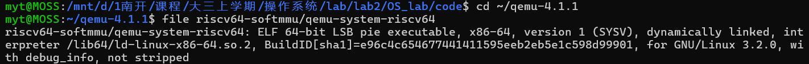

*图 4.3-01　`file` 输出确认二进制带 `debug_info` 且未被 strip。*

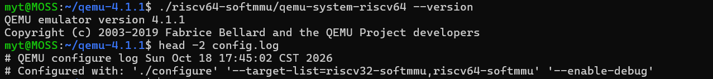

*图 4.3-02　QEMU 版本为 4.1.1，`config.log` 给出 configure 的目标列表与 `--enable-debug` 选项。*

内核侧的编译一律使用 Makefile 默认的 bare-metal 工具链，即直接执行 `make`。

在开始双 GDB 调试前，先用同一二进制以正常模式（不带 `-S`）运行一次，确认内核基线正常：

```bash
make qemu
```

串口输出依次出现 `(THU.CST) os is loading ...`、`check_alloc_page() succeeded!`、`satp physical address: 0x0000000080207000`，最后以 `[slub_test] ALL CASES PASSED` 结束。这说明内核已经完成物理内存初始化并正常开启 Sv39 分页，可以作为后续调试的对象。

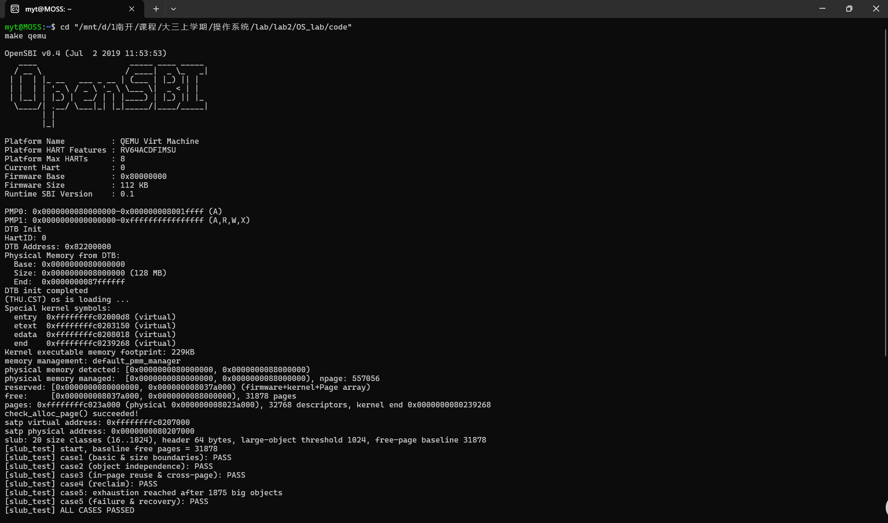

*图 4.3-03　正常模式下的完整启动输出，`check_alloc_page()` 通过且 satp 指向 `0x80207000`。*

##### 4.3.1.2 三个终端的角色

| 终端   | 启动命令                 | 调试对象           | 作用                                                             |
| ------ | ------------------------ | ------------------ | ---------------------------------------------------------------- |
| 终端 1 | `make debug`             | QEMU 进程          | 以 `-s -S` 启动：开启 gdbstub（端口 1234）并冻结 CPU             |
| 终端 2 | `sudo gdb -p <QEMU PID>` | QEMU 自身的 C 源码 | 附加到 QEMU 进程，可在 `cpu_helper.c`、`cputlb.c` 中下断点       |
| 终端 3 | `make gdb`               | ucore 客户机内核   | 通过 `target remote localhost:1234` 连接 gdbstub，控制客户机执行 |

两个 GDB 的调试对象不同：终端 2 看到的是 QEMU 的进程地址空间，终端 3 看到的是 RISC-V 客户机的寄存器和内存，二者通过 QEMU 的 gdbstub 与 ptrace 机制间接关联。

##### 4.3.1.3 实际操作顺序

**终端 1**：

```bash
cd "/mnt/d/1南开/课程/大三上学期/操作系统/lab/lab2/OS_lab/code"
make debug
```

执行后终端 1 不再输出、光标停住，这是 `-S` 冻结 CPU 的正常表现。

**终端 2**：

```bash
pgrep -af qemu-system-riscv64
sudo gdb -p <PID>
```

修改 Makefile 后，`make debug` 自身的命令行只有 `make debug`，因此 `pgrep -af qemu-system-riscv64` 只会列出一行：以调试版 QEMU 完整路径开头、参数含 `-s -S` 的 QEMU 进程。进入 GDB 后：

```gdb
handle SIGPIPE nostop noprint
handle SIGUSR1 nostop noprint pass
handle SIGUSR2 nostop noprint pass
continue
```

此时终端 2 也停住无输出——客户机还冻结在复位向量，等终端 3 放行。图 4.3-04 中还出现了随后为 4.3.3 设置的 `break get_physical_address`；连接阶段只执行上面的信号处理与 `continue`，宿主断点在客户机断点装好之后再设置。

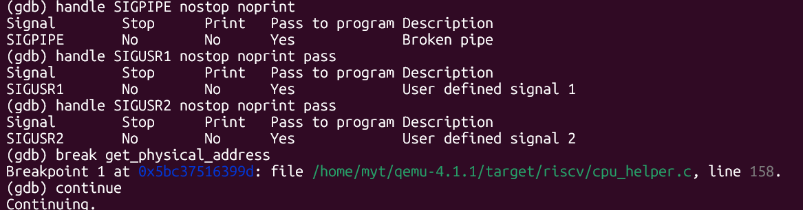

*图 4.3-04　终端 2 附加成功后设置信号处理（图中同时可见随后为 4.3.3 安装的 `get_physical_address` 断点），准备放行客户机。*

**终端 3**：

```bash
cd "/mnt/d/1南开/课程/大三上学期/操作系统/lab/lab2/OS_lab/code"
make gdb
```

```gdb
hbreak *0x80200000
hbreak *0x80200034
continue
```

这里使用 `hbreak`（硬件断点）而不是 `break`。QEMU 的 gdbstub 对 `break` 的处理是在客户机内存中写入 `ebreak` 指令；本实验要在 `csrw satp` 前后切换页表，软件断点一旦在切换后被删除，当前 PC 处可能残留 `ebreak`，再 `continue` 会反复触发 `SIGTRAP`。`hbreak` 由 QEMU 的翻译块断点表实现，不修改客户机内存，因而不受页表切换影响；实测中正是改用 `hbreak` 后三个停靠点才稳定复现。

第一条断点对应内核第一条指令的物理地址，第二条对应 `entry.S` 第 29 行 `csrw satp, t0` 的物理地址。这里不能写 `break kern_entry`：`kern_entry` 的链接地址是 `0xffffffffc0200000`，而 OpenSBI 跳入时 `satp=0`（Bare），CPU 的 PC 是物理地址 `0x80200000`，软件断点按当前 MMU 视角匹配地址，虚拟地址断点不会命中。

先装客户机断点、后装宿主断点，原因是终端 3 每次插入或删除断点，QEMU 内部都会依次调用 `gdb_breakpoint_insert` → `cpu_breakpoint_insert` → `breakpoint_invalidate` → `cpu_get_phys_page_attrs_debug` → `get_physical_address`；终端 3 读写客户机内存则走 `cpu_memory_rw_debug`，最终也进入同一个函数。如果终端 2 的宿主断点已经启用，QEMU 会在处理终端 3 请求的过程中被 ptrace 停住，回复报文发不出去，终端 3 超时后就会出现 RSP 报文错位。

放行后的观测顺序如下（终端 3；若终端 2 此时装有断点，必须先 `delete` + `continue`）：

1. `continue` 停在 `0x80200000`，`info registers pc satp` 确认 `pc=0x80200000`、`satp=0x0`；
2. `delete` 删掉两个断点，只重设 `hbreak *0x80200034`，`continue` 停在 `csrw satp` 之前，再次确认 `satp=0x0`；
3. 删掉这个物理断点（分页开启后它不再可寻址），改用虚拟地址 `hbreak *0xffffffffc02000d8`，`continue` 停在 `kern_init`，`info registers pc satp` 得到 `satp=0x8000000000080207`。

这三次停靠分别对应内核第一条指令（Bare）、开启分页的前一刻（Bare）、开启分页后的第一条指令（Sv39），可以直接对比 `pc` 与 `satp` 的取值。

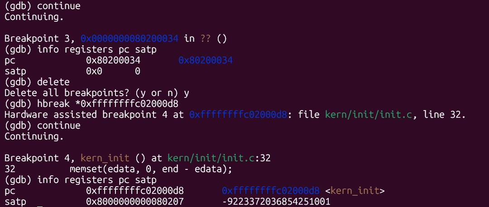

*图 4.3-05　`csrw satp` 之前 `satp=0`（Bare），之后 `satp=0x8000000000080207`（Sv39）。*

#### 4.3.2 观测对象与调用路径（表格第③④行）

##### 4.3.2.1 为什么选这一次取指

`entry.S` 在建立好 boot 页表后执行 `csrw satp, t0` 开启 Sv39，随后用 `sfence.vma` 清空旧 TLB 项，最后 `jr t0` 跳向 `kern_init`。由于 TLB 刚被清空，这次跳转的取指必然触发一次完整的页表遍历，是整个启动过程中最稳定、最容易复现的翻译事件。取指本身也是一次访存（`access_type=2`，`MMU_INST_FETCH`）；指导书的"思考"部分也建议选择内核 C 入口这种必然被访问的地址来设置条件断点，因此用它满足"某条访存指令的地址翻译"这一要求。数据 load/store 的 C 层 TLB 查询路径在 4.3.4.2 一并说明。

目标地址由内核符号表确定：

```bash
riscv64-unknown-elf-nm bin/kernel | grep -w kern_init
```

实测输出为：

```text
ffffffffc02000d8 T kern_init
```

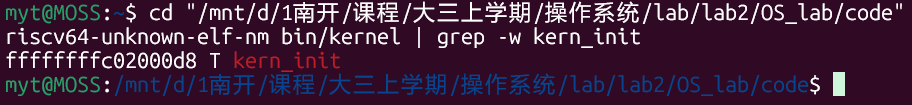

*图 4.3-06　符号表确认 `kern_init` 的链接地址。*

##### 4.3.2.2 关键调用路径

取指路径（`tb_gen_code` 需要为新的虚拟页生成翻译块时）：

```text
tb_gen_code()
  └─ get_page_addr_code()              accel/tcg/cputlb.c:1023
      ├─ tlb_index / tlb_entry         :1026
      ├─ tlb_hit() 命中 → 直接返回     :1030
      └─ 未命中
          ├─ VICTIM_TLB_HIT()          :1031
          └─ tlb_fill()                :1032（定义于 :868）
              └─ riscv_cpu_tlb_fill()  target/riscv/cpu_helper.c:435
                  └─ get_physical_address()   :451 调用，函数体自 :158 开始
                      ├─ M 模式直通               :165
                      ├─ satp.MODE=0 → MBARE 直通 :196
                      └─ Sv39 → for 循环          :237～334
                  └─ tlb_set_page_with_attrs()    cputlb.c:697（回填 TLB）
```

数据 load/store 的快路径与取指不同：TCG 在生成翻译块时就把 TLB 查询内联成宿主指令，命中时直接访存，不调用 C 函数；只有未命中时才进入 slow path，`load_helper` 在 `cputlb.c:1271` 再做一次 C 层 TLB 检查，然后调用同一个 `tlb_fill`。本实验观测的是取指，因此断点位置选在 `get_page_addr_code` 内是正确的。

##### 4.3.2.3 分支判断

`get_physical_address` 内部有三类分支：

| 条件                     | 位置               | 行为                                                 |
| ------------------------ | ------------------ | ---------------------------------------------------- |
| `mode == PRV_M` 且非取指 | `cpu_helper.c:165` | 物理地址等于虚拟地址，直接返回                       |
| `satp.MODE = 0`（Bare）  | `cpu_helper.c:196` | `*physical = addr`，不读页表                         |
| `satp.MODE = 8`（Sv39）  | `cpu_helper.c:190` | `levels=3`、`ptidxbits=9`、`ptesize=8`，进入三级循环 |

循环内部（`:237～334`）每级做四件事：用 `idx = (addr >> (PGSHIFT + ptshift)) & 0x1ff` 取出本级的 9 位索引；用 `pte_addr = base + idx * ptesize` 算出页表项物理地址；用 `ldq_phys` 物理读入 8 字节 PTE（避免递归翻译）；按标志位判断：`PTE_V=0` 返回失败，`R/W/X` 全 0 表示中间节点、把 `base` 更新为下一级页表并继续，否则是叶子，在 `:334` 按 `(ppn | (vpn & ((1L << ptshift) - 1))) << PGSHIFT` 拼出页对齐的物理地址。

#### 4.3.3 页表翻译的单步观测（表格第⑤行）

条件断点必须在客户机执行之前装好。原因见 4.3.5 现象三：`0xffffffffc02000d8` 作为真实取指地址只翻译一次，若先让 QEMU 跑起来再附加，必然错过。因此仍使用 `make debug`（`-S`）冻结 CPU。

终端 2 中执行：

```gdb
handle SIGPIPE nostop noprint
handle SIGUSR1 nostop noprint pass
handle SIGUSR2 nostop noprint pass
break get_physical_address if addr == 0xffffffffc02000d8
continue
```

终端 3 执行 `make gdb` 后，连上的第一行应为 `0x0000000000001000 in ?? ()`（复位向量，`satp=0`），确认后输入 `continue`。随后终端 3 停住，切回终端 2，条件断点命中：

```text
Thread 2 "qemu-system-ris" hit Breakpoint 1, get_physical_address (
    env=0x..., physical=0x..., prot=0x..., addr=18446744072637907160,
    access_type=2, mmu_idx=1)
    at /home/myt/qemu-4.1.1/target/riscv/cpu_helper.c:158
158	{
```

`18446744072637907160` 是 `0xffffffffc02000d8` 的十进制表示；`access_type=2` 对应 `MMU_INST_FETCH`，`mmu_idx=1` 对应 S 模式。断点落在函数体左花括号（`:158`），说明已经进入函数、尚未执行任何语句。本次为 `-O0` 构建，GDB 直接显示 `addr=...`、`access_type=2`、`mmu_idx=1`，没有 `@entry` 标记；线程号（本次为 `Thread 2`）以及 `env`、`physical`、`prot` 等宿主地址每次运行可能不同，不参与结论。

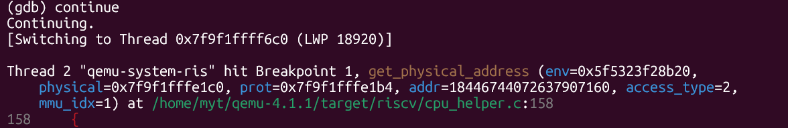

*图 4.3-07　条件断点首次命中，`addr`、`access_type`、`mmu_idx` 与预期一致。*

##### 4.3.3.1 函数入口

```gdb
print/x addr
print/x env->satp
print access_type
print mmu_idx
```

实测：

| 表达式        | 结果                 | 含义                        |
| ------------- | -------------------- | --------------------------- |
| `addr`        | `0xffffffffc02000d8` | `kern_init` 的虚拟地址      |
| `env->satp`   | `0x8000000000080207` | MODE=8（Sv39），PPN=0x80207 |
| `access_type` | `2`                  | `MMU_INST_FETCH`            |
| `mmu_idx`     | `1`                  | S 模式                      |

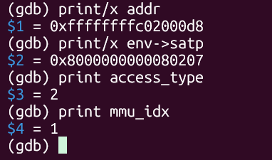

*图 4.3-08　函数入口处的虚拟地址与 satp。*

##### 4.3.3.2 进入遍历循环

本次 `--enable-debug` 构建为 `-O0`，`next` 不会因优化而跳进内联函数；但为了让截图聚焦关键行，我们采用"在关键行下断点再 `continue`"的方式。断在第 242 行（`pte_addr` 计算处）：

```gdb
delete 1
break cpu_helper.c:242
continue
print/x base
print i
print ptshift
print/x idx
print/x base + idx * 8
```

实测：

| 表达式         | 结果         | 含义                        |
| -------------- | ------------ | --------------------------- |
| `base`         | `0x80207000` | 页表基址 = `satp.PPN << 12` |
| `i`            | `0`          | 第 0 级（最高级）           |
| `ptshift`      | `18`         | 本级页内偏移 18 位          |
| `idx`          | `0x1ff`      | VPN[2] = 511                |
| `base + idx*8` | `0x80207ff8` | PTE 物理地址                |

`pte_addr` 在 `-O0` 下可以直接读取。断点停在第 242 行时赋值语句尚未执行，变量还没有值，因此先 `next` 让赋值完成，再打印：

```gdb
next
print/x pte_addr
```

实测 `next` 从 242 落到 244（`if (riscv_feature(env, RISCV_FEATURE_PMP) &&`，243 行为空行），`print/x pte_addr` 输出 `$10 = 0x80207ff8`，与 `base + idx * 8` 完全一致，说明 PTE 物理地址的计算正确。

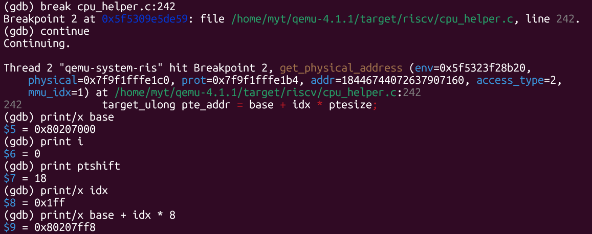

*图 4.3-09　第 0 级的索引、位移量与 PTE 地址。*

##### 4.3.3.3 读入 PTE

断在第 256 行（`PTE_V` 检查处）：

```gdb
break cpu_helper.c:256
continue
print/x pte
print/x ppn
print pte & 0xf
```

实测：

| 表达式      | 结果             | 含义                                 |
| ----------- | ---------------- | ------------------------------------ |
| `pte`       | `0x200000cf`     | PPN=0x80000，低 8 位 `0xcf`          |
| `ppn`       | `0x80000`        | 页表项中的物理页号                   |
| `pte & 0xf` | `15`（即 `0xf`） | V/R/W/X 全 1，A/D 也在 `0xcf` 中置位 |

这里 `print pte & 0xf` 默认按十进制显示为 `15`，并不表示异常；使用 `print/x` 才显示 `0xf`。`0xcf` 的低 8 位为 `1100 1111`，V、R、W、X、A、D 均为 1，说明这是一个有权限的叶子页表项。

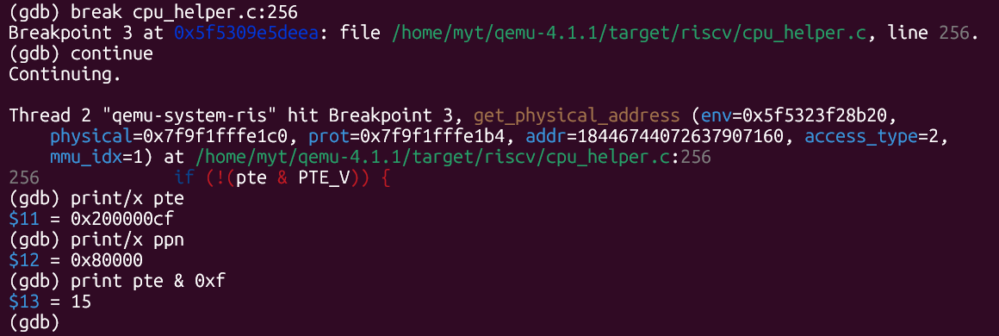

*图 4.3-10　PTE 内容与 PPN 字段。*

##### 4.3.3.4 拼出物理地址

断在第 334 行（`*physical` 赋值处），执行 `next` 越过赋值后再读：

```gdb
break cpu_helper.c:334
continue
next
print/x *physical
print/x addr & 0xfff
```

实测：

| 表达式         | 结果         | 含义                        |
| -------------- | ------------ | --------------------------- |
| `*physical`    | `0x80200000` | 页对齐的物理地址            |
| `addr & 0xfff` | `0xd8`       | 页内偏移，由 TLB 命中后相加 |

`*physical` 是页对齐的：`:334` 的表达式只保留 `ppn` 与页内高位，低 12 位为 0。页内偏移 `0xd8` 不参与页表遍历；TLB 以 4 KiB 页为粒度缓存映射，访问时把页内偏移加在页基址上。因此本次取指最终访问的物理地址为：

```text
0x80200000 + 0xd8 = 0x802000d8
```

核对虚实偏移：`0xffffffffc02000d8 − 0x802000d8 = 0xffffffff40000000`，与 `entry.S` 第 18 行设定的内核虚实映射偏移一致。

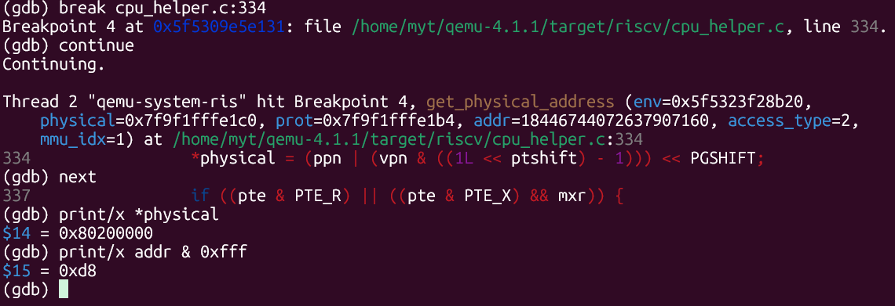

*图 4.3-11　页对齐物理地址与页内偏移。*

##### 4.3.3.5 对账

| 项目              | 值                                  |
| ----------------- | ----------------------------------- |
| 虚拟地址          | `0xffffffffc02000d8`                |
| VPN[2]（高 9 位） | `0x1ff` = 511                       |
| 页表基址          | `0x80207000`                        |
| PTE 地址          | `0x80207000 + 511 × 8 = 0x80207ff8` |
| PTE               | `0x200000cf`                        |
| PPN               | `0x80000`                           |
| 叶子级别          | `i=0`，1 GiB 大页                   |
| 页对齐物理地址    | `0x80200000`                        |
| 页内偏移          | `0xd8`                              |
| 最终物理地址      | `0x802000d8`                        |

循环在第 0 级就判定为叶子并返回，没有进入第 1、2 级。原因是 ucore 的 boot 页表使用 1 GiB 大页，最高级页表项本身就是带 `R/W/X` 的叶子；QEMU 在 `:334` 用 `ptshift` 把剩余位当作大页内偏移保留下来。需要注意，TLB 回填是按 `TARGET_PAGE_SIZE`（4 KiB）逐页进行的，不会因为映射是大页就一次缓存 1 GiB。

#### 4.3.4 TLB 查询与 Bare 对照（表格第⑥⑦⑧行）

##### 4.3.4.1 Bare 模式对照

分页开启前的内核入口地址是物理地址 `0x80200000`。重新启动后，终端 2 中：

```gdb
delete
break get_physical_address if addr == 0x80200000
break cpu_helper.c:242 if addr == 0x80200000
continue
```

终端 3 `make gdb` 后 `continue`。实测：

| 观测项                      | 结果          |
| --------------------------- | ------------- |
| `addr`                      | `0x80200000`  |
| `env->satp`                 | `0x0`         |
| `mmu_idx`                   | `1`（S 模式） |
| `access_type`               | `2`（取指）   |
| 是否命中 `cpu_helper.c:242` | 始终不命中    |

对照结论是：未开启分页时，QEMU 仍然调用同一个 `get_physical_address`，但 `satp.MODE=0` 命中 `case VM_1_10_MBARE`（`cpu_helper.c:196`），直接执行 `*physical = addr` 并返回，既不读 PTE，也不进入 `:237` 的循环；因此对循环内第 242 行设置的条件断点永远不会命中。开启分页后 `satp.MODE=8`，走 `VM_1_10_SV39` 分支并进入三级遍历。

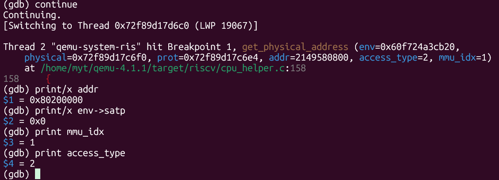

*图 4.3-12　Bare 阶段 `satp=0`、`addr=0x80200000`，随后不再命中循环内的断点。*

##### 4.3.4.2 TLB hit/miss 观测

必须重新启动一次 QEMU，因为要抓的是第一次访问 `kern_init` 所在页的时刻。终端 2 中：

```gdb
delete
break cputlb.c:1030 if (addr >> 12) == (0xffffffffc02000d8 >> 12)
continue
```

终端 3 重新 `make gdb`，确认第一行是 `0x0000000000001000 in ?? ()` 后再 `continue`。若第一行已经是 `kern_init ... while (1)`，说明客户机已经跑过、本轮作废，需要从终端 1 重启。

实测行为：

1. 第一次停在 `:1030`，执行 `next` 后落到 `:1031`（`if (!VICTIM_TLB_HIT(...))`），说明 `tlb_hit` 判定为未命中，即将调用 `tlb_fill` 进行页表遍历。
2. 再次 `continue`，仍停在 `:1030`，`next` 后直接落到 `:1039`（`if (unlikely(entry->addr_code & (TLB_RECHECK | TLB_MMIO)))`），跳过了整个 miss 分支，说明 TLB 命中。
3. 后续 `continue` 重复"停在 1030 → `next` → 1039"，同页取指持续命中。

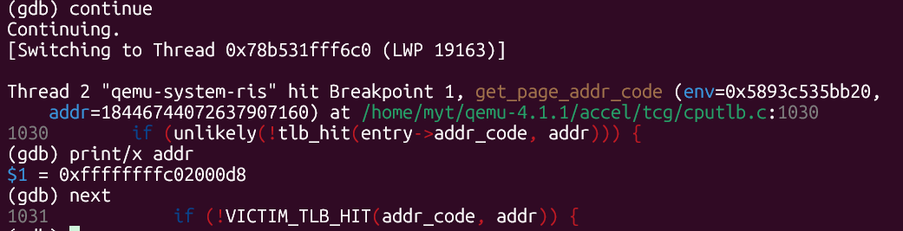

*图 4.3-13　首次查询未命中，`next` 落到 1031 行（victim TLB / `tlb_fill` 分支）。*

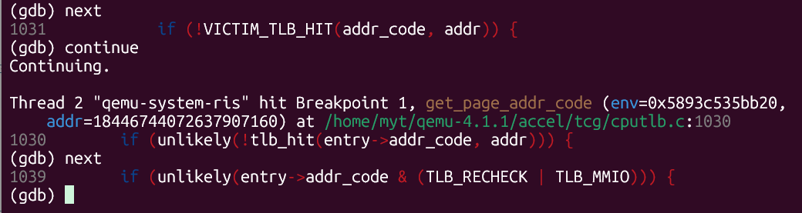

*图 4.3-14　后续查询命中，`next` 直接落到 1039 行（RECHECK/MMIO 检查）。*

需要说明的是：停在 `:1030` 时 `tlb_hit()` 尚未执行、`tlb_fill` 也尚未被调用，因此此时 `bt` 看不到 `tlb_fill → get_physical_address`。完整的 miss 调用链要在 4.3.3 的 `get_physical_address` 条件断点处观察，实测为 `get_physical_address ← riscv_cpu_tlb_fill ← tlb_fill ← get_page_addr_code`。

##### 4.3.4.3 QEMU 软件 TLB 与真实 CPU TLB 的对比

| 维度      | QEMU 软件 TLB                                                                                         | 真实 CPU TLB                  | 本次观测证据                        |
| --------- | ----------------------------------------------------------------------------------------------------- | ----------------------------- | ----------------------------------- |
| 存储位置  | 宿主进程内存中的 `CPUTLBEntry` 数组                                                                   | 处理器片上的相联存储器（CAM） | 断点可在 `cputlb.c` 的 C 代码中停下 |
| 查询方式  | 软件计算索引并比较地址标记                                                                            | 硬件并行比较全部条目          | `tlb_hit()` 是一条普通 C 语句       |
| 填充者    | 软件：`tlb_fill` → `riscv_cpu_tlb_fill` → `get_physical_address`，再由 `tlb_set_page_with_attrs` 回填 | 硬件页表遍历器                | miss 后 `next` 进入 1031/1032       |
| 命中结果  | 客户机地址 + `addend` → 宿主地址                                                                      | 物理页号 + 权限位             | 命中后直接跳至 1039，不再遍历页表   |
| 失效      | `sfence.vma` 最终调用软件清 TLB                                                                       | 同一条指令，由硬件完成        | 清空后首次取指触发唯一一次遍历      |
| 特有结构  | victim TLB（`cputlb.c:977`）                                                                          | 无此概念                      | `:1031` 的 `VICTIM_TLB_HIT`         |
| 替换策略  | 由 QEMU 的软件索引结构决定                                                                            | 硬件策略（如 LRU、随机）      | 无法在本次实验中观测到"替换"        |
| Bare 模式 | 仍走 TLB 查询流程，只是翻译函数直通返回                                                               | 一般完全旁路地址翻译          | 4.3.4.1 中 `:196` 直通              |

因此，QEMU 中的 "TLB" 是对硬件行为的软件模拟：它复现了"先查缓存、未命中再遍历页表、成功后回填"这一逻辑顺序，但其数据结构、查询开销、替换与失效机制都带有实现痕迹，观察它可以验证地址翻译的流程与页表内容。

#### 4.3.5 调试现象及问题解决过程（表格第⑨行）

##### 现象一：内核停在 OpenSBI 横幅，没有任何输出

**现象**：执行 `make GCCPREFIX=riscv64-linux-gnu-` 编译并运行后，串口输出停在 OpenSBI 横幅最后一行（`PMP1: 0x0000000000000000-0xffffffffffffffff (A,R,W,X)`），内核的 `(THU.CST) os is loading ...` 一行都不出现，QEMU 也不退出。

**定位**：用 `-d int,cpu_reset -D /tmp/qint.log` 打开异常日志，5 秒内出现约 420 万条 `riscv_raise_exception: 7`。RISC-V 异常号 7 是 store/AMO access fault，说明内核在启动最早期反复写一个非法物理地址，落入 OpenSBI 的异常处理循环。反汇编内核入口后看到：

```text
auipc t0,0x8
ld    t0,224(t0)     # 从 GOT 读到 0xffffffffc0208120（链接期虚拟地址）
sd    a0,0(t0)       # satp 仍为 0（Bare），写 0xffffffffc0208120 → 越界
```

**原因**：`riscv64-linux-gnu-gcc` 默认按 PIE 生成代码，`la` 被编译成 GOT 间接寻址；Makefile 期望的是 bare-metal 工具链 `riscv64-unknown-elf-gcc`，非 PIE 下 `la` 是 PC 相对寻址，Bare 阶段算出的就是物理地址。

**解决**：`make clean && make`，编译命令不再附加 `GCCPREFIX`。重新反汇编确认 `la` 变为 `auipc t0,0x8 ; mv t0,t0`，内核完整启动到 `[slub_test] ALL CASES PASSED`。

##### 现象二：分页开启前后的断点地址与单步陷阱

**现象**：`break kern_entry` 一次都不命中；在 `0x80200034`（`csrw satp, t0`）执行 `si` 后，PC 停在 `0x80200038`，机器再也走不动。

**原因**：`kern_entry` 的链接地址是虚拟地址 `0xffffffffc0200000`，而 OpenSBI 跳入时 `satp=0`、实际 PC 是物理地址 `0x80200000`，软件断点按当前 MMU 视角匹配地址，因此不会命中。`si` 的问题则与 QEMU 的翻译块有关：`csrw` 之后的几条指令原本与它同属一个 TB，依靠不重新取指才能执行；`si` 强制在 `0x80200038` 重新取指，QEMU 按新开的 Sv39 页表翻译该地址，而该物理地址在 Sv39 下没有映射，取指缺页后掉回 OpenSBI 异常循环。

**解决**：入口断点改用物理地址 `hbreak *0x80200000`；不要在 `csrw satp` 上 `si`，而是在 `0x80200034` 下 `hbreak` 观察 `satp=0`，删掉物理断点后用虚拟地址 `hbreak *0xffffffffc02000d8` 断 `kern_init`，再 `continue` 一步跨过 satp 切换。这里同样必须用 `hbreak`：用软件断点 `break *0x80200000` 并在命中后 `delete` 再 `continue`，当前 PC 处残留的 `ebreak` 会让 QEMU 反复停在同一地址（SIGTRAP 循环）；改用不写客户机内存的硬件断点后消失。

##### 现象三：条件断点一次都不命中

**现象**：先 `make qemu` 让内核跑起来，再附加终端 2 并设置 `break get_physical_address if addr == 0xffffffffc02000d8`，之后一次都不命中；改成无条件断点能命中，但 `addr` 多为 `0x0`、`0x1000`、`0x80200000`，调用栈显示来自 gdbstub。

**定位与原因**：用 `-d mmu` 打开 QEMU 的翻译日志后，`c02000d8` 在整个日志中只出现一组记录，即该地址作为真实取指地址只翻译了 1 次。QEMU 4.1.1 中，`write_satp()`（`target/riscv/csr.c:729`）只在 ASID 改变时调用 `tlb_flush()`；`csrw satp` 前后 ASID 都是 0，因此不清 TLB。真正清空 TLB 的是随后的 `sfence.vma`（`target/riscv/op_helper.c:144～155`），清空后第一次取指恰好是 `jr t0` 跳向 `kern_init`，这就是该地址唯一的一次 Sv39 翻译。`make qemu` 启动只需零点几秒，附加 GDB 时早已错过；而同页后续取指全部走 TLB 命中，不会再有第二次机会。

**解决**：用 `make debug`（`-s -S`）冻结 CPU，先装条件断点，再让终端 3 `continue` 放行。若条件中的形参不可读，可先设无条件断点再挂条件（本次 `--enable-debug` 的 `-O0` 构建未出现此问题）：

```gdb
break get_physical_address
condition 1 addr == 0xffffffffc02000d8
```

##### 现象四：两个 GDB 互相打断，终端 3 报 `invalid hex digit 116`

**现象**：终端 3 安装或修改客户机断点时反复出现：

```text
Ignoring packet error, continuing...
Reply contains invalid hex digit 116
Cannot insert breakpoint ...
```

`info break` 有时显示断点为空；终端 2 则同步命中 `get_physical_address`，调用栈分别为 `cpu_memory_rw_debug ← gdbstub` 和 `breakpoint_invalidate ← cpu_breakpoint_insert ← gdb_breakpoint_insert`。

**原因**：`116` 是 ASCII 字符 `'t'`（0x74），来自 GDB 解析 QEMU 停止应答 `T05thread:...` 时遇到的第一个非十六进制字符，并不是错误码。根因是两个 GDB 的工作方式冲突：终端 3 的 `m`/`M` 包（读写客户机内存）和 `Z0`/`z0` 包（插入/删除断点）都会在 QEMU 内部走 `cpu_memory_rw_debug` 或 `breakpoint_invalidate`，最终进入 `get_physical_address`，而这些调用发生在 gdbstub 回复 `OK` 之前；终端 2 的宿主断点一命中，ptrace 就把 QEMU 主循环线程停住，`put_packet` 无法完成。终端 3 的 `remotetimeout` 默认为 2 秒，超时后继续发送新包，终端 2 恢复后 QEMU 一次性清空积压，请求与应答错位，GDB 便把停止应答当成十六进制数据解析，于是报 `invalid hex digit 116`。

**解决**：建立并遵守操作不变式——终端 3 发送任何 RSP 报文时，终端 2 必须处于 `continue` 运行态；终端 2 停在提示符时不得操作终端 3。顺序上先在终端 3 装完全部客户机断点，再附加终端 2；宿主断点命中后立即 `delete` + `continue`。若仍需要长期观察翻译，宿主断点改打 `riscv_cpu_tlb_fill`，因为 gdbstub 的调试翻译路径不经过它。发生失步后，终端 2 `delete` + `continue`，终端 3 `disconnect` 后重新 `target remote :1234`，重设全部断点再继续。

##### 现象五：GDB 读一次客户机内存也会触发地址翻译

**现象**：终端 3 刚连上 gdbstub、安装软件断点时，终端 2 立即命中一次 `get_physical_address`，`addr` 为页对齐的客户机地址。

**原因**：终端 3 安装断点或读取代码时，QEMU 通过 `target_memory_rw_debug` → `cpu_memory_rw_debug` → `cpu_get_phys_page_attrs_debug` → `get_physical_address` 把客户机地址翻译成宿主地址，以便读写内存。这类翻译的 `access_type` 固定为 0（数据读），地址通常页对齐，且不经过 `riscv_cpu_tlb_fill`、不填充 TLB，因此可以与内核真实取指（`access_type=2`、非页对齐、必经 `tlb_fill`）区分开。判断时应先看调用栈，而不是只看断点是否命中。

#### 4.3.6 AI 辅助过程（表格第⑩行）

##### 提示词设计

实际使用中共写了三次提示词：A 用于静态理解源码，B 排查条件断点不命中，C 定位双 GDB 报文错乱。三次交互的共同经验是：`[RELY]` 里给足环境与行号、`[SPECIFICATION]` 里给足现象与自采证据，AI 的回答质量明显提高。

##### 提示词 A：理解 QEMU 地址翻译源码

用于静态分析阶段，目标是先建立源码级的调用路径，再用 GDB 逐项验证。提示词全文：

```text
[PROMPT]

**任务：** 帮助我理解 QEMU 4.1.1 源码中 RISC-V Sv39 虚拟地址到物理地址翻译的完整实现。
我正在进行操作系统课程实验的调试任务，需要先用源码分析建立理解，再用 GDB 验证。

**操作要求：** 只读分析我本地 ~/qemu-4.1.1 下的源码，不修改任何文件。
回答必须基于源码实际内容，标注文件路径和行号；不确定的地方明确说明，不要编造函数名。

**输出要求：** 按调用顺序给出从访存指令到页表遍历的完整调用路径，
指出每个关键分支判断的条件和含义，并解释软件 TLB 查询发生的位置。

[RELY]

- 源码根目录：~/qemu-4.1.1（QEMU 4.1.1 版本）
- 已定位的关键位置：
  - target/riscv/cpu_helper.c:155 get_physical_address()（页表遍历入口）
  - target/riscv/cpu_helper.c:237 三级页表遍历 for 循环
  - target/riscv/cpu_helper.c:435 riscv_cpu_tlb_fill()
  - accel/tcg/cputlb.c:1026-1033 tlb_index + tlb_hit（TLB 查询）
  - accel/tcg/cputlb.c:868 tlb_fill()
- 背景：ucore 内核在 entry.S 中设置 satp 为 Sv39 模式，
  用 1GiB 大页将虚拟地址 0xffffffffc0000000 映射到物理地址 0x80000000。

[GUARANTEE]

请交付：
1. 从访存到完成翻译的完整函数调用路径（含文件名和行号）
2. get_physical_address 中各分支的触发条件（Bare 直通、Sv39 遍历、失败路径）
3. for 循环每一级在做什么：索引如何计算、PTE 如何读取、如何判断叶子节点
4. TLB 查询与页表遍历的先后关系及代码证据

[SPECIFICATION]

**重点解释：**
- cpu_helper.c:184 如何从 satp 寄存器提取页表基址
- cpu_helper.c:237 开始的循环：变量 i、ptshift、idx、pte_addr、pte 在每一级的含义
- cpu_helper.c:256-262 的分支判断：PTE_V、PTE_R/W/X 各种组合分别导致什么结果
- 为什么 ucore 的映射在第一级就结束（大页叶子），不会走完三级
- cputlb.c 中 TLB 命中和未命中分别走什么路径
```

**回答要点与验证**：AI 给出两条调用路径（取指与数据），指出数据路径的快路径由 TCG 内联、未命中后的 C 层查询在 `cputlb.c:1271`，并预测第一次取指翻译会以 `idx=0x1ff`、`pte=0x200000cf`、`pa=0x80000000` 在第 0 级返回。它还纠正了我最初理解中"`cputlb.c:1026-1033` 是 TLB 查询本体"的笼统说法：该段属于取指路径，数据路径的位置不同。

后续 GDB 实测逐项验证了这些结论：`i=0`、`ptshift=18`、`idx=0x1ff`、`pte=0x200000cf`、`ppn=0x80000` 全部吻合；实测的页对齐物理地址为 `*physical=0x80200000`——AI 给出的 `0x80000000` 是该 1 GiB 大页的映射基址，实际取指地址位于大页内偏移 `0x02000000` 处，故物理地址为基址加偏移。唯一需要修正的是断点行号：`get_physical_address` 的声明在 `:155`，函数体左花括号在 `:158`，GDB 实际停在 `:158`。

##### 提示词 B：条件断点一次不命中

**情景**：先 `make qemu` 再附加 GDB 时，条件断点一次都不命中；改无条件断点能命中，但 `addr` 多为 `0x0`、`0x1000`、`0x80200000`，调用栈来自 gdbstub 的调试读写。

```text
[PROMPT]

**任务：** 分析我在用 GDB 调试 QEMU 4.1.1 地址翻译时遇到的异常现象，帮我定位原因并给出解决方案。

**操作要求：** 基于我提供的现象描述和代码位置分析，不修改任何文件。
如果信息不足以定位，列出需要我补充的观察项（比如某个变量的值、某处的输出）。

**输出要求：** 给出最可能的原因排序、验证每个原因的方法、对应的解决操作。

[RELY]

- 环境：WSL2 Ubuntu，QEMU 4.1.1（~/qemu-4.1.1/riscv64-softmmu/qemu-system-riscv64，带 debug_info）
- 调试方式：x86 宿主 gdb 用 `sudo gdb -p <PID>` attach 到 QEMU 进程，断点设在 target/riscv/cpu_helper.c 的 get_physical_address（函数体从第 158 行开始）
- 被调试系统：ucore lab2 内核，RISC-V Sv39，entry.S 第 29 行 `csrw satp, t0` 开启分页；内核链接虚拟地址 0xffffffffc0200000，物理装入地址 0x80200000
- 另有一个 riscv64-unknown-elf-gdb 通过 QEMU 的 gdbstub（`-s`，端口 1234）调试客户机内核

[GUARANTEE]

请交付：原因列表（按可能性排序）+ 每项的验证命令/操作 + 解决步骤。

[SPECIFICATION]

**我遇到的现象是：**

1. 先正常运行过一次内核，确认它能完整启动到 `[slub_test] ALL CASES PASSED`，串口输出里有 `satp virtual address: 0xffffffffc0207000`、`satp physical address: 0x0000000080207000`。
2. 想观察 `kern_init` 第一次被取指时的页表翻译。用
   `riscv64-unknown-elf-nm bin/kernel | grep -w kern_init`
   查到 `ffffffffc02000d8 T kern_init`。
3. 用 `make qemu` 启动 QEMU（**没有 -S**），等内核已经跑起来之后，用 `sudo gdb -p <QEMU PID>` attach，设置
   `break get_physical_address if addr == 0xffffffffc02000d8`
   然后 `continue`。结果是断点**一次都没有命中**，内核一直跑到结束。
4. 把条件去掉，改成无条件的 `break get_physical_address` 后能命中，但 `print/x addr` 大多是 `0x0`、`0x1000`、`0x80200000` 这类地址，调用栈是：
   `get_physical_address ← riscv_cpu_get_phys_page_debug ← cpu_get_phys_page_attrs_debug ← cpu_memory_rw_debug ← gdbstub`
   看起来是另一个 gdb 读写客户机内存触发的翻译，不是内核取指。
5. 在 riscv 那个 gdb 里改用 `break *0xffffffffc02000d8` 直接断虚拟地址，同样不命中。
6. 反而在命中时 `print/x env->satp` 的值是 `0x8000000000080207`，说明 Sv39 确实已经开启、地址也确实在走页表翻译。

**我已经做过的尝试：**

- 用 `nm` 反复确认 `kern_init` 就是 `0xffffffffc02000d8`，地址没有写错。
- 确认 `access_type`、`mmu_idx` 等参数在命中时是正常值（`access_type=2` 取指、`mmu_idx=1` S 模式），说明断点本身工作正常。
- 试过在 QEMU 启动后尽可能早地 attach，但 QEMU 从启动到跑完内核只要零点几秒，等 attach 上去时内核已经执行完了。
- 试过 `break kern_entry`，不命中；后来意识到内核入口在物理地址 0x80200000。
- 没有修改任何 QEMU 源码或内核源码。

**我想知道：** 为什么这个条件断点一次都不命中？`0xffffffffc02000d8` 这个地址的翻译在内核生命周期里到底会发生几次？在不能修改 QEMU 源码、只能用 gdb 的前提下，怎样才能可靠地在**第一次翻译发生之前**把断点装好？
```

**回答要点与采纳**：AI 首先用 `-d mmu` 日志实证了关键事实——`0xffffffffc02000d8` 作为真实取指地址只出现一组翻译记录（入口与结果各一条），在内核生命周期里只翻译 **1 次**。它给出的原因排序是：① `make qemu` 未加 `-S`，attach 和装载符号都晚于这次翻译；② TLB 按 4 KiB 页填充，`kern_init` 与 `kern_entry` 同页，首次翻译后同页取指全部命中；③ 客户机 gdb 的 `break *0xffffffffc02000d8` 同样装得太晚；④ 条件中的形参不可读（本次已被"无条件断点能打印参数"排除）；⑤ attach 到错误 PID（已用 `pgrep` 排除）。

AI 还解释了"第一次 Sv39 翻译为什么恰好是 `0xd8`"：`write_satp()`（`csr.c:729`）只在 ASID 改变时调用 `tlb_flush()`（`csr.c:746-749`），`csrw satp` 前后 ASID 都是 0，因此不清 TLB；真正清空 TLB 的是 `sfence.vma`（`op_helper.c:144-155`），清空后的第一次取指就是 `jr t0` 跳向 `kern_init`。

据此采用它的方案一：`make debug`（`-S`）冻结 QEMU → 客户机 gdb 先 `hbreak *0x80200000` 停在物理入口 → 宿主 gdb 设置 `break get_physical_address` 并挂条件 → 双 `continue`。方案二（先断 `write_satp` 作为同步点）和方案三（用 `breakpoint_invalidate` 触发的调试翻译验证条件本身）作为备选保留在实验记录中。实测按方案一命中，首次命中的 `addr`、`access_type=2`、`mmu_idx=1`、`i=0`、`ptshift=18`、`idx=0x1ff`、`pte=0x200000cf` 与 AI 给出的预期值全部一致。

##### 提示词 C：双 GDB 报文错乱

**情景**：双 GDB 三终端调试中，终端 3 装/改客户机断点反复报 `Ignoring packet error`、`Reply contains invalid hex digit 116`、`Cannot insert breakpoint`，断点时有时无；终端 2 同步抓到两条调试翻译调用栈。

```text
[PROMPT]

**任务：** 分析我在用两个 GDB 同时调试 QEMU 4.1.1 时遇到的报文错乱问题，帮我定位原因并给出可靠的操作顺序。

**操作要求：** 基于我提供的现象描述和代码位置分析，不修改任何文件。
如果信息不足以定位，列出需要我补充的观察项（比如某个变量的值、某处的输出）。

**输出要求：** 给出最可能的原因排序、验证每个原因的方法、对应的解决操作。

[RELY]

- 环境：WSL2 Ubuntu，QEMU 4.1.1（~/qemu-4.1.1/riscv64-softmmu/qemu-system-riscv64，带 debug_info）
- 被调试系统：ucore lab2 内核，RISC-V Sv39，内核入口物理地址 0x80200000，kern_init 虚拟地址 0xffffffffc02000d8，entry.S 第 29 行 csrw satp 开启分页
- 终端 1：`make debug`，即 QEMU 带 `-s -S`，gdbstub 监听 1234，启动时 CPU 冻结
- 终端 2：x86 宿主 gdb 用 `sudo gdb -p <QEMU PID>` attach 到 QEMU 进程，断点设在 target/riscv/cpu_helper.c 的 get_physical_address（函数体从第 158 行开始）
- 终端 3：riscv64-unknown-elf-gdb 用 `target remote localhost:1234` 连 gdbstub，调试客户机内核

[GUARANTEE]

请交付：原因列表（按可能性排序）+ 每项的验证命令/操作 + 解决步骤。

[SPECIFICATION]

**我遇到的现象是：**

1. 终端 1 起 QEMU（`-s -S`，CPU 冻结）。终端 2 attach 后执行
   `break get_physical_address`
   `continue`
   没有输出、光标卡住，这是预期的。
2. 终端 3 执行 `make gdb`，再输入
   `break *0x80200000`
   此时终端 3 报：
   Ignoring packet error, continuing...
   Reply contains invalid hex digit 116
   接着 `info break` 显示没有任何断点，说明这条断点根本没装上。
3. 重试 `break *0x80200000`，这次显示 `Breakpoint 1 at 0x80200000`，但 `continue` 时又报：
   Warning:
   Cannot insert breakpoint 1.
   Cannot access memory at address 0x80200000
4. 这时切到终端 2，发现它命中了 `get_physical_address`，调用栈是：
   get_physical_address
   ← riscv_cpu_get_phys_page_debug
   ← cpu_get_phys_page_attrs_debug
   ← cpu_memory_rw_debug
   ← target_memory_rw_debug
   ← gdbstub
   addr = 0x80200000, len = 64, is_write = false
   也就是终端 3 的 gdb 读客户机内存触发了终端 2 的断点。
5. 在终端 2 里 `bt`、`delete`、`continue` 之后再回终端 3 `continue`，有时能恢复；
   但终端 3 一旦要再装一个断点（例如 `break *0x80200034`），
   又会报同样的 `Reply contains invalid hex digit 116` + `Cannot insert breakpoint 2`。
6. 再看终端 2，这次的调用栈变成了：
   get_physical_address
   ← riscv_cpu_get_phys_page_debug
   ← cpu_get_phys_page_attrs_debug
   ← breakpoint_invalidate
   ← cpu_breakpoint_insert
   ← gdb_breakpoint_insert
   addr = 0x80200034
   说明终端 3 装断点这个动作本身又触发了终端 2 的断点。
7. 终端 3 有时还会出现：
   Program received signal SIGINT, Interrupt.
   0x0000000080200000 in ?? ()
   我没有主动给内核发信号，只是按过 Ctrl+C。

**我已经做过的尝试：**

- 单独只用终端 3（不 attach 终端 2）跑同样的 `break *0x80200000`、`continue`，
  完全正常：断点能装上，内核停在内核第一条指令，`pc=0x80200000`、`satp=0`。
  所以不是 QEMU 或内核本身的问题。
- 单独只用终端 2 调试 QEMU 也正常，能命中 `get_physical_address`。
- 试过在终端 3 装断点之前，先在终端 2 里 `delete` 并 `continue`；
  这样能成功一次，但后面终端 3 再装新断点时又复现。
- 试过先让终端 3 装完所有断点，再 attach 终端 2 装断点，能走通一段，
  但流程一改顺序又出问题。
- 试过在终端 3 里 `delete` 后重新 `break`，有时成功、有时仍报 `invalid hex digit 116`。
- 用 `info registers pc` 确认 gdbstub 连接本身是活的（能读到 `pc=0x1000`）。
- 用 `pgrep` 确认只有一个 QEMU 进程、1234 端口只有一个 gdbstub 客户端。
- 没有修改任何 QEMU 源码或内核源码。

**我想知道：**

- 为什么终端 2 的断点会让终端 3 的 gdbstub 报文变成 `Reply contains invalid hex digit 116`？116 对应什么？
- `cpu_memory_rw_debug` 和 `breakpoint_invalidate` 这两条路径分别在什么时机调用 `get_physical_address`，
  为什么它们都算"调试操作"而不是客户机执行？
- 两个 gdb 同时工作时，QEMU 的 vCPU 线程、gdbstub 和 ptrace 之间是什么关系？
  一个 gdb 停住进程时，另一个 gdb 的请求会发生什么？
- 有没有一种确定的操作顺序/规则，能保证终端 3 装断点时终端 2 不会把 QEMU 停住？
  （前提：两个断点都要用，且不能改 QEMU 源码）
```

**采纳与验证**：AI 定位出完整根因链，并逐条给出了代码证据：

1. `116` 就是 ASCII 字符 `'t'`（0x74）。GDB 的 `fromhex()` 解析停止应答 `T05thread:...` 时把 `t` 当成十六进制数，于是报 `invalid hex digit 116`——它是报文错位的症状，不是 QEMU 的错误码（GDB bugzilla remote/1695）。
2. 根因是宿主断点打在了 gdbstub 的同步调用链上。终端 3 的 `m/M` 读内存包走 `target_memory_rw_debug → cpu_memory_rw_debug`，`Z0/z0` 装卸断点包走 `gdb_breakpoint_insert → cpu_breakpoint_insert → breakpoint_invalidate`，两条路径都会调用 `get_physical_address`。终端 2 的断点一命中，ptrace 的 all-stop 就停住 QEMU 主循环线程，`put_packet()` 发不出去，终端 3 在默认 2 秒 `remotetimeout` 后放弃，请求与应答从此错位。
3. 断点"凭空消失"是因为 GDB 重连时发 `?`，QEMU 的 gdbstub 会执行 `gdb_breakpoint_remove_all()`（`gdbstub.c:2360`）清掉全部客户机断点。
4. 可操作的规避方式（本次采纳）：宿主断点改打 `riscv_cpu_tlb_fill`（gdbstub 的调试翻译走 `riscv_cpu_get_phys_page_debug`，不经过它）；或保留 `get_physical_address` 但把条件收紧到 `access_type == 2`；`set remotetimeout 60` 留足余量；一旦失步，终端 3 要 `disconnect` 重连并重设全部断点，不能只补发单条断点。

据此建立"终端 3 发包时终端 2 必须处于 `continue` 运行态"的不变式，并在本次实验中按该规程操作，报文错乱未再复现。

##### 迭代与收获


这些交互说明了 AI 辅助的边界：AI 的静态分析能给出准确的源码路径和行号，但没有运行 QEMU/GDB，结论必须通过实测验收。本次实验中，AI 预测的 `idx`、`pte`、`ppn` 等值全部吻合；而 `get_physical_address` 的断点行号、断在 `cputlb.c:1030` 时看不到 `tlb_fill` 等细节，则是在 GDB 中实测后才修正的。把 AI 回答当作"待验证的假设"，而不是"结论"，是本次调试中最重要的使用原则。

#### 4.3.7 小结

本次任务从源码静态分析出发，用双 GDB 完成了对一次真实地址翻译的完整观测：在 `satp.MODE=0` 时，`get_physical_address` 走 MBARE 直通、不读页表；在 `satp.MODE=8` 时，QEMU 走 Sv39 分支，在 `i=0` 读到 PTE `0x200000cf`，以 1 GiB 大页得到页对齐物理地址 `0x80200000`，加上页内偏移 `0xd8` 后访问 `0x802000d8`。TLB 观测则验证了"先查缓存、未命中再遍历页表、成功后回填"的顺序，以及 QEMU 软件 TLB 与真实 CPU TLB 在实现层面的差异。

调试过程中遇到的工具链 PIE、分页切换时的断点地址、条件断点的唯一翻译时机、双 GDB 报文错乱等问题，均通过"观察现象—提出假设—用日志与 GDB 验证—修正操作"的过程解决，其中三次 AI 交互对定位根因起到了实质作用，但每一条结论都经过了实测确认。


---

## 五、测试与验证

本节在代码完全完成之后统一组织测试。测试环境为：WSL2 Ubuntu、`riscv64-unknown-elf-gcc`（SiFive GCC 10.1.0）编译、`qemu-system-riscv64` 4.1.1、OpenSBI v0.4、128 MiB RAM（设备树 `Base 0x80000000`、`Size 0x8000000`、`End 0x87ffffff`）。

**测试构建组织。** 自研测试（SLUB 行为测试 `slub_test()`、Buddy 八组行为测试 `buddy_test()` 及其测试专用状态与竞技场钩子）经框架既有的 `ucore_test` 编译开关与生产构建分离：普通 `make qemu` 下相关编译单元被预处理器整体剔除，测试代码零编入，启动仅保留框架 `basic_check`/`best_fit_check` 与 Buddy 结构自检（快速回归保障）；`make test`（`-D ucore_test`）下全部测试编译并运行。该分离沿用框架对 `best_fit_check` 扩展段的原有挂接机制，Makefile 无任何改动。后续实验可在无测试开销的生产内核上继续开发，需要回归时以 `make test` 一键运行全部测试（Buddy 配置加 `DEFS=-DPMM_USE_BUDDY`；First-Fit 配置加 `DEFS=-PMM_USE_FIRST_FIT`，此时 Buddy 测试因宏未定义而不参与编译）。两点复现注意：其一，`make` 只按时间戳判断是否重编、不跟踪编译参数（`DEFS`、`-D ucore_test`）的变化，因此普通/测试构建之间及 Best-Fit / First-Fit / Buddy 三配置之间切换必须先 `make clean`，本节以 `make test` 运行的命令块均已内嵌 `make clean`；其二，测试分离后普通构建内核不再含测试代码与测试静态数组，空闲页基线较测试构建多 51 页（Best-Fit 普通构建 31929 页、测试构建 31878 页），本节历史日志中的基线值均为测试构建或改造前构建的记录。

**总体测试情况**：模块一通过；模块二任务一、任务二通过；Buddy 所列场景通过（阶 15 真实整块物理分配未覆盖）；SLUB 三配置回归通过；地址翻译调试已完成。

### 5.1 模块一任务一：物理内存探测与页描述符初始化

**测试目标：** 验证 `page_init()` 在设备树报告内存后正确设置 `va_pa_offset`、`npage`、`pages`，区分虚拟地址、物理地址、页号与描述符；将页对齐的 `Page` 数组布置在内核 `end` 之后，保留 OpenSBI、内核镜像与描述符数组占用的页面，并把排除后的完整空闲页交给当前管理器；`page2pa`/`pa2page` 往返一致。对应框架 `test_page_init()`（`code/tools/test_lab2.c`）的 8 项检查。

**测试方法：** 在 QEMU 4.1.1、128 MiB RAM 下执行 `make test` 与 `make grade`，由框架 `test_page_init()` 逐项检查：`va_pa_offset == PHYSICAL_MEMORY_OFFSET`；设备树内存范围有效；`npage == PPN(mem_end)` 且大于 `nbase`；`pages` 非空、页对齐且位于内核 `end` 之后；空闲页数落在 `(0, npage-nbase]` 内；内核尾页与描述符数组所在页保持保留；`pa2page(page2pa(q)) == q`。

**步骤①：清理并重新构建（默认 Best-Fit 配置）。**

```bash
cd /mnt/d/OS_CS/OS_lab/code
PREFIX=/home/luoisa/riscv-toolchain/bin/riscv64-unknown-elf-
make clean && make -j2 GCCPREFIX=$PREFIX
```

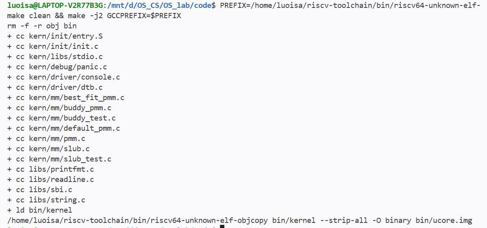

**步骤②：运行框架测试。**

```bash
QEMU_BIN=$HOME/qemu-4.1.1/riscv64-softmmu/qemu-system-riscv64
make clean && timeout --signal=TERM 90s make -j2 GCCPREFIX=$PREFIX QEMU=$QEMU_BIN test
```

完整日志见 [task2_best_fit_qemu.txt](logs/task2_best_fit_qemu.txt)（Buddy 代码加入后的默认配置复查见 [task3_best_fit_qemu.txt](logs/task3_best_fit_qemu.txt)）。本次构建与运行同时作为 5.3 步骤①②的同一份证据。

**实测结果：** 设备树报告内存 `[0x80000000, 0x88000000)`（128 MB）；`npage = 557056`，描述符共 32768 个，`pages` 位于内核 `end` 之后且页对齐。Best-Fit 配置保留区为 `[0x0000000080000000, 0x000000008037a000)`、空闲区为 `[0x000000008037a000, 0x88000000)` 共 31878 页（见 [task2_best_fit_qemu.txt](logs/task2_best_fit_qemu.txt)、[task3_best_fit_qemu.txt](logs/task3_best_fit_qemu.txt)）。框架评分输出 `check page init: OK`（见 [task2_best_fit_grade.txt](logs/task2_best_fit_grade.txt)）。4.1.1 记录的第一次迭代曾把保留区起点误打印为 `0xffffffff80000000`，经可变参数类型修正后复测为 `0x0000000080000000`，空闲起点与 31878 页不变。

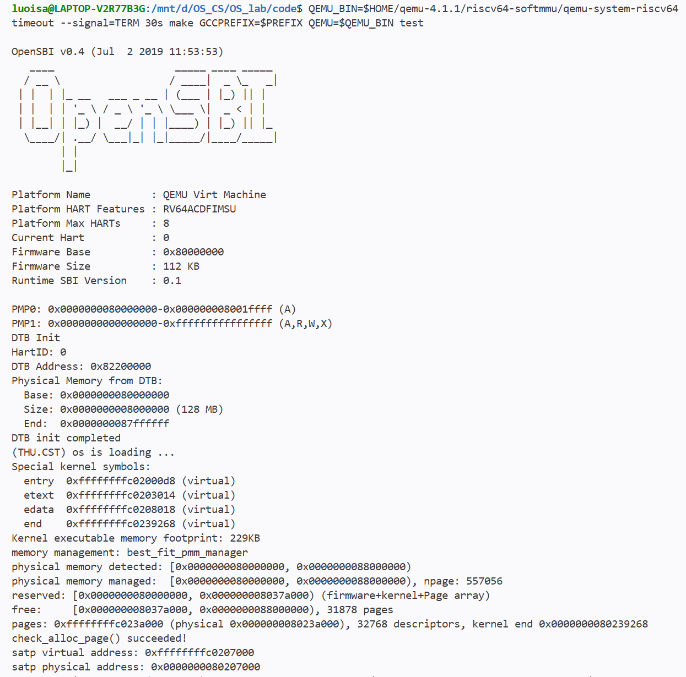


**结论。** 正常内存配置下通过，Test 1 的 8 项性质均有实际运行证据。

### 5.2 模块二任务一：First-Fit 连续物理内存分配

First-Fit 为框架原有实现，本组未改动其代码、未新增独立测试文件，也未单独留存运行日志或截图，故本任务不单独执行测试命令：其源码包含在 5.1/5.3 的完整构建流程中，作为当前管理器运行的历史证据来自 4.2.4 在 `default_pmm_manager` 配置下与 SLUB 的联调运行（SLUB 五组均 PASS、空闲基线 31878 页）。

### 5.3 模块二任务二：Best-Fit 连续物理内存分配

**测试目标。** 验证 `best_fit_pmm_manager`：选择最小的合适空闲块、同大小候选取低地址、选中较大块后拆分余块、释放时与前驱/后继双向合并、碎片导致失败时状态不变、多段乱序 `init_memmap` 合并；并确认原 `basic_check()`/`best_fit_check()` 未被改动。

**测试方法（与前文一致，此处只是再次说明一遍）：**
- 干净构建：`make clean && make -j2`
- QEMU 原测试：`make test`（`ucore_test`、QEMU 4.1.1），触发原有 `basic_check()` + `best_fit_check()`。
- 宿主对照：`python code/tools/test_best_fit_host.py --cc <gcc>`，直接包含真实 `best_fit_pmm.c`，分配预期来自独立页位图（而非复制链表实现），4 个固定种子各 5000 次循环（[task2_best_fit_host.txt](logs/task2_best_fit_host.txt)）。
- 框架评分：将工作区 `tools/grade.sh` 换行规范为 LF 后，直接运行原 `make grade`（[task2_best_fit_grade.txt](logs/task2_best_fit_grade.txt)）。
- 原测试完整性：`basic_check()`/`best_fit_check()` 函数体逐字未改（[task2_best_fit_integrity.txt](logs/task2_best_fit_integrity.txt)）。

**步骤①：清理并重新构建。**

```bash
cd /mnt/d/OS_CS/OS_lab/code
PREFIX=/home/luoisa/riscv-toolchain/bin/riscv64-unknown-elf-
make clean && make -j2 GCCPREFIX=$PREFIX
```

完整日志见 [task2_best_fit_clean.txt](logs/task2_best_fit_clean.txt)、[task2_best_fit_build.txt](logs/task2_best_fit_build.txt)。

**步骤②：QEMU 原测试（`ucore_test`，触发原有 `basic_check()` + `best_fit_check()`）。**

```bash
QEMU_BIN=$HOME/qemu-4.1.1/riscv64-softmmu/qemu-system-riscv64
make clean && timeout --signal=TERM 90s make -j2 GCCPREFIX=$PREFIX QEMU=$QEMU_BIN test
```
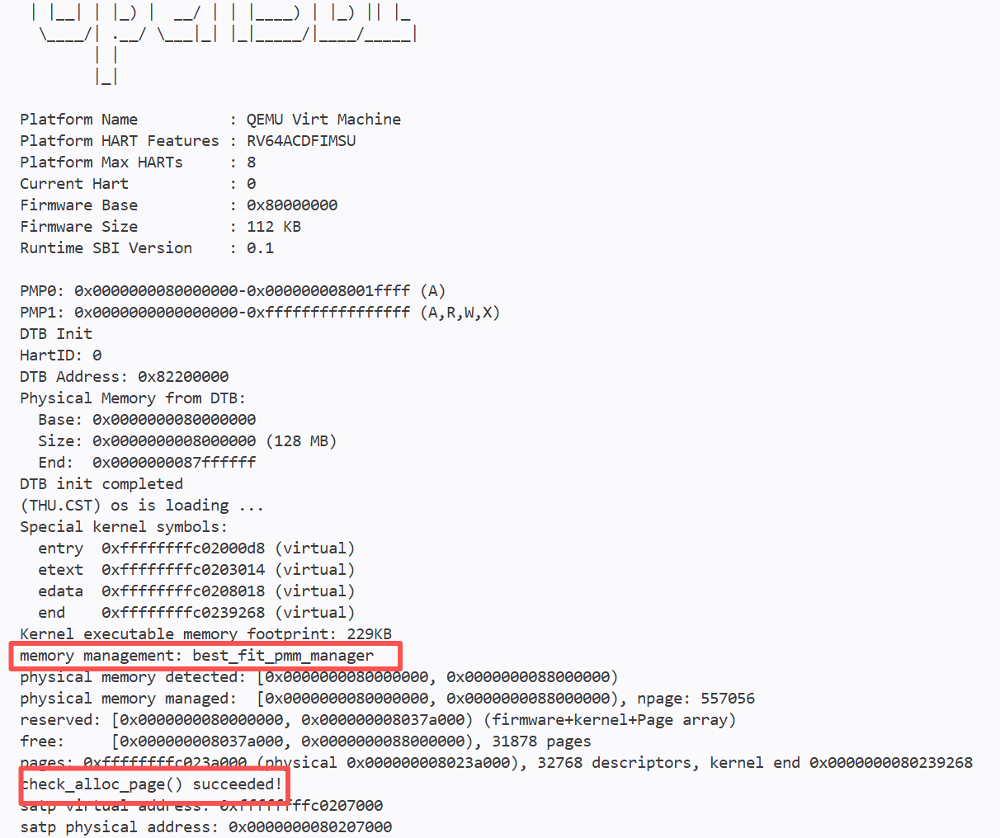
完整日志见 [task2_best_fit_qemu.txt](logs/task2_best_fit_qemu.txt)；成功标记与超时返回码的判定说明见 [task2_best_fit_qemu_evidence.txt](logs/task2_best_fit_qemu_evidence.txt)。

**步骤③：对照**

```bash
python3 tools/test_best_fit_host.py --cc gcc
```


完整日志见 [task2_best_fit_host.txt](logs/task2_best_fit_host.txt)。

**步骤④：框架评分（ `grade.sh` ）。**

```bash
cd /mnt/d/OS_CS/OS_lab/code
PREFIX=/home/luoisa/riscv-toolchain/bin/riscv64-unknown-elf-
QEMU_BIN=$HOME/qemu-4.1.1/riscv64-softmmu/qemu-system-riscv64
sed -i 's/\r$//' tools/grade.sh        # 一次性：grade.sh 原为 CRLF，规范为 LF（幂等）
grep -c $'\r' tools/grade.sh           # 自检：应输出 0
make grade GCCPREFIX=$PREFIX QEMU=$QEMU_BIN 2>&1 | tee ../report/logs/task2_best_fit_grade.txt
```

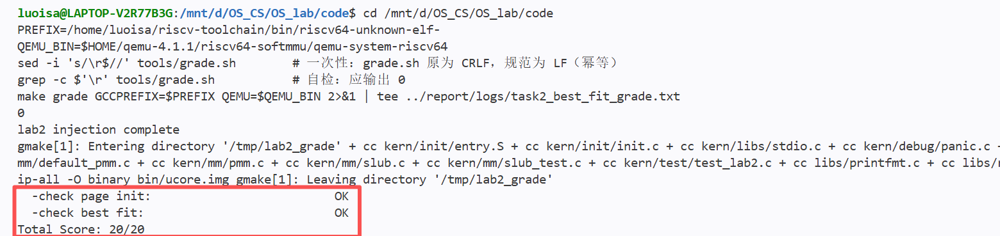


完整日志见 [task2_best_fit_grade.txt](logs/task2_best_fit_grade.txt)（`tee` 在评分的同时把输出写入该日志）；规范换行前直接评分因 CRLF 报语法错误的记录见 [task2_best_fit_grade_crlf.txt](logs/task2_best_fit_grade_crlf.txt)。`sed` 仅删除行尾 `\r`，脚本内容无其他改动。

**实测结果。**
- QEMU 运行输出 `memory management: best_fit_pmm_manager`、`grading: 1 / 6 points` 至 `grading: 6 / 6 points`、`check_alloc_page() succeeded!`；SLUB 五组 PASS，1875 个大对象后真实耗尽（[task2_best_fit_qemu.txt](logs/task2_best_fit_qemu.txt)）。
- 宿主对照输出 `ALL HOST ALGORITHM CHECKS PASSED`，含 8 条 PASS：原两测试 + 完全恢复；最小合适块、拆分、碎片失败与失败不变性；同大小取低地址；部分/整体释放及前后合并；乱序与不相邻 `init_memmap`；4 个固定种子（`1`、`2410439`、`324508639`、`12648430`）各 5000 次循环位图对照且完全恢复。
- 框架评分：`check page init: OK`、`check best fit: OK`、`Total Score: 20/20`。


**结论。** 通过。已知局限：宿主对照属算法级验证，不替代 QEMU 内核测试；未覆盖非法指针、重复释放与并发；工作区 `grade.sh` 已规范为 LF（仅换行符差异，脚本内容未改），此后可直接 `make grade`。

### 5.4 模块二任务三：Buddy System 伙伴分配算法

**测试目标。** 验证 `buddy_pmm_manager`：按阶（`k=0..15`，块长 `2^k` 页）管理空闲块；`alloc_pages` 安全向上取整、逐级分裂并记录原始请求页数；`free_pages` 按异或定位的伙伴逐级合并；`init_memmap` 支持不规则起点与多段区域；非法、溢出与不足的请求不改变状态。


**步骤①：第一阶段清理与构建（`-DPMM_USE_BUDDY` 宏接入后的默认构建）。**

```bash
cd /mnt/d/OS_CS/OS_lab/code
PREFIX=/home/luoisa/riscv-toolchain/bin/riscv64-unknown-elf-
make clean && make -j2 GCCPREFIX=$PREFIX DEFS=-DPMM_USE_BUDDY
```


完整日志见 [task3_buddy_clean.txt](logs/task3_buddy_clean.txt)、[task3_buddy_build.txt](logs/task3_buddy_build.txt)；编译宏与 ELF 符号核对见 [task3_buddy_linkage.txt](logs/task3_buddy_linkage.txt)。

**步骤②：第一阶段 QEMU 原测试。**

```bash
QEMU_BIN=$HOME/qemu-4.1.1/riscv64-softmmu/qemu-system-riscv64
timeout --signal=TERM 30s make GCCPREFIX=$PREFIX QEMU=$QEMU_BIN DEFS=-DPMM_USE_BUDDY test
```

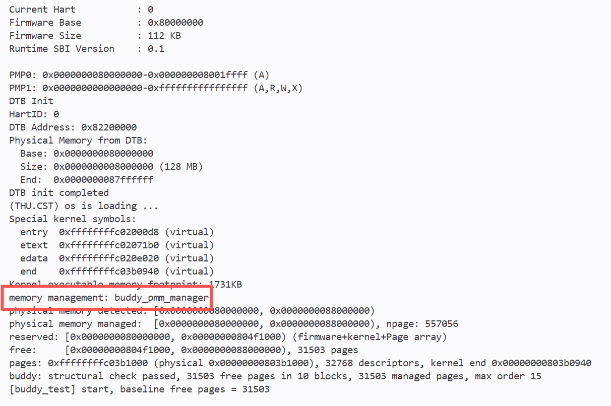

完整日志见 [task3_buddy_qemu.txt](logs/task3_buddy_qemu.txt)。该日志采集于八组测试接入与测试分离改造之前，当时 `slub_test()` 随任意构建无条件运行，故日志含 SLUB 五组 PASS（995 个大对象）；按当前代码复现本步骤输出为 Buddy 生产内核（`buddy_pmm_manager`、结构自检、框架原测试通过），不再含 SLUB 测试（经 `ucore_test` 开关剔除，见本节开头"测试构建组织"），SLUB 与八组回归见步骤③。

**步骤③ ：第二阶段运行八组独立测试（`make test` 以 `-D ucore_test` 重新编译并运行，60 秒超时包装）。**

```bash
make clean && timeout --signal=TERM 60s make GCCPREFIX=$PREFIX QEMU=$QEMU_BIN DEFS=-DPMM_USE_BUDDY TEST_CONFIG=ucore_test test
```

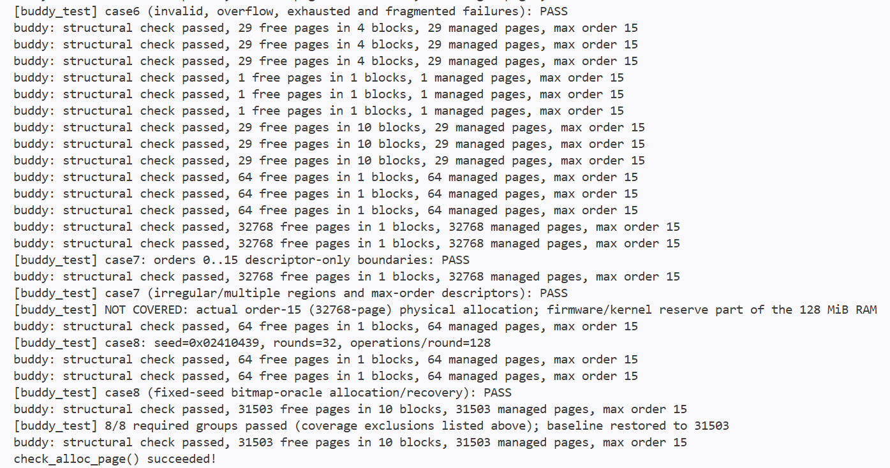

完整日志见 [task3_tests_buddy_qemu.txt](logs/task3_tests_buddy_qemu.txt)

**结论。** 所列场景通过。


### 5.5 Challenge：SLUB 内存对象分配

**测试目标。** 验证 `slub_alloc`/`slub_free`：大小类别与至少 16 字节对齐、请求范围可读写、存活对象不重叠、页内多对象共享与跨页扩展、空 slab 与大对象及时回收、零大小/大小溢出/容量不足返回 `NULL` 且不破坏既有状态、`slub_free(NULL)` 无副作用。

**测试方法。** 实际独立测试入口为 `slub_check()`，分五组串行运行于 QEMU 4.1.1；测试记录起始 `nr_free_pages()` 基线，并在各组结束时检查是否恢复。已有记录包含 First-Fit 历史联调，以及 Best-Fit、Buddy 配置的回归；当前代码通过 `make test`（`-D ucore_test` 测试构建）启用这些测试，普通 `make qemu` 不编译、不运行 SLUB 行为测试（见本节开头的"测试构建组织"）。

**覆盖内容与检验依据。** 第 4.2.4 节“测试覆盖与有效性说明”已按实际代码列出各组的具体输入、操作、通过条件及能发现的问题。核心检查包括零大小与空指针、20 个类别的边界前后、1024/1025 字节路径切换、对象区间与数据独立性、单页容量与跨页扩展、空位复用、部分及全部释放、大对象八轮回收，以及超大请求和真实容量不足后的恢复。测试同时核对地址、数据和页数：用读写结果检验对象可用性，用页数变化检验共享、复用和回收，用交错操作及失败场景检验管理状态是否受到破坏。

**步骤①：默认配置（Best-Fit）回归。**

```bash
cd /mnt/d/OS_CS/OS_lab/code
PREFIX=/home/luoisa/riscv-toolchain/bin/riscv64-unknown-elf-
QEMU_BIN=$HOME/qemu-4.1.1/riscv64-softmmu/qemu-system-riscv64
make clean && make -j2 GCCPREFIX=$PREFIX
make clean && timeout --signal=TERM 90s make -j2 GCCPREFIX=$PREFIX QEMU=$QEMU_BIN test
```

完整日志见 [task2_best_fit_qemu.txt](logs/task2_best_fit_qemu.txt)（SLUB 五组 PASS，1875 个大对象后真实耗尽；与 5.1、5.3 为同一次构建与运行）。

**步骤②：Buddy 配置回归（第一阶段）。**

```bash
make clean && make -j2 GCCPREFIX=$PREFIX DEFS=-DPMM_USE_BUDDY
timeout --signal=TERM 30s make GCCPREFIX=$PREFIX QEMU=$QEMU_BIN DEFS=-DPMM_USE_BUDDY test
```

完整日志见 [task3_buddy_qemu.txt](logs/task3_buddy_qemu.txt)（SLUB 五组 PASS，995 个大对象后真实耗尽；与 5.4 步骤①②为同一次构建与运行）。该日志采集于八组测试接入与测试分离改造之前；按当前代码复现本步骤输出不含 SLUB 测试（manager、结构自检、框架原测试一致），Buddy 配置的 SLUB 与八组回归以步骤③的测试构建为准。

**步骤③：Buddy 配置回归（第二阶段，含独立测试镜像）。**

```bash
make clean && timeout --signal=TERM 60s make GCCPREFIX=$PREFIX QEMU=$QEMU_BIN DEFS=-DPMM_USE_BUDDY TEST_CONFIG=ucore_test test
```

完整日志见 [task3_tests_buddy_qemu.txt](logs/task3_tests_buddy_qemu.txt)（SLUB 五组 PASS，984 个大对象后真实耗尽；与 5.4 步骤③为同一次运行）。

**First-Fit 配置（历史回归）。** First-Fit 下的 SLUB 回归证据来自 Best-Fit 接入前与 SLUB 的联调运行（见 4.2.4），未单独留存日志，测试记录的合并说明见 5.2。

**实测结果。** 输出 `slub: 20 size classes (16..1024), header 64 bytes, large-object threshold 1024`；五组均 PASS，`ALL CASES PASSED`。空闲页基线：First-Fit/Best-Fit 为 31878 页、Buddy（含独立测试镜像）为 31503 页；压力用例耗尽数量分别为 1875（First-Fit/Best-Fit）、984（Buddy 第二阶段含测试镜像）、995（Buddy 第一阶段）。见 [task2_best_fit_qemu.txt](logs/task2_best_fit_qemu.txt)、[task3_buddy_qemu.txt](logs/task3_buddy_qemu.txt)、[task3_tests_buddy_qemu.txt](logs/task3_tests_buddy_qemu.txt) 及报告 4.2.4。

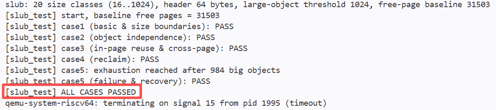


**结论。** 所列用例通过（三种配置的已有回归记录）。耗尽数量取决于测试请求大小、管理开销与可用内存，不是分配器的固定容量。现有输入尚未专门触发最终按页取整的溢出保护分支，也未覆盖并发调用、非法指针与重复释放；压力测试上限、异常清理及恢复检查的具体限制见第 4.2.4 节，不能仅凭总通过信息推断所有边界均已验证。

### 5.6 分支任务：GDB 调试页表查询过程

**测试目标。** 用两个 GDB 观测一次真实取指（`jr t0` → `kern_init`，`0xffffffffc02000d8`）的完整地址翻译，并做 TLB 命中/未命中与 Bare 模式对照。

**测试环境。** WSL2 Ubuntu；自编译 QEMU 4.1.1（`~/qemu-4.1.1`，`--enable-debug`，未 `make install`）；ucore lab2。


#### 5.6.1 准备

```bash
cd "/mnt/d/1南开/课程/大三上学期/操作系统/lab/lab2/OS_lab/code"
file ~/qemu-4.1.1/riscv64-softmmu/qemu-system-riscv64
grep -n 'QEMU' Makefile | head -5
make
riscv64-unknown-elf-nm bin/kernel | grep -w kern_init
make qemu
```


*图 5.6-01　`file` 确认二进制带 `debug_info` 且未 strip。*


*图 5.6-02　QEMU 4.1.1 与 `--enable-debug` 配置。*


*图 5.6-03　符号表给出 `kern_init = 0xffffffffc02000d8`。*


*图 5.6-04　正常模式下的完整启动输出。*


#### 5.6.2 三个停靠点

终端 1：

```bash
cd "/mnt/d/1南开/课程/大三上学期/操作系统/lab/lab2/OS_lab/code"
make debug
```

终端 2：

```bash
pgrep -af qemu-system-riscv64
sudo gdb -p <QEMU_PID>
```

```gdb
set pagination off
set confirm off
handle SIGPIPE nostop noprint
handle SIGUSR1 nostop noprint pass
handle SIGUSR2 nostop noprint pass
continue
```


终端 3：

```bash
cd "/mnt/d/1南开/课程/大三上学期/操作系统/lab/lab2/OS_lab/code"
make gdb
```

```gdb
set confirm off
hbreak *0x80200000
continue
info registers pc satp
delete
hbreak *0x80200034
continue
info registers pc satp
delete
hbreak *0xffffffffc02000d8
continue
info registers pc satp
delete
continue
```


*图 5.6-05　终端 2 附加 QEMU 后的信号处理与放行。*


*图 5.6-06　分页前 `satp=0`，分页后 `satp=0x8000000000080207`。*


#### 5.6.3 抓取一次页表翻译

先结束上一轮（终端 1 `Ctrl-A X`，终端 2、3 各按 Ctrl-C 后 `quit`），再在终端 1 重新 `make debug`。

终端 2：

```bash
pgrep -af qemu-system-riscv64
sudo gdb -p <QEMU_PID>
```

```gdb
set pagination off
set confirm off
handle SIGPIPE nostop noprint
handle SIGUSR1 nostop noprint pass
handle SIGUSR2 nostop noprint pass
break get_physical_address if addr == 0xffffffffc02000d8
continue
```

终端 3：

```bash
cd "/mnt/d/1南开/课程/大三上学期/操作系统/lab/lab2/OS_lab/code"
make gdb
```

```gdb
continue
```

终端 2 命中后：

```gdb
bt
print/x addr
print/x env->satp
print access_type
print mmu_idx
```


*图 5.6-07　条件断点命中于 `addr == 0xffffffffc02000d8`。*


*图 5.6-08　虚拟地址、`satp`、`access_type` 与 `mmu_idx`。*

继续：

```gdb
delete
break cpu_helper.c:242
continue
print/x base
print i
print ptshift
print/x idx
print/x base + idx * 8
next
print/x pte_addr
```


*图 5.6-09　第 0 级的 `base`、`i`、`ptshift`、`idx` 与 PTE 地址。*

```gdb
break cpu_helper.c:256
continue
print/x pte
print/x ppn
print pte & 0xf
```


*图 5.6-10　PTE 内容与 PPN 字段。*

```gdb
break cpu_helper.c:334
continue
next
print/x *physical
print/x addr & 0xfff
print/x (*physical) + (addr & 0xfff)
```


*图 5.6-11　页对齐物理地址、页内偏移与最终物理地址。*

结束本轮：终端 1 `Ctrl-A X`；终端 2、3 各按 Ctrl-C 后 `quit`。

#### 5.6.4 TLB miss / hit

先结束上一轮，再重启 QEMU。终端 1 `make debug`；终端 2 附加后：

```gdb
set pagination off
set confirm off
handle SIGPIPE nostop noprint
handle SIGUSR1 nostop noprint pass
handle SIGUSR2 nostop noprint pass
break cputlb.c:1030 if (addr >> 12) == (0xffffffffc02000d8 >> 12)
continue
```

终端 3 `make gdb` 后 `continue`。第一次停在 `:1030`：

```gdb
print/x addr
bt
next
```


*图 5.6-12　首次查询未命中，`next` 落到 `:1031`。*

终端 2 `continue`，第二次停在 `:1030` 后：

```gdb
next
```


*图 5.6-13　后续查询命中，`next` 直接落到 `:1039`。*

结束本轮：终端 1 `Ctrl-A X`；终端 2、3 各按 Ctrl-C 后 `quit`。

#### 5.6.5 Bare 模式对照

先结束上一轮，再重启 QEMU。终端 1 `make debug`；终端 2 附加后：

```gdb
set pagination off
set confirm off
handle SIGPIPE nostop noprint
handle SIGUSR1 nostop noprint pass
handle SIGUSR2 nostop noprint pass
break get_physical_address if addr == 0x80200000
break cpu_helper.c:242 if addr == 0x80200000
continue
```

终端 3 `make gdb` 后 `continue`。终端 2 命中后：

```gdb
print/x addr
print/x env->satp
print access_type
print mmu_idx
bt
continue
```

等 1–2 秒后 Ctrl-C，执行 `info breakpoints`。本轮结束后同样用 `Ctrl-A X` 和 `quit` 收尾。


*图 5.6-14　`satp=0` 时走 MBARE 直通，不进入页表循环。*

#### 5.6.6 小结

**结论。** 所列用例全部通过。调用路径、页表遍历、PTE 与物理地址、TLB 命中/未命中、Bare 对照五项观测均在 QEMU 4.1.1 实机运行中实际命中并留有截图：`satp` 由 `0` 变为 `0x8000000000080207`（图 5.6-06），条件断点命中 `0xffffffffc02000d8`（图 5.6-07），页表遍历与 PTE 得到 `0x802000d8`（图 5.6-09 至 5.6-11），TLB 首次未命中、后续命中（图 5.6-12、5.6-13），Bare 模式直通且不进入页表循环（图 5.6-14），结果与 4.3 的记录一致。QEMU 软件 TLB 与真实 CPU TLB 的对比见 4.3.4.3。若条件断点不命中或终端 3 报 `invalid hex digit 116`，按 4.3.5 的现象三、四处理。

### 5.7 汇总

| 验证项                    | 应记录的证据                                                                                                                                                                                                                                                                                                                                                                                                       | 状态                                                               |
| ------------------------- | ------------------------------------------------------------------------------------------------------------------------------------------------------------------------------------------------------------------------------------------------------------------------------------------------------------------------------------------------------------------------------------------------------------------ | ------------------------------------------------------------------ |
| 物理内存初始化（5.1）     | 识别 128 MiB、32768 个描述符；Best-Fit 空闲 31878 页，Buddy 初步镜像 31853 页、含独立测试镜像 31503 页；框架 `check page init: OK`                                                                                                                                                                                                                                                                                 | 正常配置运行通过；基线差异来自内核与测试静态存储占用               |
| Best-Fit（5.3）           | `best_fit_pmm_manager`、原测试 6/6、独立补充与随机对照日志                                                                                                                                                                                                                                                                                                                                                         | 本次实现与列出的测试通过，原两测试未修改                           |
| Buddy System（5.4）       | 八组独立测试、固定种子 4096 步位图对照、前后结构检查通过；恢复 31503 页                                                                                                                                                                                                                                                                                                                                            | 已完成列出场景；阶 15 正向成功仅模拟描述符，真实整块物理分配未覆盖 |
| SLUB（5.5）               | 五组均 PASS；Best-Fit 1875 个、Buddy 含测试镜像 984 个大对象后耗尽并恢复；第一阶段 Buddy 为 995 个                                                                                                                                                                                                                                                                                                                 | 已有 First-Fit 记录及本次两种配置回归均通过                        |
| 内核编译与运行（5.1–5.5） | Buddy 宏构建与启动、清理后 Best-Fit `make test`，两者均出现 `check_alloc_page() succeeded!`                                                                                                                                                                                                                                                                                                                        | 两种配置完整构建与运行通过，默认保留 Best-Fit                      |
| 框架评分（5.3）           | Best-Fit 配置 `make grade`，本轮回归仍为 `Total Score: 20/20`                                                                                                                                                                                                                                                                                                                                                      | 评分脚本换行规范为 LF 后直接通过；仅换行符差异；不是 Buddy 验收    |
| 地址翻译调试（5.6）       | 双 GDB 三终端完成；断点：`get_physical_address`（条件 `addr == 0xffffffffc02000d8`）、`cputlb.c:1030`（条件 `addr >> 12 == 0xffffffffc02000d8 >> 12`）；调用路径：`get_page_addr_code → tlb_fill → riscv_cpu_tlb_fill → get_physical_address`；寄存器：`pc`、`satp=0x8000000000080207`、`addr`、`access_type=2`、`mmu_idx=1`；页表项：`pte=0x200000cf`、`ppn=0x80000`；转换结果：`0xffffffffc02000d8 → 0x802000d8` | 已完成；5.6 给出可复现的演示步骤，详见 4.3                         |


---

## 六、实验总结与收获

### 6.1 本实验知识点与 OS 原理的对应关系

下表汇总本实验各知识点与操作系统理论的对应关系；对应的实现与测试证据见第四、五部分。

| 实验知识点                 | 对应理论                 | 联系与差异                                                                                                             |
| -------------------------- | ------------------------ | ---------------------------------------------------------------------------------------------------------------------- |
| 设备树内存信息、保留区排除 | 物理内存布局与资源管理   | 理论讨论可用空间；实际初始化还要处理固件、内核及管理结构的占用                                                         |
| `Page` 描述符与空闲块组织  | 页框管理及元数据         | 页框是实际物理内存单位，描述符是记录其状态的软件结构，两者地址不同                                                     |
| First-Fit 与 Best-Fit      | 连续内存分配与外部碎片   | 本实验按连续物理页分配；空闲总量足够不意味着存在足够大的连续块                                                         |
| Buddy System               | 分级分配、分裂与合并     | 二的幂块便于定位伙伴和合并，但请求向上取整可能产生内部浪费                                                             |
| SLUB 对象分配              | 内核动态内存管理         | 在页级分配之上服务小对象请求，需要管理对象大小、对齐和所在页                                                           |
| Sv39 页表与地址翻译        | 多级页表、地址映射与权限 | 内核链接在虚拟地址、加载在物理地址，二者由 `va_pa_offset` 关联；物理页分配决定资源归属，页表记录映射，二者协作但不等价 |
| TLB 与 QEMU 调试           | 地址翻译缓存与硬件实现   | 可通过模拟器源码观察处理流程，但其软件结构不应直接当作真实 CPU 的内部结构                                              |

### 6.2 重要但未在本实验任务中完整展开的知识点

1. **按需分页与页面置换：** 本实验集中于物理页分配和初始映射，没有完整实现缺页调入、换入换出及替换策略。
2. **进程地址空间与用户态隔离：** 初始内核映射不等于完整的多进程虚拟内存管理，用户地址空间创建、切换和保护需要后续机制支持。
3. **进程调度与上下文切换：** 本实验的内存管理是其基础，但不以实现多进程调度为任务。
4. **多核并发与一致性：** 完整系统中的分配器同步、跨核 TLB 一致性等问题，需要更复杂的运行场景与验证。
5. **页表的动态建立与修改：** 本实验只观察内核启动时已建立的 1 GiB 超级页映射，没有实现 4 KiB 页映射、超级页拆分/合并、按需建立页表，以及修改映射后的 TLB 刷新策略。
6. **碎片整理与内存压缩：** 本实验比较了 First-Fit、Best-Fit 与 Buddy 的碎片表现，但没有实现空闲页搬迁、压缩或碎片整理；长期分配/释放后的回收与整理需要更完整的机制。

### 6.3 实际收获与 AI 协作经验

1. **现象与根因之间可能隔着工具链的默认选项。** 内核停在 OpenSBI 横幅后无任何输出，`-d int` 却显示大量 store access fault，说明失败发生在启动最早期。AI 据此指出 `riscv64-linux-gnu-` 默认按 PIE 编译、`la` 走 GOT 间接寻址，分页开启前访问了链接期虚拟地址；换回 `riscv64-unknown-elf-` 重新编译后正常启动。若只盯着内核代码，这个问题很难找到方向。
2. **唯一一次翻译要求断点在 CPU 冻结时安装。** 条件断点一次不命中的原因，是 `0xffffffffc02000d8` 在真实取指中只翻译一次，而 `write_satp()` 在 ASID 未变时并不清 TLB，真正清 TLB 的是 `sfence.vma`，清空后的第一次取指恰好是 `jr t0` 跳向 `kern_init`。改为 `make debug` 冻结 CPU、先装断点再放行后实测命中，`idx=0x1ff`、`pte=0x200000cf` 等值与 AI 的预测一致。
3. **调试器本身也是被调试系统的一部分。** `Reply contains invalid hex digit 116` 中的 116 是 ASCII `'t'`，来自停止应答 `T05thread:`；根因是终端 3 的 `m`/`Z0` 包触发 `cpu_memory_rw_debug`/`breakpoint_invalidate`，终端 2 的断点命中后 all-stop 停住主循环，回复发不出去而超时错位。按"终端 3 发包时终端 2 必须处于运行态"操作后，问题不再复现。
4. **make grade 换行符问题。** `make grade` 直接运行即报 `tools/grade.sh: 2: : not found` 与第 146 行 `Syntax error: ")" unexpected`，而脚本一个字都没动过。AI 从报错特征判断是换行符问题，字节级统计随即证实 `grade.sh` 全部 244 行均为 CRLF——工程放在 Windows 盘（`/mnt/d`）上，Windows 侧编辑器或 git 的 `autocrlf` 在检出/保存时把 LF 悄悄转成了 CRLF，而 WSL 的 `/bin/sh`（dash）会把行尾 `\r` 当成命令内容；`make grade` 自带的临时复制是逐字节的，救不了它，说明失败根源在文件本身而非运行位置。最终以 `sed -i 's/\r$//' tools/grade.sh` 一次性规范为 LF（仅删行尾 `\r`，脚本内容零改动），`grep -c $'\r'` 自检为 0 后直接评分得到 `Total Score: 20/20`。收获：跨 WSL/Windows 混合开发时，先查换行、编码这类工具层默认行为，再怀疑脚本本身；修复选幂等且可自检的命令，治本可在仓库加 `.gitattributes`（`*.sh text eol=lf`）。


---


