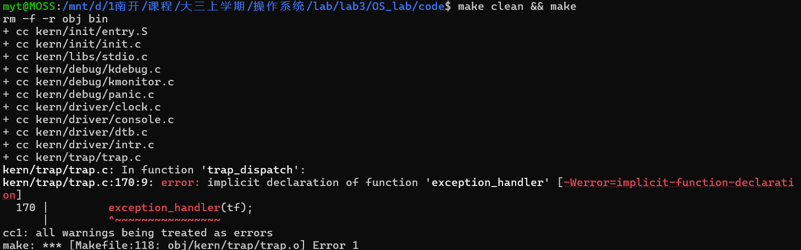
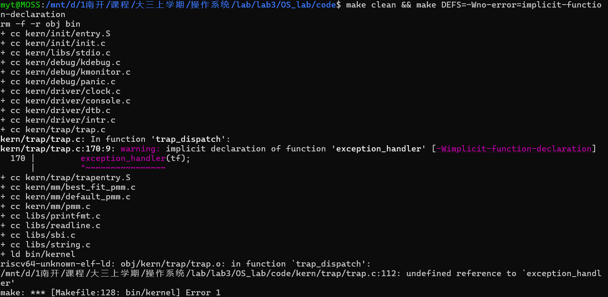

# 操作系统实验报告

## 实验基本信息

| 项目 | 内容 |
|------|------|
| **实验名称** | Lab3：RISC-V 中断与异常处理 |
| **小组成员** | 2412084-刘芳希；2410826-马伊汀；2410439-吴佳璐： |
| **完成日期** | 待实验完成后填写 |

### 小组分工

| 成员 | 负责的练习/模块 | 报告分工 |
|------|----------------|----------|
| 2412084-刘芳希 | 补全 Lab2 代码；练习一：Trap 入口与上下文恢复，实现 `RESTORE_ALL` 和 `__alltraps` | 负责报告前面的实验基本信息、实验目的、实验环境、整体逻辑分析，练习一的原理、spec、prompt、调试与验证记录 |
| 2410826-马伊汀 | 功能模块二的中断与时钟处理：实现 `interrupt_handler()`，完成时钟事件重设、计数、输出及关机逻辑 | 负责中断与时钟处理部分的功能说明、spec、prompt、实现迭代过程及对应测试记录 |
| - | 功能模块二的异常处理与集成验证：实现 `exception_handler()`，处理非法指令与断点异常，组织整体联调 | 负责异常处理部分的实现记录，以及报告后面的测试与验证汇总、实验总结与收获、全文整合和格式检查 |


---

## 一、实验目的

1. 理解 RISC-V 的 Trap 机制，区分异步中断与同步异常，理解 `stvec`、`sepc`、`scause`、`sstatus` 等寄存器的作用。
2. 掌握 Trap frame 的布局，以及通过汇编保存、恢复上下文并调用 C 语言处理函数的方法。
3. 实现时钟中断、非法指令异常和断点异常的处理，使内核能够处理事件并返回原执行流。
4. 理解时钟事件重设、异常返回地址调整和中断状态保护的必要性。
5. 根据已有接口编写需求规格与提示词，借助 AI 完成实现，并通过编译、调试和运行验证结果。

## 二、实验环境

| 成员           | AI 编程工具             | 底层模型          | 备注 |
| -------------- | ----------------------- | ----------------- | ---- |
| 2410826-马伊汀 | Claude Code for VS Code | DeepSeek-V4-Flash |
| 2412084-刘芳希 | Claude Code for VS Code | DeepSeek-V4-Flash |
| 2410439-吴佳璐 | Claude Code for VS Code | DeepSeek-V4-Flash |

---

## 三、实验整体逻辑分析

### 3.1 本章节的逻辑主线

本实验围绕“发生 Trap 后如何处理事件，再继续执行原程序”展开。硬件负责记录部分状态并跳转到入口，软件负责保存通用寄存器、分类处理事件以及恢复执行环境。

```text
发生中断或异常
→ 硬件记录 sepc、scause 等状态，跳转到 stvec 指定入口
→ __alltraps / SAVE_ALL 在栈上构造 trapframe
→ 将 trapframe 地址传给 trap(tf)
→ trap_dispatch() 区分中断和异常
→ interrupt_handler() 或 exception_handler() 处理事件
→ __trapret / RESTORE_ALL 恢复上下文
→ sret 按保存的返回状态继续执行
```

本实验当前主要处理内核执行期间发生的 Trap。`sret` 返回到哪个特权级由保存的 `sstatus.SPP` 决定，不能把它简单理解为每次都返回用户态。

### 3.2 功能的逐步实现

1. **补全 Lab2 依赖。** 恢复物理页描述符初始化和分配器实现，为内核启动检查提供内存管理支持。
2. **完成 Trap 入口与恢复。** 依据已提供的 `SAVE_ALL` 和 `struct trapframe` 实现恢复逻辑，把汇编入口与 C 函数连接起来。
3. **实现中断和异常处理。** 时钟处理中重新设置事件、计数和输出；异常处理中识别原因，并按指令长度调整返回地址。
4. **集成验证。** 检查内存管理自检、寄存器恢复、异常处理后的继续执行、周期时钟输出和规定次数后的关机。

---

## 四、实验内容与实现

### 4.1 前置任务：补全 Lab2 内存管理代码

**负责人：** 2412084-刘芳希

#### 模块功能描述与 spec

涉及文件为 `kern/mm/pmm.c`、`kern/mm/best_fit_pmm.c` 和 `kern/mm/memlayout.h`。主要函数为：

```c
static void page_init(void);
static void best_fit_init(void);
static void best_fit_init_memmap(struct Page *base, size_t n);
static struct Page *best_fit_alloc_pages(size_t n);
static void best_fit_free_pages(struct Page *base, size_t n);
static size_t best_fit_nr_free_pages(void);
static void best_fit_insert_block(struct Page *base);
```

**物理内存初始化要求：**

- 从 DTB 接口取得物理内存基址和容量，检查无效信息及地址加法溢出。
- 将管理范围限制在框架支持的物理地址上限内，并按页对齐。
- `npage` 表示物理页号上界；描述符数量为 `npage - nbase`。
- 将描述符数组放在内核结束地址之后，检查数组是否能够放入管理范围。
- 先清零描述符并将页面标为保留，再把内核和描述符数组之后的完整空闲页交给 `init_memmap()`。

**Best Fit 要求：**

- 空闲块链表按地址排列；分配时寻找容量不小于请求且最小的块。
- 大块分配后拆出剩余部分；不存在足够大的连续块时返回 `NULL`。
- 释放时重置页面状态，按地址插入并合并前后相邻块。
- 新增或释放页时更新 `nr_free`，合并操作不重复增加页数。
- 保留 Lab3 分配、释放和查询接口中的中断状态保护。

#### 提示词使用与生成结果

本次直接复用上次 Lab2 实验中编写的提示词，成功生成相关代码。经检查，生成代码的物理内存范围计算、页描述符初始化和空闲页注册逻辑与当前框架一致。使用原有 Makefile 配置单独编译 `pmm.c` 和 `best_fit_pmm.c`，均编译通过。

### 4.2 功能模块一：Trap 上下文恢复与入口

**负责人：** 2412084-刘芳希

#### 模块功能描述

**需要实现/修改的函数：**

```asm
# kern/trap/trapentry.S
.macro RESTORE_ALL    # 需要补全的上下文恢复宏
.endm

__alltraps:          # 需要补全的 Trap 汇编入口
```

本模块的实现对象是汇编宏和入口标签，没有普通 C 函数签名。对接的已有 C 接口为：

```c
void trap(struct trapframe *tf);  // 已有接口，不修改函数签名
```

**功能说明：**

本模块连接硬件 Trap 入口与 C 语言事件处理逻辑，负责在中断或异常发生后传递已保存的现场，并在处理结束后恢复原执行环境。

`__alltraps` 在已有 `SAVE_ALL` 保存现场后，按照 RISC-V 调用约定将当前 Trap frame 的地址传给 `trap()`。`RESTORE_ALL` 按相同布局恢复通用寄存器及返回所需的 `sstatus`、`sepc`，特别注意原始栈指针 `sp` 的恢复顺序，避免破坏尚未读取的现场。

该模块与 `struct trapframe`、`SAVE_ALL` 及 `trap()` 保持一致。C 层完成中断或异常处理后，控制流返回 `__trapret`，执行恢复宏并通过 `sret` 返回。若异常处理函数更新了 `tf->epc`，恢复时应使用更新后的值，使程序从正确位置继续执行。

#### 最终提示词

以下是经过迭代优化后，最终成功实现该功能的提示词：

````markdown

# Lab3 练习一提示词：Trap 入口与上下文恢复

[PROMPT]

**任务**：
完成 Lab3 练习一的 Trap 入口与上下文恢复功能。目标文件为
`D:/OS_lab/OS_lab/code/kern/trap/trapentry.S`。

使内核在发生 Trap 后，能够将已保存的上下文交给 C 语言处理函数，并在处理函数返回后恢复执行环境，形成完整的“Trap 进入—现场保存—C 语言处理—现场恢复—Trap 返回”流程。

**操作要求**：
必须修改项目中的实际文件，而不是仅展示代码。
只补全 `RESTORE_ALL` 和 `__alltraps` 中标有 `lab3 function1` 的位置。
保留 lab3 注释，将对应的 `YOUR CODE` 替换为学号 `2412084`。

不得修改 `SAVE_ALL`、`struct trapframe`、`trap()` 的函数签名以及已有 `__trapret` 返回流程，不修改其他实验模块、Makefile 或测试代码。
不得通过增加空的中断或异常处理函数来绕过其他模块的编译错误。

**输出要求**：
以工程真实代码为准，使用下列依赖、接口和行为规格完成实现。
完成后说明修改内容、关键约束的满足情况及实际验证结果。
区分单文件编译通过、完整构建通过和运行测试通过；对于因其他模块尚未完成而无法执行的验证，应说明原因。

[RELY]

## 1. 已有文件与接口

- `kern/trap/trapentry.S`：包含 `SAVE_ALL`、`RESTORE_ALL`、`__alltraps` 和 `__trapret`。
- `kern/trap/trap.h`：定义 `struct pushregs` 和 `struct trapframe`。
- `kern/trap/trap.c`：提供 C 语言处理入口：

```c
void trap(struct trapframe *tf);
```

该函数接收当前 Trap frame，通过已有分发逻辑处理中断或异常。处理函数可能修改 Trap frame 中的返回状态。

## 2. 上下文结构

```c
struct trapframe {
    struct pushregs gpr;
    uintptr_t status;
    uintptr_t epc;
    uintptr_t badvaddr;
    uintptr_t cause;
};
```

`struct pushregs` 中的字段按照 x0 至 x31 的顺序排列。在当前 RV64 框架中，`uintptr_t` 和寄存器宽度均为 8 字节。

相对于 Trap frame 起始地址，已有保存布局为：

- 第 0～31 个寄存器宽度槽位：通用寄存器 x0～x31；
- 第 32 个槽位：sstatus；
- 第 33 个槽位：sepc；
- 第 34 个槽位：异常附加信息；
- 第 35 个槽位：scause。

整个 Trap frame 占 `36 * REGBYTES` 字节。

## 3. 已有 SAVE_ALL 的语义

`SAVE_ALL` 在当前内核栈上建立 Trap frame。执行结束后，sp 指向该 Trap frame 的起始地址。

槽位 2 保存的是分配 Trap frame 之前的原始 sp，不是当前指向 Trap frame 的 sp。
`SAVE_ALL` 通过 sscratch 暂存原始 sp，并在保存过程中将 sscratch 清零。

恢复逻辑必须与实际 `SAVE_ALL` 一致，不得自行另设布局。

## 4. 宏与调用约定

`libs/riscv.h` 提供 `LOAD`、`STORE` 和 `REGBYTES`。
当前 RV64 配置中 `LOAD` 为 `ld`、`STORE` 为 `sd`、`REGBYTES` 为 8。

RISC-V 调用约定使用 a0 传递第一个参数。
调用 C 函数时须满足栈对齐要求，并允许该函数按 ABI 使用调用者保存寄存器。

## 5. 已有返回流程

```asm
__trapret:
    RESTORE_ALL
    sret
```

`sret` 根据 sepc 和 sstatus 中的返回状态继续执行。返回特权级由保存的 SPP 等状态决定，不能固定为用户态。

[GUARANTEE]

必须补全以下两个汇编接口：

```asm
.macro RESTORE_ALL
    # 恢复当前 Trap frame 所描述的执行状态
.endm

__alltraps:
    # 在已有 SAVE_ALL 的基础上连接 C 语言 Trap 处理入口
```

`RESTORE_ALL` 是汇编宏，`__alltraps` 是汇编入口标签，不应将它们改写为普通 C 函数。

交付结果必须满足：

- `__alltraps` 将当前 Trap frame 正确传给 `trap()`；
- `trap()` 正常返回后衔接已有 `__trapret`；
- `RESTORE_ALL` 恢复返回所需的执行状态；
- 已有 `sret` 能依据恢复的状态返回。

本任务不需要新增公开接口、全局变量或动态内存分配。

[SPECIFICATION]

## __alltraps

**Pre-Condition**：

- 处理器已经进入 Trap 处理入口，相关硬件状态已记录。
- 当前内核栈可用，并有足够空间保存上下文和执行 C 函数。
- 已有 `SAVE_ALL` 能够按 `struct trapframe` 布局保存现场。
- `trap(struct trapframe *tf)` 接口保持不变。

**Post-Condition**：

- `trap()` 接收到指向当前真实 Trap frame 的有效指针。
- 调用过程不会破坏 Trap frame 中后续恢复所需的数据。
- `trap()` 正常返回后，执行流进入已有 `__trapret`。
- 进入恢复阶段时，能够正确定位同一 Trap frame，不产生栈偏移泄漏。
- `trap()` 对 Trap frame 的有效修改能够传递给后续恢复阶段。

**Case 1：处理函数未修改返回现场**

当 `trap()` 仅完成事件处理、未修改保存的返回状态时，入口与调用过程应保留原现场，使恢复阶段能够返回被打断的执行流。

**Case 2：处理函数修改返回现场**

当 `trap()` 修改 `tf->epc` 等返回字段时，后续恢复应使用修改后的现场，不得重新覆盖为进入 Trap 时的旧值。

**Requirements**：

- 遵守 RISC-V 参数传递和栈对齐约定。
- 不依赖调用者保存寄存器在 C 函数调用后仍保持原值。
- 不在入口中重复实现中断分类、时钟计数或异常处理。
- 保持入口原有的四字节对齐。
- 本任务基于当前内核栈处理模型，不扩展用户栈切换或嵌套 Trap 支持。

## RESTORE_ALL

**Pre-Condition**：

- sp 指向由已有 `SAVE_ALL` 建立的有效 Trap frame。
- C 语言 Trap 处理函数已经返回。
- Trap frame 中保存的是本次应恢复的上下文，其中允许包含处理函数对返回地址等字段的有效更新。

**Post-Condition**：

- 可恢复的通用寄存器与 Trap frame 对应字段一致，x0 仍保持体系结构规定的零值。
- sp 恢复为 Trap frame 中记录的原始栈指针。
- sstatus 和 sepc 与 Trap frame 中的返回状态一致。
- 不残留本次 Trap frame 带来的额外栈空间占用。
- 执行结束后，已有 `sret` 可以从正确地址、按正确特权状态继续执行。

**Case 1：返回现场未被修改**

当 Trap frame 保留原返回状态时，恢复后的寄存器和返回状态应与被打断的执行环境相符。

**Case 2：返回地址被修改**

当异常处理函数调整了 `tf->epc` 时，恢复后的 sepc 应采用该新地址，使 `sret` 从指定位置继续执行。
本宏不自行判断指令长度，也不额外增加返回地址。

**Requirements**：

- 恢复布局和数据宽度必须与 `SAVE_ALL`、`struct trapframe` 一致。
- 恢复 sp 不得导致尚未恢复的字段失去正确寻址依据。
- 用于恢复 CSR 的临时寄存器也必须恢复为对应的最终上下文值。
- 不把 cause 和 badvaddr 等诊断快照机械地写回为返回状态。
- 不擅自强制开启中断，不固定返回到 U 模式或 S 模式。
- 保持当前框架对 sscratch 的约定。
- 不在宏内重复执行 `sret`，继续使用已有 `__trapret` 的返回指令。

## 验证要求

- 单独编译 `trapentry.S`，确认语法、宏展开和符号引用正确。
- 对照 `SAVE_ALL` 检查每个恢复字段的偏移和宽度。
- 检查调用 `trap()` 时传入的地址、栈对齐及返回后的栈位置。
- 在其他模块具备运行条件时，验证通用寄存器和 sp 的恢复，以及处理函数修改 epc 后的返回行为。
- 若中断与异常处理模块仍未完成，只报告已实际完成的检查，不修改这些模块来伪造完整测试通过。


````
#### 设计要点

本练习通过“栈上的 Trap frame、RISC-V 函数调用约定和 Trap 返回指令”把汇编与 C 语言处理逻辑连接起来。

**1. 用相同的内存布局连接汇编现场与 C 结构体。**

`SAVE_ALL` 在栈上分配 `36 * REGBYTES`，即 RV64 下的 288 字节，按 `struct trapframe` 的字段顺序保存现场。前 32 个槽位对应通用寄存器，后 4 个槽位保存状态、返回地址和异常信息。保存完成后，`sp` 就是该结构体的起始地址。C 代码可以直接通过 `tf->gpr`、`tf->status`、`tf->epc` 等字段访问这块内存，无需再复制一份现场。

**2. 按调用约定把 Trap frame 交给 C 函数。**

```asm
mv a0, sp
jal trap
```

RISC-V 使用 `a0` 传递第一个参数，因此 `mv a0, sp` 把当前现场地址作为 `trap(struct trapframe *tf)` 的参数。`jal trap` 将返回地址写入 `ra` 并进入 C 函数。原始 `a0` 和 `ra` 已由 `SAVE_ALL` 保存，所以调用过程不会丢失被打断程序的这些值。Trap frame 的 288 字节大小是 16 的整数倍，在原栈满足 ABI 对齐要求时，保存现场后仍满足 C 函数调用所需的栈对齐。

**3. 通过同一份 Trap frame 传递处理结果。**

`trap()` 经 `trap_dispatch()` 将事件交给中断或异常处理函数。处理函数拿到的是原 Trap frame 的指针，因此对 `tf->epc` 等字段的修改会直接保留在栈上的现场中。例如，异常处理函数调整返回地址后，恢复阶段应使用新值；入口代码不再自行增加 `epc`，避免重复跳过指令。

**4. 先恢复返回状态，再恢复通用寄存器，最后恢复 sp。**

`RESTORE_ALL` 从槽位 32、33 读取状态和返回地址，恢复 `sstatus`、`sepc`。读取过程中使用的 `s1`、`s2` 只是临时寄存器，它们随后也从各自的通用寄存器槽位恢复。`cause` 和 `badvaddr` 是诊断信息，不需要作为返回状态写回。

恢复其他寄存器时，`sp` 必须继续指向 Trap frame，直到所有需要的字段读取完成。最后执行：

```asm
LOAD sp, 2*REGBYTES(sp)
```

槽位 2 保存的是进入 Trap 前的原始栈指针。恢复它既还原原执行环境，也释放本次现场占用的栈空间，不需要再额外给 `sp` 加 288。

**5. 区分普通函数返回和 Trap 返回。**

`trap()` 的普通函数返回先回到汇编调用点之后，随后顺序进入 `__trapret`。`RESTORE_ALL` 完成恢复后，由已有的 `sret` 根据 `sepc` 返回，并按 `sstatus` 中的 SPP、SPIE 等状态恢复特权级和中断使能状态。因此，C 函数的返回只结束事件处理，`sret` 才完成整个 Trap 的返回；不能把返回目标固定为用户态。

```text
__alltraps → SAVE_ALL → a0 指向 Trap frame → trap(tf)
→ trap_dispatch() → 具体处理函数 → 返回 __trapret
→ RESTORE_ALL → sret → 继续执行
```

### 4.3 功能模块二：中断与时钟处理

**负责人：** 2410826-马伊汀

#### 模块功能描述

**需要实现/修改的函数：**

```c
// kern/trap/trap.c
void interrupt_handler(struct trapframe *tf);   // 需要实现
```

本模块不新增对外接口。该函数由已有的 `trap_dispatch()` 在判断为中断后调用：

```c
static inline void trap_dispatch(struct trapframe *tf) {
    if ((intptr_t)tf->cause < 0) {
        interrupt_handler(tf);      // scause 最高位为 1：中断
    } else {
        exception_handler(tf);      // scause 最高位为 0：异常
    }
}
```

**功能说明：**

`interrupt_handler()` 接收 Trap 入口保存的 `struct trapframe *`，先去掉 `tf->cause` 的最高位得到中断原因码，再按原因码分类处理。

对 S 模式时钟中断（`IRQ_S_TIMER`），处理函数要完成四件事：

1. 调用 `clock_set_next_event()` 设置下一次时钟事件。OpenSBI 的 `sbi_set_timer()` 一次只安排一个事件，若本次不重设，系统在第一次时钟中断后就不会再收到中断。
2. 把全局计数器 `ticks` 加一。`ticks` 由 `kern/driver/clock.c` 定义，初值为 0。
3. 当 `ticks` 是 `TICK_NUM`（100）的整数倍时调用已有的 `print_ticks()`，输出一行 `100 ticks`。`print_ticks()` 打印的是常量 `TICK_NUM`，不是变量 `ticks`，因此每次输出的都是 `100 ticks`。
4. 统计 `print_ticks()` 的累计调用次数，达到 `SHUTDOWN_AFTER`（本次取 3）后调用 `sbi_shutdown()` 关机。

对软件中断（`IRQ_S_SOFT`）输出 `Supervisor software interrupt`；对其他已定义的中断输出对应类型提示；对无法识别的原因输出 `Unknown interrupt: cause %d`，并调用已有的 `print_trapframe(tf)` 打印完整现场，便于调试。

本模块只处理中断，不处理异常，`exception_handler()` 由另一位成员实现；`interrupt_handler()` 不修改 `tf->epc`、`tf->status` 等返回现场，也不执行 `sret`，处理完成后直接返回 `trap_dispatch()`，由已有的 `__trapret`/`RESTORE_ALL`/`sret` 完成 Trap 返回。

#### 最终提示词

以下最终用于生成本模块代码的提示词：

````markdown
# Lab3 功能模块二提示词：中断与时钟处理

[PROMPT]

**任务**：
完成 Lab3 功能模块二中的中断处理功能。目标文件为工程根目录 `lab3/OS_lab/code` 下的 `kern/trap/trap.c`。

实现 `void interrupt_handler(struct trapframe *tf);`，使内核在收到 S 模式时钟中断时能够重设下一次时钟事件、累计 `ticks`、周期性输出统计信息，并在输出次数达到 `SHUTDOWN_AFTER` 后关机；对软件中断和其他中断完成类型区分与提示；对未知中断打印 trapframe 便于调试。

**操作要求**：
- 必须修改项目中的实际文件，而不是仅展示代码。
- 只补全 `kern/trap/trap.c` 中 `//lab3 function2` 注释下属于 `interrupt_handler()` 的代码。
- 保留 `//lab3 function2` 注释，把其中的 `YOUR CODE` 替换为学号 `2410826`。
- `exception_handler()` 由另一位成员负责。本任务不得实现它，也不得添加空函数桩或前置声明来绕过编译错误；合并时由该成员在 `trap_dispatch()` 之前提供其定义或原型。
- 不得修改函数签名、`print_ticks()`、`trap_dispatch()`、`trap()`、`idt_init()`、`trapentry.S`、`struct trapframe` 或其他文件。
- 若需要 `sbi_shutdown()`，可以增加 `#include <sbi.h>`。
- 工程中未定义 `SHUTDOWN_AFTER`，在 `TICK_NUM` 附近定义 `#define SHUTDOWN_AFTER 3`，并说明。
- `interrupt_handler()` 必须是非 `static` 的外部链接函数：评分测试在另一个编译单元中用 `extern` 引用它。
- 函数定义必须位于 `trap_dispatch()` 之前，或自带可见声明，避免隐式声明错误。

**输出要求**：
以工程真实代码为准。完成后说明修改内容、关键约束的满足情况、实际验证结果；区分单文件编译、完整构建和运行测试。由于 `exception_handler()` 尚未实现，`trap.c` 的单文件编译会在 `trap_dispatch()` 调用处因隐式声明失败（编译期错误），这不是链接期 `undefined reference`；应如实记录为受其他模块阻塞，不得添加空桩绕过。

[RELY]

## 1. 已有文件与接口

- `kern/trap/trap.c`：已包含 `idt_init`、`trap_in_kernel`、`print_trapframe`、`print_regs`、`print_ticks`、`trap_dispatch`、`trap`。
- `kern/trap/trap.h`：定义 `struct pushregs` 和 `struct trapframe`；`uintptr_t`/`intptr_t` 实际定义在 `libs/defs.h`。
- `kern/driver/clock.h`：`extern volatile size_t ticks; void clock_init(void); void clock_set_next_event(void);`
- `kern/driver/clock.c`：`ticks` 定义为 `volatile size_t`，初值 0；`timebase = 100000`；`clock_set_next_event()` 调用 `sbi_set_timer(get_cycles() + timebase)`。QEMU 时钟频率 10MHz，因此约每 10ms 一次时钟中断，每秒 100 次。
- `libs/sbi.h`：`void sbi_shutdown(void);`；它通过 legacy SBI EID 8 请求 M 模式固件关机，声明为普通 `void`，不是 `noreturn`；在 QEMU + 默认 OpenSBI 下会关机。
- `libs/riscv.h`：提供 `IRQ_*`、`CAUSE_*`、`SSTATUS_*` 等定义。
- `tools/grade.sh` 与 `tools/test_lab3.c`：评分测试在另一个编译单元中 `extern void interrupt_handler(struct trapframe *tf);`，并检查 `Supervisor software interrupt`、`Unknown interrupt: cause 15` 等字符串。

## 2. 已有常量和函数语义

- `#define TICK_NUM 100`；`print_ticks()` 输出 `"%d ticks\n"`，参数是常量 `TICK_NUM`，所以每次都输出 `100 ticks`，不是当前 `ticks` 值；`DEBUG_GRADE` 下还会输出 `End of Test.` 并 panic。不得修改。
- `ticks` 初值为 0；每收到一次时钟中断必须加 1。
- `trap_dispatch()` 用 `(intptr_t)tf->cause < 0` 判断中断；因此中断发生时 `tf->cause` 的最高位是 1，低 63 位是原因码。
- `clock_set_next_event()` 必须在每次时钟中断都调用，否则系统只能收到一次时钟中断。
- `SHUTDOWN_AFTER` 在工程中未定义，本任务取 3：第 3 次调用 `print_ticks()` 后调用 `sbi_shutdown()`。这发生在 `ticks = 300`，不会与评分测试等待的 `ticks = 200` 竞争。
- `make qemu` 不编译 `tools/test_lab3.c`；该测试只在 `make grade` 时由 `tools/inject.py` 注入到临时树。普通运行看不到 `[Test 2]` 等输出。

## 3. 需要识别的中断原因

`libs/riscv.h` 中已定义：

| 原因码 | 宏 | 建议输出 |
|---|---|---|
| 0 | `IRQ_U_SOFT` | `User software interrupt` |
| 1 | `IRQ_S_SOFT` | `Supervisor software interrupt`（评分精确检查） |
| 2 | `IRQ_H_SOFT` | `Hypervisor software interrupt` |
| 3 | `IRQ_M_SOFT` | `Machine software interrupt` |
| 4 | `IRQ_U_TIMER` | `User timer interrupt` |
| 5 | `IRQ_S_TIMER` | 按第 2 节处理 |
| 6 | `IRQ_H_TIMER` | `Hypervisor timer interrupt` |
| 7 | `IRQ_M_TIMER` | `Machine timer interrupt` |
| 8 | `IRQ_U_EXT` | `User external interrupt` |
| 9 | `IRQ_S_EXT` | `Supervisor external interrupt` |
| 10 | `IRQ_H_EXT` | `Hypervisor external interrupt` |
| 11 | `IRQ_M_EXT` | `Machine external interrupt` |
| 12 | `IRQ_COP` | `Coprocessor interrupt` |
| 13 | `IRQ_HOST` | `Host interrupt` |
| ≥14 | 未定义 | `Unknown interrupt: cause %d` + `print_trapframe(tf)` |

- `IRQ_S_TIMER`（5）：时钟中断，按第 2 节处理。
- `IRQ_S_SOFT`（1）：软件中断，输出 `Supervisor software interrupt\n`。
- 其他已定义的 `IRQ_*`：输出与类型对应的提示，不要 panic。
- 未知原因：输出 `Unknown interrupt: cause %d\n`（`%d` 为去掉最高位后的原因码，必须转成 `(int)` 以匹配 `%d`），并调用 `print_trapframe(tf)`。

## 4. 函数调用约定和上下文

- `interrupt_handler` 由 `trap_dispatch` 直接调用，正常返回即可；不要执行 `sret`，不要修改 `tf->epc` 或 `tf->status`（时钟中断不应改变返回地址）。
- `tf` 指向栈上的有效 trapframe；未知中断时 `print_trapframe(tf)` 可安全使用。
- 评分测试可能在 `clock_init()` 之前用 `memset` 清零的 trapframe 直接调用本函数（注入点在第二次 `idt_init()` 之后、`clock_init()` 之前）。因此：
  - 不得在非时钟中断分支依赖 `ticks` 或时钟状态；
  - 不得在本函数中做与中断类型无关的全局副作用；
  - `IRQ_S_TIMER` 分支可以假定时钟已初始化，因为它只在真实时钟中断时进入。
- 不需要动态内存分配，不新增公开接口；但 `interrupt_handler` 本身必须是非 `static` 的外部符号。

[GUARANTEE]

必须实现且只实现：

```c
void interrupt_handler(struct trapframe *tf);
```

要求：

- 函数签名不变，定义在 `kern/trap/trap.c` 中 `//lab3 function2` 注释下，且位于 `trap_dispatch()` 之前。
- 不实现、不声明空的 `exception_handler`。
- 对时钟中断：重设下一次事件、`ticks` 递增、每 `TICK_NUM` 次输出、达到 `SHUTDOWN_AFTER` 次输出后关机。
- 对其他中断和未知中断按上述格式输出。
- 不修改其他函数和文件。
- 函数为非 `static` 定义，满足外部编译单元的 `extern` 引用。

[SPECIFICATION]

## interrupt_handler

**Pre-Condition**：

- `tf` 指向有效 trapframe，`tf->cause` 为 scause 快照（最高位为 1 表示中断）。
- 时钟中断路径上，时钟已初始化，`sie.STIP` 已使能；其他路径可能在时钟初始化前被直接调用。
- `ticks`、`TICK_NUM`、`print_ticks()`、`clock_set_next_event()`、`sbi_shutdown()` 等接口已存在。

**Post-Condition**：

- 时钟中断：下一次时钟事件已设置；`ticks` 恰好加 1；若 `ticks` 是 `TICK_NUM` 的整数倍，输出一行统计；若累计输出次数达到 `SHUTDOWN_AFTER`，调用 `sbi_shutdown()`。
- 软件/其他中断：输出对应提示并正常返回。
- 未知中断：输出原因码并打印 trapframe，正常返回。
- 不修改 `tf` 中保存的返回现场。

**Case 1：连续时钟中断**

`ticks` 为 100、200、300 时各输出一次统计；第 3 次输出后关机。每次中断都必须重设下一次时钟事件，否则后续中断不会到来。

**Case 2：软件中断**

`tf->cause` 最高位为 1、原因码为 1 时，输出 `Supervisor software interrupt`，`ticks` 不变。

**Case 3：未知中断**

原因码为 15 时（即使最高位为 0、直接调用 `interrupt_handler`），输出 `Unknown interrupt: cause 15`，并调用 `print_trapframe(tf)`。

**Case 4：其他已定义中断**

输出与类型对应的提示，不关机、不 panic，正常返回。

**Requirements**：

- 必须先从 `tf->cause` 去掉最高位再 `switch`，不能直接 `switch (tf->cause)`。
- `ticks` 每发生一次时钟中断加 1，不能只在输出时加 1。
- 每次时钟中断都要调用 `clock_set_next_event()`，并在返回前完成；不能只在 `ticks % TICK_NUM == 0` 时重设。
- 输出次数统计不能把非时钟中断算进去。
- `print_ticks()` 已提供且打印常量 `TICK_NUM`，不得改写或“修正”为打印当前 `ticks`。
- 不修改 `exception_handler`。
- 关机阈值使用 `SHUTDOWN_AFTER = 3`；若框架已有定义则使用框架值。
- `cprintf("Unknown interrupt: cause %d\n", ...)` 的参数要转换为 `(int)`，避免 `-Wformat` 在 `-Werror` 下报错。

## 验证要求

- 单独编译 `trap.c` 时，若因 `exception_handler` 未实现而失败，应记录为“受其他模块阻塞”，不得添加空桩绕过。该失败发生在编译期（`trap_dispatch()` 中的隐式函数声明被 `-Werror` 升级为错误），不是链接期。
- 合并 `exception_handler`（定义在 `trap_dispatch()` 之前或之前有原型）后，运行 `make qemu`：期望约每秒输出一次 `100 ticks`，第 3 次后关机。
- 运行 `make grade`：期望 timer 用例在 30 秒内看到 `100 ticks` 与 `ticks=200`，并打印 `[Test 3] Sustained supervisor timer: PASS`。
- 检查 `tf->cause` 最高位处理、`ticks` 计数、下一次事件重设、关机次数和未知中断文案。
- 报告实际输出，不伪造；没有工具链或 QEMU 时，只报告源码检查和编译阻塞原因。
````

#### 实现迭代过程

**生成过程**

本次在一个无上下文的干净会话中执行上一节的提示词，模型直接修改工程中的实际文件，具体改动：

1. 第 9 行新增 `#include <sbi.h>`，用于 `sbi_shutdown()`；
2. `TICK_NUM` 之后新增 `#define SHUTDOWN_AFTER 3` 及注释，说明第 3 次统计输出（即 `ticks == 300`）时关机；
3. 把 `//lab3 function2 YOUR CODE` 替换为 `//lab3 function2 2410826`，并在 `trap_dispatch()` 之前实现非 `static` 的 `interrupt_handler()`；
4. 未实现、未声明、也未添加空桩 `exception_handler()`；未改动 `print_ticks()`、`trap_dispatch()`、`trap()`、`idt_init()`、`trapentry.S`、`struct trapframe` 和其他文件。

最终合入的代码（`kern/trap/trap.c:87-161`）：

```c
//lab3 function2 2410826

/* interrupt_handler - 处理中断，即 scause 最高位为 1 的 Trap。
 *
 * 收到 S 模式时钟中断时，先重设下一次时钟事件，再累加 ticks；每累计
 * TICK_NUM 次时钟中断输出一次统计信息，累计输出次数达到
 * SHUTDOWN_AFTER 后关闭机器。
 *
 * 其他中断只按类型输出提示；无法识别的原因输出原因码并打印 trapframe，
 * 便于调试。
 */
void interrupt_handler(struct trapframe *tf) {
    // 去掉 scause 的最高位，得到中断原因码
    uintptr_t cause = tf->cause & ~((uintptr_t)1 << 63);
    // print_ticks() 的累计调用次数（只统计时钟中断）
    static int print_count = 0;

    switch (cause) {
    case IRQ_S_TIMER:
        // 重新设置下一次时钟事件；否则系统只会收到一次时钟中断，
        // 之后不会再有新的时钟中断到来
        clock_set_next_event();
        ticks++;
        if (ticks % TICK_NUM == 0) {
            print_ticks();
            if (++print_count >= SHUTDOWN_AFTER) {
                sbi_shutdown();
            }
        }
        break;
    case IRQ_U_SOFT:
        cprintf("User software interrupt\n");
        break;
    case IRQ_S_SOFT:
        cprintf("Supervisor software interrupt\n");
        break;
    case IRQ_H_SOFT:
        cprintf("Hypervisor software interrupt\n");
        break;
    case IRQ_M_SOFT:
        cprintf("Machine software interrupt\n");
        break;
    case IRQ_U_TIMER:
        cprintf("User timer interrupt\n");
        break;
    case IRQ_H_TIMER:
        cprintf("Hypervisor timer interrupt\n");
        break;
    case IRQ_M_TIMER:
        cprintf("Machine timer interrupt\n");
        break;
    case IRQ_U_EXT:
        cprintf("User external interrupt\n");
        break;
    case IRQ_S_EXT:
        cprintf("Supervisor external interrupt\n");
        break;
    case IRQ_H_EXT:
        cprintf("Hypervisor external interrupt\n");
        break;
    case IRQ_M_EXT:
        cprintf("Machine external interrupt\n");
        break;
    case IRQ_COP:
        cprintf("Coprocessor interrupt\n");
        break;
    case IRQ_HOST:
        cprintf("Host interrupt\n");
        break;
    default:
        cprintf("Unknown interrupt: cause %d\n", (int)cause);
        print_trapframe(tf);
        break;
    }
}
```

生成代码与提示词要求的对应关系：

| 提示词要求 | 生成结果 |
|---|---|
| 先从 `tf->cause` 去掉最高位再分类 | `uintptr_t cause = tf->cause & ~((uintptr_t)1 << 63);` 之后才 `switch` |
| 每次时钟中断重设下一次事件 | `IRQ_S_TIMER` 分支第一步调用 `clock_set_next_event()` |
| `ticks` 每次时钟中断加 1 | `ticks++` 位于重设事件之后、输出判断之前；其他分支不修改 |
| 每 `TICK_NUM` 次中断输出一次统计 | `if (ticks % TICK_NUM == 0) print_ticks();` |
| 输出次数达到阈值后关机 | 静态计数器 `print_count` 只在时钟分支自增，`++print_count >= SHUTDOWN_AFTER` 时调用 `sbi_shutdown()` |
| 软件中断文案 | `IRQ_S_SOFT` 输出 `Supervisor software interrupt` |
| 未知中断兜底 | `default` 输出 `Unknown interrupt: cause %d`（`(int)` 转换）并调用 `print_trapframe(tf)` |
| 不修改返回现场 | 未写入 `tf->epc`/`tf->status`，不执行 `sret` |
| 外部链接、非 `static` | 定义为 `void interrupt_handler(struct trapframe *tf)`，满足评分测试的 `extern` 引用 |
| 模块边界 | 未实现、未声明 `exception_handler()`，未改动其他函数和文件 |

**实际验证结果**

环境：WSL Ubuntu，`riscv64-unknown-elf-gcc` 10.2，`python3` 可用。运行验证统一使用 QEMU 4.1.1，与模板 5.2、5.3、5.4 记录的环境一致。

**(1) 默认构建 `make`**



`interrupt_handler()` 本身零告警。失败原因是 `trap_dispatch()` 调用了全工程尚未声明的 `exception_handler()`，在 `-Wall -Werror` 下隐式声明被升级为错误，属于编译期错误，而且是由另一位成员负责的模块阻塞，不是本模块代码问题。

**(2) 诊断构建**



这两段输出说明了两件事：其一，其余所有目标文件都编译通过，全工程只缺 `exception_handler` 一个符号；其二，`trap.c` 能正常编出目标文件，最终卡在链接期，与 (1) 的编译期隐式声明是两个不同阶段的阻塞，不能混为一谈。

**(3) `make qemu` / `make grade`：未运行**

两者都需要链接完整内核，在 `exception_handler()` 合入前构建失败，构建产物已用 `make clean` 清理。


### 4.4 功能模块二：异常处理与集成验证

**负责人：**

#### 模块功能描述与 spec

#### 最终提示词

#### 实现迭代过程

---

## 五、测试与验证

### 5.1 练习一：源码与上下文布局检查

本次验证对象为 `kern/trap/trapentry.S` 中的 `__alltraps` 和 `RESTORE_ALL`，重点核对汇编入口、C 函数调用以及现场恢复之间的关系。

| 检查项 | 检查结果 |
|--------|----------|
| 保存与恢复布局 | 通用寄存器恢复偏移与 `SAVE_ALL` 一致，未遗漏需要恢复的通用寄存器；x0 保持恒为零 |
| 返回状态 | 从槽位 32、33 恢复 `sstatus`、`sepc`，能够使用处理函数更新后的返回地址 |
| 临时寄存器 | 读取 CSR 快照时使用的 `s1`、`s2` 随后从各自槽位恢复，不污染最终现场 |
| 栈指针恢复 | 最后从槽位 2 恢复原始 `sp`，保证之前的字段读取仍以 Trap frame 为基址 |
| 参数传递 | `mv a0, sp` 将当前 Trap frame 地址作为 `trap()` 的第一个参数 |
| 调用与返回 | `jal trap` 返回后顺序进入 `__trapret`，恢复完成后执行已有 `sret` |
| 栈对齐 | Trap frame 为 288 字节，是 16 的整数倍，保持原有 ABI 栈对齐 |

以上为源码检查结果，不等同于实际运行中的寄存器恢复测试通过。

### 5.2 框架代码兼容问题及修改

首次单独编译时，错误出现在原框架 `SAVE_ALL` 中：

```asm
csrr s3, sbadaddr
```

汇编器输出：

```text
kern/trap/trapentry.S:47: Error: unknown CSR `sbadaddr'
```

当前 RISC-V 工具链不识别框架使用的 CSR 名称 `sbadaddr`。该错误发生在汇编阶段，尚未启动 QEMU，与选择 QEMU 4.1.1 或其他版本无关，也不是本次新增的恢复逻辑导致的错误。

将对应读取指令改为当前工具链支持的 `stval`：

```asm
# csrr s3, sbadaddr
csrr s3, stval
```

后续仍将读取结果保存到第 34 个槽位，`struct trapframe` 的布局及其他保存逻辑保持不变。这是对原框架的名称兼容性修正，是本次对“保留 SAVE_ALL”约束所作的必要调整。

### 5.3 单文件编译与反汇编检查

定位问题时，曾仅在编译参数中使用 `DEFS=-Dsbadaddr=stval` 进行临时映射。该次编译成功，并通过 `objdump -dr` 检查了目标文件：现场分配为 288 字节，参数传递指令和对 `trap` 的调用重定位正确，恢复时从 256、264 字节偏移读取状态和返回地址，最后从 16 字节偏移恢复 `sp`，随后执行 `sret`。此检查针对目标文件，未验证最终链接后的运行行为。

将源文件正式修改为 `stval` 后，在仓库 `code/` 目录中使用原有 Makefile 配置重新强制编译，不再使用临时 CSR 名称映射：

```bash
cd /mnt/d/OS_lab/OS_lab/code
make -B \
  GCCPREFIX=/home/user/compiler-lab/riscv-elf-toolchains/bin/riscv64-unknown-elf- \
  obj/kern/trap/trapentry.o
```

实际输出：

```text
+ cc kern/trap/trapentry.S
```

命令退出码为 `0`，没有汇编错误，说明修改后的练习一代码已通过单文件编译。

### 5.4 当前验证范围

已完成练习一的源码审查、临时兼容映射下的目标文件反汇编检查，以及正式修正源文件后的单文件编译。

当前 `trap.c` 中的 `exception_handler()` 尚未实现，完整构建仍受这个接口缺失影响。因此，本次没有启动 QEMU，也没有将寄存器恢复、异常返回或评分测试记录为运行通过。

待相关模块补齐后，使用 QEMU 4.1.1 验证实际 Trap 进入与返回、寄存器和栈指针恢复，以及处理函数更新 `epc` 后的继续执行行为，再补充运行截图。

### 5.5 功能模块二：中断与时钟处理的源码检查


检查对象为按定稿提示词实际生成并合入 `kern/trap/trap.c` 的 `interrupt_handler()`（`trap.c:98-161`），重点核对原因码解析、时钟事件重设、计数与输出、关机阈值和模块边界。

| 检查项 | 检查结果 |
|--------|----------|
| 原因码解析 | 先用 `tf->cause & ~((uintptr_t)1 << 63)` 去掉中断位，再 `switch`；`0x8000000000000005` 能匹配 `IRQ_S_TIMER`，不会落入 `default` |
| 时钟事件重设 | `IRQ_S_TIMER` 分支每次进入都调用 `clock_set_next_event()`；`timebase = 100000`，对应约 10ms 一次中断 |
| `ticks` 计数 | 每次时钟中断执行一次 `ticks++`；软件中断、未知中断不修改 `ticks` |
| 周期输出 | `ticks % TICK_NUM == 0` 时调用 `print_ticks()`；`ticks = 100/200/300` 各输出一次 `100 ticks` |
| 关机逻辑 | 用独立的静态计数器 `print_count` 统计 `print_ticks()` 的调用次数，达到 `SHUTDOWN_AFTER = 3` 后调用 `sbi_shutdown()`；第 3 次输出在 `ticks = 300` |
| 软件中断 | `IRQ_S_SOFT` 输出 `Supervisor software interrupt`，与评分脚本的精确匹配字符串一致 |
| 未知中断 | 输出 `Unknown interrupt: cause %d`，参数转换为 `(int)`，并调用 `print_trapframe(tf)` 兜底 |
| 返回现场 | 不修改 `tf->epc`、`tf->status`，不执行 `sret`；处理完直接返回 `trap_dispatch()` |
| 链接属性 | `interrupt_handler` 为非 `static` 定义，满足 `tools/test_lab3.c` 在另一编译单元的 `extern` 引用 |
| 模块边界 | 本模块的改动未实现、未声明空的 `exception_handler()`；未修改 `print_ticks()`、`trap_dispatch()`、`trap()`、`idt_init()` 等函数 |
| 测试注入顺序 | 非时钟分支不依赖 `ticks` 或时钟状态，因此在 `clock_init()` 之前用全零 trapframe 直接调用本函数也安全 |

以上为源码级检查结果，其中“原因码解析”“链接属性”两项另有目标文件证据：`nm obj/kern/trap/trap.o` 显示 `T interrupt_handler`，`strings` 也能找到 `Supervisor software interrupt`、`Unknown interrupt: cause %d`、`%d ticks`。


---

## 六、实验总结与收获

### 对操作系统的理解

| 实验知识点 | 对应 OS 原理及联系 |
|------------|-------------------|
| Trap 入口与事件分发 | 中断和异常为内核响应硬件事件、处理执行错误提供入口；本实验通过 scause 区分原因。 |
| 保存和恢复上下文 | 现场保护使原执行流能够继续；这里保存的是 Trap 现场，不等同于已经实现进程调度或进程切换。 |
| 时钟中断 | 周期事件是时间管理和调度的基础；本实验主要验证计数、输出和关机，尚未实现多进程调度。 |
| epc 调整 | 返回位置决定程序继续执行的位置；本实验处理指定异常时跳过触发指令，不能推广为所有异常都应跳过。 |
| 临界区与中断保护 | 分配器操作前保存并关闭本核中断，结束后恢复原状态；多核互斥还需要额外同步机制。 |
| 物理内存管理 | 页描述符、空闲链表和 Best Fit 延续 Lab2，为内核提供连续物理页分配能力。 |
| 时钟中断与 `ticks` | 周期性时钟是时间片轮转、超时检测和时间管理的基础。本实验只做计数、周期输出和关机，还没有进程调度器来消费这些 tick。 |
| 一次性定时器与重设 | `sbi_set_timer()` 每次只安排一个事件，所以内核必须在每次时钟中断里重设下一次事件。这与真实 OS 的“时钟事件/定时器轮”模型一致：时钟源只负责在指定时刻打断 CPU，周期节拍由软件重新装载。 |
| `scause` 最高位 | RISC-V 用最高位区分异步中断和同步异常，低 63 位才是原因码。因此处理函数必须先掩码再分类；直接 `switch (tf->cause)` 会把时钟中断当成未知原因。 |
| 中断处理与返回现场 | 时钟中断不是异常，处理完应回到被打断的指令继续执行，所以不能修改 `tf->epc`；这与需要跳过触发指令的非法指令/断点异常形成对比。 |
| S 模式与 SBI | 内核运行在 S 模式，关机等平台操作通过 `ecall` 请求 M 模式的 OpenSBI 完成。这体现了 M/S/U 三级特权分工：操作系统管理资源和策略，固件提供平台服务。 |
| 中断上下文中的副作用 | `interrupt_handler()` 可能被测试用全零 trapframe 直接调用，也可能在时钟初始化前进入；处理函数应只在对应分支内做该类型该做的事，不依赖无关的全局状态。 |

本实验尚未完整覆盖进程调度、用户进程隔离、完整系统调用体系、缺页处理与页面置换、多核同步等内容。

### AI 协作开发的经验

本次复用了上次 Lab2 实验的提示词，成功生成了 `page_init()`。复用提示词后，仍需结合当前框架检查接口与地址布局。本次通过核对 `npage`、`nbase` 和描述符索引，并单独编译相关文件，确认生成代码与当前框架兼容。

验证结论需要与证据相匹配：单文件编译成功不代表整个内核能够运行，也不代表分配器自检和中断测试已经通过。后续应保存真实的提示词、调试输出和截图，再补全报告中的最终结果。

本模块的生成过程说明：即使中断处理的核心算法不复杂，AI 也容易在“工程约束”上出错，而不是在“中断逻辑”上出错。提示词需要重点固定的二类问题是：

1. **错误阶段**：模型容易把“另一个函数没实现”笼统说成链接错误；实际上 `-Werror` 下的隐式函数声明是编译期错误。提示词和报告都应区分编译、链接和运行三个阶段。
2. **测试语境**：评分测试会在时钟初始化之前直接调用处理函数，也会精确匹配输出字符串；提示词如果不写清注入顺序和文案，生成代码可能在“看起来合理”的地方丢分。

因此，给 AI 的提示词不能只写“实现时钟中断”，还要把原因码编码、一次性定时器的重设、计数口径、关机阈值、输出字符串、链接属性和模块边界固定下来；生成之后再按源码检查和实际运行逐层验证。
